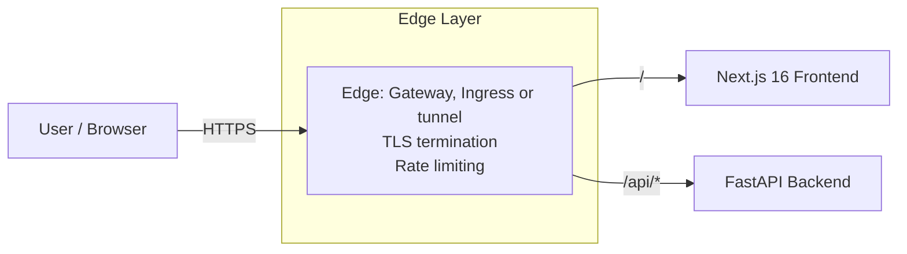
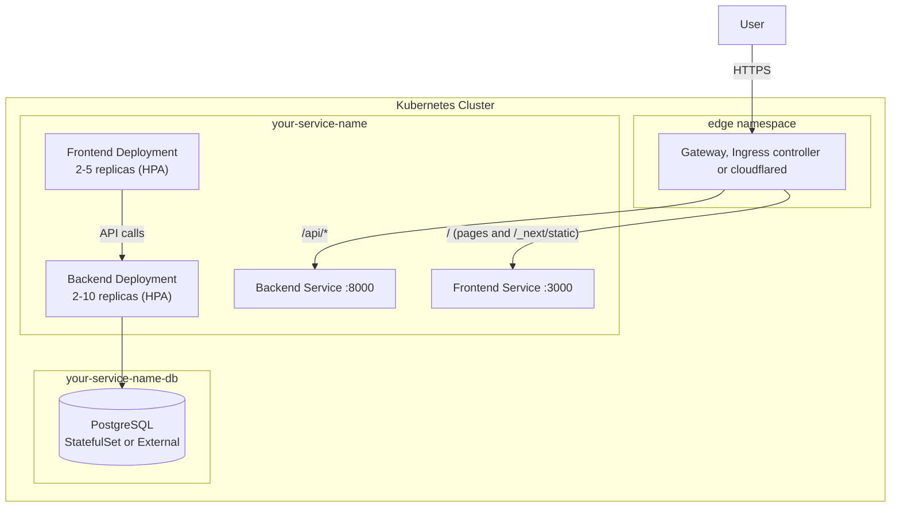

# Service Template

[](pyproject.toml)
[](https://github.com/your-org/your-repo/actions/workflows/ci.yml)
[](https://scorecard.dev/viewer/?uri=github.com/your-org/your-repo)
[](LICENSE)
[](wiki/adr/0016-slsa-build-l3-for-release-images.md)

This repository provides a standardized template that standardizes architecture, CI/CD, containerization, and documentation for new API-based services.

It ensures:

- **Production-ready standards.**
- **Integrated tools** for checking code quality and security,
- **Automated code quality and security checks** (lint, format, typecheck, tests, coverage, SAST).
- **Ease of use for development, deployment, and maintenance.**
- **Kubernetes-native deployment** with a Helm chart and per-environment values.

---

## Features

- **Consistent Architecture**: Backend (FastAPI), Frontend (Next.js 16, which serves its own static assets), and an edge in one of three modes (Gateway API, Ingress or a tunnel)
- **Kubernetes Deployment**: Helm chart with per-env values (dev/qa/production/local), HPA, PDB, NetworkPolicy
- **Developer Experience**: Makefile shortcuts, run scripts, `.env` support, local K8s via kind/minikube
- **Code Quality & Security**: Ruff, Mypy, Pytest, CodeQL, gitleaks, supply-chain (digest-pin, typosquat scan, OpenVEX, CI self-check; keyless image signing + SLSA provenance)
- **Containerization**: Docker, Podman, buildx builds
- **Observability**: Prometheus ServiceMonitor, structured logging, health probes
- **Adaptation**: Script for renaming the service easily and safely with dry-run and backups

---

## Project Structure (top-level)

```text
.
├── docker-compose.yml      # Local development stack (optional)
├── Dockerfile.backend      # Backend image (FastAPI + Uvicorn)
├── Dockerfile.frontend     # Frontend image (Next.js standalone)
├── Dockerfile.waf          # Optional WAF image (Envoy + the pinned Coraza Wasm)
├── charts/your-service-name/  # Helm chart (dev/qa/production/local via values.<env>.yaml)
├── .github/                # GitHub Actions workflows, composite actions, helper scripts
├── Makefile
├── pyproject.toml
├── .env.example
├── frontend/               # Next.js 16 app
├── src/
│   └── your_service_name/
│       ├── backend/        # routers/schemas/services/models/repos/entities/middleware
│       ├── scripts/        # the sample-data seed
│       ├── utils/          # validators, API versioning
│       └── __init__.py     # runtime version resolution
├── tests/                  # unit/integration/e2e/live/contract, and the kind tests (subfolders)
├── docs-site/              # the curated documentation site (Starlight), published to GitHub Pages
└── wiki                    # extended documentation
```

> ℹ️ The stack is deployed with the **Helm** chart (`charts/your-service-name/`); environment-specific configuration lives in `values.<env>.yaml`, not separate overlays. No ports/hosts are hard-coded; change behavior via environment variables and the values file.

---

## Quick Start

Follow [`wiki/getting-started.md`](wiki/getting-started.md) for a proper and detailed setup and usage. A quick start is provided below:

### 1) Prerequisites

* Git installed and configured
* Python ≥ 3.12
* Node.js 26 (the pinned version: `tools/pins.tsv`, `frontend/.nvmrc`)
* Docker or Podman (for local container builds)
* kubectl + Helm (for Kubernetes deployment)
* A Kubernetes cluster (kind, minikube, or production cluster)
* (optional) make

### 2) Clone & configure

```bash
git clone <YOUR_REPO_URL>
cd <YOUR_REPO_DIR>
cp .env.example .env
```

### 3) (Optional) Adapt the service name

```bash
# Dry-run rename 'your_service_name' -> 'awesome_solution'
infra/adapt/replace_service_name.sh -n awesome_solution --dry-run
# Apply
infra/adapt/replace_service_name.sh -n awesome_solution
```

> Ports are environment-driven (no adaptation script): set `BACKEND_PORT` / `FRONTEND_PORT`
> in `.env`, `docker-compose.yml`, the workflows' `env` blocks (`.github/workflows/deploy.yml`), and the Helm `values.<env>.yaml`.
> See [`wiki/adaptation.md`](wiki/adaptation.md).

---

## Running the application

### A) Local development (three terminals)

```bash
# Terminal 1 — Backend
./run_backend.sh                            # migrates, then serves http://127.0.0.1:${BACKEND_PORT}/ (docs at /docs)

# Terminal 2 — Frontend
cd frontend && npm run dev                  # http://127.0.0.1:${FRONTEND_PORT}/

# Terminal 3 — (Optional) Docker Compose for full stack
docker compose up -d                        # Includes PostgreSQL
```

### B) Local Kubernetes (kind, as CI runs it)

```bash
make tools        # the pinned toolchain in .tools/bin (kind, Helm, kubectl, ...)
make kind-up      # the cluster fst on a pinned node image, kubeconfig in .local/kind/
make kind-deploy  # build, load and deploy the chart as CI's kind job does
make kind-down    # delete fst
```

The options and the kind tests are in the [Makefile](Makefile) and
[Local cluster (kind)](wiki/infrastructure.md#local-cluster-kind). Optional: minikube or a cluster of your own,
step by step, in [Local Deployment (minikube)](wiki/local-development-minikube.md).

### C) Kubernetes deployment (production)

```bash
# The release workflow builds, signs and pushes the images (ghcr.io/<owner>/<repo>/backend, …/frontend, …/waf)
# and deploys them by digest with scripts/ci/deploy-env.sh (wiki/ci-cd.md#deploy-chain). By hand:
# Production needs an auth mode first: wiki/getting-started.md#production-needs-an-auth-mode
# Once per environment, as a cluster admin: the namespaces, quota and deployer RBAC (wiki/infrastructure.md)
scripts/k8s-bootstrap.sh production | kubectl apply -f -
# Production refuses an image without a digest (the release's image-digests.env has them)
helm upgrade --install your-service-name ./charts/your-service-name \
  -f ./charts/your-service-name/values.production.yaml \
  --namespace your-service-name-production --wait --wait-for-jobs \
  --set images.backend.digest=sha256:<backend digest> --set images.frontend.digest=sha256:<frontend digest>

# Verify rollout
kubectl -n your-service-name-production rollout status deployment/your-service-name-backend
kubectl -n your-service-name-production rollout status deployment/your-service-name-frontend
```

### D) Docker Compose (full local stack)

```bash
docker compose build --no-cache
docker compose up -d
```

This brings up **three long-running services** (postgres, backend, frontend) plus a one-shot `migrate` job, with health-gated startup.

---

## Architecture (overview)



### Kubernetes topology



---

## CI Pipeline (summary)

Defined in `.github/workflows/`; the full map is in [`wiki/ci-cd.md`](wiki/ci-cd.md).

*   **ci** → backend (`ruff`, `mypy`, unit on Python 3.12 and 3.13, integration, e2e), frontend (`eslint`, `prettier`, `tsc`, build, Vitest, Playwright config), chart lint, live suites, security scans, workflow hardening; the required checks are **`CI OK`** and the pull request title (`pr-title.yml`)
*   **release** (`main` and `v*` tags only) → **buildx** build & push, immutable digest check, SBOM, Grype (blocking), licence check, OpenVEX; then keyless signing and SLSA provenance attestations, by digest
*   **deploy** → Helm `upgrade --install` by digest (`--wait-for-jobs`, so a failed migration Job fails the release) + verify + smoke test, with a rollback to the recorded revision; `deploy-ops` rolls back by hand
*   **docs-site** → the [documentation site](docs-site/README.md), built strictly and scanned with axe on pull requests, published from `main` to GitHub Pages (`https://<owner>.github.io/<repo>/`, or your custom domain)
*   **security** → CodeQL, gitleaks, dependency review, `pip-audit`, OSV-Scanner, GuardDog, Checkov, Kubescape, and a ZAP baseline (`dast`)

> **Build method**: the release builds with `docker/build-push-action` (buildx) on GitHub-hosted runners, with no Docker-in-Docker and no build cache (the hardening lint refuses one); a pull request builds into the runner's local daemon, with no cache either.

---

## Supply-Chain Hardening

Beyond the built-in scanners, the pipeline hardens its own supply chain:

- **Image signing + provenance** — every image that passes the Grype gate is signed keyless and
  carries SLSA provenance and SBOM attestations; verify one by hand as described in
  [`wiki/security.md`](wiki/security.md#verifying-an-image). Example Kyverno policies make a cluster refuse
  an unsigned or unattested image: [`wiki/admission-control.md`](wiki/admission-control.md).
- **Immutable digest-pin** — the release workflow captures each built image's immutable manifest
  digest (`<ID>_IMAGE_DIGEST=sha256:…`, never a mutable `:latest` / `:main`) and verifies it against
  the registry. The **helm** deploy jobs pin the image by that digest and `scripts/ci/deploy-verify.sh`
  checks the running pod's digest against it; outside a cluster you can confirm a running image
  with `infra/security/verify-image-digest.sh`.
- **Typosquat / malicious-dep detection** — **OSV-Scanner** flags a malicious package that has no
  CVE (so dependency review misses it), on pull requests and on `main`. It is ecosystem-aware — the
  Python (`pypi`) and frontend (`npm`) dependency trees are matched against the OSV
  malicious-packages (`MAL-*`) corpus separately, so a PyPI record never flags an npm name and vice
  versa.
- **OpenVEX** — the `vex` job emits an `affected` statement (with an action) for every Grype finding, pinned by the
  immutable digest; `not_affected` only for entries of a reviewed list (see
  [vulnerability management](wiki/vulnerability-management.md#the-releases-openvex)).
- **The CI's own supply chain** — the blocking `workflows` job runs `infra/security/check-ci-hardening.sh`,
  actionlint and zizmor over `.github/`, and goes red if the workflows regress on the controls above
  (SHA-pinned actions, least-privilege tokens, no inline secrets).

See [`wiki/security.md`](wiki/security.md), [`wiki/containerization.md`](wiki/containerization.md)
and [`wiki/ci-cd.md`](wiki/ci-cd.md). What is intentionally **not** yet implemented (Kyverno
admission) is tracked
in [`wiki/ROADMAP-supply-chain.md`](wiki/ROADMAP-supply-chain.md).

---

## Versioning

*   **Package version**: computed from **Git tags** with `setuptools_scm` (no hard-coded versions); propagated to **package metadata**, **OCI labels**, and **image tags**.
*   **API version**: controlled via `API_VERSION` (e.g., `v1`); used by routes, docs, and health endpoints.

---

## Documentation

* see the **`wiki/`** folder (or project Wiki).
* Key docs: [Getting Started](wiki/getting-started.md) · [Architecture](wiki/architecture.md) · [Operations Runbook](wiki/operations-runbook.md)

## **Important:**
Services are expected to stay aligned with ongoing updates on the templates.
When the template introduces improvements (e.g., CI/CD stages improvements, security scans, updated versioning logic, Kubernetes manifests, etc.), developers need to adopt these changes in their service to remain compliant.

See: [`changelog.md`](wiki/changelog.md)

---

## License

Apache 2.0
