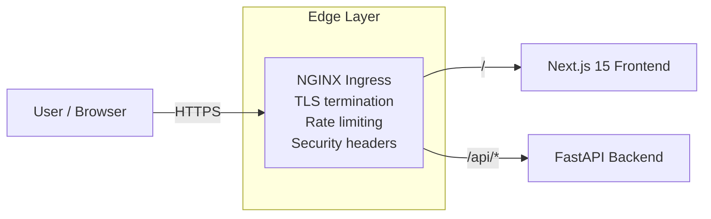
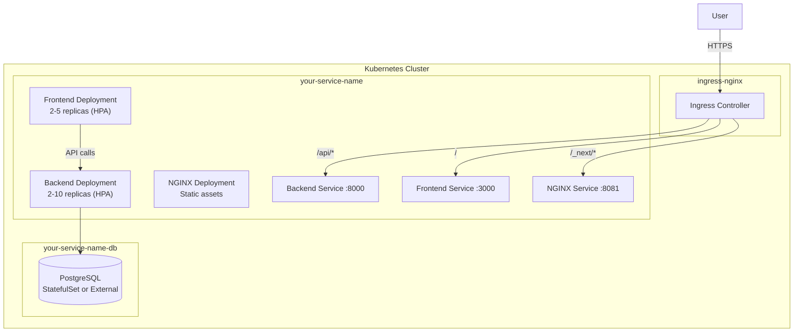

# Service Template

[]()
[](https://github.com/<owner>/<your-service-name>/actions/workflows/ci.yml)

This repository provides a standardized template that standardizes architecture, CI/CD, containerization, and documentation for new API-based services.

It ensures:

- **Production-ready standards.**
- **Integrated tools** for checking code quality and security,
- **Automated code quality and security checks** (lint, format, typecheck, tests, coverage, SAST).
- **Ease of use for development, deployment, and maintenance.**
- **Kubernetes-native deployment** with a Helm chart and per-environment values.

---

## Features

- **Consistent Architecture**: Backend (FastAPI), Frontend (Next.js 15), NGINX Ingress gateway
- **Kubernetes Deployment**: Helm chart with per-env values (dev/qa/production/local), HPA, PDB, NetworkPolicy
- **Developer Experience**: Makefile shortcuts, run scripts, `.env` support, local K8s via kind/minikube
- **Code Quality & Security**: Ruff, Mypy, Pytest, CodeQL, gitleaks, supply-chain (digest-pin, typosquat scan, OpenVEX, CI self-check; image signing + SLSA provenance *parked*)
- **Containerization**: Docker, Podman, buildx builds
- **Observability**: Prometheus ServiceMonitor, structured logging, health probes
- **Adaptation**: Script for renaming the service easily and safely with dry-run and backups

---

## Project Structure (top-level)

```text
.
├── docker-compose.yml      # Local development stack (optional)
├── Dockerfile.backend      # Backend image (FastAPI + Gunicorn)
├── Dockerfile.frontend     # Frontend image (Next.js standalone)
├── Dockerfile.nginx        # NGINX static-asset image
├── charts/your-service-name/  # Helm chart (dev/qa/production/local via values.<env>.yaml)
├── .github/                # GitHub Actions workflows, composite actions, helper scripts
├── Makefile
├── pyproject.toml
├── .env.example
├── src/
│   └── your_service_name/
│       ├── backend/        # routers/schemas/services/models/repos/entities/middleware
│       ├── frontend/       # Next.js 15 app
│       ├── utils/          # validators, API versioning
│       └── __init__.py     # runtime version resolution
├── tests/                  # unit/e2e/integration/live (subfolders)
└── wiki                    # extended documentation
```

> ℹ️ The stack is deployed with the **Helm** chart (`charts/your-service-name/`); environment-specific configuration lives in `values.<env>.yaml`, not separate overlays. No ports/hosts are hard-coded; change behavior via environment variables and the values file.

---

## Quick Start

Follow [`wiki/getting-started.md`](wiki/getting-started.md) for a proper and detailed setup and usage. A quick start is provided below:

### 1) Prerequisites

* Git installed and configured
* Python ≥ 3.12
* Node.js ≥ 22
* Docker or Podman (for local container builds)
* kubectl + Helm (for Kubernetes deployment)
* A Kubernetes cluster (kind, minikube, or production cluster)
* (optional) make

### 2) Clone & configure

```bash
git clone <YOUR_REPO_URL>
cd <YOUR_REPO_DIR>
cp .env.example .env
```

### 3) (Optional) Adapt the service name

```bash
# Dry-run rename 'your_service_name' -> 'awesome_solution'
infra/adapt/replace_service_name.sh -n awesome_solution --dry-run
# Apply
infra/adapt/replace_service_name.sh -n awesome_solution
```

> Ports are environment-driven (no adaptation script): set `BACKEND_PORT` / `FRONTEND_PORT` /
> `NGINX_PORT` in `.env`, `docker-compose.yml`, the workflows' `env` blocks (`.github/workflows/deploy.yml`), and the Helm `values.<env>.yaml`.
> See [`wiki/adaptation.md`](wiki/adaptation.md).

---

## Running the application

### A) Local development (three terminals)

```bash
# Terminal 1 — Backend
python -m your_service_name.backend.main    # http://127.0.0.1:${BACKEND_PORT}/ (docs at /docs)

# Terminal 2 — Frontend
cd frontend && npm run dev                  # http://127.0.0.1:${FRONTEND_PORT}/

# Terminal 3 — (Optional) Docker Compose for full stack
docker compose up -d                        # Includes PostgreSQL
```

### B) Local Kubernetes (kind/minikube)

```bash
# Create a local cluster (minikube shown; kind works too)
minikube start

# Build each image into the node daemon (bare `name:local` tags, picked up via imagePullPolicy: IfNotPresent)
make compose-build-backend compose-build-frontend compose-build-nginx

# Deploy + verify the whole stack in one command
# (reads charts/your-service-name/values.local.yaml; migration runs as a post-install hook)
./scripts/e2e.sh --env local

# Access the service (self-cleaning port-forwards to backend/frontend/nginx)
./scripts/port-forward.sh --env local &
```

### C) Kubernetes deployment (production)

```bash
# Build and push images (registry flow — see wiki/containerization.md)
#   …<registry>/your-service-name:<tag>

# Deploy with the Helm chart (reads charts/your-service-name/values.production.yaml)
helm upgrade --install your-service-name ./charts/your-service-name \
  -f ./charts/your-service-name/values.production.yaml \
  --namespace your-service-name --create-namespace

# Verify rollout
kubectl -n your-service-name rollout status deployment/your-service-name-backend
kubectl -n your-service-name rollout status deployment/your-service-name-frontend
```

### D) Docker Compose (full local stack)

```bash
docker compose build --no-cache
docker compose up -d
```

This brings up **four services** (postgres, backend, frontend, nginx) with health-gated startup.

---

## Architecture (overview)



### Kubernetes topology



---

## CI Pipeline (summary)

Defined in `.github/workflows/`; the full map is in [`wiki/ci-cd.md`](wiki/ci-cd.md).

*   **ci** → backend (`ruff`, `mypy`, unit on Python 3.12 and 3.13, integration, e2e), frontend (`eslint`, `prettier`, `tsc`, build, Vitest, Playwright config), chart lint, live suites, security scans, workflow hardening; the required check is **`CI OK`**
*   **release** (`main` and `v*` tags only) → **buildx** build & push, immutable digest check, SBOM, Grype (blocking), licence check, OpenVEX; keyless signing and SLSA provenance arrive in a later change
*   **deploy** → Helm `upgrade --install` by digest + migration hook + verify + smoke test, with a rollback to the recorded revision; `deploy-ops` rolls back by hand
*   **security** → CodeQL, gitleaks, dependency review, `pip-audit`, OSV-Scanner, GuardDog, Checkov, Kubescape, and a ZAP baseline (`dast`)

> **Build method**: CI builds with `docker/build-push-action` (buildx) on GitHub-hosted runners, with no Docker-in-Docker and a GitHub Actions layer cache.

---

## Supply-Chain Hardening

Beyond the built-in scanners, the pipeline hardens its own supply chain:

- **Image signing + provenance** — keyless signing and SLSA provenance as GitHub attestations are
  delivered in a later change; until then images are digest-pinned
  and unsigned. See [`wiki/ROADMAP-supply-chain.md`](wiki/ROADMAP-supply-chain.md).
- **Immutable digest-pin** — the release workflow captures each built image's immutable manifest
  digest (`<ID>_IMAGE_DIGEST=sha256:…`, never a mutable `:latest` / `:main`) and verifies it against
  the registry. The **helm** deploy jobs pin the image by that digest and `scripts/ci/deploy-verify.sh`
  checks the running pod's digest against it; outside a cluster you can confirm a running image
  with `infra/security/verify-image-digest.sh`.
- **Typosquat / malicious-dep detection** — **OSV-Scanner** flags a malicious package that has no
  CVE (so dependency review misses it), on pull requests and on `main`. It is ecosystem-aware — the
  Python (`pypi`) and frontend (`npm`) dependency trees are matched against the OSV
  malicious-packages (`MAL-*`) corpus separately, so a PyPI record never flags an npm name and vice
  versa.
- **OpenVEX** — the `vex` job emits `not_affected` / `fixed_version` statements pinned by the
  immutable digest.
- **The CI's own supply chain** — the blocking `workflows` job runs `infra/security/check-ci-hardening.sh`,
  actionlint and zizmor over `.github/`, and goes red if the workflows regress on the controls above
  (SHA-pinned actions, least-privilege tokens, no inline secrets).

See [`wiki/security.md`](wiki/security.md), [`wiki/containerization.md`](wiki/containerization.md)
and [`wiki/ci-cd.md`](wiki/ci-cd.md). What is intentionally **not** yet implemented (Kyverno
admission, distroless backend, signing and provenance until their phase lands) is tracked
in [`wiki/ROADMAP-supply-chain.md`](wiki/ROADMAP-supply-chain.md).

---

## Versioning

*   **Package version**: computed from **Git tags** with `setuptools_scm` (no hard-coded versions); propagated to **package metadata**, **OCI labels**, and **image tags**.
*   **API version**: controlled via `API_VERSION` (e.g., `v1`); used by routes, docs, and health endpoints.

---

## Documentation

* see the **`wiki/`** folder (or project Wiki).
* Key docs: [Getting Started](wiki/getting-started.md) · [Architecture](wiki/architecture.md) · [Operations Runbook](wiki/operations-runbook.md)

## **Important:**
Services are expected to stay aligned with ongoing updates on the templates.
When the template introduces improvements (e.g., CI/CD stages improvements, security scans, updated versioning logic, Kubernetes manifests, etc.), developers need to adopt these changes in their service to remain compliant.

See: [`changelog.md`](wiki/changelog.md)

---

## License

Apache 2.0
