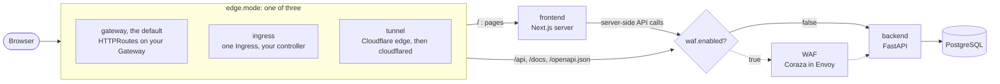
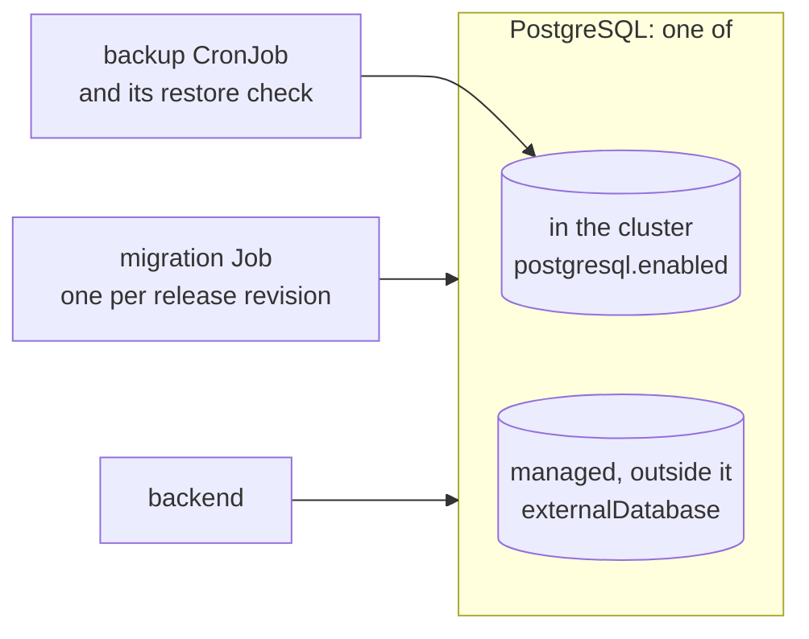
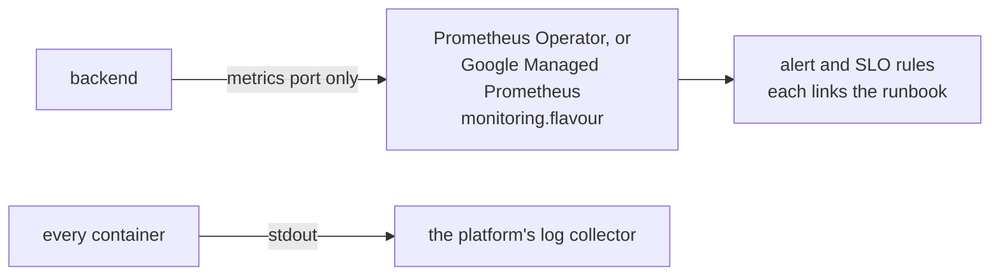

Two app images run in every environment: the **frontend**, a Next.js server that renders the pages and serves its
own static assets, and the **backend**, a FastAPI API in front of PostgreSQL. An optional **WAF** image can sit in
front of the API. One Helm chart deploys them all, and `values.<env>.yaml` holds what differs per environment.

## The request path

One routes list feeds every edge: `/api`, `/docs` and `/openapi.json` go to the backend, everything else to the
frontend. `edge.mode` picks how traffic reaches the two Services, and `waf.enabled` puts the WAF in front of the
API routes.

| Mode | The edge object | TLS ends at |
|---|---|---|
| `gateway` (default) | an HTTPRoute per host, on a Gateway you run | your Gateway's listener |
| `ingress` | one controller-agnostic Ingress | your controller, with the certificate you add |
| `tunnel` | none: the chart prints the route table for the tunnel | Cloudflare's edge |

:::note[The WAF is off by default]
With `waf.enabled: false` the edge and the frontend reach the backend directly. Turned on, nothing but the WAF
reaches the backend, and the pages bypass it. The NetworkPolicies follow the mode and the WAF switch.
:::

The app namespace is default-deny: each mode admits only its own edge peers, and the backend trusts forwarding
headers only from the proxies listed in `TRUSTED_PROXY_CIDRS`. The API's caller identity comes from `AUTH_MODE`,
with OpenID Connect and Cloudflare Access as the production modes.

## The data tier

- **Where it runs.** The chart's own PostgreSQL StatefulSet for dev, qa and local clusters; a managed database for
  production, optionally through the Cloud SQL Auth Proxy sidecar.
- **Migrations** run in a Job that is a plain release resource, and the backend reports ready only once the schema
  is at head.
- **Backups.** A CronJob dumps the in-cluster database, and a second one proves the dump restores; production's
  managed database brings its own point-in-time recovery.

## Observability

- **Metrics** are served on their own port, never on the API port, and scraped by the flavour you pick.
- **Logs** go to stdout, as JSON in production; the chart ships no collector. Every backend line carries the
  request's `X-Request-Id`, which the WAF passes through, so one id finds a request's lines.
- **Alerts and SLOs** come from one set of rules, rendered for either flavour, and each alert links its runbook
  section.

## Go deeper

- [System architecture](../../../../wiki/architecture.md): components, layers and the Kubernetes topology.
- [Infrastructure, Edge](../../../../wiki/infrastructure.md#edge): the modes, the routes list, the NetworkPolicy per
  mode, TLS and the client IP; the values themselves are in
  [`values.yaml`](../../../../charts/your-service-name/values.yaml).
- [Security, Authentication & Authorization](../../../../wiki/security.md#authentication--authorization): the auth
  modes.
- [Database](../../../../wiki/database.md) and [Disaster recovery](../../../../wiki/disaster-recovery.md): the data
  tier, migrations, backups and restores.
- [Operations runbook](../../../../wiki/operations-runbook.md): metrics, SLOs, log correlation and every alert.
- Decisions: [edge modes](../../../../wiki/adr/0008-edge-modes.md),
  [one routes list](../../../../wiki/adr/0009-retire-nginx-one-routes-list.md),
  [migrations as a release Job](../../../../wiki/adr/0006-migrations-as-a-release-job.md),
  [stdout logging](../../../../wiki/adr/0007-stdout-logging-no-collector.md),
  [two monitoring flavours](../../../../wiki/adr/0036-two-monitoring-flavours.md).
