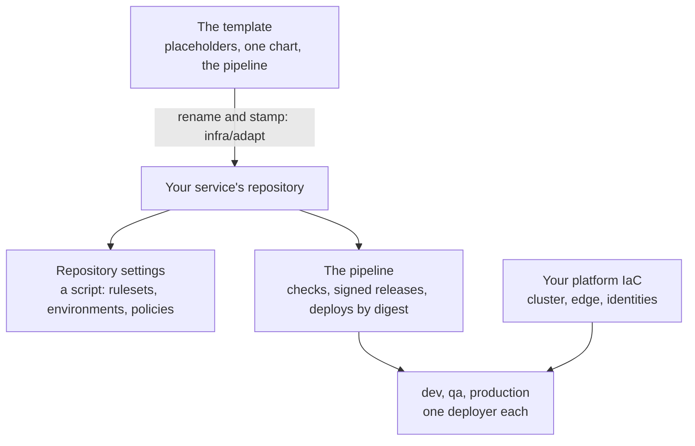

The template is a machine for producing services, not one service. Every decision serves that: a change that only
works for one concrete service breaks every service built from the template.

## The shape of the system

- **Generic by construction.** The service name, the repository and the domain are placeholders; ports, hosts and
  URLs come from configuration. One script renames and stamps them.
- **Layered.** The backend goes routers, schemas, services, models, repositories; each concern stays in its layer, so
  a part can be swapped.
- **One source per fact.** A version, a command or a path lives in one place, and every other place links to it.
- **Settings and policy as code.** The GitHub settings are a script, the CI rules a lint, the admission rules example
  policies, all versioned with the code.
- **The platform is yours.** The cluster, the edge and the identities live in your own infrastructure-as-code; the
  template documents them and checks them, and never creates them.

## The decisions, by theme

Each record says the context, the decision as built, its costs and the alternatives. Keep a decision knowingly, or
replace it on purpose.

**The project and its forge**
- [GitHub only](../../../../wiki/adr/0001-github-only.md), [Apache-2.0](../../../../wiki/adr/0002-apache-2-licence.md),
  [platform IaC outside the template](../../../../wiki/adr/0003-platform-iac-outside-the-template.md),
  [settings as a script](../../../../wiki/adr/0022-repository-settings-as-a-script.md),
  [generic names only](../../../../wiki/adr/0038-generic-names-only.md), [Copier deferred](../../../../wiki/adr/0039-copier-deferred.md).

**The app at runtime**
- [one Uvicorn process per Pod](../../../../wiki/adr/0004-one-uvicorn-process-per-pod.md),
  [the client IP from trusted proxies](../../../../wiki/adr/0005-client-ip-from-trusted-proxies.md),
  [logs to stdout](../../../../wiki/adr/0007-stdout-logging-no-collector.md),
  [CPU requests, no CPU limits](../../../../wiki/adr/0012-cpu-requests-no-cpu-limits.md),
  [a distroless runtime](../../../../wiki/adr/0013-distroless-runtime-one-interpreter.md), [auth modes](../../../../wiki/adr/0029-auth-modes.md),
  [the API contract and its versioning](../../../../wiki/adr/0027-api-contract-and-versioning.md).

**The edge and HTTP**
- [three edge modes](../../../../wiki/adr/0008-edge-modes.md), [one routes list](../../../../wiki/adr/0009-retire-nginx-one-routes-list.md),
  [one source per security header](../../../../wiki/adr/0010-one-source-per-security-header.md),
  [the WAF's CSP report exception](../../../../wiki/adr/0032-waf-csp-report-exception.md).

**Kubernetes and the deploy**
- [migrations as a release Job](../../../../wiki/adr/0006-migrations-as-a-release-job.md),
  [an admin bootstrap and a scoped deployer](../../../../wiki/adr/0011-namespace-bootstrap-scoped-deployer.md),
  [deploy by digest](../../../../wiki/adr/0020-deploy-by-digest.md),
  [keyless deploys per environment](../../../../wiki/adr/0021-keyless-deploys-per-environment.md),
  [dev, qa and production](../../../../wiki/adr/0030-environments-dev-qa-production.md),
  [optional previews](../../../../wiki/adr/0031-optional-pr-previews.md), [the Kubernetes floor](../../../../wiki/adr/0033-kubernetes-floor-1-34.md),
  [Helm for deploys](../../../../wiki/adr/0034-helm-4.md), [kind as the local cluster](../../../../wiki/adr/0035-kind-default-local-cluster.md),
  [two monitoring flavours](../../../../wiki/adr/0036-two-monitoring-flavours.md),
  [one hostname per environment](../../../../wiki/adr/0042-one-hostname-per-environment.md).

**The supply chain and the release**
- [Debian fixes over the base](../../../../wiki/adr/0014-debian-fixes-over-the-base.md), [uv for Python](../../../../wiki/adr/0015-uv-for-python.md),
  [aiming at SLSA Build L3](../../../../wiki/adr/0016-slsa-build-l3-for-release-images.md),
  [no release cache](../../../../wiki/adr/0017-release-builds-use-no-cache.md),
  [keyless signing and Kyverno admission](../../../../wiki/adr/0018-cosign-keyless-and-kyverno-admission.md),
  [attestations and release assets](../../../../wiki/adr/0019-attestations-and-release-assets.md),
  [the release flow](../../../../wiki/adr/0023-release-flow.md),
  [the signed chart](../../../../wiki/adr/0024-signed-chart-from-its-own-workflow.md),
  [Renovate for updates](../../../../wiki/adr/0025-renovate-for-updates.md),
  [blocking pull request gates](../../../../wiki/adr/0026-blocking-pr-security-gates.md),
  [frozen supply-chain scripts](../../../../wiki/adr/0028-frozen-supply-chain-scripts.md),
  [the weekly re-scan](../../../../wiki/adr/0037-weekly-rescan-scope.md).

**Reviews and documentation**
- [an optional AI reviewer](../../../../wiki/adr/0040-optional-ai-pr-review.md), [this documentation site](../../../../wiki/adr/0041-documentation-site.md).

## Go deeper

- [The ADR index](../../../../wiki/adr/README.md): every record with its status and one line, and how to add or supersede one.
- [Conventions](../../../../CONVENTIONS.md): the cross-cutting rules, each with the smell and the fix.
- [System architecture](../../../../wiki/architecture.md) and [Backend architecture](../../../../wiki/backend-architecture.md).
- [Threat model](../../../../wiki/threat-model.md): the threats the decisions answer.
