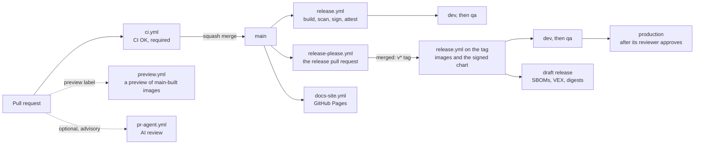

Every change reaches `main` through a pull request with one required check, `CI OK`. What runs after the merge
depends on the ref: `main` builds and signs images and deploys to dev and qa, and a release tag adds the chart, the
release assets and production.

## On a pull request

- **`CI OK` is the one required check.** It waits for every blocking job, among them the backend and frontend gates, the chart
  lint and render, the security scans, the workflow hardening lint, the image structure checks, the chart in a kind
  cluster, the API contract check and the documentation site. Path filters skip what a change cannot affect.
- **Nothing leaves the runner.** A pull request's checks may build images into the runner's own daemon (the kind
  tests use a loopback registry). Nothing they build leaves the runner, and no pull request pushes or signs a release
  image. The only deploy a pull request can start is the opt-in preview, of `main`-built images.
- **Advisory jobs warn, never block:** the live full-stack suite, the advisory scanners and the optional AI review.
- **The title is the commit.** Merges are squash only, so `pr-title.yml` holds the title to a Conventional Commit,
  which release-please reads later.

## On main

- `release.yml` builds each image, scans it with a blocking Grype gate, then signs it and attests its provenance
  and SBOMs. The digests flow to the deploys.
- `deploy.yml` deploys dev, then qa, by digest, once `DEPLOY_ENABLED` is `true`; until then it skips with a notice,
  so a fresh copy stays green. `DEPLOY_ENVS` can leave qa out.
- `release-please.yml` updates the release pull request from the titles merged since the last release.
- `docs-site.yml` publishes this site when its inputs changed.

## On a release tag

Merging the release pull request makes the `v*` tag and a draft release, with the release GitHub App's token. The
tag runs the release again, adds the signed chart and the release assets to the draft, and deploys dev, qa and then
production, behind the `production` environment's reviewer. A pre-release tag never reaches production. You publish
the draft by hand. [Releasing](./releasing.md) has the overview.

## Previews

Optional and off by default. With `PREVIEWS_ENABLED` set and a cluster namespace bootstrapped for them, a pull
request from this repository that carries the `preview` label gets its own release of the chart, with images built
on `main`, redeployed on each push and removed when it closes or loses the label. A daily sweep removes stale ones.

:::caution[A preview runs the pull request's chart]
A preview runs with write-access trust: inside the preview namespace, a pull request can run its own code. The bounds
of that are in [CI/CD, Pull request previews](../../../../wiki/ci-cd.md#pull-request-previews).
:::

## Go deeper

- [CI/CD pipeline](../../../../wiki/ci-cd.md): the workflow map, the triggers and gates, advisory against blocking,
  the image operations, the deploy chain, previews, the AI review, the caches and where each tool is pinned.
- [Releasing](../../../../wiki/releasing.md): the release flow, the tags and the chart.
- [GitHub repository settings](../../../../wiki/github-repository-settings.md): the required check, the rulesets and
  the environments, set by a script.
- [Pull request previews](../../../../wiki/ci-cd.md#pull-request-previews) and
  [Deploy chain](../../../../wiki/ci-cd.md#deploy-chain), in full.
- The workflows themselves: [`.github/workflows/`](../../../../.github/workflows/).
