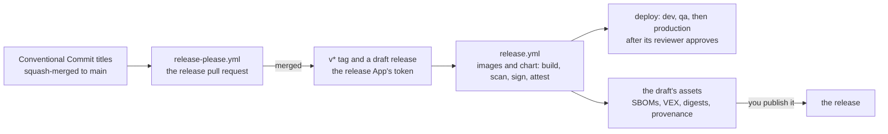

A release is a Git tag, and nobody types it: release-please proposes it from the pull request titles, and merging
that proposal makes the tag. The version comes from the tag alone.

1. **Titles drive it.** Each pull request title is a Conventional Commit, checked by `pr-title.yml`; its type picks
   the next version, and a breaking change moves the major one.
2. **The release pull request.** On each push to `main`, release-please updates one pull request with the next
   version and its changelog. Merge it when you want a release.
3. **The tag.** The merge creates the `v*` tag and a draft release, with the token of a GitHub App that only it
   holds; a tag ruleset lets no one else create a `v*` tag.
4. **The build.** The tag runs the release workflow: the images are built, scanned, signed and attested, and the
   chart is packaged, pushed and signed beside them.
5. **The deploys.** Dev, then qa, then production, by digest, with production behind its environment's reviewer.
6. **Publish.** The draft gets the SBOMs, the VEX, the licence report, the digests and the provenance list. Edit the
   notes and publish it by hand once the run is green; releases are immutable after that.

:::note[Pre-releases]
A `Release-As` footer with a pre-release version on a pull request makes the next release a pre-release. Its tag
deploys dev and qa, never production, and its images do not move `latest`.
:::

## Go deeper

- [Releasing](../../../../wiki/releasing.md): the [tag policy](../../../../wiki/releasing.md#tag-policy), the
  [workflow](../../../../wiki/releasing.md#release-workflow), [creating a release](../../../../wiki/releasing.md#creating-a-release),
  [pre-release tags](../../../../wiki/releasing.md#pre-release-tags), [the chart](../../../../wiki/releasing.md#the-chart) and the
  [post-release checks](../../../../wiki/releasing.md#post-release).
- [Versioning](../../../../wiki/versioning.md): how the version is derived from the tag.
- [The release GitHub App](../../../../wiki/github-repository-settings.md#the-release-github-app): its one-time setup.
- [Release notes template](../../../../wiki/release-notes-template.md) and [Changelog](../../../../wiki/changelog.md).
- Decisions: [the release flow](../../../../wiki/adr/0023-release-flow.md) and
  [the signed chart](../../../../wiki/adr/0024-signed-chart-from-its-own-workflow.md).
