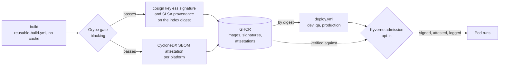

The release proves where each image came from, and the cluster can refuse any image that cannot prove it. Image
operations run on `main` and release tags only, never in a pull request, so a pull request's author cannot forge
that chain.

## From build to running Pod

- **Signing.** An image is signed keyless with Sigstore once it passes the blocking gate: no key to keep, a
  short-lived certificate that names the build workflow, and an entry in the public Rekor log. An image that fails
  the gate stays in the registry unsigned, and nothing deploys it. The chart is signed by its own workflow.
- **Provenance.** A SLSA build-provenance attestation sits on each image's index digest, next to the signature. Only
  the reusable build workflow can push, sign and attest an image, which a lint enforces; the release aims at SLSA Build L3.
- **SBOM and VEX.** Each platform's image carries a CycloneDX SBOM attestation, and the release assets include the
  SBOMs, an OpenVEX document, the licence report and the digests. The VEX states each finding as affected unless a
  reviewed entry says it is not, and the gate never reads it.
- **Deploy by digest.** The digests flow from the build to every environment and are checked after the deploy.
- **Admission.** The example Kyverno policies make the cluster refuse an image from this repository's path that is
  not signed by the release workflow, has no provenance or no Rekor entry, or is spelt with an alias. They are
  opt-in: until an admin applies them, the cluster runs any image the deployer names.
- **After the release.** A weekly re-scan of what runs and of the latest release opens an issue, with an SLA, for
  each new critical or high finding that has a fix.

:::note[Attestations need a public repository]
Artifact attestations need a public repository or GitHub Enterprise Cloud. On a private copy, the release skips them
with a warning unless you opt in, and the admission policy's provenance rule cannot be met.
:::

## On every pull request

The source-level controls run on every pull request and on `main`: CodeQL and dependency review (both blocking),
secret scanning, the CI hardening lint, actionlint and zizmor, the pin drift check, and advisory OSV and typosquat
scans. Every action is pinned by commit SHA, every image by digest and every tool by checksum; Renovate proposes each
update once the release has aged, and the blocking pin check holds every checksum to the vendor's.

## The threat model's boundaries

The threat model goes boundary by boundary, with STRIDE, and says what risk is left for each:

| Boundary | At a glance |
|---|---|
| The internet to the edge | Cloudflare, the Tunnel or the Gateway; no public origin in tunnel mode |
| The edge to the app namespace | default-deny NetworkPolicies, the optional WAF, trusted proxies only |
| The app | an auth mode, security headers, rate and size limits |
| The app to the database | its own namespace, reached only by the backend and the migration Job |
| CI to the cloud and the cluster | OIDC to Workload Identity, one deployer per environment, no long-lived keys |
| The registry and the supply chain | signatures, provenance, deploy by digest, hashed locks, the re-scan |
| The registry to the cluster | admission, when applied |

Its last section lists plainly what is **not** mitigated, among them: admission is opt-in, a single owner is the
gate, and in-cluster traffic is plain HTTP.

## Go deeper

- [Security](../../../../wiki/security.md): headers, authentication, rate limits, the client IP, containers,
  Kubernetes, secrets and TLS, and [Verifying an image](../../../../wiki/security.md#verifying-an-image) by hand.
- [Supply-chain security](../../../../wiki/supply-chain-security.md): every control, gate or advisory, by ref.
- [Admission control](../../../../wiki/admission-control.md): what the policies enforce and how they are proven.
- [Threat model](../../../../wiki/threat-model.md), and
  [what is not mitigated](../../../../wiki/threat-model.md#what-is-not-mitigated).
- [Vulnerability management](../../../../wiki/vulnerability-management.md): the weekly re-scan and its SLA.
- Decisions: [aiming at SLSA Build L3](../../../../wiki/adr/0016-slsa-build-l3-for-release-images.md),
  [no release cache](../../../../wiki/adr/0017-release-builds-use-no-cache.md),
  [keyless signing and Kyverno](../../../../wiki/adr/0018-cosign-keyless-and-kyverno-admission.md),
  [attestations and release assets](../../../../wiki/adr/0019-attestations-and-release-assets.md),
  [deploy by digest](../../../../wiki/adr/0020-deploy-by-digest.md),
  [blocking pull request gates](../../../../wiki/adr/0026-blocking-pr-security-gates.md).
