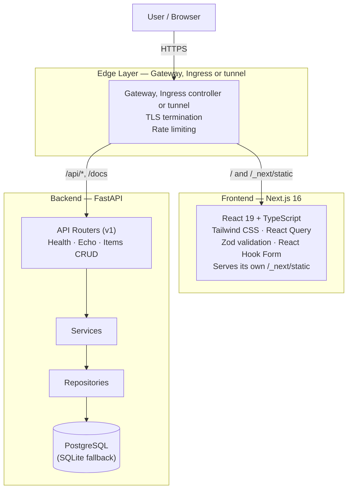

# Your Service Name — Documentation

Production-grade template for API-based services with a FastAPI backend, Next.js 16 frontend, Kubernetes deployment with a Helm chart, and comprehensive CI/CD.

---

## Quick Navigation

| Category | Documents |
|----------|-----------|
| **Getting Started** | [Getting Started](./getting-started.md) · [Environment Variables](./environment-variables.md) · [Adaptation](./adaptation.md) |
| **Architecture** | [System Overview](./architecture.md) · [Backend](./backend-architecture.md) · [Frontend](./frontend-architecture.md) · [Infrastructure](./infrastructure.md) |
| **API** | [API Reference](./api-reference.md) · [API lifecycle](./api-lifecycle.md) |
| **Development** | [Developer Guide](./developer-guide.md) · [Code Quality](./code-quality.md) · [Database](./database.md) · [Local development on minikube](./local-development-minikube.md) · [Template upgrades](./template-upgrades.md) |
| **Testing** | [Testing Strategy](./testing.md) |
| **CI/CD & Deploy** | [CI/CD Pipeline](./ci-cd.md) · [GitHub repository settings](./github-repository-settings.md) · [Supply-Chain Security](./supply-chain-security.md) · [Supply-chain roadmap](./ROADMAP-supply-chain.md) · [Supply-chain tooling assessment](./supply-chain-tooling-assessment.md) · [Containerization](./containerization.md) · [Frontend Deployment](./frontend-deployment.md) |
| **Operations** | [Platform Setup](./platform-setup.md) · [GKE Cluster Setup](./gke-cluster-setup.md) · [Cloudflare Setup](./cloudflare-setup.md) · [Operations Runbook](./operations-runbook.md) · [Disaster Recovery](./disaster-recovery.md) · [Security](./security.md) · [Admission control](./admission-control.md) · [Vulnerability management](./vulnerability-management.md) · [Versioning](./versioning.md) · [Releasing](./releasing.md) · [Troubleshooting](./troubleshooting.md) · [DAST and WAF on OpenShift Local](./dast-waf-openshift-local-runbook.md) |
| **Decisions & threats** | [Architecture decision records](./adr/README.md) · [Threat model](./threat-model.md) |
| **Reference** | [Changelog](./changelog.md) · [Release notes template](./release-notes-template.md) · [Doc Templates](./doc-templates.md) |

---

## System at a Glance



---

## Technology Stack

| Layer | Technology | Version |
|-------|-----------|---------|
| **Backend** | Python, FastAPI, SQLAlchemy 2.0, Alembic, Pydantic v2 | 3.12+ |
| **Frontend** | Next.js 16, React 19, TypeScript 6.0, Tailwind CSS 4 | Node 26+ |
| **Edge/Gateway** | Gateway API, an Ingress controller, or a tunnel (`edge.mode`) | — |
| **Static** | The Next.js server ([cache policy](./frontend-deployment.md#static-assets)) | — |
| **Database** | PostgreSQL 16 (asyncpg) / SQLite fallback | — |
| **Orchestration** | Kubernetes, Helm (per-env `values.<env>.yaml`) | 1.34+ |
| **CI/CD** | GitHub Actions, buildx, Playwright | — |
| **Testing** | pytest, Vitest, React Testing Library, MSW | — |
| **Observability** | Prometheus, ServiceMonitor, structured logging | — |
| **Security** | SAST, Secret Detection, SBOM (Syft/Grype), License Scan (Grant), NetworkPolicy | — |

---

## Project Structure

```
.
├── .github/                    # GitHub Actions workflows, composite actions, helper scripts
├── docker-compose.yml          # Local dev stack (3 long-running services plus a one-shot `migrate` job)
├── Dockerfile.backend          # Backend container (FastAPI + Uvicorn)
├── Dockerfile.frontend         # Frontend container (Next.js)
├── Dockerfile.waf              # Optional WAF container (Envoy + the pinned Coraza Wasm)
├── Makefile                    # Development shortcuts
├── pyproject.toml              # Python project config (Ruff, MyPy, pytest)
├── alembic.ini                 # Database migration config
├── .env.example                  # Environment variable reference
│
├── scripts/                    # Local ops tools, the toolchain installer (tools.sh) and pin refresh
├── scripts/ci/                 # Scripts the workflows call (deploy-env, deploy-verify, shell-lint, check-secrets)
├── tools/pins.tsv              # The pinned, checksum-verified dev toolchain
├── deploy/policies/            # Example Kyverno admission policies, with their tests
│
├── charts/your-service-name/   # Helm chart (the deploy mechanism; values.<env>.yaml per environment)
├── infra/                      # Infrastructure scripts & configs
│   ├── runtime/                # Entrypoint for local dev: starts backend and frontend (--mode all)
│   ├── k8s/bootstrap/          # The one-time admin bootstrap chart (namespaces, quota, deployer RBAC)
│   ├── adapt/                  # Service name adaptation
│   └── security/               # SBOM, Grype, Grant scan scripts
│
├── src/your_service_name/      # Python source (src-layout)
│   ├── backend/
│   │   ├── main.py             # create_app() factory with lifespan
│   │   ├── api/routers/v1/     # Health, Echo, Items endpoints
│   │   ├── schemas/            # Pydantic v2 request/response models
│   │   ├── services/           # Business logic layer
│   │   ├── repositories/       # Protocol-based data access
│   │   ├── entities/           # Immutable dataclasses
│   │   ├── db/                 # Engine, models, Alembic migrations
│   │   ├── middleware/          # Security, logging, rate limiting
│   │   └── logging/            # Audit logging
│   └── utils/                  # API versioning, validators
│
├── frontend/                   # Next.js 16 frontend
│   ├── app/                    # App Router pages & layouts
│   ├── components/             # Shared UI components
│   ├── features/items/         # Item CRUD feature module
│   ├── lib/                    # API client, hooks, config, query, toast
│   ├── e2e/                    # Playwright E2E tests
│   ├── src/test/               # Test utilities, MSW mocks, setup
│   ├── package.json
│   ├── next.config.ts
│   └── vitest.*.config.ts      # Unit & integration test configs
│
├── tests/                      # Backend test suite
│   ├── conftest.py             # Shared fixtures
│   ├── backend/                # Unit tests (db, entities, schemas, services, ...)
│   ├── integration/            # In-process ASGI integration tests
│   ├── e2e/                    # End-to-end API tests
│   ├── live/                   # Live tests against running stack
│   ├── contract/               # Schemathesis contract tests (make test-contract)
│   └── k8s/                    # Tests against the kind cluster (make kind-*-test)
│
└── wiki/                       # This documentation
```

---

## Key Design Principles

1. **One role per process** — Each container runs exactly one service (backend or frontend) via its own dedicated Dockerfile. No `SERVICE_MODE` variable.
2. **No hard-coded ports** — All ports, hosts, and URLs are configurable via environment variables.
3. **API-first** — Backend exposes OpenAPI spec; frontend generates typed API client from it.
4. **Testing pyramid** — Four layers: unit → integration → e2e → live, for both backend and frontend.
5. **Security by default** — Rate limiting, security headers, CORS, NetworkPolicy, PodSecurity, SBOM generation, vulnerability scanning, and license compliance in CI.
6. **buildx on hosted runners** — Container images are built without Docker-in-Docker; they are pushed, by `docker/build-push-action`, only on `main` and `v*` tags (a pull request builds them into the runner's local daemon to check them).
7. **Dual versioning** — Package version from Git tags (`setuptools_scm`), API version from `API_VERSION` env var.
8. **Kubernetes-native** — Helm chart with per-env values for multi-environment strategy, HPA for autoscaling, PDB for availability, NetworkPolicy for network isolation.

---

## License

Apache 2.0
