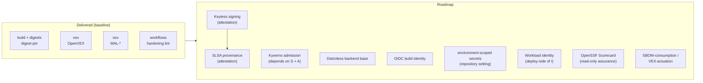

# Supply-Chain Hardening Roadmap

The supply-chain controls **delivered today** are documented in
[`wiki/security.md`](./security.md) (CI scanning), [`wiki/containerization.md`](./containerization.md)
(signing / provenance / digest-pin) and [`wiki/ci-cd.md`](./ci-cd.md) (jobs + variables).
This page is the honest list of what is **not yet implemented** — the remaining gaps against
the supply-chain and CI/CD pipeline practices this template aims for — and why each item is deferred.

> **Rule of thumb:** signing, provenance and admission form a chain — admission
> can only *enforce* what signing and provenance *produce*. The items below are ordered so each
> depends only on what is already delivered above it.

---

## Delivered (baseline for everything below)

| Control | Job(s) | Stage | Where documented |
|---------|--------|-------|------------------|
| Immutable digest-pin | `release.yml` `build` / `digests` → `scripts/ci/deploy-verify.sh` | release / deploy | [`wiki/ci-cd.md`](./ci-cd.md) |
| OpenVEX (`not_affected` / `fixed_version`) | `release.yml` `vex` | release | [`wiki/security.md`](./security.md) |
| Typosquat / malicious-dep detection | `security.yml` `advisory` leg `osv` (OSV-Scanner `MAL-*`) | security | [`wiki/security.md`](./security.md) |
| CI's-own-supply-chain self-check | `ci.yml` `workflows` (hardening lint, actionlint, zizmor) | ci | [`wiki/security.md`](./security.md) |

Everything in this table runs on **`main` and `v*` tags only** for the image-touching jobs
(`vex`) — a pull request author can never resolve a production digest. The source-level checks
(`osv`, `workflows`) also run on pull requests for fast feedback.

> **Image signing + SLSA provenance are NOT delivered here yet.** The old pipeline signed keylessly
> with cosign and attested SLSA in-toto provenance, then parked both; the GitHub release workflow
> ships no signing or attestation stage yet. A later change delivers
> them as GitHub artifact attestations. They head the roadmap below
> (item `0`) because the image-touching work depends on them. An adopter that needs signed /
> provenanced images before then adds them to `release.yml` — see
> [`containerization.md`](./containerization.md).

---

## 0. Keyless cosign signing + SLSA provenance — *parked*

The template previously delivered **keyless cosign signing** (`cosign:sign`) and **SLSA in-toto
provenance** (`cosign:attest`) on protected refs (Fulcio + Rekor,
enforced-verify pinned to the project's OIDC issuer + identity). Both were **parked** — the jobs,
`infra/security/sign-images.sh` / `attest-provenance.sh`, and the SLSA predicate template were
removed, and the CI self-check now surfaces its `slsa-provenance` control as a roadmap SKIP rather
than a false GREEN. This template therefore ships **no signed or provenanced images**.

Why it is parked:

- Signing / provenance only buy what **admission enforces**: without a cluster policy
  that *denies* unsigned / un-provenanced pods (item `1`), a build-time signature is assurance the
  runtime never checks — a structural hole. With admission itself deferred, the build-time control
  is low-leverage for the template's Compose / `main` flavour.
- Keyless signing needs a **Fulcio-trusted OIDC issuer** (`COSIGN_OIDC_ISSUER`) and a registry that
  stores and propagates signatures — a project / infra setup, not a service-repo edit.
- It is **`main` and `v*` only** by design (a pull request author must never mint a signature), so it adds CI
  surface the minimal template does not yet need.

To deliver it: add signing and attestation jobs to `release.yml` (each declaring `id-token: write` and
`attestations: write`), and pin the tooling in `infra/security/config.yaml`. The self-check's `slsa-provenance` control then grades it PASS again.

See [`wiki/supply-chain-security.md`](./supply-chain-security.md).

---

## 1. Kubernetes admission (Kyverno) — *roadmap*

**Depends on:** keyless cosign signing + SLSA provenance (parked — item `0`).

Add a **Kyverno** admission policy that *denies* a pod unless its image is **signed** and carries
an **SLSA provenance attestation** (verify at admission time, not just at build time). This closes
the loop that leaves a structural hole: the registry can hold a signed image,
but nothing *enforces* that only signed/provenanced images run.

Why it is deferred:

- The template's deploy surface is **Helm-native** (`charts/`), and admission is a **cluster-level**
  concern (Kyverno / Gatekeeper / Sigstore policy-controller) that lives outside the service repo.
- It needs a running policy engine and a verified root of trust (the Rekor/Fulcio issuer the jobs
  already pin via `COSIGN_OIDC_ISSUER` / `COSIGN_CERT_IDENTITY`).
- **Kubernetes admission is out of scope for this template's Compose / `main` flavour** by design;
  it belongs to the cluster platform, not the service.

---

## 2. Distroless / hardened backend base — *roadmap*

Migrate the backend runtime base from `python:3.12-slim` (Debian, `apt`, a package manager and a
shell present at runtime) to a **distroless / Chainguard** base, so the production image has no
package manager, no shell, and a materially smaller CVE surface. The frontend is already distroless
(Next.js standalone on `node:22-slim` / static); the backend is the remaining large base.

Why it is deferred:

- A distroless Python base changes the health-check / migration / `tini` story (no shell, no
  `curl`) and must be re-proven through the live suite — a separate, careful migration.
- It is a **runtime-hardening** item, downstream of the supply-chain *attestation* work above.

See the container-hardening notes in [`wiki/security.md`](./security.md).

---

## 3. CI-hardening controls — *surfaced, not waved*

The CI self-check (`infra/security/check-ci-hardening.sh`) grades five controls. Two are not simply
satisfied in-repo and are surfaced as **SKIP** (neither a false GREEN nor a gate-blocking RED):

- **SLSA provenance (`slsa-provenance`).** Surfaced as roadmap because image signing + provenance
  are **not delivered yet** (item `0`) — there is no attestation for the control to detect, so it SKIPs rather
  than falsely GREENing off a prose mention. Delivering the attestations makes it
  PASS again. The build-level workload identity (binding the image build to a GitHub OIDC token,
  so provenance is workload-attested "toward L3") is delivered with them.
- **Environment-scoped secrets.** On GitHub, secrets are scoped to an Environment and gated by its
  deployment rules; that is a repository setting, set by `scripts/github-settings.sh` and checked by
  the `environment-for-secrets` lint, not by repo YAML alone.

The self-check gates RED only on a real regression of a *verifiable* control; the not-verifiable
control neither passes nor fails the gate.

---

## 4. Retired: `curl | bash` tool installs — *done*

This was the one genuine tool-install debt in the baseline: the pre-existing image-first scanners
(the SBOM job → Syft, the Grype job → Grype, the licence job → Grant) installed their
binaries with unverified `curl | bash` / `wget`, while every **new** tool went through the
checksum-verified `infra/security/tools-install.sh`. That split is now closed — all three legacy
scanners install through `tools-install.sh` too (`ci/security.yml`), so nothing in this repo's
supply-chain surface fetches a tool with an unverified `curl | bash` any more. It is recorded here
only as history, not as outstanding debt.

---

## 5. Workload identity / short-lived deploy credentials — *roadmap*

Replace the long-lived deploy secrets (registry push tokens, etc.) with **short-lived, workload-
scoped credentials**: in-cluster sealed-secrets / External Secrets Operator (ESO) / SOPS, or cloud
workload-identity federation that exchanges the GitHub Actions OIDC token for a time-limited cloud IAM
token — so a deploy authenticates with a credential bound to the workload and expiring in minutes,
not a stored secret that survives an attacker.

**Why it is deferred / cluster-level:** this lives in the **cluster platform**, not the service repo.
It needs the GitHub OIDC issuer to be a trusted identity provider in the cloud IAM, and an in-cluster secrets
operator to be installed — none of which a service-repo edit can deliver. The repo can at most
reference the issuer; the federation and rotation are platform concerns. It is the deploy-side
counterpart of the keyless OIDC build-identity work (item I).

---

## 6. OpenSSF Scorecard / CII Best Practices Badge — *roadmap*

Run **OpenSSF Scorecard** against the repo (and/or earn the **CII Best Practices Badge**) as
**read-only assurance**: a periodic, scored assessment of supply-chain hygiene (pinned dependencies,
signed releases, token permissions, …) that *reports* a score rather than gating the build.

**Why it is deferred / not a service-repo change:** it is an **assurance layer that measures the
repo**, typically on a schedule in a separate job or an external service — it produces a score, not
a shipped artifact, and does not change the service. An adopter should not expect a repo stub to
"deliver" a Scorecard score; it is run against the repo, not built into it. Deferred as read-only
assurance, not a hard gate.

---

## 7. SBOM-consumption / VEX-actuation loop — *roadmap*

Close the loop from the **SBOM + VEX** the pipeline already produces to **remediation**: when a
*fixable* CVE appears in the SBOM and is `not_affected` / `fixed_version` in the VEX, drive a
remediation SLA (open an issue, bump the dependency, re-attest the VEX) on a cadence — rather than
publishing the SBOM/VEX once and treating that as done.

**Why it is deferred / not a service-repo change:** the repo *produces* the SBOM and VEX (delivered);
**consuming** them on a schedule with a remediation SLA is a **delivery/ops process** (dependency-
update automation, triage, VEX re-attestation cadence) that lives downstream of the repo. It depends
on the SBOM + VEX work being in place first.

---

## Summary

