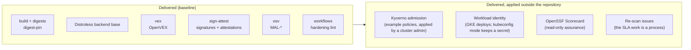

# Supply-Chain Hardening Roadmap

The supply-chain controls **delivered today** are documented in
[`wiki/security.md`](./security.md) (CI scanning), [`wiki/containerization.md`](./containerization.md)
(signing / provenance / digest-pin) and [`wiki/ci-cd.md`](./ci-cd.md) (jobs + variables).
This page is the honest list of the items beyond that baseline — the gaps against the supply-chain and
CI/CD pipeline practices this template aims for: what each now delivers, and what stays outside the
repository and why.

> **Rule of thumb:** signing, provenance and admission form a chain — admission
> can only *enforce* what signing and provenance *produce*. The items below are ordered so each
> depends only on what is already delivered above it.

---

## Delivered (baseline for everything below)

| Control | Job(s) | Stage | Where documented |
|---------|--------|-------|------------------|
| Immutable digest-pin | `reusable-build.yml` `build`, `release.yml` `digests` → `scripts/ci/deploy-verify.sh` | release / deploy | [`wiki/ci-cd.md`](./ci-cd.md) |
| Keyless signing, SLSA provenance, SBOM attestation | `reusable-build.yml` `sign-attest` | release | [`wiki/security.md`](./security.md#verifying-an-image) |
| OpenVEX (`affected`, plus a reviewed `not_affected` list) | `release.yml` `vex` | release | [`wiki/security.md`](./security.md) |
| Typosquat / malicious-dep detection | `security.yml` `advisory` leg `osv` (OSV-Scanner `MAL-*`) | security | [`wiki/security.md`](./security.md) |
| CI's-own-supply-chain self-check | `ci.yml` `workflows` (hardening lint, actionlint, zizmor) | ci | [`wiki/security.md`](./security.md) |

Everything in this table runs on **`main` and `v*` tags only** for the image-touching jobs
(`vex`) — a pull request author can never resolve a production digest. The source-level checks
(`osv`, `workflows`) also run on pull requests for fast feedback.

> **Image signing + SLSA provenance are delivered** (item `0`), and so are example admission policies
> that refuse an unsigned or unattested image (item `1`). The chart does not install them: nothing
> refuses an unsigned image until a cluster admin applies them.

---

## 0. Keyless cosign signing + SLSA provenance — *delivered*

`reusable-build.yml` (called by `release.yml` on `main` and `v*` tags only) signs each image digest
keyless with the pinned cosign after the blocking Grype gate, verifies the signature against the
workflow identity, and attaches a SLSA build-provenance attestation and a CycloneDX SBOM attestation
(`push-to-registry`). A pull request never reaches it. The hardening lint's `image-push-isolation`
and `provenance` checks keep it that way. The certificate identity and the manual verification are
in [`security.md`](./security.md#verifying-an-image).

Signing and provenance only buy what **admission enforces**: until a cluster policy *denies*
unsigned pods (item `1`), the build-time signature is assurance the runtime never checks.

See [`wiki/supply-chain-security.md`](./supply-chain-security.md).

---

## 1. Kubernetes admission (Kyverno) — *delivered as example policies*

**Depends on:** keyless cosign signing + SLSA provenance (delivered — item `0`).

Two Kyverno policies in [`deploy/policies/`](../deploy/policies/) deny a pod unless its image from this
repository is **signed** and carries an **SLSA provenance attestation** by the release build, and deny
alias spellings of the image path. They are tested offline (`kyverno test`, the `repo` job) and on kind
(`make kind-admission-test`). See [Admission control](./admission-control.md).

What stays outside the repository: admission is a **cluster-level** concern. The chart does not
install the policies or Kyverno; a cluster admin renders and applies them
(`scripts/render-admission-policy.sh`), and only then is an unsigned image refused at runtime.

---

## 2. Distroless / hardened backend base — *done*

The backend runtime is `gcr.io/distroless/python3-debian13`, pinned by digest: no shell, no `curl`, no
package manager and no `pip`, and a materially smaller CVE surface. The builder is a Debian 13 image with
the same Debian interpreter, so the copied virtual environment always matches. The image's command and
HEALTHCHECK are Python modules, `tini` is copied from the Debian package with its dpkg record (so the SBOM
lists it), and every consumer that used to run a shell or `curl` inside the container now uses the
image's own interpreter. The frontend was already distroless.

See [`wiki/containerization.md`](./containerization.md) and the container-hardening notes in
[`wiki/security.md`](./security.md).

---

## 3. CI-hardening controls — *surfaced, not waved*

The CI self-check (`infra/security/check-ci-hardening.sh`) grades, among others:

- **SLSA provenance (`provenance`).** Graded for real: when any workflow calls `reusable-build.yml`, that workflow must sign, verify after signing, and attest provenance and the SBOM with `push-to-registry`. The build-level workload identity (the GitHub OIDC token) binds the image to the build.
- **Environment-scoped secrets.** On GitHub, secrets are scoped to an Environment and gated by its
  deployment rules; that is a repository setting, set by `scripts/github-settings.sh` and checked by
  the `environment-for-secrets` lint, not by repo YAML alone.

The self-check goes RED on a real regression of a control it can verify in the YAML.

---

## 4. Retired: `curl | bash` tool installs — *done*

This was the one genuine tool-install debt in the baseline: the pre-existing image-first scanners
(the SBOM job → Syft, the Grype job → Grype, the licence job → Grant) installed their
binaries with unverified `curl | bash` / `wget`, while every **new** tool went through the
checksum-verified `infra/security/tools-install.sh`. That split is now closed — all three legacy
scanners install through `tools-install.sh` too ([`security.yml`](../.github/workflows/security.yml)), so nothing in this repo's
supply-chain surface fetches a tool with an unverified `curl | bash` any more. It is recorded here
only as history, not as outstanding debt.

---

## 5. Workload identity / short-lived deploy credentials — *delivered on GKE*

The deploy jobs authenticate with **workload identity federation**: on GKE (`DEPLOY_MODE=gke`, the default)
the job's GitHub Actions OIDC token is exchanged for a short-lived token of the environment's deployer
service account ([`.github/actions/cluster-access`](../.github/actions/cluster-access/action.yml)), with no
stored cloud key. The other mode, `kubeconfig`, reads a stored kubeconfig secret of the environment, and is
the one left on a long-lived credential. Images are pushed with the job's own `GITHUB_TOKEN`. App secrets can
come from the External Secrets Operator (`secrets.externalSecret.enabled` in the chart). Setup:
[GKE cluster setup](./gke-cluster-setup.md) and [CI/CD, Deploy chain](./ci-cd.md#deploy-chain).

---

## 6. OpenSSF Scorecard / CII Best Practices Badge — *Scorecard delivered; the badge is not*

[`scorecard.yml`](../.github/workflows/scorecard.yml) runs **OpenSSF Scorecard** weekly and on every push to
`main`, publishes the result and uploads it as SARIF: **read-only assurance**, never a gate, on public
repositories only. The **CII (OpenSSF) Best Practices Badge** is a self-assessment on an external site, not
a repository change; it stays with the adopter.

---

## 7. SBOM-consumption / VEX-actuation loop — *partly delivered*

The weekly re-scan ([`rescan.yml`](../.github/workflows/rescan.yml)) scans the running and released images
by digest and opens or updates one issue per fixable critical or high finding, with an SLA
([Vulnerability management](./vulnerability-management.md)). What stays a **delivery/ops process** outside
the repository: working those issues to the SLA, bumping the dependency, and re-reviewing the VEX
`not_affected` list on a cadence.

---

## Summary

