# Supply-Chain Hardening Roadmap

The supply-chain controls **delivered today** are documented in
[`wiki/security.md`](./security.md) (CI scanning), [`wiki/containerization.md`](./containerization.md)
(signing / provenance / digest-pin) and [`wiki/ci-cd.md`](./ci-cd.md) (jobs + variables).
This page is the honest list of what is **not yet implemented** — the remaining gaps against
the supply-chain and CI/CD pipeline practices this template aims for — and why each item is deferred.

> **Rule of thumb:** signing, provenance and admission form a chain — admission
> can only *enforce* what signing and provenance *produce*. The items below are ordered so each
> depends only on what is already delivered above it.

---

## Delivered (baseline for everything below)

| Control | Job(s) | Stage | Where documented |
|---------|--------|-------|------------------|
| Immutable digest-pin | `reusable-build.yml` `build`, `release.yml` `digests` → `scripts/ci/deploy-verify.sh` | release / deploy | [`wiki/ci-cd.md`](./ci-cd.md) |
| Keyless signing, SLSA provenance, SBOM attestation | `reusable-build.yml` `sign-attest` | release | [`wiki/security.md`](./security.md#verifying-an-image) |
| OpenVEX (`affected`, plus a reviewed `not_affected` list) | `release.yml` `vex` | release | [`wiki/security.md`](./security.md) |
| Typosquat / malicious-dep detection | `security.yml` `advisory` leg `osv` (OSV-Scanner `MAL-*`) | security | [`wiki/security.md`](./security.md) |
| CI's-own-supply-chain self-check | `ci.yml` `workflows` (hardening lint, actionlint, zizmor) | ci | [`wiki/security.md`](./security.md) |

Everything in this table runs on **`main` and `v*` tags only** for the image-touching jobs
(`vex`) — a pull request author can never resolve a production digest. The source-level checks
(`osv`, `workflows`) also run on pull requests for fast feedback.

> **Image signing + SLSA provenance are delivered** (item `0`): `reusable-build.yml` signs every image
> digest keyless and attaches provenance and SBOM attestations. Admission enforcement (item `1`) is
> what is still missing, so nothing yet *refuses* an unsigned image at runtime.

---

## 0. Keyless cosign signing + SLSA provenance — *delivered*

`reusable-build.yml` (called by `release.yml` on `main` and `v*` tags only) signs each image digest
keyless with the pinned cosign after the blocking Grype gate, verifies the signature against the
workflow identity, and attaches a SLSA build-provenance attestation and a CycloneDX SBOM attestation
(`push-to-registry`). A pull request never reaches it. The hardening lint's `image-push-isolation`
and `provenance` checks keep it that way. The certificate identity and the manual verification are
in [`security.md`](./security.md#verifying-an-image).

Signing and provenance only buy what **admission enforces**: until a cluster policy *denies*
unsigned pods (item `1`), the build-time signature is assurance the runtime never checks.

See [`wiki/supply-chain-security.md`](./supply-chain-security.md).

---

## 1. Kubernetes admission (Kyverno) — *roadmap*

**Depends on:** keyless cosign signing + SLSA provenance (delivered — item `0`).

Add a **Kyverno** admission policy that *denies* a pod unless its image is **signed** and carries
an **SLSA provenance attestation** (verify at admission time, not just at build time). This closes
the loop that leaves a structural hole: the registry can hold a signed image,
but nothing *enforces* that only signed/provenanced images run.

Why it is deferred:

- The template's deploy surface is **Helm-native** (`charts/`), and admission is a **cluster-level**
  concern (Kyverno / Gatekeeper / Sigstore policy-controller) that lives outside the service repo.
- It needs a running policy engine and a verified root of trust (the Rekor/Fulcio issuer the jobs
  already pin via `COSIGN_OIDC_ISSUER` / `COSIGN_CERT_IDENTITY`).
- **Kubernetes admission is out of scope for this template's Compose / `main` flavour** by design;
  it belongs to the cluster platform, not the service.

---

## 2. Distroless / hardened backend base — *done*

The backend runtime is `gcr.io/distroless/python3-debian13`, pinned by digest: no shell, no `curl`, no
package manager and no `pip`, and a materially smaller CVE surface. The builder is a Debian 13 image with
the same Debian interpreter, so the copied virtual environment always matches. The image's command and
HEALTHCHECK are Python modules, `tini` is copied from the Debian package with its dpkg record (so the SBOM
lists it), and every consumer that used to run a shell or `curl` inside the container now uses the
image's own interpreter. The frontend was already distroless.

See [`wiki/containerization.md`](./containerization.md) and the container-hardening notes in
[`wiki/security.md`](./security.md).

---

## 3. CI-hardening controls — *surfaced, not waved*

The CI self-check (`infra/security/check-ci-hardening.sh`) grades, among others:

- **SLSA provenance (`provenance`).** Graded for real: when any workflow calls `reusable-build.yml`, that workflow must sign, verify after signing, and attest provenance and the SBOM with `push-to-registry`. The build-level workload identity (the GitHub OIDC token) binds the image to the build.
- **Environment-scoped secrets.** On GitHub, secrets are scoped to an Environment and gated by its
  deployment rules; that is a repository setting, set by `scripts/github-settings.sh` and checked by
  the `environment-for-secrets` lint, not by repo YAML alone.

The self-check goes RED on a real regression of a control it can verify in the YAML.

---

## 4. Retired: `curl | bash` tool installs — *done*

This was the one genuine tool-install debt in the baseline: the pre-existing image-first scanners
(the SBOM job → Syft, the Grype job → Grype, the licence job → Grant) installed their
binaries with unverified `curl | bash` / `wget`, while every **new** tool went through the
checksum-verified `infra/security/tools-install.sh`. That split is now closed — all three legacy
scanners install through `tools-install.sh` too (`ci/security.yml`), so nothing in this repo's
supply-chain surface fetches a tool with an unverified `curl | bash` any more. It is recorded here
only as history, not as outstanding debt.

---

## 5. Workload identity / short-lived deploy credentials — *roadmap*

Replace the long-lived deploy secrets (registry push tokens, etc.) with **short-lived, workload-
scoped credentials**: in-cluster sealed-secrets / External Secrets Operator (ESO) / SOPS, or cloud
workload-identity federation that exchanges the GitHub Actions OIDC token for a time-limited cloud IAM
token — so a deploy authenticates with a credential bound to the workload and expiring in minutes,
not a stored secret that survives an attacker.

**Why it is deferred / cluster-level:** this lives in the **cluster platform**, not the service repo.
It needs the GitHub OIDC issuer to be a trusted identity provider in the cloud IAM, and an in-cluster secrets
operator to be installed — none of which a service-repo edit can deliver. The repo can at most
reference the issuer; the federation and rotation are platform concerns. It is the deploy-side
counterpart of the keyless OIDC build-identity work (item I).

---

## 6. OpenSSF Scorecard / CII Best Practices Badge — *roadmap*

Run **OpenSSF Scorecard** against the repo (and/or earn the **CII Best Practices Badge**) as
**read-only assurance**: a periodic, scored assessment of supply-chain hygiene (pinned dependencies,
signed releases, token permissions, …) that *reports* a score rather than gating the build.

**Why it is deferred / not a service-repo change:** it is an **assurance layer that measures the
repo**, typically on a schedule in a separate job or an external service — it produces a score, not
a shipped artifact, and does not change the service. An adopter should not expect a repo stub to
"deliver" a Scorecard score; it is run against the repo, not built into it. Deferred as read-only
assurance, not a hard gate.

---

## 7. SBOM-consumption / VEX-actuation loop — *roadmap*

Close the loop from the **SBOM + VEX** the pipeline already produces to **remediation**: when a
*fixable* CVE appears in the SBOM and is `affected` in the VEX, drive a
remediation SLA (open an issue, bump the dependency, re-attest the VEX) on a cadence — rather than
publishing the SBOM/VEX once and treating that as done.

**Why it is deferred / not a service-repo change:** the repo *produces* the SBOM and VEX (delivered);
**consuming** them on a schedule with a remediation SLA is a **delivery/ops process** (dependency-
update automation, triage, VEX re-attestation cadence) that lives downstream of the repo. It depends
on the SBOM + VEX work being in place first.

---

## Summary

```mermaid
flowchart LR
    subgraph Delivered["Delivered (baseline)"]
        V["build + digests<br/>digest-pin"]
        D["Distroless backend base"]
        X["vex<br/>OpenVEX"]
        S["sign-attest<br/>signatures + attestations"]
        M["osv<br/>MAL-*"] & H["workflows<br/>hardening lint"]
    end

    subgraph Roadmap["Roadmap"]
        K["Kyverno admission<br/>(enforces the delivered signatures)"]
        I["OIDC build identity"]
        P["environment-scoped secrets<br/>(repository setting)"]
        W["Workload identity<br/>(deploy-side of I)"]
        SC["OpenSSF Scorecard<br/>(read-only assurance)"]
        SB["SBOM-consumption /<br/>VEX-actuation"]
    end

    Delivered --> Roadmap
```

