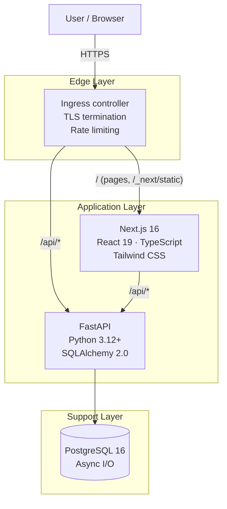
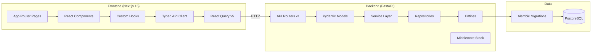
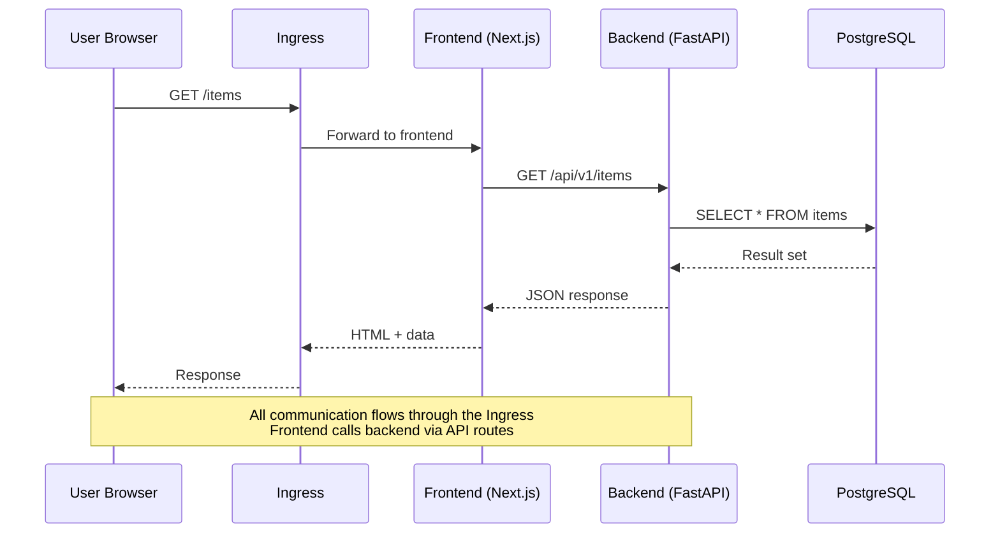
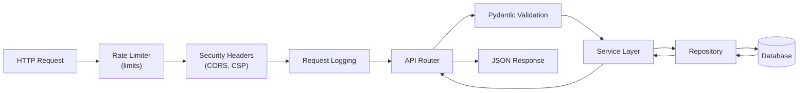
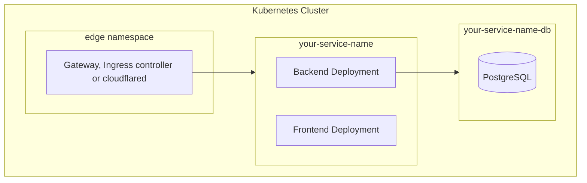
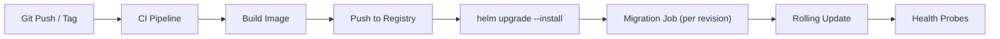

# System Architecture

High-level overview of the service template architecture, component roles, and data flow.

---

## Table of Contents

- [Overview](#overview)
- [Component Diagram](#component-diagram)
- [Request Flow](#request-flow)
- [Layer Responsibilities](#layer-responsibilities)
- [Kubernetes Topology](#kubernetes-topology)
- [Deployment Strategy](#deployment-strategy)
- [Design Decisions](#design-decisions)

---

## Overview

The service template follows a **gateway pattern** with services deployed to Kubernetes behind an Ingress. Two images run: the backend and the frontend. The Next.js server serves its own pages and static assets; the cache policy is in [frontend-deployment.md](frontend-deployment.md#static-assets):



---

## Component Diagram

### Detailed Component Breakdown



---

## Request Flow

### Browser → Ingress → Backend



### API Request Lifecycle



---

## Layer Responsibilities

| Layer | Technology | Responsibility |
|-------|-----------|---------------|
| **Edge/Gateway** | Ingress controller | TLS termination, routing, rate limiting, health checks |
| **Frontend** | Next.js 16, React 19 | UI rendering, state management, API communication, form validation |
| **Backend API** | FastAPI | Request handling, validation, business logic orchestration |
| **Services** | Python | Business logic, transaction coordination |
| **Repositories** | SQLAlchemy 2.0 | Data access, query building, soft-delete patterns |
| **Entities** | Python dataclasses | Immutable domain objects, frozen with `slots=True` |
| **Schemas** | Pydantic v2 | Request/response validation, serialization |
| **Database** | PostgreSQL 16 | Persistent storage, ACID transactions |
| **Migrations** | Alembic | Schema evolution, versioned migrations |
| **Static** | The Next.js server | Serves `/_next/static` and `public/` files; see [Frontend Deployment](./frontend-deployment.md#static-assets) |
| **Orchestration** | Kubernetes | Pod scheduling, scaling, health probes, rolling updates |

---

## Kubernetes Topology

### Namespace Layout



### Resource Overview

| Resource | Purpose |
|----------|---------|
| **Deployment** | Backend (2-10 replicas), Frontend (2-5 replicas) |
| **Service** | ClusterIP services for backend (:8000) and frontend (:3000) |
| **Ingress** | Routes `/api`, `/docs` and `/openapi.json` to the backend and everything else to the frontend, with TLS and rate limiting |
| **HPA** | Horizontal Pod Autoscaler (CPU/memory based) |
| **PDB** | Pod Disruption Budget (minAvailable: 1) |
| **NetworkPolicy** | Default deny + explicit allow rules |
| **ConfigMap** | Non-secret configuration (env vars) |
| **Secret** | Sensitive data (DB credentials, stats password) |
| **ServiceAccount** | Minimal RBAC for the application |
| **Job** | Database migration runner |
| **CronJob** | PostgreSQL backup (daily at 2 AM) |
| **ServiceMonitor** | Prometheus metrics scraping |

### Health Probes

| Probe | Backend | Frontend |
|-------|---------|----------|
| **startupProbe** | `/api/v1/healthz` (30×5s) | `/api/healthz` (20×5s) |
| **readinessProbe** | `/api/v1/health` (10s interval) | `/api/healthz` (10s interval) |
| **livenessProbe** | `/api/v1/healthz` (15s interval) | `/api/healthz` (15s interval) |

---

## Deployment Strategy

### Rolling Updates

All deployments use **rolling updates** with zero-downtime guarantees:

```yaml
strategy:
  type: RollingUpdate
  rollingUpdate:
    maxUnavailable: 0    # Never reduce below desired count
    maxSurge: 1          # Allow one extra pod during rollout
```

### Deployment Flow



### Multi-Environment Strategy

| Environment | Replicas | Debug | Log Level | Hosts |
|-------------|----------|-------|-----------|-------|
| **dev** | 1 | true | DEBUG | dev-api, dev-app |
| **qa** | 2 | false | INFO | qa-api, qa-app |
| **production** | 3 | false | WARNING | api, app |

---

## Design Decisions

### Why an Ingress?

- **Kubernetes-native** — Standard pattern, well-supported, automatic TLS via cert-manager
- **Declarative routing** — Ingress resources define routing rules
- **Annotations** — Rate limiting and SSL redirect via the controller's annotations
- **Alternatives**: Traefik, or cloud load balancers for advanced needs

### Why Helm?

The stack is deployed as a single Helm chart (`charts/your-service-name/`); per-environment differences
live in `values.<env>.yaml`, not separate overlays.

- **Values-driven config** — One chart, parameterized by `values.dev/qa/production/local.yaml`
- **Templating** — Repeats (labels, selectors, secrets) are DRY'd into chart helpers
- **Release management** — `helm upgrade --install`, `helm history`, `helm rollback`
- **Gated optional pieces** — in-cluster Postgres, backups, monitoring, logging toggle on/off via values

> The pre-Helm `k8s/` Kustomize tree was removed in Phase 2 Stage C (recoverable from git history);
> its overlay pattern lives on as the `values.<env>.yaml` files.

### Why Per-Service Dockerfiles?

- **Smaller images** — Each image contains only the dependencies it needs (backend: Python, frontend: Node).
- **Independent builds** — A frontend change does not rebuild the backend image, and vice versa.
- **Clear responsibility** — Each Dockerfile has one job: build and run one service.
- **Faster CI** — Parallel builds, smaller layers, better cache utilization.

### Why SQLAlchemy 2.0?

- **Async I/O** — Native async session support with `asyncpg`.
- **Type safety** — Mypy-compatible type annotations.
- **Modern API** — 2.0-style queries with `select()` instead of legacy Query API.

### Why Next.js 16 App Router?

- **Server Components** — Reduced client-side JavaScript.
- **Standalone output** — Minimal production bundle (`output: 'standalone'`).
- **Typed routes** — `typedRoutes: true` for compile-time route checking.

### Why Not N+1 Queries?

The Item model is a **flat single-table entity** with no relationships, foreign keys, or `relationship()` declarations. Both `list_items()` and `get_item()` execute exactly one SQL query. N+1 problems only arise with related models.
