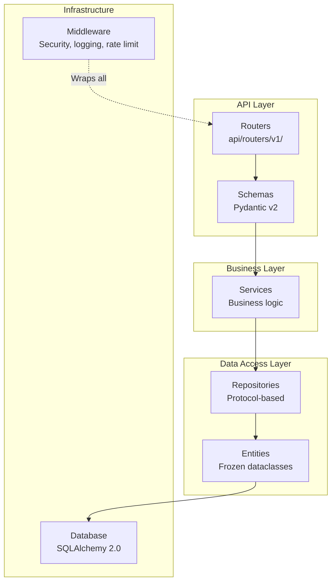
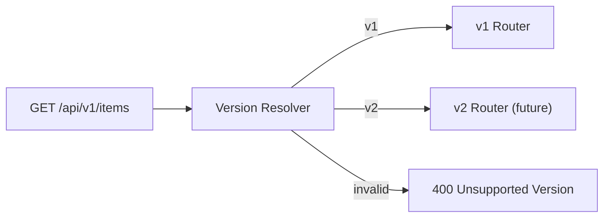
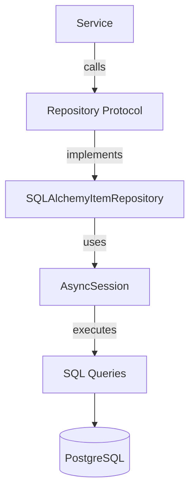
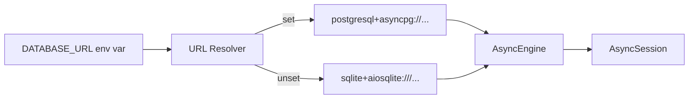
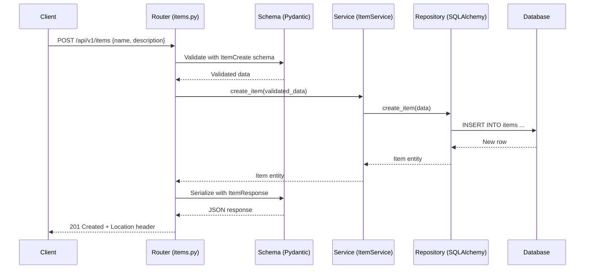
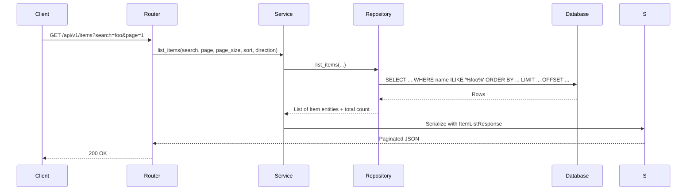

# Backend Architecture

Detailed breakdown of the FastAPI backend: layered architecture, data flow, and component responsibilities.

---

## Table of Contents

- [Overview](#overview)
- [Project Layout](#project-layout)
- [Application Factory](#application-factory)
- [API Layer](#api-layer)
- [Service Layer](#service-layer)
- [Repository Layer](#repository-layer)
- [Entity Layer](#entity-layer)
- [Schema Layer](#schema-layer)
- [Database Layer](#database-layer)
- [Middleware Stack](#middleware-stack)
- [Data Flow](#data-flow)

---

## Overview

The backend follows a **clean layered architecture** with strict dependency direction:

```
Request → Router → Schema → Service → Repository → Entity → Database
Response ← Router ← Schema ← Service ← Repository ← Entity ← Database
```

Each layer depends only on the layer below it. Routers never call repositories directly; services never touch HTTP.



---

## Project Layout

```
src/your_service_name/
├── backend/
│   ├── main.py                 # create_app() factory + lifespan
│   ├── api/
│   │   ├── routers/
│   │   │   └── v1/             # Versioned API routers
│   │   │       ├── health.py   # GET /health, GET /healthz
│   │   │       ├── echo.py     # POST /echo, GET /echo/history
│   │   │       └── items.py    # CRUD: list, get, create, update, delete
│   │   └── accessors.py        # API access helpers
│   ├── schemas/
│   │   ├── health.py           # HealthResponse, HealthzResponse
│   │   ├── echo.py             # EchoRequest, EchoResponse, EchoHistoryResponse
│   │   └── item.py             # ItemCreate, ItemUpdate, ItemResponse, ItemListResponse
│   ├── services/
│   │   ├── echo_service.py     # EchoService (business logic)
│   │   └── item_service.py     # ItemService (CRUD operations)
│   ├── repositories/
│   │   ├── base.py             # Base repository protocol
│   │   ├── item_protocol.py    # ItemRepository ABC/Protocol
│   │   ├── sqlalchemy_item.py  # SQLAlchemy implementation
│   │   └── in_memory_echo.py   # In-memory echo repository (for testing)
│   ├── entities/
│   │   ├── echo_record.py      # EchoRecord dataclass
│   │   └── item.py             # Item dataclass
│   ├── db/
│   │   ├── engine.py           # Async engine + session factory
│   │   ├── models.py           # SQLAlchemy ORM models
│   │   └── migrations/         # Alembic migration scripts
│   ├── middleware/
│   │   ├── security.py         # CORS, security headers
│   │   ├── logging.py          # Request/response logging
│   │   └── rate_limiting.py    # per-IP rate limiter (limits)
│   └── logging/
│       └── audit.py            # Audit logging utilities
├── utils/
│   ├── versioning_api.py       # API version resolution
│   └── validators.py           # Input validators
└── scripts/
    └── seed.py                 # Database seed script
```

---

## Application Factory

The backend uses a `create_app()` factory pattern with a lifespan context manager:


**Key file**: `src/your_service_name/backend/main.py`

- Creates the FastAPI application with OpenAPI docs
- Registers versioned routers under `/api/{version}/`
- Configures middleware stack (CORS, rate limiting, logging)
- Manages the database engine via `@asynccontextmanager` lifespan; it does **not** migrate (see [Database operations](./database.md#database-operations))

---

## API Layer

### Routers

Each router is scoped to an API version (`v1`) and a domain:

| Router | Endpoints | Description |
|--------|-----------|-------------|
| `health.py` | `GET /health`, `GET /healthz` | Health checks (DB-aware and simple) |
| `echo.py` | `POST /echo`, `GET /echo/history` | Echo service (sample) |
| `items.py` | `GET /items`, `GET /{id}`, `POST /items`, `PATCH /{id}`, `DELETE /{id}` | Full CRUD for items |

### API Versioning



The `SUPPORTED_VERSIONS` dict in `versioning_api.py` controls which versions are active.

---

## Service Layer

Services contain **business logic** and orchestrate repository calls:

```python
# Example: ItemService
class ItemService:
    def __init__(self, repo: ItemRepositoryProtocol):
        self.repo = repo

    async def list_items(self, ...) -> list[Item]:
        return await self.repo.list_items(...)

    async def create_item(self, data: ItemCreate) -> Item:
        return await self.repo.create_item(data)
```

**Principles**:
- Services depend on repository **protocols** (not concrete implementations)
- Enables easy testing with in-memory repositories
- No HTTP knowledge — services work with domain objects only

---

## Repository Layer

Repositories handle **data access** using SQLAlchemy 2.0 async patterns:



**Key patterns**:
- **Protocol-based** — `ItemRepositoryProtocol` defines the interface; `SQLAlchemyItemRepository` implements it
- **Soft delete** — Items are soft-deleted (`deleted_at` set) rather than hard-deleted
- **Search** — `ilike` filtering on name/description
- **Pagination** — Offset/limit with total count

---

## Entity Layer

Entities are **immutable dataclasses** representing domain objects:

```python
@dataclass(slots=True, frozen=True)
class Item:
    id: str
    name: str
    description: str | None
    is_active: bool
    created_at: datetime
    updated_at: datetime
    deleted_at: datetime | None
```

**Properties**:
- `slots=True` — Memory efficient, faster attribute access
- `frozen=True` — Immutable after creation (prevents accidental mutation)

---

## Schema Layer

Pydantic v2 models for **request validation** and **response serialization**:

| Schema | Purpose | Key Constraints |
|--------|---------|----------------|
| `ItemCreate` | POST body | `name` required (1-255 chars), `description` optional, `is_active` optional |
| `ItemUpdate` | PATCH body | All fields optional, same constraints as create |
| `ItemResponse` | GET response | All fields, `from_attributes=True` |
| `ItemListResponse` | List response | `items`, `total`, `page`, `page_size`, `total_pages` |

---

## Database Layer

### Engine



- **Primary**: PostgreSQL via `asyncpg` (async I/O)
- **Fallback**: SQLite via `aiosqlite` (when `DATABASE_URL` is not set)
- **Session management**: Yield pattern with commit/rollback in `get_session()`

### Models

SQLAlchemy ORM models map to database tables:

```python
class ItemModel(Base):
    __tablename__ = "items"

    id = Column(String(36), primary_key=True, default=uuid4)
    name = Column(String(255), nullable=False)
    description = Column(Text, nullable=True)
    is_active = Column(Boolean, default=True, nullable=False)
    created_at = Column(DateTime, server_default=func.now())
    updated_at = Column(DateTime, server_default=func.now(), onupdate=func.now())
    deleted_at = Column(DateTime, nullable=True)  # Soft delete
```

### Migrations

Alembic manages schema evolution:

```bash
# Create a new migration
alembic revision --autogenerate -m "add items table"

# Apply migrations
alembic upgrade head

# Rollback one migration
alembic downgrade -1
```

---

## Middleware Stack

Middleware wraps all requests in this order, outermost first (`create_app` in `main.py`):

1. `ClientIpMiddleware`: resolves the real client address first, so everything below sees one value
2. `CorrelationIdMiddleware`: scopes the `X-Request-Id` and the `traceparent` trace id for every log line
3. `RequestSizeLimitMiddleware`: refuses an oversized body before anything reads it
4. `TrustedHostMiddleware`: refuses a `Host` that is not in `ALLOWED_HOSTS`
5. `RequestLoggingMiddleware`: method, path, status, duration and client (opt-in via `LOG_REQUESTS`)
6. security headers
7. `RateLimitMiddleware`: per-client-IP throttling
8. `CORSMiddleware`

The two refusals sit just inside the correlation middleware so their problem bodies carry the request
id, and outside everything else so a refused request costs nothing more.

The Prometheus instrumentator (`/metrics`) is added last, so it wraps the whole stack from outside. It
only records metrics and does not read the client address.

| Middleware | File | Purpose |
|-----------|------|---------|
| Client IP | `middleware/client_ip.py` | Rewrites the client address from a trusted proxy's headers; the trust rules are in [Client IP](security.md#client-ip) |
| Correlation | `middleware/correlation.py` | `X-Request-Id` and `traceparent` trace id for the request's logs |
| Request limits | `middleware/request_limits.py` | Body-size cap (413) and trusted hosts (400) |
| Logging | `middleware/logging.py` | Request/response logging (opt-in via `LOG_REQUESTS`) |
| Security | `middleware/security.py` | Security headers |
| Rate Limiting | `middleware/rate_limiting.py` | Per-IP request throttling (enforced in-middleware via `limits`) |
| CORS | `main.py` | CORS configuration from the `CORS_*` settings |
| Prometheus | `main.py` | Metrics exposition at `/metrics` for ServiceMonitor |

-----------|------|---------|
| Rate Limiting | `middleware/rate_limiting.py` | Per-IP request throttling (enforced in-middleware via `limits`) |
| Security | `middleware/security.py` | CORS configuration, security headers |
| Logging | `middleware/logging.py` | Request/response logging (opt-in via `LOG_REQUESTS`) |
| Prometheus | `main.py` | Metrics exposition at `/metrics` for ServiceMonitor |

---

## Data Flow

### Create Item — Full Flow



### List Items — Full Flow


