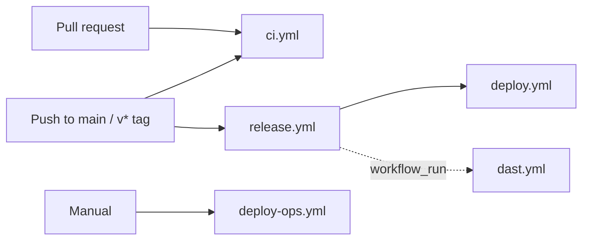
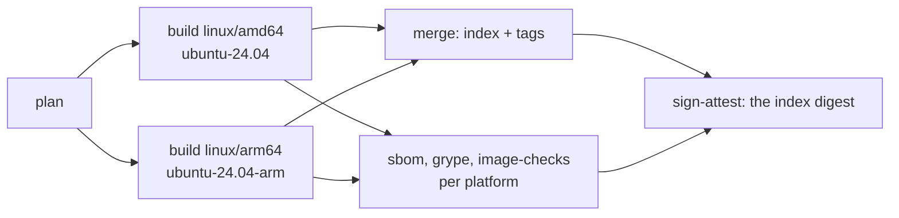

# CI/CD pipeline

GitHub Actions workflows: what runs when, what blocks a merge, how an image is built, released and deployed, and where each tool is pinned.

---

## Table of Contents

- [Overview](#overview)
- [Workflow map](#workflow-map)
- [Triggers and gates](#triggers-and-gates)
- [Advisory vs blocking](#advisory-vs-blocking)
- [Image operations](#image-operations)
- [Deploy chain](#deploy-chain)
- [Caches](#caches)
- [Where each tool is pinned](#where-each-tool-is-pinned)
- [Job map from the old GitLab pipeline](#job-map-from-the-old-gitlab-pipeline)

---

## Overview

The workflows live in `.github/workflows/`. Reusable workflows and three composite actions (`.github/actions/setup-backend`, `setup-frontend`, `cluster-access`) hold the shared steps. Repository settings that the pipeline depends on (the required check, environments, variables) are code too: [GitHub repository settings](./github-repository-settings.md) and [`scripts/github-settings.sh`](../scripts/github-settings.sh).

## Workflow map

| Workflow | Runs on | What it does |
|---|---|---|
| [`ci.yml`](../.github/workflows/ci.yml) | pull request, push to `main` and `v*`, manual | The quality gate. Jobs: `changes` (path filter), `backend`, `frontend`, `chart`, `live`, `security`, `repo`, `hadolint`, `api-compat` (the oasdiff gate), `workflows`, `pins` (pin drift), `image-plan` and `images` (the image structure checks, pull requests only), `kind` (the chart in a real cluster, pull requests only), and the `CI OK` gate |
| [`reusable-backend.yml`](../.github/workflows/reusable-backend.yml) | called by `ci` | `lint` (ruff format, ruff lint, mypy, squawk), `unit` (Python 3.12, 3.13 and the advisory 3.14), `integration` (with the contract tests) and `e2e`, both on a PostgreSQL service container |
| [`reusable-frontend.yml`](../.github/workflows/reusable-frontend.yml) | called by `ci` | `eslint`, `prettier`, `type-check`, `openapi-drift`, `build`, `unit`, `integration`, `playwright-list`, `a11y` (axe, blocking) and `lighthouse` (Lighthouse CI, advisory) |
| [`reusable-live.yml`](../.github/workflows/reusable-live.yml) | called by `ci` | The full stack, then the backend live suite and the Playwright suite |
| [`reusable-kind.yml`](../.github/workflows/reusable-kind.yml) | called by `ci` on pull requests | The chart in a kind cluster on two pinned node images (the `kubeVersion` floor and kind's newest): the images built locally, the admin bootstrap, `ct lint` and `ct install`, the pull request's base chart upgraded to its head as the deployer, `helm test`, the WAF and the deployer's rights ([Infrastructure](./infrastructure.md#local-cluster-kind)) |
| [`reusable-chart.yml`](../.github/workflows/reusable-chart.yml) | called by `ci` and `deploy` | `ct lint` (settings in `.github/ct.yaml`: yamllint with `.github/ct-lintconf.yaml`, Chart.yaml schema `.github/ct-chart-schema.yaml`; yamllint and yamale come from hashed locks in `$RUNNER_TEMP` venvs, since runners have no uv), then Helm lint and render for every values file, the vendored CRD schemas checked against their pinned sources, `kubeconform -strict` over every render, offline ([Infrastructure](./infrastructure.md#validating-every-render-kubeconform)), and `make rules-test`: the rules of both monitoring flavours through the pinned `promtool` ([Infrastructure](./infrastructure.md#checking-the-rules-promtool)) |
| [`security.yml`](../.github/workflows/security.yml) | called by `ci`; weekly schedule; manual | `codeql`, `dependency-review`, `gitleaks`, `pip-audit`, and the `advisory` matrix (`osv`, `guarddog`, `checkov`, `kubescape`) |
| [`release.yml`](../.github/workflows/release.yml) | push to `main` and `v*` | `plan`, `images` (calls `reusable-build.yml`), `digests`, `grant`, `vex`, `release-assets` (`v*` tags), then `deploy` |
| [`reusable-build.yml`](../.github/workflows/reusable-build.yml) | called by `release` | `build` (one leg per image and platform, on that platform's native runner: push by digest, verify it), `merge` (one leg per image: the index, the tags, the index digest), `sbom` and `grype` (blocking gate; per platform), `image-checks` (the structure checks on each platform's pushed digest, natively), `sign-attest` (signs the index and attests its provenance), `attest-sbom` (one leg per image and platform: that platform's SBOM attestation, after the same gate) |
| [`deploy.yml`](../.github/workflows/deploy.yml) | called by `release` | `helm-checks`, `deploy-notice` (the skip notice), then `deploy-dev`, `deploy-qa`, `deploy-production` |
| [`deploy-ops.yml`](../.github/workflows/deploy-ops.yml) | manual | `rollback`, `history`, `cleanup` (a report) and `check` on one environment |
| [`reusable-pins.yml`](../.github/workflows/reusable-pins.yml) | called by `ci` and `pins-drift` | `pins`: `scripts/pins-refresh.sh --check` (read-only) against the vendors' published checksums; on a pull request only the rows that differ from the base. See [dependency updates](./security.md#dependency-updates-and-pinned-checksums) |
| [`pins-drift.yml`](../.github/workflows/pins-drift.yml) | weekly (Monday 04:41 UTC); manual | `pins` over every row |
| [`scorecard.yml`](../.github/workflows/scorecard.yml) | weekly (Monday 03:17 UTC); push to `main` | `analysis`: the OpenSSF Scorecard, published and uploaded as SARIF. Public repositories only; never a gate |
| [`rescan.yml`](../.github/workflows/rescan.yml) | weekly (Wednesday 05:41 UTC); manual | `collect` (digests from deployments and the latest release), `scan` (Grype by digest, no VEX), `report` (opens or updates `vuln` issues). See [vulnerability management](./vulnerability-management.md) |
| [`dast.yml`](../.github/workflows/dast.yml) | after `Release` succeeds; manual | The ZAP baseline against the backend image just pushed |

`ci.yml` jobs: `repo` runs shellcheck, the secret-template check and the bats suites; `hadolint` lints every tracked Dockerfile with the pinned hadolint (`scripts/ci/hadolint.sh`, also a pre-commit hook); `workflows` runs the CI hardening lint, actionlint and zizmor over `.github/`; `image-plan` and `images` build each image of the manifest into the runner's local daemon and run `scripts/ci/image-checks.sh --strict` on it (see [Image structure checks](./containerization.md#image-structure-checks)).

## Triggers and gates

- **Path filter.** On a pull request, the `changes` job decides whether `backend` and `frontend` run. Backend paths: `src/`, `tests/`, `alembic*`, `pyproject.toml`, `Makefile`, `frontend/lib/api/`, `.github/`, `scripts/`, `infra/`, `tools/` (every root `make ruff-lint` covers). Frontend paths: `frontend/`, `Makefile`, `.github/`, `scripts/`, `tools/`. The frontend job also runs when the backend changed, because the OpenAPI drift check needs it. On `main`, tags and manual runs everything runs.
- **`pins`** runs on a pull request only when `tools/pins.tsv`, `tools/requirements/`, `infra/security/config.yaml` or the refresh script changed; on `main`, tags and manual runs it always does.
- **`kind`** runs on a pull request only, when the chart, the bootstrap, a path the images copy in, a Dockerfile, `.github/`, `scripts/`, `tools/` or the `Makefile` changed. It builds the images into the runner's daemon through the images job's build path (`scripts/ci/build-image.sh`), with no push, registry or cache; building them there, rather than handing over the `images` job's, keeps it independent of that job's path filter and avoids moving image archives between jobs.
- **`image-plan` and `images`** run on a pull request only, when a path the Dockerfiles copy in (`src/`, `frontend/`, `pyproject.toml`, `uv.lock`, `alembic.ini`, `README.md`, `LICENSE`, `VERSION`, `.dockerignore`), a Dockerfile, `.github/`, `scripts/` or `tools/` changed. A push to `main` or a `v*` tag skips them: the release build checks the pushed image instead. They never log in, push, read a secret or use a build cache.
- **Always run:** `chart`, `security`, `repo`, `hadolint`, `api-compat`, `workflows`. `api-compat` skips itself with a summary line on a push.
- **Label events.** `labeled` and `unlabeled` are pull request event types, and on them every job runs as on any other event (a test asserts no job's `if:` looks at the event action), so `CI OK` can never pass over a failing test job. They exist because `api-compat` reads the `breaking-change` label ([API lifecycle](./api-lifecycle.md)).
- **`CODE_SECURITY=off`** (a repository variable, for a private copy without GitHub code security) makes `codeql` and `dependency-review` skip, and a `code-security-off` job says so in the summary. See [Platform setup](./platform-setup.md#variables-and-secrets).
- **`live`** waits for `backend` and `frontend` (a skipped one does not stop it) and runs when either side changed.
- **The required check is `CI OK`.** It depends on every blocking job and fails on any result other than success. On a pull request `backend`, `frontend` and `pins` may be skipped (their path filter), `image-plan`, `images` and `kind` may be skipped on any event (they run on pull requests only, behind their path filters), and `live`'s result is ignored (it is advisory there). See [GitHub repository settings](./github-repository-settings.md#required-status-checks).
- **A fork's pull request** gets a read-only token and no secrets, never pushes an image and never reaches a deploy job. Workflows never use `pull_request_target`, and every workflow starts from `permissions: {}` with job-level grants.
- **Concurrency.** A pull request run cancels the previous one; release, deploy and DAST runs are never cancelled mid-flight.

## Advisory vs blocking

| Kind | Behaviour | Jobs |
|---|---|---|
| Blocking, required | Fails the run on a finding; behind `CI OK` | ruff, mypy, unit (3.12, 3.13), integration, e2e, the frontend gates, `chart`, `codeql`, `dependency-review`, `gitleaks`, `repo`, `hadolint`, `api-compat`, `workflows`, `pins`, `image-plan`, `images` (image structure checks, pull requests only), `kind` (pull requests only); `live` on `main` and tags |
| Blocking, release | Fails the release run | `build` (digest check), `image-checks` (structure checks on the pushed digest, before signing), `grype` (threshold `policy.fail_level` in `infra/security/config.yaml`) |
| Advisory | Findings become a `::warning` annotation and a step-summary line; fails only on a tool error; never a required check | `pip-audit`, the `advisory` matrix (`osv`, `guarddog`, `checkov`, `kubescape`), `Unit (Python 3.14)`, `live` on pull requests, `grant`, `vex`, DAST |

SARIF from the scanners goes to code scanning with `continue-on-error`, so a repository without code scanning stays green and a summary line says so.

## Image operations

Build, push, sign, attest and digest resolution happen only in [`reusable-build.yml`](../.github/workflows/reusable-build.yml), called by [`release.yml`](../.github/workflows/release.yml) on a push to `main` or a `v*` tag, never in a pull request. A pull request only builds images into its local daemon, in the `images` job, to check their structure ([Image structure checks](./containerization.md#image-structure-checks)); it never pushes.

1. `plan` renders the image matrix and the version (`.github/scripts/container_matrix.py`, manifest `.github/container-images.yml`).
2. `images` calls `reusable-build.yml`, which is the only workflow that may push, sign or attest an image (the hardening lint enforces it). Its `build` job runs one leg per image and platform, each on that platform's native runner, and pushes the platform image to `ghcr.io/<owner>/<repo>/<id>` by digest, with no tag, using `docker/build-push-action`; it checks that the registry digest equals the build digest. Then `merge` runs once per image: `docker buildx imagetools create` builds the index from the platform digests, applies the tags and resolves the index digest, which becomes the image's `digest-<id>` artifact (what `digests`, `deploy`, the VEX and the release assets use).
3. `sbom`, `grype` (the blocking gate) and `image-checks` run per platform, by that platform's digest; `image-checks` runs on the platform's native runner, so the container runs natively. `sign-attest` runs only after every platform passed: it signs the **index digest** keyless with the pinned cosign, runs `cosign verify` against the workflow identity, then adds the provenance attestation for the index digest (`push-to-registry`). `attest-sbom` runs one leg per image and platform from the same matrix as the scans, after the same gate, and attests that platform's SBOM against that platform's manifest digest; adding a platform to the manifest adds its leg, with no workflow edit. The identity and how to verify by hand are in [Security](./security.md#verifying-an-image).
4. Every `reusable-build.yml` job refuses to run unless the caller's event is a push to `main` or a `v*` tag. `digests` merges the per-image digests; `grant`, `vex` and `deploy` run after `images`, so nothing deploys unless the gate passed and the images are signed.
5. `grant` and `vex` now start only after `images` succeeded, so a release that fails the gate leaves no licence or VEX evidence (by design). On a `v*` tag `release-assets` puts the SBOMs, the OpenVEX document, the licence report and the image digests (`image-digests.env`, `scan.env`) on a **draft** GitHub Release (created with `--verify-tag`, never published by the workflow).

Tags: the immutable `<version>-<channel>-<sha>` on every release run, plus `latest` on a `v*` tag; both point at the index.

### Multi-architecture flow

- The platforms an image supports are the `platforms` list of its entry in `.github/container-images.yml`; the manifest's `runners` map names the native runner of each platform. Nothing else names a runner for a platform, and no job uses QEMU or `binfmt`: a platform is built and structure-checked only on a runner of its own architecture. The SBOM, the Grype scan and the SBOM attestation are static and run per platform on `ubuntu-24.04`.
- The repository variable `BUILD_ARM64` turns arm64 on (`true`). Unset, as in a fresh fork, only `linux/amd64` builds and the `plan` summary says arm64 was skipped and why; the flow is the same code path with one platform, and the index then holds one manifest.
- Pull requests build and check `linux/amd64` only, whatever the variable says (the `images` job). arm64 is checked natively on the release path, on `main` and `v*` tags.
- The per-platform artifacts are `platform-<id>.<platform>` (digests), `sbom-<id>.<platform>` and `grype-<id>.<platform>`; the SARIF category is `grype-<id>-<platform>`. The release assets carry one SBOM per image and platform, and the OpenVEX document merges the platforms' findings per image, pinned by the index digest.
- The weekly re-scan reads the index digest, lists the platforms of the index and runs Grype on each (`scripts/ci/rescan-scan.sh`), merging the matches into one findings file per image, so a finding that exists only on arm64 opens an issue too. See [Containerization](./containerization.md) and [Releasing](./releasing.md).

## Deploy chain

`release.yml` calls `deploy.yml` with the verified digests. Everything is skipped, with a summary line saying why, unless the repository variable `DEPLOY_ENABLED` is `true`, so a fresh fork with no cluster stays green.

1. `helm-checks` lints and renders the chart.
2. `deploy-dev`, then `deploy-qa` (only after dev succeeded, and only if `DEPLOY_ENVS` is empty or lists `qa`; `DEPLOY_ENVS` gates nothing else), then `deploy-production` (only on a `v*` tag with an immutable tag, after dev succeeded and after QA succeeded or was skipped by `DEPLOY_ENVS`, behind the `production` environment's required reviewer).
3. Each job runs [`scripts/ci/deploy-env.sh`](../scripts/ci/deploy-env.sh): it records the last deployed Helm revision, runs `helm upgrade --install --rollback-on-failure --wait --history-max 5` by digest, then [`scripts/ci/deploy-verify.sh`](../scripts/ci/deploy-verify.sh) (pods, health routes over a port-forward, running image digest equals the expected one) and the smoke test. If verify or smoke fails, it **rolls back to the recorded revision** and fails the job.
4. Cluster access comes from [`.github/actions/cluster-access`](../.github/actions/cluster-access/action.yml): Workload Identity Federation by default (`DEPLOY_MODE=gke`), or a kubeconfig from the environment secret `KUBECONFIG_B64`. A job that logs in declares `environment:`.
5. [`deploy-ops.yml`](../.github/workflows/deploy-ops.yml) is the manual follow-up: `rollback` (needs the input `confirm` set to `ROLLBACK`; empty `revision` means the previous one), `history`, `cleanup` (a report; Helm has no per-revision removal) and `check` (proves the login and the deployer's rights, read-only).

Setup of the cloud side: [GKE cluster setup](./gke-cluster-setup.md), [Cloudflare setup](./cloudflare-setup.md) and [Platform setup](./platform-setup.md). Runbook: [Operations runbook](./operations-runbook.md).

## Caches

| Cache | Key | Saved by |
|---|---|---|
| uv (`setup-backend`) | `uv-<os>-<python>-<hash of uv.lock>` (pruned with `uv cache prune --ci` before the save) | a push to `main` only |
| npm (`setup-frontend`) | `npm-<os>-<node>-<hash of frontend/package-lock.json>` | a push to `main` only |
| dev tools (`.tools/`) | `tools-<os>-<hash of tools/pins.tsv>` | a push to `main` only |

Pull requests and tags restore caches and never save them, so a pull request cannot poison what `main` restores.

**The release build uses no cache at all.** `reusable-build.yml` has no `cache-from`, `cache-to` or `actions/cache`, and nothing on the release path uses any other cache. The release path is the whole closure from `release.yml`: `reusable-build.yml`, `deploy.yml` (which in turn calls `reusable-chart.yml`) and the local composite action `cluster-access`. The lint derives that closure from the call graph and lists every action that may run there (`docker/setup-buildx-action` runs with `cache-binary: false`, because its default caches the buildx binary). Every release therefore builds every layer cold, from the commit, the pinned base images and the locked dependencies. The caches above serve test jobs only; nothing they hold is signed, and deploy jobs hold cluster credentials, so a poisoned cached tool there would be as dangerous as in the build. The hardening lint enforces this (`no-release-cache`). The reason is in [Security](./security.md#a-release-build-starts-cold).

## Where each tool is pinned

| What | Where |
|---|---|
| Third-party actions | the `uses:` line, a full 40-character SHA with a `# vX.Y.Z` comment (Renovate keeps them current) |
| Dev tools (shellcheck, bats, yq, actionlint, helm, kubectl, node) | `tools/pins.tsv`, with checksums, installed by `scripts/tools.sh` |
| Python tools (zizmor, pip-audit, yamllint, ...) | `tools/requirements/*.txt`, hash-pinned; `pyyaml.txt` is the PyYAML for `container_matrix.py` in the release `plan` and deploy jobs (no setup-python there), installed into a venv and called by full path |
| Security tools (syft, grype, grant, osv-scanner, kubescape, ...) | `infra/security/config.yaml`, installed by `infra/security/tools-install.sh` |
| The ZAP image | `infra/security/config.yaml` (`dast.zap_image`), by tag and digest |
| Container base images | the `FROM` lines of the Dockerfiles, by `@sha256:` digest |
| Licence allowlist | `infra/security/grant.yaml` |

`infra/security/check-ci-hardening.sh` (run by the `workflows` job) fails when a workflow regresses on these rules.

---

## Job map from the old GitLab pipeline

The template used to run on GitLab CI (`ci/*.yml`). Every old job key is mapped below, once; the blocking column reads old -> new. Keys that start with a dot were hidden templates (`extends:` bases), not jobs; the docs also used the aliases `deploy:k8s` (for `deploy:dev`, `deploy:qa` and `deploy:production`) and `frontend:e2e` (for `frontend:e2e-validate`).

| Old job | New workflow / job | Blocking (old -> new) | Note |
|---|---|---|---|
| `ruff` | `reusable-backend.yml` / `lint` | blocking -> blocking | format check and lint |
| `mypy` | `reusable-backend.yml` / `lint` | blocking -> blocking | |
| `openapi-drift` (Python file) | `reusable-frontend.yml` / `openapi-drift` | blocking -> blocking | one check now, with `frontend:openapi-drift` below |
| `check-secrets` | `ci.yml` / `repo` | blocking -> blocking | `scripts/ci/check-secrets.sh` |
| `shellcheck` | `ci.yml` / `repo` | blocking -> blocking | `scripts/ci/shell-lint.sh` |
| `test:security-local` | `ci.yml` / `repo` | blocking -> blocking | the bats suites under `infra/security/local/tests/` and `tests/scripts/` |
| `.base_python`, `.unit_template`, `.frontend_base` | `.github/actions/setup-backend`, `setup-frontend`, the reusable workflows | template -> template | hidden bases became composite actions and reusable workflows |
| `python-3.12-unit`, `python-3.13-unit` | `reusable-backend.yml` / `unit` (matrix) | blocking -> blocking | 3.14 is added as an advisory leg |
| `integration` | `reusable-backend.yml` / `integration` | blocking -> blocking | |
| `e2e` | `reusable-backend.yml` / `e2e` | blocking -> blocking | in-process ASGI |
| `live` | `reusable-live.yml` / `live` | blocking on push and tags, advisory on merge requests -> blocking on `main` and tags, advisory on pull requests | same split as before; now one job runs the backend and the Playwright live suites |
| `frontend:eslint`, `frontend:prettier`, `frontend:type-check` | `reusable-frontend.yml` / `eslint`, `prettier`, `type-check` | blocking -> blocking | |
| `frontend:openapi-drift` | `reusable-frontend.yml` / `openapi-drift` | blocking -> blocking | `make openapi-drift-check` |
| `frontend:build` | `reusable-frontend.yml` / `build` | blocking -> blocking | |
| `frontend:unit`, `frontend:integration` | `reusable-frontend.yml` / `unit`, `integration` | blocking -> blocking | |
| `frontend:e2e-validate` (alias `frontend:e2e`) | `reusable-frontend.yml` / `playwright-list` | advisory (manual) -> blocking | validates the Playwright config |
| `frontend:live` | `reusable-live.yml` / `live` | advisory (manual) -> advisory on pull requests, blocking on `main` and tags | now automatic, merged into the one live job |
| `compute-version` | `release.yml` / `plan` | blocking -> blocking | `.github/scripts/container_matrix.py` |
| `docker:build-push` | `reusable-build.yml` / `build` | blocking -> blocking | `main` and `v*` only |
| `verify:registry` | `reusable-build.yml` / `build` (digest step) and `release.yml` / `digests` | blocking -> blocking | |
| `helm:lint` | `reusable-chart.yml` / `chart` (called by `ci` and `deploy`) | blocking on MRs -> blocking | |
| `.deploy` (template), `deploy:dev`, `deploy:qa` (alias `deploy:k8s`) | `deploy.yml` / `deploy-dev`, `deploy-qa` | blocking -> blocking, only when `DEPLOY_ENABLED` is `true` | |
| `deploy:production` (alias `deploy:k8s`) | `deploy.yml` / `deploy-production` | manual -> required reviewer on the `production` environment | `v*` tag only |
| `.verify` (template), `dev:verify`, `qa:verify`, `production:verify` | `scripts/ci/deploy-verify.sh`, run inside each deploy job | blocking -> blocking | compares the running digest |
| `.smoke` (template), `dev:smoke`, `qa:smoke`, `production:smoke` | the smoke step of `scripts/ci/deploy-env.sh` | blocking -> blocking | a failure rolls back to the recorded revision |
| `deploy:rollback` | `deploy-ops.yml` / operation `rollback` | manual -> manual | needs `confirm: ROLLBACK` |
| `deploy:history` | `deploy-ops.yml` / operation `history` | advisory -> advisory | |
| `deploy:cleanup` | `deploy-ops.yml` / operation `cleanup` | advisory -> advisory | now a report that deletes nothing |
| `sast` | `security.yml` / `codeql` | blocking -> blocking | CodeQL `security-extended` |
| `secret_detection` | `security.yml` / `gitleaks` | blocking -> blocking | |
| `dependency_scanning` | `security.yml` / `dependency-review` | blocking -> blocking | pull requests only |
| `pip_audit` | `security.yml` / `pip-audit` | advisory -> advisory | |
| `osv_scan` | `security.yml` / `advisory`, leg `osv` | advisory -> advisory | |
| `malware_heuristic_scan` | `security.yml` / `advisory`, leg `guarddog` | advisory -> advisory | |
| `iac_scan` | `security.yml` / `advisory`, leg `checkov` | advisory -> advisory | |
| `k8s_scan` | `security.yml` / `advisory`, leg `kubescape` | advisory -> advisory | |
| `sbom_consolidated` | `reusable-build.yml` / `sbom` | blocking -> blocking | by digest, never on pull requests |
| `grype_scan` | `reusable-build.yml` / `grype` | blocking on protected refs -> blocking | threshold from `config.yaml` |
| `grant_license_scan` | `release.yml` / `grant` | advisory -> advisory | |
| `vex:generate` | `release.yml` / `vex` | advisory -> advisory | |
| `dast_scan` | `dast.yml` / `dast` | advisory -> advisory | |
| `ci:hardening-selfcheck` (in the docs, not in the YAML) | `ci.yml` / `workflows` | blocking -> blocking | hardening lint plus actionlint and zizmor |
| `malware_scan` (retired in the old tree) | retired | n/a | replaced by OSV-Scanner `MAL-*` |
| `cosign:sign`, `cosign:attest` | `reusable-build.yml` / `sign-attest` | blocking -> blocking | `main` and `v*` only; GitHub attestations |
| `publish_sbom_registry` (removed) | retired | n/a | the package registry has no GitHub equivalent |
| self-hosted runner for `live` | retired | n/a | GitHub-hosted runners |
