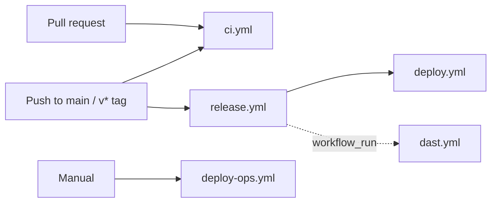

# CI/CD pipeline

GitHub Actions workflows: what runs when, what blocks a merge, how an image is built, released and deployed, and where each tool is pinned.

---

## Table of Contents

- [Overview](#overview)
- [Workflow map](#workflow-map)
- [Triggers and gates](#triggers-and-gates)
- [Advisory vs blocking](#advisory-vs-blocking)
- [Image operations](#image-operations)
- [Deploy chain](#deploy-chain)
- [Caches](#caches)
- [Where each tool is pinned](#where-each-tool-is-pinned)
- [Job map from the old GitLab pipeline](#job-map-from-the-old-gitlab-pipeline)

---

## Overview

The workflows live in `.github/workflows/`. Reusable workflows and three composite actions (`.github/actions/setup-backend`, `setup-frontend`, `cluster-access`) hold the shared steps. Repository settings that the pipeline depends on (the required check, environments, variables) are code too: [GitHub repository settings](./github-repository-settings.md) and [`scripts/github-settings.sh`](../scripts/github-settings.sh).

## Workflow map

| Workflow | Runs on | What it does |
|---|---|---|
| [`ci.yml`](../.github/workflows/ci.yml) | pull request, push to `main` and `v*`, manual | The quality gate. Jobs: `changes` (path filter), `backend`, `frontend`, `chart`, `live`, `security`, `repo`, `workflows`, and the `CI OK` gate |
| [`reusable-backend.yml`](../.github/workflows/reusable-backend.yml) | called by `ci` | `lint` (ruff format, ruff lint, mypy), `unit` (Python 3.12, 3.13 and the advisory 3.14), `integration`, `e2e` |
| [`reusable-frontend.yml`](../.github/workflows/reusable-frontend.yml) | called by `ci` | `eslint`, `prettier`, `type-check`, `openapi-drift`, `build`, `unit`, `integration`, `playwright-list` |
| [`reusable-live.yml`](../.github/workflows/reusable-live.yml) | called by `ci` | The full stack, then the backend live suite and the Playwright suite |
| [`reusable-chart.yml`](../.github/workflows/reusable-chart.yml) | called by `ci` and `deploy` | Helm lint and render for every values file |
| [`security.yml`](../.github/workflows/security.yml) | called by `ci`; weekly schedule; manual | `codeql`, `dependency-review`, `gitleaks`, `pip-audit`, and the `advisory` matrix (`osv`, `guarddog`, `checkov`, `kubescape`) |
| [`release.yml`](../.github/workflows/release.yml) | push to `main` and `v*` | `plan`, `build` (build, push, verify the digest), `digests`, `sbom`, `grype`, `grant`, `vex`, then `deploy` |
| [`deploy.yml`](../.github/workflows/deploy.yml) | called by `release` | `helm-checks`, `deploy-notice` (the skip notice), then `deploy-dev`, `deploy-qa`, `deploy-production` |
| [`deploy-ops.yml`](../.github/workflows/deploy-ops.yml) | manual | `rollback`, `history`, `cleanup` (a report) and `check` on one environment |
| [`dast.yml`](../.github/workflows/dast.yml) | after `Release` succeeds; manual | The ZAP baseline against the backend image just pushed |

`ci.yml` jobs: `repo` runs shellcheck, the secret-template check and the bats suites; `workflows` runs the CI hardening lint, actionlint and zizmor over `.github/`.

## Triggers and gates

- **Path filter.** On a pull request, the `changes` job decides whether `backend` and `frontend` run. Backend paths: `src/`, `tests/`, `alembic*`, `pyproject.toml`, `Makefile`, `frontend/lib/api/`, `.github/`, `scripts/`, `tools/`. Frontend paths: `frontend/`, `Makefile`, `.github/`, `scripts/`, `tools/`. The frontend job also runs when the backend changed, because the OpenAPI drift check needs it. On `main`, tags and manual runs everything runs.
- **Always run:** `chart`, `security`, `repo`, `workflows`.
- **`CODE_SECURITY=off`** (a repository variable, for a private copy without GitHub code security) makes `codeql` and `dependency-review` skip, and a `code-security-off` job says so in the summary. See [Platform setup](./platform-setup.md#variables-and-secrets).
- **`live`** waits for `backend` and `frontend` (a skipped one does not stop it) and runs when either side changed.
- **The required check is `CI OK`.** It depends on every blocking job and fails on any result other than success. On a pull request `backend` and `frontend` may be skipped, and `live`'s result is ignored (it is advisory there). See [GitHub repository settings](./github-repository-settings.md#required-status-checks).
- **A fork's pull request** gets a read-only token and no secrets, never pushes an image and never reaches a deploy job. Workflows never use `pull_request_target`, and every workflow starts from `permissions: {}` with job-level grants.
- **Concurrency.** A pull request run cancels the previous one; release, deploy and DAST runs are never cancelled mid-flight.

## Advisory vs blocking

| Kind | Behaviour | Jobs |
|---|---|---|
| Blocking, required | Fails the run on a finding; behind `CI OK` | ruff, mypy, unit (3.12, 3.13), integration, e2e, the frontend gates, `chart`, `codeql`, `dependency-review`, `gitleaks`, `repo`, `workflows`; `live` on `main` and tags |
| Blocking, release | Fails the release run | `build` (digest check), `grype` (threshold `policy.fail_level` in `infra/security/config.yaml`) |
| Advisory | Findings become a `::warning` annotation and a step-summary line; fails only on a tool error; never a required check | `pip-audit`, the `advisory` matrix (`osv`, `guarddog`, `checkov`, `kubescape`), `Unit (Python 3.14)`, `live` on pull requests, `grant`, `vex`, DAST |

SARIF from the scanners goes to code scanning with `continue-on-error`, so a repository without code scanning stays green and a summary line says so.

## Image operations

Build, push, sign, attest and digest resolution happen only in [`release.yml`](../.github/workflows/release.yml), on a push to `main` or a `v*` tag, never in a pull request. A pull request builds images locally for kind and never pushes.

1. `plan` renders the image matrix and the version (`.github/scripts/container_matrix.py`, manifest `.github/container-images.yml`).
2. `build` builds and pushes each image to `ghcr.io/<owner>/<repo>/<id>` with `docker/build-push-action`, then checks that the registry digest equals the build digest.
3. `digests` merges the per-image digests; `sbom`, `grype`, `grant` and `vex` all work by digest.
4. Signing and provenance attestations are delivered in a later change; until then the release ships digest-pinned, unsigned images.

Tags: the immutable `<version>-<channel>-<sha>` on every release run, plus `latest` on a `v*` tag. See [Containerization](./containerization.md) and [Releasing](./releasing.md).

## Deploy chain

`release.yml` calls `deploy.yml` with the verified digests. Everything is skipped, with a summary line saying why, unless the repository variable `DEPLOY_ENABLED` is `true`, so a fresh fork with no cluster stays green.

1. `helm-checks` lints and renders the chart.
2. `deploy-dev`, then `deploy-qa` (only after dev succeeded, and only if `DEPLOY_ENVS` is empty or lists `qa`; `DEPLOY_ENVS` gates nothing else), then `deploy-production` (only on a `v*` tag with an immutable tag, after dev succeeded and after QA succeeded or was skipped by `DEPLOY_ENVS`, behind the `production` environment's required reviewer).
3. Each job runs [`scripts/ci/deploy-env.sh`](../scripts/ci/deploy-env.sh): it records the last deployed Helm revision, runs `helm upgrade --install --rollback-on-failure --wait` by digest, then [`scripts/ci/deploy-verify.sh`](../scripts/ci/deploy-verify.sh) (pods, endpoints, running image digest equals the expected one) and the smoke test. If verify or smoke fails, it **rolls back to the recorded revision** and fails the job.
4. Cluster access comes from [`.github/actions/cluster-access`](../.github/actions/cluster-access/action.yml): Workload Identity Federation by default (`DEPLOY_MODE=gke`), or a kubeconfig from the environment secret `KUBECONFIG_B64`. A job that logs in declares `environment:`.
5. [`deploy-ops.yml`](../.github/workflows/deploy-ops.yml) is the manual follow-up: `rollback` (needs the input `confirm` set to `ROLLBACK`; empty `revision` means the previous one), `history`, `cleanup` (a report; Helm has no per-revision removal) and `check` (proves the login and the deployer's rights, read-only).

Setup of the cloud side: [GKE cluster setup](./gke-cluster-setup.md), [Cloudflare setup](./cloudflare-setup.md) and [Platform setup](./platform-setup.md). Runbook: [Operations runbook](./operations-runbook.md).

## Caches

| Cache | Key | Saved by |
|---|---|---|
| pip (`setup-backend`) | `pip-<os>-<python>-<hash of pyproject.toml>` | a push to `main` only |
| npm (`setup-frontend`) | `npm-<os>-<node>-<hash of frontend/package-lock.json>` | a push to `main` only |
| dev tools (`.tools/`) | `tools-<os>-<hash of tools/pins.tsv>` | a push to `main` only |
| image layers | the GitHub Actions cache, scoped per image id | `release.yml` (`mode=max`) |

Pull requests and tags restore caches and never save them, so a pull request cannot poison what `main` restores.

## Where each tool is pinned

| What | Where |
|---|---|
| Third-party actions | the `uses:` line, a full 40-character SHA with a `# vX.Y.Z` comment (Renovate keeps them current) |
| Dev tools (shellcheck, bats, yq, actionlint, helm, kubectl, node) | `tools/pins.tsv`, with checksums, installed by `scripts/tools.sh` |
| Python tools (zizmor, pip-audit, yamllint, ...) | `tools/requirements/*.txt`, hash-pinned; `pyyaml.txt` is the PyYAML for `container_matrix.py` in the release `plan` and deploy jobs (no setup-python there), installed into a venv and called by full path |
| Security tools (syft, grype, grant, osv-scanner, kubescape, ...) | `infra/security/config.yaml`, installed by `infra/security/tools-install.sh` |
| The ZAP image | `infra/security/config.yaml` (`dast.zap_image`), by tag and digest |
| Container base images | the `FROM` lines of the Dockerfiles, by `@sha256:` digest |
| Licence allowlist | `infra/security/grant.yaml` |

`infra/security/check-ci-hardening.sh` (run by the `workflows` job) fails when a workflow regresses on these rules.

---

## Job map from the old GitLab pipeline

The template used to run on GitLab CI (`ci/*.yml`). Every old job key is mapped below, once; the blocking column reads old -> new. Keys that start with a dot were hidden templates (`extends:` bases), not jobs; the docs also used the aliases `deploy:k8s` (for `deploy:dev`, `deploy:qa` and `deploy:production`) and `frontend:e2e` (for `frontend:e2e-validate`).

| Old job | New workflow / job | Blocking (old -> new) | Note |
|---|---|---|---|
| `ruff` | `reusable-backend.yml` / `lint` | blocking -> blocking | format check and lint |
| `mypy` | `reusable-backend.yml` / `lint` | blocking -> blocking | |
| `openapi-drift` (Python file) | `reusable-frontend.yml` / `openapi-drift` | blocking -> blocking | one check now, with `frontend:openapi-drift` below |
| `check-secrets` | `ci.yml` / `repo` | blocking -> blocking | `scripts/ci/check-secrets.sh` |
| `shellcheck` | `ci.yml` / `repo` | blocking -> blocking | `scripts/ci/shell-lint.sh` |
| `test:security-local` | `ci.yml` / `repo` | blocking -> blocking | the bats suites under `infra/security/local/tests/` and `tests/scripts/` |
| `.base_python`, `.unit_template`, `.frontend_base` | `.github/actions/setup-backend`, `setup-frontend`, the reusable workflows | template -> template | hidden bases became composite actions and reusable workflows |
| `python-3.12-unit`, `python-3.13-unit` | `reusable-backend.yml` / `unit` (matrix) | blocking -> blocking | 3.14 is added as an advisory leg |
| `integration` | `reusable-backend.yml` / `integration` | blocking -> blocking | |
| `e2e` | `reusable-backend.yml` / `e2e` | blocking -> blocking | in-process ASGI |
| `live` | `reusable-live.yml` / `live` | blocking on push and tags, advisory on merge requests -> blocking on `main` and tags, advisory on pull requests | same split as before; now one job runs the backend and the Playwright live suites |
| `frontend:eslint`, `frontend:prettier`, `frontend:type-check` | `reusable-frontend.yml` / `eslint`, `prettier`, `type-check` | blocking -> blocking | |
| `frontend:openapi-drift` | `reusable-frontend.yml` / `openapi-drift` | blocking -> blocking | `make openapi-drift-check` |
| `frontend:build` | `reusable-frontend.yml` / `build` | blocking -> blocking | |
| `frontend:unit`, `frontend:integration` | `reusable-frontend.yml` / `unit`, `integration` | blocking -> blocking | |
| `frontend:e2e-validate` (alias `frontend:e2e`) | `reusable-frontend.yml` / `playwright-list` | advisory (manual) -> blocking | validates the Playwright config |
| `frontend:live` | `reusable-live.yml` / `live` | advisory (manual) -> advisory on pull requests, blocking on `main` and tags | now automatic, merged into the one live job |
| `compute-version` | `release.yml` / `plan` | blocking -> blocking | `.github/scripts/container_matrix.py` |
| `docker:build-push` | `release.yml` / `build` | blocking -> blocking | `main` and `v*` only |
| `verify:registry` | `release.yml` / `build` (digest step) and `digests` | blocking -> blocking | |
| `helm:lint` | `reusable-chart.yml` / `chart` (called by `ci` and `deploy`) | blocking on MRs -> blocking | |
| `.deploy` (template), `deploy:dev`, `deploy:qa` (alias `deploy:k8s`) | `deploy.yml` / `deploy-dev`, `deploy-qa` | blocking -> blocking, only when `DEPLOY_ENABLED` is `true` | |
| `deploy:production` (alias `deploy:k8s`) | `deploy.yml` / `deploy-production` | manual -> required reviewer on the `production` environment | `v*` tag only |
| `.verify` (template), `dev:verify`, `qa:verify`, `production:verify` | `scripts/ci/deploy-verify.sh`, run inside each deploy job | blocking -> blocking | compares the running digest |
| `.smoke` (template), `dev:smoke`, `qa:smoke`, `production:smoke` | the smoke step of `scripts/ci/deploy-env.sh` | blocking -> blocking | a failure rolls back to the recorded revision |
| `deploy:rollback` | `deploy-ops.yml` / operation `rollback` | manual -> manual | needs `confirm: ROLLBACK` |
| `deploy:history` | `deploy-ops.yml` / operation `history` | advisory -> advisory | |
| `deploy:cleanup` | `deploy-ops.yml` / operation `cleanup` | advisory -> advisory | now a report that deletes nothing |
| `sast` | `security.yml` / `codeql` | blocking -> blocking | CodeQL `security-extended` |
| `secret_detection` | `security.yml` / `gitleaks` | blocking -> blocking | |
| `dependency_scanning` | `security.yml` / `dependency-review` | blocking -> blocking | pull requests only |
| `pip_audit` | `security.yml` / `pip-audit` | advisory -> advisory | |
| `osv_scan` | `security.yml` / `advisory`, leg `osv` | advisory -> advisory | |
| `malware_heuristic_scan` | `security.yml` / `advisory`, leg `guarddog` | advisory -> advisory | |
| `iac_scan` | `security.yml` / `advisory`, leg `checkov` | advisory -> advisory | |
| `k8s_scan` | `security.yml` / `advisory`, leg `kubescape` | advisory -> advisory | |
| `sbom_consolidated` | `release.yml` / `sbom` | blocking -> blocking | by digest, never on pull requests |
| `grype_scan` | `release.yml` / `grype` | blocking on protected refs -> blocking | threshold from `config.yaml` |
| `grant_license_scan` | `release.yml` / `grant` | advisory -> advisory | |
| `vex:generate` | `release.yml` / `vex` | advisory -> advisory | |
| `dast_scan` | `dast.yml` / `dast` | advisory -> advisory | |
| `ci:hardening-selfcheck` (in the docs, not in the YAML) | `ci.yml` / `workflows` | blocking -> blocking | hardening lint plus actionlint and zizmor |
| `malware_scan` (retired in the old tree) | retired | n/a | replaced by OSV-Scanner `MAL-*` |
| `cosign:sign`, `cosign:attest` (parked in the old tree) | retired | n/a | delivered as GitHub attestations in a later change |
| `publish_sbom_registry` (removed) | retired | n/a | the package registry has no GitHub equivalent |
| self-hosted runner for `live` | retired | n/a | GitHub-hosted runners |
