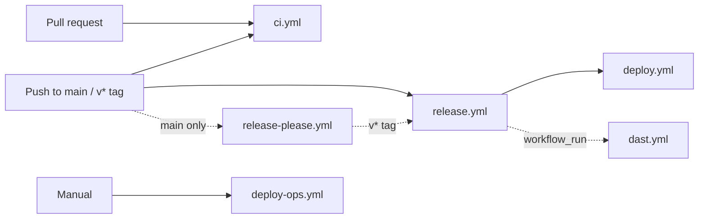
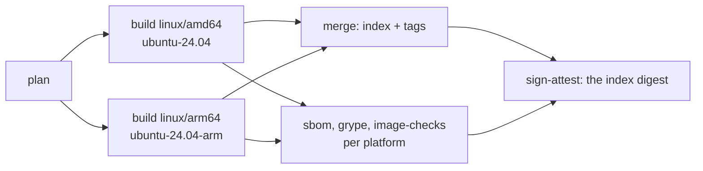

# CI/CD pipeline

GitHub Actions workflows: what runs when, what blocks a merge, how an image is built, released and deployed, and where each tool is pinned.

---

## Table of Contents

- [Overview](#overview)
- [Workflow map](#workflow-map)
- [Triggers and gates](#triggers-and-gates)
- [Advisory vs blocking](#advisory-vs-blocking)
- [Image operations](#image-operations)
- [Deploy chain](#deploy-chain)
- [Pull request previews](#pull-request-previews)
- [Live drift](#live-drift)
- [AI pull request review](#ai-pull-request-review)
- [Documentation site](#documentation-site)
- [The adopted copy](#the-adopted-copy)
- [Caches](#caches)
- [Where each tool is pinned](#where-each-tool-is-pinned)
- [Job map from the old GitLab pipeline](#job-map-from-the-old-gitlab-pipeline)

---

## Overview

The workflows live in `.github/workflows/`. Reusable workflows and three composite actions (`.github/actions/setup-backend`, `setup-frontend`, `cluster-access`) hold the shared steps. Repository settings that the pipeline depends on (the required check, environments, variables) are code too: [GitHub repository settings](./github-repository-settings.md) and [`scripts/github-settings.sh`](../scripts/github-settings.sh).

## Workflow map

| Workflow | Runs on | What it does |
|---|---|---|
| [`ci.yml`](../.github/workflows/ci.yml) | pull request, push to `main` and `v*`, manual | The quality gate. Jobs: `changes` (path filter), `backend`, `frontend`, `chart`, `live`, `security`, `repo`, `hadolint`, `api-compat` (the oasdiff gate), `workflows`, `adopted` (an adopted copy's own suites, [The adopted copy](#the-adopted-copy)), `pins` (pin drift), `image-plan` and `images` (the image structure checks, pull requests only), `kind` (the chart in a real cluster, pull requests only), `docs-site` (the documentation site), and the `CI OK` gate |
| [`reusable-backend.yml`](../.github/workflows/reusable-backend.yml) | called by `ci` | `lint` (ruff format, ruff lint, mypy, the env-docs check, squawk), `unit` (Python 3.12, 3.13 and the advisory 3.14), `integration` (with the contract tests) and `e2e`, both on a PostgreSQL service container |
| [`reusable-frontend.yml`](../.github/workflows/reusable-frontend.yml) | called by `ci` | `eslint`, `prettier`, `type-check`, `openapi-drift` (with the pnpm settings and build-script guard), `build`, `unit`, `integration`, `playwright-list`, `a11y` (axe, blocking) and `lighthouse` (Lighthouse CI, advisory) |
| [`reusable-docs-site.yml`](../.github/workflows/reusable-docs-site.yml) | called by `ci` and `docs-site` | `build`: the documentation site's resolver tests, strict build and axe scan; for `docs-site`, the Pages artifact too. `guards` (every `ci` call, never the Pages run): the site's configuration tests. See [Documentation site](#documentation-site) |
| [`docs-site.yml`](../.github/workflows/docs-site.yml) | push to `main` that changes the site's inputs; manual | `pages` (is Pages on, with Source: GitHub Actions?), `build`, then `deploy` to GitHub Pages. See [Documentation site](#documentation-site) |
| [`reusable-live.yml`](../.github/workflows/reusable-live.yml) | called by `ci` | The full stack, then the backend live suite and the Playwright suite |
| [`reusable-kind.yml`](../.github/workflows/reusable-kind.yml) | called by `ci` on pull requests | The chart in a kind cluster on two pinned node images (the `kubeVersion` floor and kind's newest): the images built locally, the admin bootstrap, `ct lint` and `ct install`, the pull request's base chart upgraded to its head as the deployer, `helm test`, the WAF and the deployer's rights ([Infrastructure](./infrastructure.md#local-cluster-kind)) |
| [`reusable-chart.yml`](../.github/workflows/reusable-chart.yml) | called by `ci` and `deploy` | `ct lint` (settings in `.github/ct.yaml`: yamllint with `.github/ct-lintconf.yaml`, Chart.yaml schema `.github/ct-chart-schema.yaml`; yamllint and yamale come from hashed locks in `$RUNNER_TEMP` venvs, since runners have no uv), then Helm lint and render for every values file, the vendored CRD schemas checked against their pinned sources, `kubeconform -strict` over every render, offline ([Infrastructure](./infrastructure.md#validating-every-render-kubeconform)), and `make rules-test`: the rules of both monitoring flavours through the pinned `promtool` ([Infrastructure](./infrastructure.md#checking-the-rules-promtool)) |
| [`security.yml`](../.github/workflows/security.yml) | called by `ci`; weekly schedule; manual | `codeql`, `dependency-review` (or `code-security-off`, a notice, when the variable `CODE_SECURITY` is `off`), `gitleaks`, `pip-audit`, and the `advisory` matrix (`osv`, `guarddog`, `checkov`, `kubescape`) |
| [`release.yml`](../.github/workflows/release.yml) | push to `main` and `v*` | `plan`, `images` (calls `reusable-build.yml`), `chart` (`v*` tags; calls `reusable-chart-release.yml`), `digests`, `grant`, `vex`, `release-assets` (`v*` tags), then `deploy` |
| [`reusable-build.yml`](../.github/workflows/reusable-build.yml) | called by `release` | `build` (one leg per image and platform, on that platform's native runner: push by digest, verify it), `merge` (one leg per image: the index, the tags, the index digest), `sbom` and `grype` (blocking gate; per platform), `image-checks` (the structure checks on each platform's pushed digest, natively), `sign-attest` (signs the index and attests its provenance), `attest-sbom` (one leg per image and platform: that platform's SBOM attestation, after the same gate) |
| [`reusable-chart-release.yml`](../.github/workflows/reusable-chart-release.yml) | called by `release` (`v*` tags, after `images`) | `chart` (the chart packaged at the tag's version, pushed to `ghcr.io/<owner>/<repo>/charts`, signed and attested; only `release-assets` waits for it; see [Releasing, The chart](./releasing.md#the-chart)) |
| [`release-please.yml`](../.github/workflows/release-please.yml) | push to `main` | `release-please` (in the `release` environment, with the release GitHub App's token: the release pull request, and on its merge the `v*` tag and a draft release), or `notice` when `RELEASE_APP_ID` is unset. See [Creating a Release](./releasing.md#creating-a-release) |
| [`pr-title.yml`](../.github/workflows/pr-title.yml) | pull request (opened, edited, synchronize, reopened, labeled, unlabeled) | `title`: the title must be a Conventional Commit, because a squash merge makes it the commit message on `main`, and with the `breaking-change` label it must carry the `!` ([API lifecycle](./api-lifecycle.md)). Reads only the event; never behind `CI OK`, since an edit re-runs it without a commit, so it is a required check of its own. See [Releasing, Pull request titles](./releasing.md#pull-request-titles) |
| [`deploy.yml`](../.github/workflows/deploy.yml) | called by `release` | `helm-checks`, `deploy-notice` (the skip notice), then `deploy-dev`, `deploy-qa`, `deploy-production` |
| [`preview.yml`](../.github/workflows/preview.yml) | pull request (labelled, unlabelled, synchronize, reopened, closed); daily (04:23 UTC) | Off unless `PREVIEWS_ENABLED` is `true`: `digests` and `deploy` (a `preview`-labelled same-repository pull request's preview), `bot-skip` (a notice instead, for a run Dependabot starts), `cleanup` (closed or unlabelled), `open-prs` and `sweep` (the daily TTL cleanup). Never a check. See [Pull request previews](#pull-request-previews) |
| [`pr-agent.yml`](../.github/workflows/pr-agent.yml) | pull request (opened, reopened, ready for review); a pull request comment | Off unless `PR_AGENT_ENABLED` is `true`: `gate` (decides, with no secret), then `review` (advisory, never required; same-repository pull requests and collaborators' slash commands). See [AI pull request review](#ai-pull-request-review) |
| [`deploy-ops.yml`](../.github/workflows/deploy-ops.yml) | manual | `ops`: one operation (`rollback`, `history`, `cleanup`, a report, or `check`) on one environment |
| [`reusable-pins.yml`](../.github/workflows/reusable-pins.yml) | called by `ci` and `pins-drift` | `pins`: `scripts/pins-refresh.sh --check` (read-only): `mise.lock` against `mise.toml` for both platforms (offline) and each `github:` tool's locked checksum against its vendor's file, then the `tools/pins.tsv` rows against the vendors' published checksums; on a pull request only the rows that differ from the base. See [dependency updates](./security.md#dependency-updates-and-pinned-checksums) |
| [`pins-drift.yml`](../.github/workflows/pins-drift.yml) | weekly (Monday 04:41 UTC); manual | `pins` over every row |
| [`scorecard.yml`](../.github/workflows/scorecard.yml) | weekly (Monday 03:17 UTC); push to `main` | `analysis`: the OpenSSF Scorecard, published and uploaded as SARIF. Public repositories only; never a gate |
| [`rescan.yml`](../.github/workflows/rescan.yml) | weekly (Wednesday 05:41 UTC); manual | `collect` (digests from deployments and the latest release), `scan` (Grype by digest, no VEX), `report` (opens or updates `vuln` issues). See [vulnerability management](./vulnerability-management.md) |
| [`drift.yml`](../.github/workflows/drift.yml) | weekly (Thursday 06:23 UTC); manual | `collect` (what each environment's latest deployment applied), `drift` (one leg per environment, as its read-only `drift-<env>` identity: the deployed commit's render against the live objects), `report` (opens or updates `drift` issues). Each environment skips with a summary line until its drift identity is set up. See [Live drift](#live-drift) |
| [`dast.yml`](../.github/workflows/dast.yml) | after `Release` succeeds; manual | The ZAP baseline against the backend image just pushed |

`ci.yml` jobs: `repo` runs shellcheck, the secret-template check, the offline doc link check (`make docs-links`: the pinned lychee over the docs, file links and in-repo anchors only, [`lychee.toml`](../lychee.toml)), the bats suites, the admission policy tests and the tree-wide guards (`pytest -m tree_wide`, the tests that read every tracked file, on every pull request); `hadolint` lints every tracked Dockerfile with the pinned hadolint (`scripts/ci/hadolint.sh`, also a git hook); `workflows` runs the CI hardening lint, actionlint and zizmor over `.github/`; `image-plan` and `images` build each image of the manifest into the runner's local daemon and run `scripts/ci/image-checks.sh --strict` on it (see [Image structure checks](./containerization.md#image-structure-checks)).

## Triggers and gates

- **Path filter.** On a pull request, the `changes` job decides whether `backend` and `frontend` run. Backend paths: `src/`, `tests/`, `alembic*`, `pyproject.toml`, `uv.lock`, `Makefile`, `frontend/lib/api/`, `frontend/package*.json`, `.github/`, `scripts/`, `infra/`, `tools/`, `deploy/`, `wiki/`, `.devcontainer/`, `renovate.json5`, `.pr_agent.toml`, `lychee.toml`, the release-please files and the root files the suite reads (Dockerfiles, `.dockerignore`, `docker-compose.yml`, `run_backend.sh`, `.env.example`, `.gitignore`, `.gitleaksignore`, `.pre-commit-config.yaml`, `README.md` and the other root docs, `LICENSE`), `charts/`, `agent/skills/`, `docs-site/site.json`, `docs-site/src/content/` and the few `frontend/` files it reads (the Node version pins, `static-paths.ts`, the Lighthouse, Playwright and Vitest configs, the a11y spec) (every root `make ruff-lint` covers, and every file the backend suite's guards read). Frontend paths: `frontend/`, `Makefile`, `.github/`, `scripts/`, `tools/`. The frontend job also runs when the backend changed, because the OpenAPI drift check needs it. On `main`, tags and manual runs everything runs.
- **`pins`** runs on a pull request only when `tools/pins.tsv`, `mise.toml`, `mise.lock`, `tools/requirements/`, `infra/security/config.yaml` or the refresh script changed; on `main`, tags and manual runs it always does.
- **`kind`** runs on a pull request only, when the chart, the bootstrap, a path the images copy in, a Dockerfile, `deploy/policies/`, the kind and live tests (`tests/k8s/`, `tests/live/`, `tests/utils/`, `tests/conftest.py`), `.github/`, `scripts/`, `tools/` or the `Makefile` changed. It builds the images into the runner's daemon through the images job's build path (`scripts/ci/build-image.sh`), with no push, registry or cache; building them there, rather than handing over the `images` job's, keeps it independent of that job's path filter and avoids moving image archives between jobs.
- **`image-plan` and `images`** run on a pull request only, when a path the Dockerfiles copy in (`src/`, `frontend/`, `pyproject.toml`, `uv.lock`, `alembic.ini`, `README.md`, `LICENSE`, `VERSION`, `.dockerignore`), a Dockerfile, `.github/`, `scripts/` or `tools/` changed. A push to `main` or a `v*` tag skips them: the release build checks the pushed image instead. They never log in, push, read a secret or use a build cache.
- **`docs-site`** runs on a pull request when `docs-site/`, any Markdown file, `tools/pins.tsv`, `mise.toml`, `mise.lock`, `.github/` or `scripts/` changed, or when a file was deleted or renamed: a loaded page may link any tracked file.
- **Always run:** `chart`, `security`, `repo`, `hadolint`, `api-compat`, `workflows`, `adopted`. `api-compat` skips itself with a summary line on a push.
- **Label events.** `labeled` and `unlabeled` are pull request event types, and on them every job runs as on any other event (a test asserts no job's `if:` looks at the event action), so `CI OK` can never pass over a failing test job. They exist because `api-compat` reads the `breaking-change` label ([API lifecycle](./api-lifecycle.md)).
- **`CODE_SECURITY=off`** (a repository variable, for a private copy without GitHub code security) makes `codeql` and `dependency-review` skip, and a `code-security-off` job says so in the summary. See [Platform setup](./platform-setup.md#variables-and-secrets).
- **`live`** waits for `backend` and `frontend` (a skipped one does not stop it) and runs when either side changed.
- **The required checks are `CI OK` and `PR title (Conventional Commits)`.** `CI OK` depends on every blocking job and fails on any result other than success. On a pull request `backend`, `frontend`, `pins` and `docs-site` may be skipped (their path filter), `image-plan`, `images` and `kind` may be skipped on any event (they run on pull requests only, behind their path filters), and `live`'s result is ignored (it is advisory there). See [GitHub repository settings](./github-repository-settings.md#required-status-checks).
- **A fork's pull request** gets a read-only token and no secrets, never pushes an image and never reaches a deploy job. Workflows never use `pull_request_target`, and every workflow starts from `permissions: {}` with job-level grants.
- **Concurrency.** A pull request run cancels the previous one; release, deploy and DAST runs are never cancelled mid-flight.

## Advisory vs blocking

| Kind | Behaviour | Jobs |
|---|---|---|
| Blocking, required | Fails the run on a finding; behind `CI OK` | ruff, mypy, unit (3.12, 3.13), integration, e2e, the frontend gates, `chart`, `codeql`, `dependency-review`, `gitleaks`, `repo` (its steps: [Workflow map](#workflow-map)), `hadolint`, `api-compat`, `workflows`, `adopted`, `pins`, `image-plan`, `images` (image structure checks, pull requests only), `kind` (pull requests only), `docs-site`; `live` on `main` and tags |
| Blocking, release | Fails the release run (`main` and `v*` tags, where the images exist; a pull request builds no image to scan, so none of these runs there) | `build` (digest check), `image-checks` (structure checks on the pushed digest, before signing), `grype` (threshold `policy.fail_level` in `infra/security/config.yaml`) |
| Advisory | Findings become a `::warning` annotation and a step-summary line; fails only on a tool error; never a required check | `pip-audit`, the `advisory` matrix (`osv`, `guarddog`, `checkov`, `kubescape`), `Unit (Python 3.14)`, `live` on pull requests, `grant`, `vex`, DAST |

SARIF from the scanners goes to code scanning with `continue-on-error`, so a repository without code scanning stays green and a summary line says so.

## Image operations

Build, push, sign, attest and digest resolution happen only in [`reusable-build.yml`](../.github/workflows/reusable-build.yml), called by [`release.yml`](../.github/workflows/release.yml) on a push to `main` or a `v*` tag, never in a pull request. A pull request only builds images into its local daemon, in the `images` job, to check their structure ([Image structure checks](./containerization.md#image-structure-checks)); it never pushes.

1. `plan` renders the image matrix and the version (`.github/scripts/container_matrix.py`, manifest `.github/container-images.yml`).
2. `images` calls `reusable-build.yml`, which is the only workflow that may push, sign or attest an image (the hardening lint enforces it). Its `build` job runs one leg per image and platform, each on that platform's native runner, and pushes the platform image to `ghcr.io/<owner>/<repo>/<id>` by digest, with no tag, using `docker/build-push-action`; it checks that the registry digest equals the build digest. Then `merge` runs once per image: `docker buildx imagetools create` builds the index from the platform digests, applies the tags and resolves the index digest, which becomes the image's `digest-<id>` artifact (what `digests`, `deploy`, the VEX and the release assets use).
3. `sbom`, `grype` (the blocking gate) and `image-checks` run per platform, by that platform's digest; `image-checks` runs on the platform's native runner, so the container runs natively. `sign-attest` runs only after every image and platform passed `grype` and `image-checks`: it signs the **index digest** keyless with the pinned cosign, runs `cosign verify` against the workflow identity, then adds the provenance attestation for the index digest (`push-to-registry`). `attest-sbom` runs one leg per image and platform from the same matrix as the scans, after the same gate and the merge, and attests that platform's SBOM against that platform's manifest digest; adding a platform to the manifest adds its leg, with no workflow edit. An image that fails the gate stays in the registry unsigned, and nothing deploys it. The identity and how to verify by hand are in [Security](./security.md#verifying-an-image).
4. Every `reusable-build.yml` job refuses to run unless the caller's event is a push to `main` or a `v*` tag. `digests` merges the per-image digests; `grant`, `vex` and `deploy` run after `images`, so nothing deploys unless the gate passed and the images are signed.
5. `grant` and `vex` now start only after `images` succeeded, so a release that fails the gate leaves no licence or VEX evidence (by design). On a `v*` tag `release-assets` puts the SBOMs, the OpenVEX document, the licence report, the image digests (`image-digests.env`, `scan.env`), the chart's reference (`chart.env`) and `provenance.md` (every signed digest and how to verify it) on a **draft** GitHub Release (created with `--verify-tag`, never published by the workflow).

Two network-bound steps retry a transient failure, bounded: the `merge` job's `imagetools create` (it builds from exact digests, so a repeat is safe) and the Playwright install, which is two steps, each with its own timeout and [`scripts/ci/retry.sh`](../scripts/ci/retry.sh).

Tags: the immutable `<version>-<channel>-<sha>` on every release run, plus `latest` on a final `v*` tag (never a pre-release such as `v1.2.3-rc.1`); both point at the index.

### Multi-architecture flow

- The platforms an image supports are the `platforms` list of its entry in `.github/container-images.yml`; the manifest's `runners` map names the native runner of each platform. Nothing else names a runner for a platform, and no job uses QEMU or `binfmt`: a platform is built and structure-checked only on a runner of its own architecture. The SBOM, the Grype scan and the SBOM attestation are static and run per platform on `ubuntu-24.04`.
- The repository variable `BUILD_ARM64` turns arm64 on (`true`). Unset, as in a fresh fork, only `linux/amd64` builds and the `plan` summary says arm64 was skipped and why; the flow is the same code path with one platform, and the index then holds one manifest.
- Pull requests build and check `linux/amd64` only, whatever the variable says (the `images` job). arm64 is checked natively on the release path, on `main` and `v*` tags.
- The per-platform artifacts are `platform-<id>.<platform>` (digests), `sbom-<id>.<platform>` and `grype-<id>.<platform>`; the SARIF category is `grype-<id>-<platform>`. The release assets carry one SBOM per image and platform, and the OpenVEX document merges the platforms' findings per image, pinned by the index digest.
- The weekly re-scan reads the index digest, lists the platforms of the index and runs Grype on each (`scripts/ci/rescan-scan.sh`), merging the matches into one findings file per image, so a finding that exists only on arm64 opens an issue too. See [Containerization](./containerization.md) and [Releasing](./releasing.md).

## Deploy chain

`release.yml` calls `deploy.yml` with the verified digests. Everything is skipped, with a summary line saying why, unless the repository variable `DEPLOY_ENABLED` is `true`, so a fresh fork with no cluster stays green.

1. `helm-checks` lints and renders the chart.
2. `deploy-dev`, then `deploy-qa` (only after dev succeeded, and only if `DEPLOY_ENVS` is empty or lists `qa`; `DEPLOY_ENVS` gates nothing else), then `deploy-production` (only on a `v*` tag with an immutable tag and no pre-release suffix, [Pre-release Tags](./releasing.md#pre-release-tags), after dev succeeded and after QA succeeded or was skipped by `DEPLOY_ENVS`, behind the `production` environment's required reviewer).
3. Each job installs the pinned Helm 4 (`helm4` in [`mise.toml`](../mise.toml), locked with a sha256 in `mise.lock`, Renovate-bumped; `scripts/tools.sh install helm4`, first on `PATH`, so a runner's own Helm is never used), then runs [`scripts/ci/deploy-env.sh`](../scripts/ci/deploy-env.sh): it records the last deployed Helm revision, runs the Helm upgrade by digest, waiting up to `HELM_TIMEOUT` with `--rollback-on-failure` (the flags are in the script; `--rollback-on-failure` is Helm 4's name for 3's `--atomic`: Helm rolls a failed upgrade back and uninstalls a failed first install, and the script prints the failed migration Job's logs), then [`scripts/ci/deploy-verify.sh`](../scripts/ci/deploy-verify.sh) (pods, health routes over a port-forward, running image digest equals the expected one) and the smoke test. If verify or smoke fails, it **rolls back to the recorded revision** and fails the job.
4. Cluster access comes from [`.github/actions/cluster-access`](../.github/actions/cluster-access/action.yml): Workload Identity Federation by default (`DEPLOY_MODE=gke`), or a kubeconfig from the environment secret `KUBECONFIG_B64`. A job that logs in declares `environment:`.
5. **Deployment records.** Each deploy job declares its environment with `url: ${{ vars.DEPLOY_URL }}` (an optional environment variable, [Platform setup](./platform-setup.md#variables-and-secrets)), so GitHub records one deployment per job in that environment's history, linking the URL, with the job's result: *success* when the upgrade, verify and smoke passed; *failure* when any of them failed, a failed verify or smoke that the script rolled back included (the record does not say it rolled back: the job's log and step summary name the revision it returned to). A `rollback` from `deploy-ops.yml` records its own deployment (the other operations record none).
6. [`deploy-ops.yml`](../.github/workflows/deploy-ops.yml) is the manual follow-up: `rollback` (needs the input `confirm` set to `ROLLBACK`; empty `revision` means the previous one), `history`, `cleanup` (a report; Helm has no per-revision removal) and `check` (proves the login and the deployer's rights, read-only).

**The deploy always wins over a hand edit.** Helm 4 applies server-side, and a hand edit (`kubectl scale`, `set image`, `set env`, `edit`, `patch`) makes kubectl's field manager own the field it changed; without more, the next upgrade would fail on that conflict, and its automatic rollback the same way. Every Helm upgrade and rollback the template runs (`deploy-env.sh`, `deploy-ops.yml`'s `rollback`, the previews, `k8s-env.sh`, `kind-deploy.sh`, `migrate-to-bootstrap.sh`) passes `--force-conflicts` and takes the field back; server-side apply stays on ([`tests/supply_chain/test_helm_force_conflicts.py`](../tests/supply_chain/test_helm_force_conflicts.py)). The chart never sets a field another controller owns at runtime, so the deploy never fights one: with the HPA on, a Deployment renders no `replicas`, and with External Secrets the chart renders no Secret the operator writes ([`runtime_owners_test.yaml`](../charts/your-service-name/tests/runtime_owners_test.yaml)). The weekly [live-drift check](#live-drift) reports a hand edit before the next deploy reverts it; a fix made by hand during an incident must be made permanent in the values (or the chart), or the next deploy undoes it ([Operations runbook](./operations-runbook.md#hand-edits-and-the-next-deploy)).

Every Helm wait of a deploy path is below the backend's `rollout.progressDeadlineSeconds`, or a retry after a failed first install fails on a stale `ProgressDeadlineExceeded` ([Proven on kind](./database.md#proven-on-kind)); [`tests/supply_chain/test_deploy_timeouts.py`](../tests/supply_chain/test_deploy_timeouts.py) checks each. Keep a `HELM_TIMEOUT` you set below it too.

### Proven on kind

[`tests/k8s/test_deploy_env.py`](../tests/k8s/test_deploy_env.py) runs `deploy-env.sh` itself on the local kind cluster, on a release and namespaces of its own. After `make kind-up kind-deploy`, run it with `make kind-deploy-env-test` (it stops at the first failure); CI runs it on the kind job's newest leg ([Local cluster (kind)](./infrastructure.md#local-cluster-kind)). The kind job's images are pushed to a throwaway TLS registry on the kind network (the admission test's), so the script deploys them by registry digest, as the deploy jobs do, with the placeholder guard on, as the deployer and with the deploy workflow's default `HELM_TIMEOUT`. In order:

| Case | What it shows |
|------|---------------|
| First install | revision 1 deployed, the backend Pods run the pushed digest, verify and smoke pass; the WAF, off, deploys without a digest |
| No-op upgrade | the script records revision 1 and deploys revision 2 with no rollback |
| Failed upgrade | the migration fails on purpose: Helm rolls back to revision 2 itself, the script prints the failed Job's logs and fails before verify, and revision 2's Pods keep serving |
| Failed verify | the upgrade succeeds, then the real `deploy-verify.sh` finds a wrong image (it is told to expect the frontend's digest on the backend): the script rolls back to the revision it recorded, skips the smoke and fails |
| Failed first install, then a retry | Helm uninstalls the failed install and keeps the Failed Job; the retry deletes that Job itself and installs revision 1, nothing removed by hand |

The script takes the kind cluster only through a test-only seam: `DEPLOY_ENV=kind` with `DEPLOY_ENV_KIND_TEST=1`, refused without the flag and unless the kubeconfig's one context is `kind-fst` ([`tests/scripts/deploy-env.bats`](../tests/scripts/deploy-env.bats)); no workflow sets either ([`tests/supply_chain/test_workflows_deploy.py`](../tests/supply_chain/test_workflows_deploy.py)). It uses `values.local.yaml` and the kind values file [`tests/k8s/deploy-env-kind.yaml`](../tests/k8s/deploy-env-kind.yaml) instead of `values.<env>.yaml`. The migration lifecycle's failed first install runs the script the same way ([Proven on kind](./database.md#proven-on-kind)).

Setup of the cloud side: [GKE cluster setup](./gke-cluster-setup.md), [Cloudflare setup](./cloudflare-setup.md) and [Platform setup](./platform-setup.md). Runbook: [Operations runbook](./operations-runbook.md).

## Pull request previews

Optional, and off by default: [`preview.yml`](../.github/workflows/preview.yml) does nothing unless the repository variable `PREVIEWS_ENABLED` is `true`, and the cluster has no preview namespace until an admin bootstraps one. With both, a pull request from this repository (never a fork; the head and base repository ids must be equal) that carries the `preview` label gets a preview on the dev cluster, redeployed on every push, and removed when it is closed or the label comes off.

**What a preview is, and is not.** It deploys the pull request's **chart and values** with the **images dev runs**: built, signed and attested on `main` (or a `v*` tag), by digest, read from dev's latest successful deployment record (`scripts/rescan_collect.py --deployed dev`, the re-scan's reader). After a `rollback` of dev from `deploy-ops.yml`, that latest record is the rollback's, which carries no digests, so every preview deploy fails (`--deployed dev` exits non-zero) until dev's next deploy from the release workflow: merge a fix to `main` (or re-run the dev deploy job of the release run whose images dev should run), and the previews read that. It never builds or runs an image from the pull request: image operations never run in a pull request (rule 5 of [`AGENTS.md`](../AGENTS.md)), and the [admission policy](./admission-control.md) admits this repository's images only with the release build's signature. So a preview shows the pull request's chart, values and Helm-side changes, and the migrations as the main image ships them; **not its application code changes**. A pull request that changes the backend or the frontend shows them only once merged.

**One namespace, one release per pull request.** Each preview is the Helm release `<SERVICE_NAME>-pr-<N>` in the one namespace `<SERVICE_NAME>-preview` (and its database, per release, in `<SERVICE_NAME>-preview-db`). Not a namespace per pull request: Kubernetes RBAC cannot limit namespace creation by name, so creating them would need cluster-wide `namespaces/create` for the deployer. The bootstrap creates the two namespaces once, with their quota, LimitRange, the ServiceAccount the releases share and a deployer of their own ([the bootstrap](./infrastructure.md#namespace-bootstrap-one-time-admin-step)); the chart runs there with [`values.preview.yaml`](../charts/your-service-name/values.preview.yaml): one Pod per component, a small database without backups, and the database password from the two Secrets the bootstrap creates (`--create-secrets`, below), none in values. [`deploy-verify.sh`](../scripts/ci/deploy-verify.sh) checks only the release's own Pods (its `app.kubernetes.io/instance`), so another preview in the namespace neither fails nor passes it.

**Deploy.** `digests` reads what dev runs; `deploy` (environment `preview`) runs [`deploy-env.sh`](../scripts/ci/deploy-env.sh) with `DEPLOY_ENV=preview` and `PREVIEW_PR=<N>`: the same upgrade by digest, `--rollback-on-failure`, verify, smoke and rollback as the [deploy chain](#deploy-chain). The deployment record in the `preview` environment links the preview's URL; no comment is posted, so no job needs `pull-requests: write`. A run Dependabot starts (its push to a previewed pull request) gets no environment secret and no OIDC token, so it deploys nothing and `bot-skip` leaves a notice instead of a failed deploy; remove and re-add the label to preview that push.

**Hostnames.** With the `preview` environment variable `PREVIEW_DOMAIN` set, a preview answers on `<SERVICE_NAME>-pr-<N>.<PREVIEW_DOMAIN>` (every route; the preview has this one hostname only); the script then also runs the smoke test through that URL, sending the Access service token (`CF_ACCESS_CLIENT_ID`, `CF_ACCESS_CLIENT_SECRET`, environment secrets) as `CF-Access-Client-Id` and `CF-Access-Client-Secret` from a private header file, never on a command line or in the log. Each hostname is one label under `PREVIEW_DOMAIN`, because Cloudflare's free Universal SSL certificate covers `<zone>` and `*.<zone>` only, never `*.preview.<zone>`: so `PREVIEW_DOMAIN` is a zone of its own (a second, cheap domain on the free plan keeps the wildcard away from your main domain; on your main zone the wildcard Access application would also cover every hostname without its own application, `www` included, see [Cloudflare 9.2](./cloudflare-setup.md#92-optional-the-previews-hostnames-access-application-and-service-token)). The previews need the dev cluster's Gateway (`edge.mode: gateway`, the default; a tunnel route per pull request is not automatic) behind one wildcard tunnel route and one wildcard Access application. Unset, the previews get hostnames under the reserved domain `invalid` that resolve nowhere: deploy, verify, smoke (through the port-forward) and cleanup work the same, with no public URL.

**Cleanup.** Closing the pull request or removing its label runs `cleanup`; the daily `sweep` removes the previews of pull requests that are no longer open and those last deployed more than `PREVIEW_TTL_DAYS` (default 7) days ago; a push redeploys an expired one. Both run [`scripts/ci/preview-cleanup.sh`](../scripts/ci/preview-cleanup.sh) as the preview deployer: it uninstalls the release and deletes what Helm keeps (the migration Jobs and the database volume), and refuses any namespace but `<SERVICE_NAME>-preview` and any release not named `<SERVICE_NAME>-pr-<N>`.

**The trust boundary.** The jobs run on `pull_request`, so they run the pull request's own workflow and scripts: anyone who can push a branch here can change what they do, and already can run any workflow. The label and the conditions in `preview.yml` are a convenience, not a control. The controls are outside the pull request's reach:
- the `preview` environment: its protection rules (add required reviewers to approve each preview deploy; they gate the cleanups too, which the sweep then catches up on) and its secrets;
- the Workload Identity provider's attribute condition and the preview deployer's binding: only a job of environment `preview`, from `preview.yml` of this repository, gets a token, and it acts only as the preview deployer (subject `repo:<owner>/<repo>:environment:preview`); the `dev`, `qa` and `production` environments admit no pull request ref (their branch policies), so a pull request that names them gets nothing;
- the preview deployer's RBAC: Helm's verbs in the two preview namespaces only; no namespaces, no RBAC, no quota, no other namespace; the API server refuses the rest.

So a malicious same-repository pull request **can**, through the preview deployer: run **arbitrary code in the preview namespaces' Pods** (it writes the Pod spec, so it can replace a signed main image's command, arguments and environment, or name a third-party public image: the admission policy governs only this repository's image path); create, change and delete any of the chart's kinds in the preview namespaces, other previews included; read their Secrets (the database password, one for every preview: the bootstrap generates it once, and a password per preview would separate nothing, because the preview deployer reads every Secret of the namespace and every preview database admits the same `preview-app` tier); open its own NetworkPolicies; and read the Access service token (so scope that token's Access policy to the preview hostnames only). Neither an image allowlist nor a digest check closes this: admission judges the image, not the command it runs, and any check in the workflow is the pull request's own code. It **cannot**: create or delete namespaces, change any Role, binding, quota or LimitRange, act in or read from the `dev`, `qa` or `production` namespaces, reach their databases (they admit the `app-ns` tier only; the preview namespace is `preview-app`), use another environment's deployer or secrets, or push, sign or attest an image. What bounds that code: the deployer's namespace-scoped RBAC (above); the bootstrap's ResourceQuota and LimitRange in **both** preview namespaces (the app namespace's sized for three previews at `values.preview.yaml`, the database namespace's for exactly three databases, refusing a fourth); the `restricted` Pod Security profile both namespaces enforce (no privileged, root or host access); and the other namespaces' NetworkPolicies and tiers.

**Kubeconfig mode.** With `DEPLOY_MODE=kubeconfig`, the `preview` environment's `KUBECONFIG_B64` is a long-lived preview-deployer credential that any write-access pull request's job can copy out: persistent access, still bounded by the RBAC above, until you rotate it. Use `gke` mode (short-lived Workload Identity tokens, minted per job) for previews.

**Turn them off** in this order, because `PREVIEWS_ENABLED` gates the cleanup and the sweep too, so turning it off first strands the previews that exist: remove the `preview` label from every open pull request that has it (each runs `cleanup`); set `PREVIEW_TTL_DAYS` to `0` and let the next daily `sweep` remove what is left; check that `helm list -n <SERVICE_NAME>-preview` (as the admin) lists nothing; then set `PREVIEWS_ENABLED` to anything but `true`. The admin can then delete the bootstrap's objects (`scripts/k8s-bootstrap.sh preview | kubectl delete -f -`). The cleanup jobs keep the variable's gate rather than running whenever the environment exists: off by default means a pull request reaches no cluster credential at all.

**Turn them on** (once, as the owner):
1. Bootstrap the preview namespaces on the dev cluster: `scripts/k8s-bootstrap.sh preview | kubectl apply -f -` (set `deployer.name` in [`infra/k8s/bootstrap/values.preview.yaml`](../infra/k8s/bootstrap/values.preview.yaml) first; [the bootstrap](./infrastructure.md#namespace-bootstrap-one-time-admin-step)), then `scripts/k8s-bootstrap.sh preview --create-secrets` as the same admin: the database Secrets, with a random password that is never printed or committed (a re-run keeps them; it creates both or neither, so run it after the apply, once both namespaces exist). Then set the internal Gateway (`edge.gateway.parentRefs`) and the two other values of the chart's `values.preview.yaml` (`edge.gateway.gke.enabled` and `edge.extraPeers`); [GKE §12.5](./gke-cluster-setup.md#125-optional-pull-request-previews) gives the Gateway and the three values. The deploy's placeholder guard refuses the placeholder Gateway, and the hostnames come from the script; [`tests/backend/test_chart_preview_deploy.py`](../tests/backend/test_chart_preview_deploy.py) checks that the guard names nothing else.
2. A deployer service account for `preview`, as for the other environments ([GKE §12.3](./gke-cluster-setup.md#123-one-deployer-service-account-per-environment), with `env=preview`), and a **second Workload Identity provider** in the same pool for it: the first one admits only `deploy.yml` and `deploy-ops.yml` on `main` and tags ([GKE §12.2](./gke-cluster-setup.md#122-the-identity-pool-and-the-github-provider)). Its condition, with the same owner and repository ids: `assertion.repository_owner_id=='<OWNER_ID>' && assertion.repository_id=='<REPO_ID>' && assertion.environment=='preview' && assertion.job_workflow_ref.matches('^<owner>/<repo>/\\.github/workflows/preview\\.yml@refs/(pull/[0-9]+/merge|heads/main)$')`. [GKE §12.5](./gke-cluster-setup.md#125-optional-pull-request-previews) gives the commands.
3. The GitHub environment `preview`, with no branch restriction (a pull request's ref must reach it), its cluster variables pointing at the second provider and the preview deployer ([Platform setup](./platform-setup.md#variables-and-secrets)), and, for public hostnames, `PREVIEW_DOMAIN` and the two Access secrets.
4. For public hostnames: a wildcard DNS record and tunnel route for `*.<PREVIEW_DOMAIN>` to the internal preview Gateway ([GKE §12.5](./gke-cluster-setup.md#125-optional-pull-request-previews)), a wildcard Access application for it with your `owner` policy, and an Access service token allowed by a Service Auth policy on that application only ([Cloudflare §9.2](./cloudflare-setup.md#92-optional-the-previews-hostnames-access-application-and-service-token)).
5. The `preview` label, and the repository variable `PREVIEWS_ENABLED=true`.

### Previews proven on kind

[`tests/k8s/test_previews.py`](../tests/k8s/test_previews.py) (`make kind-preview-test` after `make kind-up kind-deploy`; the kind job's newest leg) bootstraps the preview environment as the admin does (`--create-secrets` too, run twice: the second keeps the Secrets), for a release name of its own, and runs the real scripts as the preview deployer, the main release's images by digest from the throwaway registry. `deploy-env.sh` takes it through the same test-only kind seam as above, with `PREVIEW_PR` and the chart's `values.preview.yaml`, whose database password comes from the bootstrap's Secrets (not the kind cluster's generated values). In order:

| Case | What it shows |
|------|---------------|
| Two previews | pull requests 1 and 2 deploy into the one namespace, each verified (its own Pods only) and smoke tested through its own Services, with its own hostnames, sharing the bootstrap's ServiceAccount |
| A new push | pull request 1 is upgraded to revision 2; pull request 2's release and Pods are untouched |
| Database quota | the database namespace's quota holds the two previews; as the preview deployer, a third release's volume claim fits and a fourth's is refused (`exceeded quota`) |
| The deployer fenced | the API server refuses the preview deployer a namespace, the main release's Secrets and Deployment, and its Helm release; the cleanup refuses the main namespace |
| Closed | `preview-cleanup.sh --pr 1` removes the release, its kept Jobs and its database volume; pull request 2 keeps serving |
| Expired | the sweep keeps open, fresh pull request 2 at a 7-day TTL and removes it at 0 days |

## Live drift

Optional: [`drift.yml`](../.github/workflows/drift.yml) runs weekly (Thursday 06:23 UTC) and on demand, and compares each of dev, qa and production with what its latest deployment applied. Without the drift identity (the `drift-<env>` environments' variables) every environment's job skips with a summary line saying which variable is missing, and the run is green. Why this design: [ADR-0046](./adr/0046-read-only-live-drift.md).

1. **`collect`** (`contents`, `actions` and `deployments: read`) finds each environment's newest successful deployment the way the [re-scan](./vulnerability-management.md#the-weekly-re-scan) does ([`scripts/drift_collect.py`](../scripts/drift_collect.py), on [`rescan_collect.py`](../scripts/rescan_collect.py)): its commit, its ref (`main` or the `v*` tag) and the digests it deployed. A `deploy-ops.yml` rollback, an expired digest artifact, or no deployment at all is a reason not to compare, said in the summary; a failing API call fails the run.
2. **`drift`**, one job per environment in the GitHub environment `drift-<env>` (`contents: read`, `id-token: write`; `deployment: false`, so a drift run gets the environment's variables and branch policy but records no deployment, and the deployment lookups above only ever ask for `dev`, `qa` and `production` by name), renders the deployed commit **before** it logs in: [`scripts/ci/drift-render.sh`](../scripts/ci/drift-render.sh) runs that commit's own `deploy-env.sh` with `DEPLOY_RENDER_ONLY`, which writes the upgrade's render (the same values files and `--set` flags, one array in the script; [`deploy-env.bats`](../tests/scripts/deploy-env.bats) checks the two match) and stops before any cluster call, with that commit's `deploy.yml` constants, the deployment's ref and commit as the release ran on them (so the image matrix and tag come out the same) and the deployed digests. Nothing is recorded at deploy time: every input is in Git or the deployment record. A deployed commit whose deploy script predates the render mode is reported as not comparable until its next deploy. Then it logs in as the environment's drift reader ([GKE §12.6](./gke-cluster-setup.md#126-optional-the-live-drift-identity)) and [`scripts/drift.py`](../scripts/drift.py) compares, with `get` and `list` only:
   - only the fields the render sets, recursively, so server defaults, `status`, `managedFields`, `resourceVersion`, `uid`, `generation`, `creationTimestamp` and labels or annotations a controller adds never count; lists by position, or by `name` where Kubernetes merges by name (containers, env, ports, volumes), where an item the render lacks counts too; resource quantities by value (`0.5` is `500m`);
   - reported, each with kind, namespace, name and field path, never a value: a **changed** field, a **missing** object, an **extra** object of a rendered kind that carries the release's `app.kubernetes.io/instance` label (not one a controller owns, a Helm hook, an earlier revision's kept migration Job or a StatefulSet's claim), an `ExternalSecret` that is **not ready**, and a workload the HPA scales whose replicas are **outside the HPA's range**;
   - not compared, each with its reason in the summary: Secrets (the identity has no right on Secrets at all, since a `list` returns their data; the `ExternalSecret` that writes one is checked instead), Jobs (a run, named by the Helm revision and removed after its TTL) and Helm hooks.
   A read the identity is refused (the bootstrap's drift Role behind the chart) fails the job.
3. **`report`** (`issues: write`, no cluster access; [`scripts/drift_report.py`](../scripts/drift_report.py)) opens or updates one issue per environment, labelled `drift`, with a table of the findings; an unchanged state changes nothing, a changed one rewrites the body and adds a comment, and no issue is ever closed automatically, not even once the drift is gone. The next deploy overwrites what it reports ([Deploy chain](#deploy-chain)): bring a change you keep into Git first, then redeploy and close the issue. It runs after a failed `drift` job too, so one environment's error doesn't hide another's findings.

Findings keep the run green; a failure in collecting, rendering or reading fails it. The jobs never run on a pull request.

### Live drift proven on kind

[`tests/k8s/test_drift.py`](../tests/k8s/test_drift.py) (`make kind-drift-test` after `make kind-up kind-deploy`; the kind job's newest leg) bootstraps a release of its own with the bootstrap's drift Role bound to a ServiceAccount, deploys it with `deploy-env.sh` (the test-only kind seam, the main release's images by digest from the throwaway registry), renders it with the same script and `DEPLOY_RENDER_ONLY`, and runs `drift.py` with nothing but a short-lived token of that ServiceAccount (TokenRequest, never printed). In order:

| Case | What it shows |
|------|---------------|
| A clean deploy | nothing reported |
| Each of six hand edits, then a redeploy | `kubectl scale`, `kubectl set image`, `kubectl set env`, a patched ConfigMap key, a deleted PodDisruptionBudget and an extra ConfigMap with the release's label: each reported with its field path and nothing else; then `deploy-env.sh` again (the extra object first removed by hand: Helm doesn't own it) succeeds over kubectl's field managers, and nothing is reported |
| A rollback over hand edits | three hand edits, then `deploy-ops.yml`'s rollback command as the deployer: it succeeds, and nothing is reported |
| The identity fenced | the API server refuses it every Secret read and every write (`patch`, `scale`, `delete`, `create`) |

## AI pull request review

Optional, off by default, and advisory: [`pr-agent.yml`](../.github/workflows/pr-agent.yml) runs [PR-Agent](https://github.com/The-PR-Agent/pr-agent) (MIT, community-maintained) only when the repository variable `PR_AGENT_ENABLED` is `true`. It reviews and describes a pull request when it opens (the workflow's `pull_request` types and `auto_*` switches), and answers the slash commands the gate accepts (its `commands` pattern) in pull request comments. It is never a required check, never approves, and never resolves review threads, and the repository setting also stops the workflow token from approving. Its token can edit a pull request's title, body and labels; [`.pr_agent.toml`](../.pr_agent.toml) keeps it to comments (the description is posted as a comment, no AI title, no labels), which matters because the squash merge puts the body into the commit on `main`. Each of these settings is a commented key in that file, and a test pins it. A comment cannot undo them: PR-Agent reads a `--section.key=value` argument in a command as a setting, so the gate removes every quote (`"`, `'`) and backslash from the comment, as PR-Agent's shell-style split does, and refuses any comment that still contains `--`. A comment cannot pass options to PR-Agent, at the price of also refusing a harmless `--`. A test pins the refused and accepted bodies. Why it exists and its limits: [ADR-0040](./adr/0040-optional-ai-pr-review.md).

**Who can start it.** Two jobs. `gate` holds no environment, no secret and only read rights, and writes `run=true` or `run=false`; `review`, the only job with the key, runs on `run=true` alone. The gate's `if:` lets only a pull request event or a comment starting with `/` start a runner, so ordinary comments cost nothing; its shell step decides. A `pull_request` run passes the gate for a pull request from this repository only, compared by repository ID rather than name (an ID survives a rename and has no case to get wrong). A comment passes only when it is on a pull request, starts with a supported command, comes from an `OWNER`, `MEMBER` or `COLLABORATOR` (the comment's `author_association`), holds no `--` once quotes and backslashes are removed, and is not from a bot; the gate then looks up the pull request's head repository through the API and skips a fork's pull request too, so fork content (a prompt-injection source) never reaches the job with the key. Every skip leaves a notice saying why. In an organisation repository `MEMBER` and `COLLABORATOR` do not imply write access (an organisation member or a collaborator may hold read rights only); the gate accepts them because the association is in the event with no extra API call, and a run they start can only comment, at a cost the spend limit caps. Workflows never use `pull_request_target`. The comment trigger is the one place zizmor's `dangerous-triggers` audit is silenced inline, with the reason beside it; a test keeps it the only one.

**What it can do.** One job, `review`, with `contents: read`, `pull-requests: write` and `issues: write` (its comments; replies go through the issues API), in the `ai-review` environment, whose `ANTHROPIC_KEY` is the only secret it sees. Nothing is checked out and no pull request code runs: PR-Agent reads the diff through the API and reads `.pr_agent.toml` from the default branch, so a pull request can't change its settings. The image is pinned by tag and digest and run directly (`docker://`): the upstream action only builds `FROM pragent/pr-agent:github_action`, a rolling tag, so its commit SHA alone would not pin what runs. The workflow's comment records the release the image corresponds to (tag and commit), as provenance. Renovate moves the image by tag and digest, and the release line with it, in one `pr-agent` pull request ([`renovate.json5`](../renovate.json5)); read the release notes before merging one. Upstream publishes GitHub artifact attestations for the image (checked in its release workflow at the pinned release): `gh attestation verify oci://index.docker.io/pragent/pr-agent@sha256:<digest> --repo The-PR-Agent/pr-agent`, with the digest from the workflow's `uses:` line.

**What is sent to the model provider.** The pull request's title, description, branch names, diff (clipped to the model's limit), the comments it answers, and the prompt PR-Agent builds from them, to Anthropic under your API key and their terms. Turn it on only if the code may leave your organisation. Issue text stays out: [`.pr_agent.toml`](../.pr_agent.toml) turns off the ticket analysis and the issue taken from the branch name, because in a public repository anyone can write an issue, which would put an outsider's text in the prompt ([the opt-in](./pr-agent-setup.md#7-optional-ticket-context)).

**Cost.** Each run is a few model calls, billed per token, and the cap is a spend limit at the provider; the model choice and the limit are in [PR-Agent setup](./pr-agent-setup.md#5-the-model-and-its-cost). A review on each push is an opt-in there too ([section 6](./pr-agent-setup.md#6-optional-a-review-on-each-push)).

**Prompt injection.** The pull request text and diff are untrusted input to the model: an author can write instructions that make its comments wrong or misleading. Read them as a hint, never as a verdict. This is why its rights are minimal: its settings keep it to comments (its token could edit the title, body and labels); it can't approve, resolve threads, push, merge, read another secret or reach a deploy, and neither required check depends on it. Anyone with write access can still change the workflow in their own pull request and read the key, as with every same-repository secret: the spend limit bounds that too.

**Turn it on, off, and the first run.** The owner's steps (the key and its spend limit, the `ai-review` environment and its secret, the variable, the opt-ins, what to watch on the first run, and how to turn it off) are in [PR-Agent setup](./pr-agent-setup.md).

**The alternative.** Anthropic's [`claude-code-action`](https://github.com/anthropics/claude-code-action) is a supported action that can review pull requests and answer `@claude` mentions, with its own permission and tool settings. It is not wired in here; a team that prefers it applies the same rules: same-repository pull requests, collaborators only, the key in an environment, comment rights only.

## Documentation site

[`docs-site/`](../docs-site/README.md) is the curated site in front of this wiki (Astro + Starlight; why: [ADR-0041](./adr/0041-documentation-site.md)). How it is built, how a page is added and the link rules are in its README.

- **Checks.** On a pull request that changes the site's inputs, and on every push to `main`, `v*` tag and manual run, the `docs-site` job of `ci.yml` (behind `CI OK`) builds the site strictly and runs axe over every built page in both themes, failing on a serious or critical violation. It installs with `pnpm install --frozen-lockfile`, uses no cache, and downloads the Playwright Chromium through `scripts/ci/retry.sh` for the build-time diagrams and the scan. Its `guards` job runs the site's configuration tests (`tests/docs_site/` and the version rule of `tests/test_adr_index.py`), which the `backend` job's path filter would leave out of a docs-only pull request; it is one short job on the backend setup (with that setup's uv cache, as every backend job has; it never runs in the Pages deploy), where adding `docs-site/` to that filter would run the whole backend, frontend and `live` chain.
- **Deploy.** [`docs-site.yml`](../.github/workflows/docs-site.yml) runs on a push to `main` that changes the site's inputs, and never on a pull request or in a fork. Its `deploy` job is the only one with `pages: write` and `id-token: write`, in the `github-pages` environment; the hardening lint knows it by name. When Pages is not enabled, or builds from a branch, the run ends green with a notice; [`scripts/github-settings.sh`](../scripts/github-settings.sh) turns Pages on with Source: GitHub Actions, and leaves a branch-built site as it is. The build takes its URL and base path from the Pages API's `html_url`, so a custom domain needs no change here; an address that is not a plain `https://` URL is ignored, with a warning. Turning Pages on, the first deploy, a custom domain and what each notice means: [GitHub Pages setup](./github-pages-setup.md).
- **Pinned actions.** `actions/upload-pages-artifact` is a composite action that pins its own `actions/upload-artifact`, which can differ from the version the other workflows pin; that inner pin moves only with a new upload-pages-artifact release.

## The adopted copy

The `adopted` job of `ci.yml` (`Adopted copy`, behind `CI OK`, on every event) proves that a repository made from this
template passes its own suites. It checks the template only: its first step looks for the template's placeholder
package, and in an adopted repository every later step is skipped, so the job succeeds at once with a notice, one short
step. Keep it there: the copy's own supply-chain tests read the job. In the template the job installs the checkout's
backend from its lock, whose ruff the adoption uses to sort and format the renamed Python.
[`scripts/ci/adopted-copy.sh`](../scripts/ci/adopted-copy.sh), which refuses to run without that ruff and the pinned
helm, copies the checkout to `$RUNNER_TEMP/adopted` and runs `infra/adapt/adopt.sh` on it with a test identity and every
optional value set ([Adaptation](./adaptation.md#what-the-adapters-stamp-and-what-they-leave)). The end-to-end
adoption test (`tests/scripts/adopt-e2e.bats`) then checks that copy, and in the copy the job installs the backend from
its lock (`uv sync --locked`, so a lock the rename left stale fails) and runs the copy's own suites. Which suites run on
a pull request, and which only on a push to `main`, a `v*` tag or a manual run, is stated once, in the comment above the
[`adopted` job](../.github/workflows/ci.yml). The job has `contents: read`, reads no secret and uses no cache: every
tool and package installs from its pin and lock, as in a new repository. Its budget (`timeout-minutes` on the job) is
sized from a replay of its steps on a fresh clone, with headroom for a slower hosted runner.

## Caches

| Cache | Key | Saved by |
|---|---|---|
| uv (`setup-backend`) | `uv-<os>-<python>-<hash of uv.lock>` (pruned with `uv cache prune --ci` before the save) | a push to `main` only |
| pnpm store (`setup-frontend`, `.tools/pnpm/store`) | `pnpm-<os>-<node>-<hash of frontend/pnpm-lock.yaml>` | a push to `main` only |
| dev tools (`.tools/`) | `tools-<os>-<hash of tools/pins.tsv, mise.toml and mise.lock>` | a push to `main` only |

Pull requests and tags restore caches and never save them, so a pull request cannot poison what `main` restores.

**The release build uses no cache at all.** `reusable-build.yml` has no `cache-from`, `cache-to` or `actions/cache`, and nothing on the release path uses any other cache. The release path is the whole closure from `release.yml`: `reusable-build.yml`, `deploy.yml` (which in turn calls `reusable-chart.yml`) and the local composite action `cluster-access`. The lint derives that closure from the call graph and lists every action that may run there (`docker/setup-buildx-action` runs with `cache-binary: false`, because its default caches the buildx binary). Every release therefore builds every layer cold, from the commit, the pinned base images and the locked dependencies. The caches above serve test jobs only; nothing they hold is signed, and deploy jobs hold cluster credentials, so a poisoned cached tool there would be as dangerous as in the build. The hardening lint enforces this (`no-release-cache`). The reason is in [Security](./security.md#a-release-build-starts-cold).

## Where each tool is pinned

| What | Where |
|---|---|
| Third-party actions | the `uses:` line, a full 40-character SHA with a `# vX.Y.Z` comment (Renovate keeps them current) |
| Dev tools (shellcheck, bats, yq, actionlint, zizmor, lychee, helm, kubectl, node, uv, ...) | `mise.toml` and `mise.lock` (a sha256 per platform), installed by `scripts/tools.sh`; [how](./getting-started.md#the-developer-toolchain). mise itself, Python and the data rows: `tools/pins.tsv` |
| Python tools (pip-audit, yamllint, ...) | `tools/requirements/*.txt`, hash-pinned; `pyyaml.txt` is the PyYAML of the jobs with no setup-python (the container matrix helper, the hardening lint, the chart and preview jobs), installed into a venv and called by full path |
| Security tools (syft, grype, grant, osv-scanner, kubescape, ...) | `infra/security/config.yaml`, installed by `infra/security/tools-install.sh` |
| The ZAP image | `infra/security/config.yaml` (`dast.zap_image`), by tag and digest |
| Container base images | the `FROM` lines of the Dockerfiles, by `@sha256:` digest |
| Licence allowlist | `infra/security/grant.yaml` |

`infra/security/check-ci-hardening.sh` (run by the `workflows` job) fails when a workflow regresses on these rules.

---

## Job map from the old GitLab pipeline

The template used to run on GitLab CI (`ci/*.yml`). Every old job key is mapped below, once; the blocking column reads old -> new. Keys that start with a dot were hidden templates (`extends:` bases), not jobs; the docs also used the aliases `deploy:k8s` (for `deploy:dev`, `deploy:qa` and `deploy:production`) and `frontend:e2e` (for `frontend:e2e-validate`).

| Old job | New workflow / job | Blocking (old -> new) | Note |
|---|---|---|---|
| `ruff` | `reusable-backend.yml` / `lint` | blocking -> blocking | format check and lint |
| `mypy` | `reusable-backend.yml` / `lint` | blocking -> blocking | |
| `openapi-drift` (Python file) | `reusable-frontend.yml` / `openapi-drift` | blocking -> blocking | one check now, with `frontend:openapi-drift` below |
| `check-secrets` | `ci.yml` / `repo` | blocking -> blocking | `scripts/ci/check-secrets.sh` |
| `shellcheck` | `ci.yml` / `repo` | blocking -> blocking | `scripts/ci/shell-lint.sh` |
| `test:security-local` | `ci.yml` / `repo` | blocking -> blocking | the bats suites under `infra/security/local/tests/` and `tests/scripts/` |
| `.base_python`, `.unit_template`, `.frontend_base` | `.github/actions/setup-backend`, `setup-frontend`, the reusable workflows | template -> template | hidden bases became composite actions and reusable workflows |
| `python-3.12-unit`, `python-3.13-unit` | `reusable-backend.yml` / `unit` (matrix) | blocking -> blocking | 3.14 is added as an advisory leg |
| `integration` | `reusable-backend.yml` / `integration` | blocking -> blocking | |
| `e2e` | `reusable-backend.yml` / `e2e` | blocking -> blocking | in-process ASGI |
| `live` | `reusable-live.yml` / `live` | blocking on push and tags, advisory on merge requests -> blocking on `main` and tags, advisory on pull requests | same split as before; now one job runs the backend and the Playwright live suites |
| `frontend:eslint`, `frontend:prettier`, `frontend:type-check` | `reusable-frontend.yml` / `eslint`, `prettier`, `type-check` | blocking -> blocking | |
| `frontend:openapi-drift` | `reusable-frontend.yml` / `openapi-drift` | blocking -> blocking | `make openapi-drift-check` |
| `frontend:build` | `reusable-frontend.yml` / `build` | blocking -> blocking | |
| `frontend:unit`, `frontend:integration` | `reusable-frontend.yml` / `unit`, `integration` | blocking -> blocking | |
| `frontend:e2e-validate` (alias `frontend:e2e`) | `reusable-frontend.yml` / `playwright-list` | advisory (manual) -> blocking | validates the Playwright config |
| `frontend:live` | `reusable-live.yml` / `live` | advisory (manual) -> advisory on pull requests, blocking on `main` and tags | now automatic, merged into the one live job |
| `compute-version` | `release.yml` / `plan` | blocking -> blocking | `.github/scripts/container_matrix.py` |
| `docker:build-push` | `reusable-build.yml` / `build` | blocking -> blocking | `main` and `v*` only |
| `verify:registry` | `reusable-build.yml` / `build` (digest step) and `release.yml` / `digests` | blocking -> blocking | |
| `helm:lint` | `reusable-chart.yml` / `chart` (called by `ci` and `deploy`) | blocking on MRs -> blocking | |
| `.deploy` (template), `deploy:dev`, `deploy:qa` (alias `deploy:k8s`) | `deploy.yml` / `deploy-dev`, `deploy-qa` | blocking -> blocking, only when `DEPLOY_ENABLED` is `true` | |
| `deploy:production` (alias `deploy:k8s`) | `deploy.yml` / `deploy-production` | manual -> required reviewer on the `production` environment | `v*` tag only, never a pre-release |
| `.verify` (template), `dev:verify`, `qa:verify`, `production:verify` | `scripts/ci/deploy-verify.sh`, run inside each deploy job | blocking -> blocking | compares the running digest |
| `.smoke` (template), `dev:smoke`, `qa:smoke`, `production:smoke` | the smoke step of `scripts/ci/deploy-env.sh` | blocking -> blocking | a failure rolls back to the recorded revision |
| `deploy:rollback` | `deploy-ops.yml` / operation `rollback` | manual -> manual | needs `confirm: ROLLBACK` |
| `deploy:history` | `deploy-ops.yml` / operation `history` | advisory -> advisory | |
| `deploy:cleanup` | `deploy-ops.yml` / operation `cleanup` | advisory -> advisory | now a report that deletes nothing |
| `sast` | `security.yml` / `codeql` | blocking -> blocking | CodeQL `security-extended` |
| `secret_detection` | `security.yml` / `gitleaks` | blocking -> blocking | |
| `dependency_scanning` | `security.yml` / `dependency-review` | blocking -> blocking | pull requests only |
| `pip_audit` | `security.yml` / `pip-audit` | advisory -> advisory | |
| `osv_scan` | `security.yml` / `advisory`, leg `osv` | advisory -> advisory | |
| `malware_heuristic_scan` | `security.yml` / `advisory`, leg `guarddog` | advisory -> advisory | |
| `iac_scan` | `security.yml` / `advisory`, leg `checkov` | advisory -> advisory | |
| `k8s_scan` | `security.yml` / `advisory`, leg `kubescape` | advisory -> advisory | |
| `sbom_consolidated` | `reusable-build.yml` / `sbom` | blocking -> blocking | by digest, never on pull requests |
| `grype_scan` | `reusable-build.yml` / `grype` | blocking on protected refs -> blocking | threshold from `config.yaml`; `main` and `v*` only, never on pull requests |
| `grant_license_scan` | `release.yml` / `grant` | advisory -> advisory | |
| `vex:generate` | `release.yml` / `vex` | advisory -> advisory | |
| `dast_scan` | `dast.yml` / `dast` | advisory -> advisory | |
| `ci:hardening-selfcheck` (in the docs, not in the YAML) | `ci.yml` / `workflows` | blocking -> blocking | hardening lint plus actionlint and zizmor |
| `malware_scan` (retired in the old tree) | retired | n/a | replaced by OSV-Scanner `MAL-*` |
| `cosign:sign`, `cosign:attest` | `reusable-build.yml` / `sign-attest` | blocking -> blocking | `main` and `v*` only; GitHub attestations |
| `publish_sbom_registry` (removed) | retired | n/a | the package registry has no GitHub equivalent |
| self-hosted runner for `live` | retired | n/a | GitHub-hosted runners |
