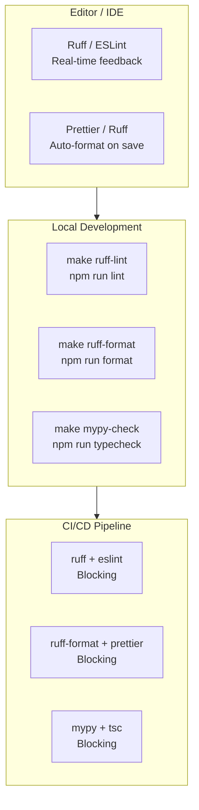

# Code Quality

Linting, type checking, formatting, and code quality tools for backend and frontend.

---

## Table of Contents

- [Overview](#overview)
- [Backend Tools](#backend-tools)
- [Frontend Tools](#frontend-tools)
- [Configuration](#configuration)
- [CI Integration](#ci-integration)
- [Best Practices](#best-practices)

---

## Overview

Code quality is enforced at multiple levels:



---

## Backend Tools

### Ruff

**Purpose**: Lightning-fast Python linter and formatter (replacement for Flake8, Black, isort)

| Command | Description |
|---------|-------------|
| `make ruff-format` | Auto-format code |
| `make ruff-format-check` | Check formatting (dry run) |
| `make ruff-lint` | Run linter (never rewrites files) |
| `make ruff-lint-fix` | Auto-fix lint errors (`make check-all` runs it) |

The scope is `RUFF_PATHS` in the Makefile: `src/ tests/ scripts/ infra/ .github/scripts/`. CI, `make check-all-dry` and the pre-commit hooks never fix; only `make check-all` does.

**Configuration** (`pyproject.toml`):

```toml
[tool.ruff]
line-length = 100
target-version = "py312"
show-fixes = true
exclude = ["tests/exclude/*", "**/_version.py"]

[tool.ruff.lint]
select = ["ALL"]
ignore = ["D", "TD", "FIX002", "TC003", "COM812", "CPY001", "F821", "ASYNC240"]

[tool.ruff.lint.per-file-ignores]
"tests/*" = ["S101", "S603", "SLF001", "T201"]
"infra/adapt/*" = ["T201"]
```

**Rules**:
- `ALL` — All Ruff rules enabled
- Ignored: docstrings (`D`), TODOs (`TD`), and a few specific rules
- Tests: relaxed rules for assertions and private access

### MyPy

**Purpose**: Static type checker with strict mode

| Command | Description |
|---------|-------------|
| `mypy` | Run type checker |
| `mypy src/` | Check source only |
| `mypy tests/` | Check tests only |

**Configuration** (`pyproject.toml`):

```toml
[tool.mypy]
files = ["src", "tests"]
exclude = "\\.ipynb$"
strict = true
show_error_codes = true
pretty = true
mypy_path = "src"
follow_imports = "normal"
ignore_missing_imports = true
```

**Strict mode** enables:
- `warn_unused_configs`
- `warn_redundant_casts`
- `warn_unused_ignores`
- `warn_return_any`
- `no_implicit_optional`
- `check_untyped_defs`
- `disallow_untyped_defs`
- `disallow_incomplete_defs`

---

## Frontend Tools

### ESLint

**Purpose**: JavaScript/TypeScript linter (v9 flat config)

| Command | Description |
|---------|-------------|
| `npm run lint` | Run linter (0 warnings allowed) |
| `npm run lint-fix` | Auto-fix errors |

**Plugins**:
- `@typescript-eslint` — TypeScript rules
- `eslint-plugin-react` — React rules
- `eslint-plugin-react-hooks` — Hooks rules
- `eslint-plugin-import` — Import ordering
- `eslint-plugin-jsdoc` — JSDoc comments
- `eslint-plugin-testing-library` — Testing best practices
- `@next/eslint-plugin-next` — Next.js rules

### Prettier

**Purpose**: Opinionated code formatter

| Command | Description |
|---------|-------------|
| `npm run format` | Format all files |
| `npm run format-check` | Check formatting (dry run) |

### TypeScript

**Purpose**: Static type checking

| Command | Description |
|---------|-------------|
| `npm run typecheck` | Run TypeScript compiler (no emit) |

**Configuration** (`tsconfig.json`):
- `strict: true` — Full strict mode
- `exactOptionalPropertyTypes: true` — Distinguish `undefined` from missing
- `noUncheckedIndexedAccess: true` — Index access returns `T | undefined`

---

## Configuration

### Backend Config Files

| File | Purpose |
|------|---------|
| `pyproject.toml` | Ruff, MyPy, pytest, coverage config |
| `alembic.ini` | Database migration config |

### Frontend Config Files

| File | Purpose |
|------|---------|
| `eslint.config.mjs` | ESLint 9 flat config |
| `prettier.config.cjs` | Prettier formatting rules |
| `tsconfig.json` | TypeScript compiler options |
| `styles/globals.css` | Tailwind CSS import and `@theme` tokens |
| `vitest.config.ts` | Vitest test config |
| `playwright.config.ts` | Playwright E2E config |

---

## CI Integration

### Backend CI

```yaml
ruff:
  stage: lint
  script:
    - make ruff-format-check
    - make ruff-lint

mypy:
  stage: type-check
  script:
    - mypy
```

Both jobs are **blocking** — the pipeline fails if they don't pass.

### Frontend CI

```yaml
frontend:eslint:
  stage: lint
  script:
    - npm run lint  # 0 warnings allowed

frontend:prettier:
  stage: lint
  script:
    - npm run format-check

frontend:type-check:
  stage: type-check
  script:
    - npm run typecheck
```

All three jobs are **blocking** and must pass before the build stage.

---

## Best Practices

### Python

1. **Type annotations** — Annotate all function signatures
2. **Docstrings** — Use the project's Sphinx-compatible format
3. **No `assert` in production code** — Use explicit checks
4. **Prefer `pathlib`** over `os.path`
5. **Use `slots=True`** on dataclasses for performance
6. **Frozen dataclasses** — Prevent accidental mutation

### TypeScript/React

1. **Strict types** — No `any`, use `unknown` when needed
2. **JSDoc comments** — Document all exported types and functions
3. **Import order** — Follow ESLint `import/order` rule
4. **Use `type`** instead of `interface` (consistent-type-definitions)
5. **Test coverage** — Maintain ≥80% lines, ≥70% branches
6. **Zero warnings** — ESLint configured with `--max-warnings=0`

### General

1. **Pre-commit hooks** — Run formatters and linters before committing
2. **Small commits** — Each commit should pass all checks independently
3. **Review CI** — Check pipeline results before merging
4. **Validate the chart** — Run `helm lint` + `helm template` before committing chart/`values.*` changes
5. **Test locally** — Run `make test` and `npm test` before pushing
