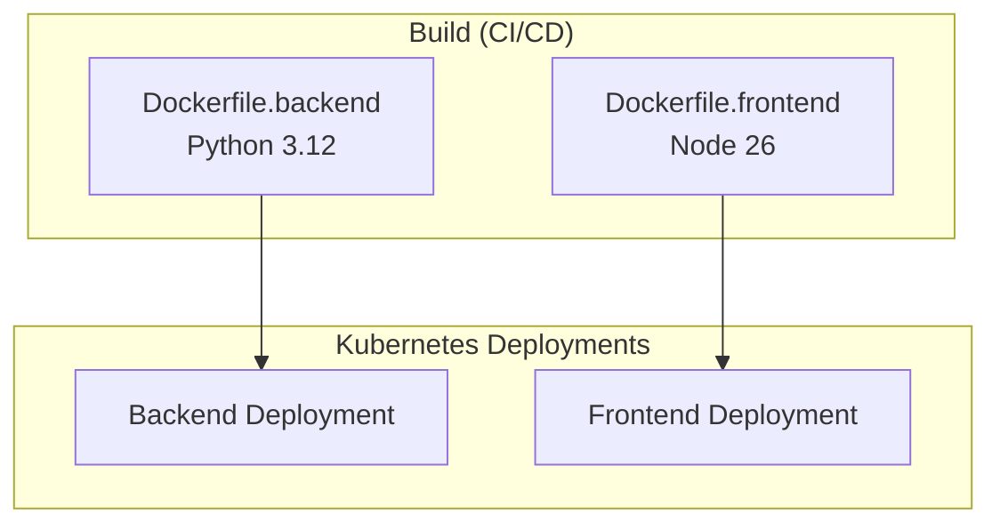
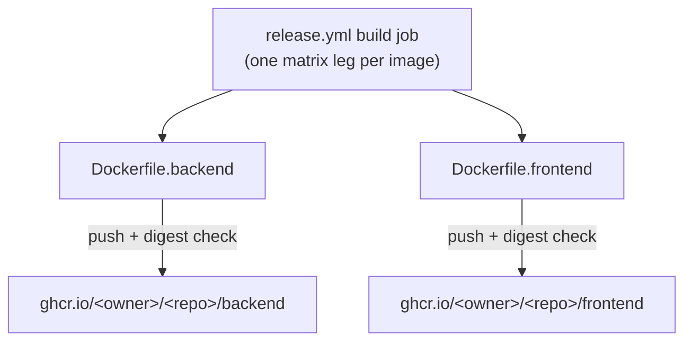
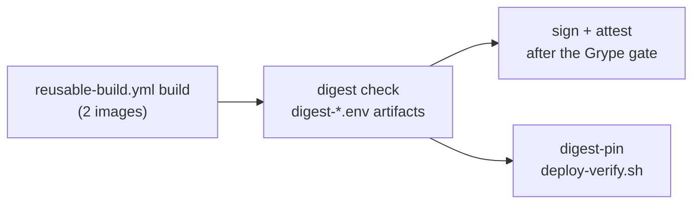

# Containerization

Per-service Dockerfiles, buildx builds in GitHub Actions, container runtime, and Kubernetes deployment.

---

## Table of Contents

- [Overview](#overview)
- [Per-Service Dockerfiles](#per-service-dockerfiles)
- [Dockerfile.backend](#dockerfilebackend)
- [Dockerfile.frontend](#dockerfilefrontend)
- [Image builds in CI](#image-builds-in-ci)
- [Container Runtime](#container-runtime)
- [Image Tags](#image-tags)
- [Health Check](#health-check)
- [Build Helpers](#build-helpers)
- [Digest-Pin, signing & provenance](#digest-pin-signing--provenance)
- [Kubernetes Deployment](#kubernetes-deployment)

---

## Overview

The project uses **two dedicated Dockerfiles**, one per service (backend and frontend). Each image contains only the dependencies it needs and starts its service directly via `CMD`. There is no `SERVICE_MODE` variable.



---

## Per-Service Dockerfiles

| Dockerfile | Service | Base Image | Port |
|------------|---------|-----------|------|
| `Dockerfile.backend` | FastAPI + Uvicorn | `debian:13-slim` (build), distroless `python3-debian13` (runtime) | 8000 |
| `Dockerfile.frontend` | Next.js standalone | `node:26-trixie-slim` (build), distroless `nodejs26-debian13` (runtime) | 3000 |

---

## Dockerfile.backend

```dockerfile
FROM gcr.io/distroless/python3-debian13@sha256:<digest> AS runtime-base   # declared once, by digest

FROM debian:13-slim@sha256:<digest> AS py-builder
ENV UV_COMPILE_BYTECODE=1 UV_LINK_MODE=copy UV_PYTHON=/usr/bin/python3.13 \
    UV_PYTHON_DOWNLOADS=never UV_PYTHON_PREFERENCE=only-system
COPY --from=ghcr.io/astral-sh/uv:<version>@sha256:<digest> /uv /bin/uv   # same version as tools/pins.tsv
RUN apt-get update -y && apt-get install -y --no-install-recommends python3.13 tini
# ... the tini dpkg record, and passwd/group with the app user (10001) added to the base's entries
WORKDIR /app
COPY pyproject.toml uv.lock /app/
RUN uv sync --frozen --no-dev --no-install-project --no-editable   # locked dependencies, hash-checked
COPY README.md LICENSE alembic.ini /app/
COPY src /app/src
RUN uv sync --frozen --no-dev --no-editable

FROM runtime-base AS runtime
LABEL org.opencontainers.image.title="Your Service Name"
LABEL org.opencontainers.image.source="${SOURCE_URL}"   # plus version, revision, ref.name and created

COPY --from=py-builder /usr/bin/tini /usr/bin/tini      # and its dpkg record and licence, for the SBOM
COPY --from=py-builder /out/etc/passwd /out/etc/group /etc/
COPY --from=py-builder /app/.venv /app/.venv   # root-owned: the app user cannot rewrite its code
COPY --chmod=644 alembic.ini /app/alembic.ini
COPY --from=py-builder --chown=10001:10001 /out/app/logs /app/logs   # and /app/data, the only writable dirs
ENV PATH="/app/.venv/bin:$PATH"

HEALTHCHECK --interval=10s --timeout=5s --start-period=30s --retries=5 \
  CMD ["/app/.venv/bin/python", "-m", "your_service_name.backend.healthcheck"]

USER 10001
ENTRYPOINT ["/usr/bin/tini", "-s", "--"]
CMD ["/app/.venv/bin/python", "-m", "your_service_name.backend.serve"]
```

The runtime is **distroless**: no shell, no `curl`, no package manager and no `pip`, and the runtime stage has no `RUN`.
One Debian interpreter serves both stages (`/usr/bin/python3.13`), so the copied virtual environment always
matches; the builder needs no compiler, because every runtime dependency ships a wheel. The database driver
is asyncpg, so no `libpq` is installed. A test pins the digests, the Debian major of both stages and the
absence of `RUN`.

**Key features**:
- **OCI metadata labels** — version, revision, branch, build date, vendor, and `source` (the repository URL, from the `SOURCE_URL` build argument; GHCR links the package to it). Both images carry them, and the build workflow fills each one: the commit SHA, the branch or tag, the commit time (UTC, RFC 3339) and `${{ github.server_url }}/${{ github.repository }}`
- **Non-root user** — runs as `appuser` (UID 10001, with a passwd and group entry and a home directory)
- **Tini init** — proper PID 1 for signal handling
- **Health check** — a stdlib Python probe (`python -m your_service_name.backend.healthcheck`) of `/healthz`, with a 4 s timeout; it reads `HEALTHCHECK_SCHEME`, `BACKEND_PORT` and `API_VERSION`, and treats a redirect or a TLS failure as unhealthy
- **Launcher** — `python -m your_service_name.backend.serve` starts Uvicorn in-process (no shell, no curl); see [Environment Variables](./environment-variables.md)
- **Migrations** — run by the chart's Job (and compose's `migrate` service) with `python -m your_service_name.backend.db.run_migrations`; the image ships no shell script and no shell

---

## Dockerfile.frontend

```dockerfile
# Both base images are pinned by digest in the real file (shortened here).
FROM node:26-trixie-slim@sha256:... AS builder
WORKDIR /app
COPY frontend/package.json frontend/package-lock.json ./
RUN npm ci --include=dev --ignore-scripts
COPY frontend/ ./
ARG VERSION
ARG VCS_REF
RUN npm run openapi-gen \
 && NEXT_DEPLOYMENT_ID="$(node scripts/deployment-id.mjs "${VERSION}" "${VCS_REF}")" npx next build

FROM gcr.io/distroless/nodejs26-debian13@sha256:... AS runtime
LABEL org.opencontainers.image.title="Your Service Name — Frontend"
WORKDIR /app
COPY --from=builder --chown=10001:10001 /app/.next/standalone ./
COPY --from=builder --chown=10001:10001 /app/.next/static ./.next/static
COPY --from=builder --chown=10001:10001 /app/public ./public

ENV NODE_ENV=production NEXT_TELEMETRY_DISABLED=1 PORT=3000
HEALTHCHECK CMD ["/nodejs/bin/node","-e","fetch(...)"]  # no shell, no curl
USER 10001
EXPOSE 3000
CMD ["server.js"]   # the image's ENTRYPOINT is /nodejs/bin/node
```

**Key features**:
- **Multi-stage build** — builder stage installs deps and builds; runtime is minimal
- **Standalone output** — Next.js `output: 'standalone'` for minimal production bundle
- **Non-root user** — numeric UID 10001 (distroless has no `appuser`)
- **Health check** — fetches the frontend root `/` with the bundled Node (no shell or curl)
- **Static assets** — the Next.js server serves `/_next/static` (hashed, immutable, one-year cache) and the `public/` files itself; there is no separate static image. A CDN in front caches them at the edge. The cache and security headers per path come from [`frontend/static-paths.ts`](../frontend/static-paths.ts) and `frontend/next.config.ts`.
- **Deployment id** — the builder stage sets `NEXT_DEPLOYMENT_ID` from the `VERSION` and `VCS_REF` build arguments (`frontend/scripts/deployment-id.mjs`), so a client caught mid-rollout reloads instead of loading a chunk that is gone

---

## Image builds in CI

The release workflow builds the two images with `docker/build-push-action` (buildx) on a GitHub-hosted runner, only on a push to `main` or a `v*` tag (a pull request builds locally, without pushing, to check the images). No Docker-in-Docker, no privileged runner:



### Advantages

| Feature | Benefit |
|---------|---------|
| **Matrix legs** | The two images build in parallel |
| **Cold builds** | The release build uses no layer cache, so every layer is built from the commit, the pinned bases and the locked dependencies |
| **Digest check** | The pushed manifest digest must equal the build's digest |
| **Pinned actions** | Every action is pinned by a full commit SHA |

### Multi-architecture

Each image lists the platforms it supports (`platforms` in `.github/container-images.yml`, today `linux/amd64` and `linux/arm64`; every base image is pinned by a multi-arch index digest that includes both). The release builds one platform per job, on a runner of that architecture (the manifest's `runners` map), and never under emulation: no QEMU and no `binfmt`. Each platform is pushed by digest without a tag; a `merge` job then makes one index per image with `docker buildx imagetools create`, applies the tags to it and resolves its digest. So `ghcr.io/<owner>/<repo>/<id>:<tag>` and the digest that deploys, signing and admission use name the index, and a node pulls the manifest for its own architecture.

arm64 is optional: set the repository variable `BUILD_ARM64` to `true` (see [GitHub repository settings](./github-repository-settings.md#the-vars-file)). Unset builds `linux/amd64` only, through the same steps. Pull requests build and check `linux/amd64` only; arm64 is checked natively on the release path. After `replace_service_name.sh` regenerates the `images:` block, every image lists `linux/amd64` only until you add `platforms` back. The full flow is in [CI/CD](./ci-cd.md#multi-architecture-flow).

### CI Configuration

The image list is `.github/container-images.yml` (the single source), rendered into the matrix by `.github/scripts/container_matrix.py`; the build itself is the `build` and `merge` jobs of [`.github/workflows/reusable-build.yml`](../.github/workflows/reusable-build.yml), called by [`.github/workflows/release.yml`](../.github/workflows/release.yml). Read those files rather than a copy here.

---

## Image structure checks

`scripts/ci/image-checks.sh [--strict] <image-id> <image-ref>` checks one built image, with the settings of its entry in `.github/container-images.yml` (`distroless`, and the optional `run_env` and `run_args` for the health-check container; none of the shipped images needs any):

| Check | Passes when |
|---|---|
| user | `Config.User` is numeric and not 0 (`USER 10001`) |
| no shell | distroless images only: the filesystem (read with `docker export`, nothing executed) has no shell, package manager or fetcher in `/bin`, `/sbin`, `/usr/bin`, `/usr/sbin`, `/usr/local/bin` or `/usr/local/sbin` |
| healthcheck | the image declares a HEALTHCHECK, and a throwaway container (unique name, no published ports) becomes `healthy` within the image's own start period + interval x retries + timeout |
| labels | the OCI `source`, `version`, `revision`, `created` and `title` labels are present; with `--strict` none is `unknown` and `source` is not the template placeholder |

Each failure prints an `::error::` line (an unhealthy container also prints its last health-log entries and log lines); the container is always removed by its exact name.

- **Pull request:** the `images` job in [`ci.yml`](../.github/workflows/ci.yml) builds each image locally with the release build's arguments and runs the script with `--strict`. It has no registry login, push, secret or cache.
- **Release:** the `image-checks` job in [`reusable-build.yml`](../.github/workflows/reusable-build.yml) pulls each pushed image by its digest and runs the script with `--strict`; `sign-attest` needs it, so an image that fails is never signed. A multi-platform build must run it once per platform.
- **Locally:** `make image-checks` builds the images with throwaway tags (label values set locally, so `--strict` holds), runs the script and removes them; `make image-checks IDS="backend frontend"` limits it. It needs docker, jq and the project venv (PyYAML); it builds with the manifest's own build arguments, as CI does.

---

## Container Runtime

Each container starts its service directly via `CMD`:

| Service | Init | Command | User |
|---------|------|---------|------|
| **Backend** | `tini` | `python -m your_service_name.backend.serve` (one Uvicorn process) | `appuser` (10001) |
| **Frontend** | — | `node server.js` | `appuser` (10001) |

There is no `SERVICE_MODE` variable. Each Dockerfile has a single `CMD` that starts its service.

---

## Image Tags

The `plan` job of `release.yml` generates the tag from the Git ref (see [Versioning](./versioning.md#image-tagging)):

| Trigger | Tags |
|---------|------|
| **Git tag** (e.g., `v1.2.3`) | `1.2.3-prod-abc1234`, `latest` |
| **Push to `main`** | `0.0.0-main-abc1234` (baseline from the `VERSION` file) |

A pull request never pushes an image. The tags name the multi-architecture index. The tag is the same for both images; each image has its own repository (`ghcr.io/<owner>/<repo>/backend`, and `/frontend`).

---

## Health Check

Each Dockerfile includes a built-in health check:

| Service | Endpoint | Interval | Timeout |
|---------|----------|----------|---------|
| **Backend** | `/api/${API_VERSION}/health` | 15s | 5s |
| **Frontend** | `/` | 15s | 5s |

---

## Build Helpers

> The former root-level `build_docker.sh` / `build_podman.sh` / `build_apptainer.sh`
> helpers were removed (they predated the per-service Dockerfiles). Build images
> directly from the per-service Dockerfiles below.

### Per-Service Build

```bash
docker build -t your-service-name:backend  -f Dockerfile.backend  .
docker build -t your-service-name:frontend -f Dockerfile.frontend .
```

### Docker Compose (full stack, local)

```bash
docker compose build    # Build all services
docker compose up -d    # Start all services
docker compose down     # Stop all services
```

---

## Digest-Pin, signing & provenance

Once the images are built and pushed, the pipeline adds supply-chain controls around them. **Immutable digest-pin, keyless signing and SLSA provenance are delivered**. The pipeline
mechanics are in [`wiki/ci-cd.md`](./ci-cd.md); what follows is the what/why of what *is*
delivered, plus signing.



### Image signing & SLSA provenance

After the blocking Grype gate, the `sign-attest` job of `reusable-build.yml` signs each image digest
keyless with cosign (Fulcio + Rekor), verifies the signature, and attaches a SLSA build-provenance
attestation and a CycloneDX SBOM attestation as GitHub artifact attestations. The signing identity
is the workflow's OIDC identity; the certificate identity and the commands to verify an image are in
[Verifying an image](./security.md#verifying-an-image).

Signing / provenance only buy what **admission enforces**; until admission (Kyverno)
exists, a build-time signature is assurance the runtime never checks. The hardening lint's
`provenance` check fails if the signing and attestation steps go missing.

### Immutable Digest-Pin

- The `build` job (in `reusable-build.yml`) resolves each built image's immutable manifest digest, checks it against the
  registry, and records `<ID>_IMAGE_DIGEST=sha256:…` — **captured**, never floated on a mutable
  `:latest` / `:main` tag. The `digests` job merges them.
- **Consuming** that digest at deploy time is the **helm** flavour's job: every deploy job pins
  `repository@sha256:…`, and `scripts/ci/deploy-verify.sh` confirms the deployed image matches the
  captured digest. This Compose/main flavour has no deploy-time consumer, so it can instead confirm
  a running/pulled image against the captured digest with `infra/security/verify-image-digest.sh` —
  a verification aid, not admission enforcement.
- The OpenVEX document (the `vex` job) also pins the product by the captured digest.

> **Roadmap** (not yet implemented): Kyverno admission to *enforce* the delivered
> signatures and provenance at deploy time. See
> [`wiki/ROADMAP-supply-chain.md`](./ROADMAP-supply-chain.md).

---

## Kubernetes Deployment

### Deploying to Kubernetes

After building and pushing the images, deploy with the Helm chart. Namespaces are per-env
(`your-service-name-<env>` app + `<app-ns>-db` db); the chart creates them.

```bash
# Deploy + verify the whole stack for the target environment (one command).
# Image tag + registry come from charts/your-service-name/values.<environment>.yaml.
./scripts/e2e.sh --env <environment>                 # helm upgrade --install then verify

# Or the raw Helm call:
helm upgrade --install your-service-name charts/your-service-name \
  -f charts/your-service-name/values.<environment>.yaml \
  -n your-service-name-<environment> --create-namespace
```

### CI/CD Deployment

The `ci/deploy.yml` pipeline handles automated deployment — **Helm-native** (see
[`wiki/ci-cd.md`](./ci-cd.md)):

1. **build** (`release.yml`) — builds and pushes the backend and frontend images, one matrix leg each
2. **helm-checks** (`deploy.yml`) — lints + renders the chart for the target environment (validation gate)
3. **deploy-<env>** — `helm upgrade --install` by digest (migrations via the per-revision Job), then rolling update
4. **verify and smoke** — post-deployment health checks inside each deploy job

### Updating the Image

To deploy a new image version, set the tag in the env's values file (or via `--set`) and re-apply:

```bash
# Via Helm --set (image tag + registry), then roll out:
helm upgrade --install your-service-name charts/your-service-name \
  -f charts/your-service-name/values.<environment>.yaml \
  --set images.backend.tag=<new-tag> --set images.backend.registry=<registry> \
  -n your-service-name-<environment>
```

### Rolling Back

A failed verify or smoke step rolls back to the recorded revision by itself. By hand, use the
`deploy-ops` workflow (see [Operations runbook](./operations-runbook.md#rolling-back-a-deployment)) or Helm:

```bash
helm history your-service-name -n your-service-name-<environment>
helm rollback your-service-name <N> -n your-service-name-<environment> --wait
```
