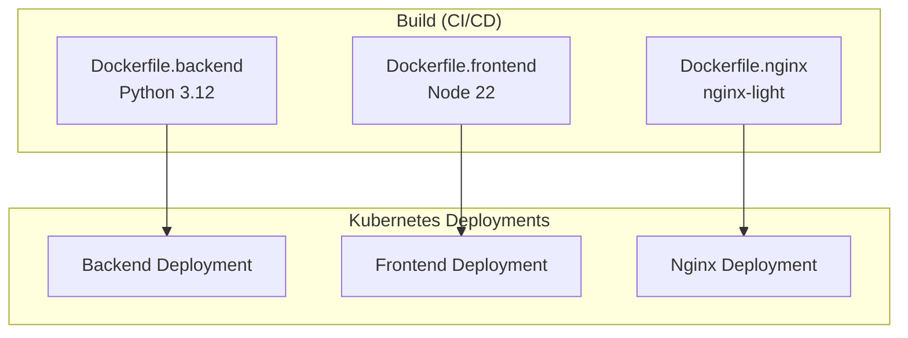
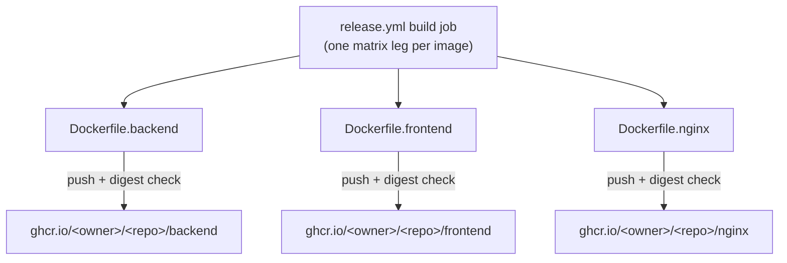

# Containerization

Per-service Dockerfiles, buildx builds in GitHub Actions, container runtime, and Kubernetes deployment.

---

## Table of Contents

- [Overview](#overview)
- [Per-Service Dockerfiles](#per-service-dockerfiles)
- [Dockerfile.backend](#dockerfilebackend)
- [Dockerfile.frontend](#dockerfilefrontend)
- [Dockerfile.nginx](#dockerfilenginx)
- [Image builds in CI](#image-builds-in-ci)
- [Container Runtime](#container-runtime)
- [Image Tags](#image-tags)
- [Health Check](#health-check)
- [Build Helpers](#build-helpers)
- [Digest-Pin, signing & provenance](#digest-pin-signing--provenance)
- [Kubernetes Deployment](#kubernetes-deployment)

---

## Overview

The project uses **three dedicated Dockerfiles**, one per service. Each image contains only the dependencies it needs and starts its service directly via `CMD`. There is no `SERVICE_MODE` variable.



---

## Per-Service Dockerfiles

| Dockerfile | Service | Base Image | Port |
|------------|---------|-----------|------|
| `Dockerfile.backend` | FastAPI + Uvicorn | `python:3.12-slim` | 8000 |
| `Dockerfile.frontend` | Next.js standalone | `node:22-slim` | 3000 |
| `Dockerfile.nginx` | Static assets | `nginx:alpine` | 8081 |

---

## Dockerfile.backend

```dockerfile
FROM python:3.12-slim AS builder
ENV UV_COMPILE_BYTECODE=1 UV_LINK_MODE=copy UV_PYTHON_DOWNLOADS=never
COPY --from=ghcr.io/astral-sh/uv:<version>@sha256:<digest> /uv /bin/uv   # same version as tools/pins.tsv
RUN apt-get update && apt-get install -y build-essential libpq-dev
WORKDIR /app
COPY pyproject.toml uv.lock /app/
RUN uv sync --frozen --no-dev --no-install-project --no-editable   # locked dependencies, hash-checked
COPY README.md LICENSE alembic.ini /app/
COPY src /app/src
RUN uv sync --frozen --no-dev --no-editable

FROM python:3.12-slim AS runtime
LABEL org.opencontainers.image.title="Your Service Name"
LABEL org.opencontainers.image.version="${VERSION}"

RUN apt-get install -y libsqlite3-0 libpq5 bash tini curl ca-certificates
RUN useradd -m -u 10001 appuser
COPY --from=builder /app/.venv /app/.venv   # root-owned: the app user cannot rewrite its code
ENV PATH="/app/.venv/bin:$PATH"

WORKDIR /app
COPY infra/db/run_migrations.sh /app/infra/db/run_migrations.sh
COPY alembic.ini /app/alembic.ini

HEALTHCHECK --interval=15s --timeout=5s --start-period=20s --retries=5 \
  CMD curl -fsS "http://localhost:8000/api/${API_VERSION}/health" || exit 1

USER appuser
ENTRYPOINT ["/usr/bin/tini", "-s", "--"]
CMD ["/app/infra/backend/run_backend.sh"]
```

**Key features**:
- **OCI metadata labels** — version, revision, branch, build date, vendor
- **Non-root user** — runs as `appuser` (UID 10001)
- **Tini init** — proper PID 1 for signal handling
- **Health check** — curls backend `/health` endpoint
- **Migration support** — includes `run_migrations.sh` for init containers

---

## Dockerfile.frontend

```dockerfile
FROM node:22-slim AS builder
WORKDIR /app/frontend
COPY frontend/package.json frontend/package-lock.json ./
RUN npm ci
COPY frontend/ ./
RUN npm run openapi-gen
RUN npm run build

FROM node:22-slim AS runtime
LABEL org.opencontainers.image.title="Your Service Name Frontend"
LABEL org.opencontainers.image.version="${VERSION}"

RUN useradd -m -u 10001 appuser
COPY --from=builder /app/frontend/.next/standalone /app
COPY --from=builder /app/frontend/.next/static /app/.next/static
COPY --from=builder /app/frontend/public /app/public

ENV NODE_ENV=production NEXT_TELEMETRY_DISABLED=1
WORKDIR /app

HEALTHCHECK --interval=15s --timeout=5s --start-period=20s --retries=5 \
  CMD curl -fsS "http://localhost:3000/" || exit 1

USER appuser
EXPOSE 3000
CMD ["node", "server.js"]
```

**Key features**:
- **Multi-stage build** — builder stage installs deps and builds; runtime is minimal
- **Standalone output** — Next.js `output: 'standalone'` for minimal production bundle
- **Non-root user** — runs as `appuser` (UID 10001)
- **Health check** — curls frontend root `/`

---

## Dockerfile.nginx

```dockerfile
FROM nginx:alpine
LABEL org.opencontainers.image.title="Your Service Name Nginx"
LABEL org.opencontainers.image.version="${VERSION}"

COPY infra/nginx/nginx.conf /etc/nginx/nginx.conf
COPY --from=frontend /app/public /usr/share/nginx/html

HEALTHCHECK --interval=15s --timeout=5s --start-period=10s --retries=5 \
  CMD curl -fsS "http://localhost:8081/healthz" || exit 1

EXPOSE 8081
CMD ["nginx", "-g", "daemon off;"]
```

**Key features**:
- **Lightweight** — based on `nginx:alpine`
- **Static assets** — serves Next.js `_next/static` and `public/` files
- **Health endpoint** — `/healthz` for readiness checks
- **Non-root** — nginx worker runs as `nginx` user (UID 101)

---

## Image builds in CI

The release workflow builds the three images with `docker/build-push-action` (buildx) on a GitHub-hosted runner, only on a push to `main` or a `v*` tag. No Docker-in-Docker, no privileged runner:



### Advantages

| Feature | Benefit |
|---------|---------|
| **Matrix legs** | The three images build in parallel |
| **GitHub Actions layer cache** | `cache-from` / `cache-to` of type `gha`, scoped per image |
| **Digest check** | The pushed manifest digest must equal the build's digest |
| **Pinned actions** | Every action is pinned by a full commit SHA |

### CI Configuration

The image list is `.github/container-images.yml` (the single source), rendered into the matrix by `.github/scripts/container_matrix.py`; the build itself is the `build` job of [`.github/workflows/release.yml`](../.github/workflows/release.yml). Read those files rather than a copy here.

---

## Container Runtime

Each container starts its service directly via `CMD`:

| Service | Init | Command | User |
|---------|------|---------|------|
| **Backend** | `tini` | `uvicorn` (one process, via `run_backend.sh`) | `appuser` (10001) |
| **Frontend** | — | `node server.js` | `appuser` (10001) |
| **Nginx** | — | `nginx -g daemon off;` | `nginx` (101) |

There is no `SERVICE_MODE` variable. Each Dockerfile has a single `CMD` that starts its service.

---

## Image Tags

The `plan` job of `release.yml` generates the tag from the Git ref (see [Versioning](./versioning.md#image-tagging)):

| Trigger | Tags |
|---------|------|
| **Git tag** (e.g., `v1.2.3`) | `1.2.3-prod-abc1234`, `latest` |
| **Push to `main`** | `0.0.0-main-abc1234` (baseline from the `VERSION` file) |

A pull request never pushes an image. The tag is the same for all three images; each image has its own repository (`ghcr.io/<owner>/<repo>/backend`, `/frontend`, `/nginx`).

---

## Health Check

Each Dockerfile includes a built-in health check:

| Service | Endpoint | Interval | Timeout |
|---------|----------|----------|---------|
| **Backend** | `/api/${API_VERSION}/health` | 15s | 5s |
| **Frontend** | `/` | 15s | 5s |
| **Nginx** | `/healthz` | 15s | 5s |

---

## Build Helpers

> The former root-level `build_docker.sh` / `build_podman.sh` / `build_apptainer.sh`
> helpers were removed (they predated the per-service Dockerfiles and NGINX edge). Build images
> directly from the per-service Dockerfiles below.

### Per-Service Build

```bash
docker build -t your-service-name:backend  -f Dockerfile.backend  .
docker build -t your-service-name:frontend -f Dockerfile.frontend .
docker build -t your-service-name:nginx    -f Dockerfile.nginx    .
```

### Docker Compose (full stack, local)

```bash
docker compose build    # Build all services
docker compose up -d    # Start all services
docker compose down     # Stop all services
```

---

## Digest-Pin, signing & provenance

Once the images are built and pushed, the pipeline adds supply-chain controls around them. **Immutable digest-pin, keyless signing and SLSA provenance are delivered**. The pipeline
mechanics are in [`wiki/ci-cd.md`](./ci-cd.md); what follows is the what/why of what *is*
delivered, plus signing.


### Image signing & SLSA provenance

After the blocking Grype gate, the `sign-attest` job of `reusable-build.yml` signs each image digest
keyless with cosign (Fulcio + Rekor), verifies the signature, and attaches a SLSA build-provenance
attestation and a CycloneDX SBOM attestation as GitHub artifact attestations. The signing identity
is the workflow's OIDC identity; the certificate identity and the commands to verify an image are in
[Verifying an image](./security.md#verifying-an-image).

Signing / provenance only buy what **admission enforces**; until admission (Kyverno)
exists, a build-time signature is assurance the runtime never checks. The hardening lint's
`provenance` check fails if the signing and attestation steps go missing.

### Immutable Digest-Pin

- The `build` job (in `reusable-build.yml`) resolves each built image's immutable manifest digest, checks it against the
  registry, and records `<ID>_IMAGE_DIGEST=sha256:…` — **captured**, never floated on a mutable
  `:latest` / `:main` tag. The `digests` job merges them.
- **Consuming** that digest at deploy time is the **helm** flavour's job: every deploy job pins
  `repository@sha256:…`, and `scripts/ci/deploy-verify.sh` confirms the deployed image matches the
  captured digest. This Compose/main flavour has no deploy-time consumer, so it can instead confirm
  a running/pulled image against the captured digest with `infra/security/verify-image-digest.sh` —
  a verification aid, not admission enforcement.
- The OpenVEX document (the `vex` job) also pins the product by the captured digest.

> **Roadmap** (not yet implemented): Kyverno admission to *enforce* the delivered
> signatures and provenance at deploy time, a distroless
> backend base. See
> [`wiki/ROADMAP-supply-chain.md`](./ROADMAP-supply-chain.md).

---

## Kubernetes Deployment

### Deploying to Kubernetes

After building and pushing the images, deploy with the Helm chart. Namespaces are per-env
(`your-service-name-<env>` app + `<app-ns>-db` db); the chart creates them.

```bash
# Deploy + verify the whole stack for the target environment (one command).
# Image tag + registry come from charts/your-service-name/values.<environment>.yaml.
./scripts/e2e.sh --env <environment>                 # helm upgrade --install then verify

# Or the raw Helm call:
helm upgrade --install your-service-name charts/your-service-name \
  -f charts/your-service-name/values.<environment>.yaml \
  -n your-service-name-<environment> --create-namespace
```

### CI/CD Deployment

The `ci/deploy.yml` pipeline handles automated deployment — **Helm-native** (see
[`wiki/ci-cd.md`](./ci-cd.md)):

1. **build** (`release.yml`) — builds and pushes the backend, frontend and nginx images, one matrix leg each
2. **helm-checks** (`deploy.yml`) — lints + renders the chart for the target environment (validation gate)
3. **deploy-<env>** — `helm upgrade --install` by digest (migrations via the hook Job), then rolling update
4. **verify and smoke** — post-deployment health checks inside each deploy job

### Updating the Image

To deploy a new image version, set the tag in the env's values file (or via `--set`) and re-apply:

```bash
# Via Helm --set (image tag + registry), then roll out:
helm upgrade --install your-service-name charts/your-service-name \
  -f charts/your-service-name/values.<environment>.yaml \
  --set images.backend.tag=<new-tag> --set images.backend.registry=<registry> \
  -n your-service-name-<environment>
```

### Rolling Back

A failed verify or smoke step rolls back to the recorded revision by itself. By hand, use the
`deploy-ops` workflow (see [Operations runbook](./operations-runbook.md#rolling-back-a-deployment)) or Helm:

```bash
helm history your-service-name -n your-service-name-<environment>
helm rollback your-service-name <N> -n your-service-name-<environment> --wait
```
