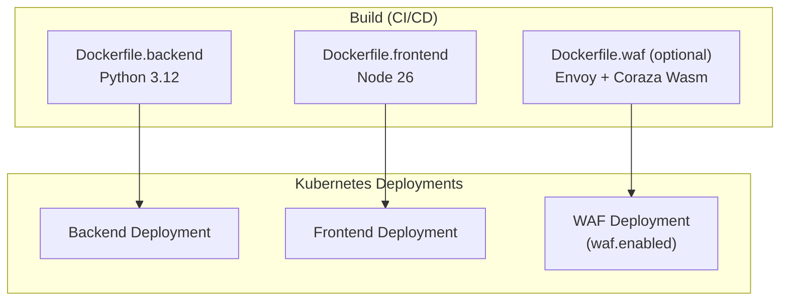
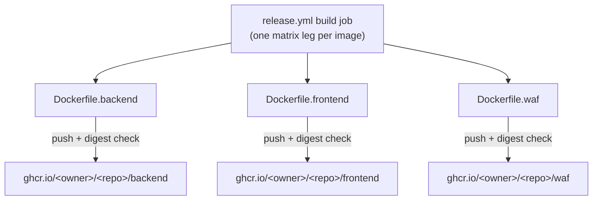
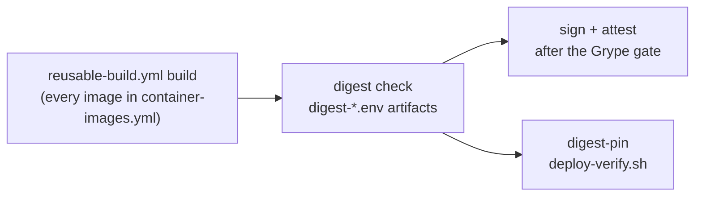

# Containerization

Per-service Dockerfiles, buildx builds in GitHub Actions, container runtime, and Kubernetes deployment.

---

## Table of Contents

- [Overview](#overview)
- [Per-Service Dockerfiles](#per-service-dockerfiles)
- [Dockerfile.backend](#dockerfilebackend)
- [Dockerfile.frontend](#dockerfilefrontend)
- [Dockerfile.waf](#dockerfilewaf)
- [Debian fixes the base has not shipped yet](#debian-fixes-the-base-has-not-shipped-yet)
- [Image builds in CI](#image-builds-in-ci)
- [Container Runtime](#container-runtime)
- [Image Tags](#image-tags)
- [Health Check](#health-check)
- [Build Helpers](#build-helpers)
- [Digest-Pin, signing & provenance](#digest-pin-signing--provenance)
- [Kubernetes Deployment](#kubernetes-deployment)

---

## Overview

The project builds **two app images**, one per service (backend and frontend), plus an **optional WAF image** (`Dockerfile.waf`: Envoy with the Coraza Wasm, deployed only with the chart's `waf.enabled`). All three are built, scanned, signed and deployed by digest the same way. Each image contains only what it needs and starts its service directly via `CMD`. There is no `SERVICE_MODE` variable.



---

## Per-Service Dockerfiles

| Dockerfile | Service | Base Image | Port |
|------------|---------|-----------|------|
| `Dockerfile.backend` | FastAPI + Uvicorn | `debian:13-slim` (build), distroless `python3-debian13` (runtime) | 8000 |
| `Dockerfile.frontend` | Next.js standalone | `node:26-trixie-slim` (build), distroless `nodejs26-debian13` (runtime) | 3000 |
| `Dockerfile.waf` | Envoy + Coraza Wasm (optional) | `debian:13-slim` (fetch and check the Wasm), distroless `envoyproxy/envoy` (runtime) | `waf.service.port` (8080), health `waf.health.port` (8090) |

Each Dockerfile declares its distroless runtime base once (`runtime-base`, by digest), and its runtime stage
starts from it and first copies the `debian-fixes` stage over it: [Debian fixes the base has not shipped
yet](#debian-fixes-the-base-has-not-shipped-yet).

---

## Dockerfile.backend

```dockerfile
FROM gcr.io/distroless/python3-debian13@sha256:<digest> AS runtime-base   # declared once, by digest

FROM debian:13-slim@sha256:<digest> AS debian-fixes   # Debian fixes the base has not shipped yet
ARG DEBIAN_FIXES="..."
COPY --from=runtime-base / /base-root/
COPY scripts/docker/debian-fixes.sh /usr/local/bin/debian-fixes
RUN debian-fixes /base-root /out

FROM debian:13-slim@sha256:<digest> AS py-builder
ENV UV_COMPILE_BYTECODE=1 UV_LINK_MODE=copy UV_PYTHON=/usr/bin/python3.13 \
    UV_PYTHON_DOWNLOADS=never UV_PYTHON_PREFERENCE=only-system
COPY --from=ghcr.io/astral-sh/uv:<version>@sha256:<digest> /uv /bin/uv   # same version as mise.toml
RUN apt-get update -y && apt-get install -y --no-install-recommends python3.13 tini
# ... the tini dpkg record, and passwd/group with the app user (10001) added to the base's entries
WORKDIR /app
COPY pyproject.toml uv.lock /app/
RUN uv sync --frozen --no-dev --no-install-project --no-editable   # locked dependencies, hash-checked
COPY README.md LICENSE alembic.ini /app/
COPY src /app/src
RUN uv sync --frozen --no-dev --no-editable

FROM runtime-base AS runtime
COPY --from=debian-fixes /out/ /                        # first, so every later layer sits on the fixed base
LABEL org.opencontainers.image.title="Your Service Name"
LABEL org.opencontainers.image.source="${SOURCE_URL}"   # plus version, revision, ref.name and created

COPY --from=py-builder /usr/bin/tini /usr/bin/tini      # and its dpkg record and licence, for the SBOM
COPY --from=py-builder /out/etc/passwd /out/etc/group /etc/
COPY --from=py-builder /app/.venv /app/.venv   # root-owned: the app user cannot rewrite its code
COPY --chmod=644 alembic.ini /app/alembic.ini
COPY --from=py-builder --chown=10001:10001 /out/app/data /app/data   # the only writable dir; logs go to stdout
ENV PATH="/app/.venv/bin:$PATH"

HEALTHCHECK --interval=10s --timeout=5s --start-period=30s --retries=5 \
  CMD ["/app/.venv/bin/python", "-m", "your_service_name.backend.healthcheck"]

USER 10001
ENTRYPOINT ["/usr/bin/tini", "-s", "--"]
CMD ["/app/.venv/bin/python", "-m", "your_service_name.backend.serve"]
```

The runtime is **distroless**: no shell, no `curl`, no package manager and no `pip`, and the runtime stage has no `RUN`.
One Debian interpreter serves both stages (`/usr/bin/python3.13`), so the copied virtual environment always
matches; the builder needs no compiler, because every runtime dependency ships a wheel. The database driver
is asyncpg, so no `libpq` is installed. A test pins the digests, the Debian major of both stages and the
absence of `RUN`.

**Key features**:
- **OCI metadata labels** — version, revision, branch, build date, vendor, and `source` (the repository URL, from the `SOURCE_URL` build argument; GHCR links the package to it). Every image carries them, and the build workflow fills each one: the commit SHA, the branch or tag, the commit time (UTC, RFC 3339) and `${{ github.server_url }}/${{ github.repository }}`
- **Non-root user** — runs as `appuser` (UID 10001, with a passwd and group entry and a home directory)
- **Tini init** — proper PID 1 for signal handling
- **Health check** — a stdlib Python probe (`python -m your_service_name.backend.healthcheck`) of `/api/${API_VERSION}/healthz` (process only, no database check), every 10 s with a 5 s timeout; it reads `HEALTHCHECK_SCHEME`, `BACKEND_PORT` and `API_VERSION`, and treats a redirect or a TLS failure as unhealthy
- **Launcher** — `python -m your_service_name.backend.serve` starts Uvicorn in-process (no shell, no curl); see [Environment Variables](./environment-variables.md)
- **Migrations** — run by the chart's Job (and compose's `migrate` service) with `python -m your_service_name.backend.db.run_migrations`; the image ships no shell script and no shell

---

## Dockerfile.frontend

```dockerfile
# Every base image is pinned by digest in the real file (shortened here).
FROM gcr.io/distroless/nodejs26-debian13@sha256:... AS runtime-base   # declared once
FROM debian:13-slim@sha256:... AS debian-fixes                       # as in Dockerfile.backend

FROM node:26-trixie-slim@sha256:... AS builder
WORKDIR /app
COPY frontend/package.json frontend/pnpm-lock.yaml frontend/pnpm-workspace.yaml ./
RUN pnpm install --frozen-lockfile
COPY frontend/ ./
ARG VERSION
ARG VCS_REF
RUN pnpm run openapi-gen \
 && NEXT_DEPLOYMENT_ID="$(node scripts/deployment-id.mjs "${VERSION}" "${VCS_REF}")" pnpm exec next build

FROM runtime-base AS runtime
COPY --from=debian-fixes /out/ /
LABEL org.opencontainers.image.title="Your Service Name — Frontend"
WORKDIR /app
COPY --from=builder --chown=10001:10001 /app/.next/standalone ./
COPY --from=builder --chown=10001:10001 /app/.next/static ./.next/static
COPY --from=builder --chown=10001:10001 /app/public ./public

ENV NODE_ENV=production NEXT_TELEMETRY_DISABLED=1 PORT=3000
HEALTHCHECK CMD ["/nodejs/bin/node","-e","fetch(...)"]  # no shell, no curl
USER 10001
EXPOSE 3000
CMD ["server.js"]   # the image's ENTRYPOINT is /nodejs/bin/node
```

**Key features**:
- **Multi-stage build** — builder stage installs deps and builds; runtime is minimal
- **Standalone output** — Next.js `output: 'standalone'` for minimal production bundle
- **Non-root user** — numeric UID 10001 (distroless has no `appuser`)
- **Health check** — fetches `/api/healthz` with the bundled Node (no shell or curl), every 10 s with a 5 s timeout
- **Static assets** — the Next.js server serves `/_next/static` and the `public/` files itself; there is no separate static image. The cache policy is in [Frontend Deployment](./frontend-deployment.md#static-assets).
- **Deployment id** — the builder stage sets `NEXT_DEPLOYMENT_ID` from the `VERSION` and `VCS_REF` build arguments (`frontend/scripts/deployment-id.mjs`), so a client caught mid-rollout reloads instead of loading a chunk that is gone

---

## Dockerfile.waf

The optional WAF (`waf.enabled` in the chart). Every input is pinned: the builder (`debian:13-slim`, the backend's
digest) and the runtime (`envoyproxy/envoy:distroless-<version>`) by multi-arch index digest, and the
[Coraza proxy-wasm](https://github.com/corazawaf/coraza-proxy-wasm) release asset by the `CORAZA_WASM_VERSION`
and `CORAZA_WASM_SHA256` build arguments. `ADD --checksum` makes BuildKit check the download before any step
uses it; the builder extracts the module (the zip's one member; `gzip` reads it and checks its CRC) and checks
the Wasm magic number. The final stage starts from the Envoy base (declared once, as `runtime-base`), copies
the [Debian fixes](#debian-fixes-the-base-has-not-shipped-yet) over it, then only copies the module to
`/etc/envoy/coraza/coraza-proxy-wasm.wasm` (no `RUN`, no shell) and runs as the base image's user, `65532:65532`.

- **The Envoy minor** is the newest supported one (1.39). Coraza 0.6.0's own CI tests Envoy up to 1.33, which is end of life; the proxy-wasm ABI is stable, and the pin was proven by a run of the chart's configuration: the Wasm loads, the health path answers 200, a benign GET and POST reach the upstream, and a query-string XSS and a form-body SQLi get 403.
- **Trust on first use.** The asset's sha256 was recorded when the version was first pinned. Renovate proposes a
  new `CORAZA_WASM_VERSION` (the `# renovate:` line above it), and the build then fails the checksum until a
  maintainer records the new asset's sha256 (GitHub shows each release asset's digest). Renovate refreshes the
  two base image digests, and a `packageRule` versions Envoy's `distroless-vX.Y.Z` tag (regex versioning), so
  new Envoy patches and minors are proposed too.
- **No HEALTHCHECK:** distroless Envoy has no binary to probe with, so its manifest entry sets
  `healthcheck_exempt` and Kubernetes probes the chart's health listener instead. The exemption is
  allowed only for the `waf` id (`container_matrix.py` and `image-checks.sh` both refuse it on any
  other image), and an exempt image that declares a HEALTHCHECK fails the check. Run bare, the image prints
  its version: the chart passes the whole Envoy configuration, and the base image's default configuration
  (which binds the admin interface to every address) is never used.
- **Request bodies are inspected.** The chart loads Coraza's recommended configuration (`@recommended-conf`), enforcing (`SecRuleEngine On`), with `SecRequestBodyAccess On` and `SecResponseBodyAccess Off`, then the OWASP CRS. `SecRequestBodyLimit`, `SecRequestBodyInMemoryLimit` (with `SecRequestBodyLimitAction Reject`) and Envoy's listener buffer (`per_connection_buffer_limit_bytes`, which caps what Envoy buffers for the filter) are all `config.MAX_REQUEST_BODY_BYTES`. In the cluster that one chart value also sets the backend's own limit (through the ConfigMap); the backend's built-in default (10 MiB, `settings.py`) is kept equal to it by a test. A larger body gets a `413`. **Nothing reaches the upstream before Coraza has passed the whole request:** Coraza lets the headers through at once and runs its phase-2 rules at the end of the request, so an Envoy buffer filter (`max_request_bytes`, the same value) sits between Coraza and the router. A request whose body never finishes is never forwarded, not even its headers. A run proves it: a held-back body with an XSS or SQLi query string gets `403` and the upstream sees no connection; a complete one gets `403`; a 2 MiB body and benign requests pass.
- **Memory.** The container's memory limit equals its request (`waf.resources`, through the chart's resources helper), and that limit is the hard bound. Envoy's overload manager watches Envoy's own heap (`envoy.resource_monitors.fixed_heap`, `max_heap_size_bytes` = 80% of that memory, computed in the template): at 0.90 it returns free memory to the system (`shrink_heap`), at 0.95 it refuses new requests with a `503` (`stop_accepting_requests`). **Coraza's Wasm VM memory is outside that heap** (V8 maps it separately, and it never shrinks), and each concurrent request can hold up to the body limit in Envoy plus Coraza's copy, so under extreme load the container can still be OOM-killed. Size `waf.resources` for your concurrent uploads, and monitor the container's working-set memory against its limit (`container_memory_working_set_bytes`), its restarts and `OOMKilled` terminations, and the WAF's `503` responses in the edge's request logs (Envoy's own stats, such as `overload.envoy.overload_actions.stop_accepting_requests.active`, need a stats sink: the admin interface that would serve them is disabled).
- **Rule exclusions.** `waf.extraDirectives` appends Coraza directives after CRS. For a binary upload endpoint, CRS refuses `application/octet-stream` (920420, "Request content type is not allowed by policy"), and Coraza then parses a binary body as form fields, which trips other rules (920270 null characters, 921150 CR/LF). Proven by a run, this pair allows uploads on one path and keeps everything else inspected:

  ```yaml
  waf:
    extraDirectives:
      - SecRuleRemoveById 920420
      - SecRule REQUEST_METHOD "@streq POST" "id:10001,phase:1,pass,nolog,chain"
      - SecRule REQUEST_FILENAME "@streq /api/v1/uploads" "ctl:requestBodyAccess=Off"
  ```

  The first line turns the content-type policy off for every path; the chained rule skips body inspection only for a POST to exactly `/api/v1/uploads` (its query string and headers are still inspected). An exact match, not a prefix, because `/api/v1/uploadsX` or `/api/v1/uploads/../items` would otherwise share the exemption; the path is already normalised (below), so a dot-segment variant resolves before the match. The run showed: POST to that path 200; PUT to it, POST to `/api/v1/uploads/x` and to `/api/v1/uploadsX` 403. Allow only what you must.
- **One canonical path and bounded slow requests.** The connection manager sets `normalize_path` and `merge_slashes`, so Coraza and the router see the same path (`/api//v1/../v1/items` is `/api/v1/items`), and `path_with_escaped_slashes_action: REJECT_REQUEST`: an encoded slash (`%2F`) is a `400`, since no API route has one and it is a classic way to make the WAF and the backend split a path differently (redirecting instead would hand the decision to the client). `request_headers_timeout` (`waf.timeouts.requestHeadersSeconds`, 10 s; a real client sends its headers in one packet) and `request_timeout` (`waf.timeouts.requestSeconds`, 120 s, the whole request including its body) answer a slow client with `408`; nothing reaches the upstream (proven by a run). `requestSeconds` must be at least `edge.gateway.gke.timeoutSec` when the GKE backend policy is on (the render refuses less), so the WAF never cuts off a request the load balancer still allows.
- **Runtime:** Envoy loads the module from that file (`vm_config.code.local.filename`), so nothing is fetched at
  runtime; the admin interface is disabled, a separate listener answers the probes, and the root filesystem
  is read-only. Build it locally with
  `docker build -t your-service-name-waf:local -f Dockerfile.waf .` (it downloads the pinned asset).

---

## Base image signatures

`infra/security/local/verify-base-images.sh` (also `devsec.sh base-images`) reads every `<image>@sha256:<digest>` the Dockerfiles pull, the one list of digests, and runs it before the build in the pull-request `images` job and in the release `build` job. It is a read of public data (the registry, Rekor, the TUF root): `contents: read`, no secret, no `id-token`.

| Base | Checked | Evidence |
|------|---------|----------|
| `gcr.io/distroless/*` (python3, nodejs26) | `cosign verify` with identity `keyless@distroless.iam.gserviceaccount.com`, issuer `https://accounts.google.com` | The distroless README: every image is signed keyless and the identity is that account; `cosign tree` lists a signature and an attestation |
| `debian:13-slim` | no | A Docker Official Image; `cosign tree` finds no signature or attestation |
| `node:*-trixie-slim` | no | A Docker Official Image; `cosign tree` finds no signature or attestation |
| `envoyproxy/envoy` | no | `cosign tree` finds no signature or attestation |
| `ghcr.io/astral-sh/uv` (`COPY --from`) | no | `cosign tree` and `cosign verify-attestation` find none; its GitHub attestation needs `gh attestation verify` and a token, which a pull request does not hold |

The unsigned bases are listed with their reason in [`unsigned-base-images.tsv`](../infra/security/local/unsigned-base-images.tsv); they stay protected by the digest pin and the scans only. The check fails on a missing signature, another identity, a `FROM` without a digest or one it cannot parse (an `ARG` in the reference), and on a base that is neither distroless nor listed, so a new distroless base is covered at once and any other base must be classified. The same rules cover an image named by `COPY --from=`, `ADD --from=` or `RUN --mount=from=` (a stage alias or index is not an image). It tries each signature three times with a growing pause, still fails closed, prints the full cosign output, and says so when the registry or Sigstore could not be reached rather than the signature being wrong. It reads every tracked `Dockerfile*` outside `tests/`.

---

## Debian fixes the base has not shipped yet

The three runtime bases are distroless images built from Debian packages, and their publishers rebuild them
some days after Debian publishes a fix. Until then the blocking vulnerability gate (Grype, `fail-on: high`
with `only-fixed`) fails on every image built from such a base: the fix exists in Debian, not yet in the
image. So each Dockerfile has a `debian-fixes` stage, on the backend's `debian:13-slim` digest, and its runtime
stage copies that stage's output over the base before anything else:

```dockerfile
FROM debian:13-slim@sha256:<digest> AS debian-fixes
# glibc: CVE-... (High), fixed in 2.41-12+deb13u5.
ARG DEBIAN_FIXES="libc6=2.41-12+deb13u5"
COPY --from=runtime-base / /base-root/
COPY scripts/docker/debian-fixes.sh /usr/local/bin/debian-fixes
RUN debian-fixes /base-root /out
# ...
FROM runtime-base AS runtime
COPY --from=debian-fixes /out/ /
```

`scripts/docker/debian-fixes.sh` works on a copy of the base's filesystem and its dpkg records (distroless
keeps one file per package in `/var/lib/dpkg/status.d/`). For each `<package>=<version>` (separated by spaces
or newlines) it:

- requires that the base ships the package, for the stage's architecture, at an older version (the record
  must name the package and hold one `Version` and one `Architecture`);
- downloads exactly that version with apt, which checks it against the archive's signed indices;
- unpacks it, and replaces the package's record and md5sums, so an SBOM lists the fixed version;
- checks that the copy over the base changes nothing but the package's own files, and refuses it otherwise:
  a path under a directory that is a symlink in the base (`/lib` is a link to `usr/lib`), a path of another
  type than the base's, a directory with another mode or owner, a conffile whose contents differ from the
  base's (the base may have changed it, and this cannot merge it), a file the base's record lists that the
  fixed package no longer ships (copying over the base cannot remove it), or unpacked files that fail their
  md5sums. A path the base does not have is added and logged.

The image then holds the same files its base will have once its publisher rebuilds it. An empty list (the
usual state) fetches nothing and copies nothing. The fixed files sit in a layer above the base's, so the
replaced versions stay in the base layer, unreachable at runtime: an SBOM of the image (what CI scans) lists
only the fixed version, while a scanner that reports layer by layer may still list the old one.

- **Adding a fix.** When the gate fails on a package of the base (the Grype report names the package, its
  installed version and the fixed version), first check whether the base has been rebuilt: Renovate proposes
  each base's new digest, and it may already carry the fix. If not, add `<package>=<fixed version>` to
  `DEBIAN_FIXES` in each affected Dockerfile, with a comment naming the CVEs. One Debian source often builds
  several packages a base ships (glibc builds `libc6` and `libc-bin`): every package the report names needs
  its own entry. Build the image and scan it to see the finding clear (`make help` lists the local
  `security-*` targets).
- **Removing a fix.** The build refuses an entry the base already has, at that version or newer (`the base
  already ships libc6 2.41-12+deb13u5 (not older than 2.41-12+deb13u5): remove 'libc6=2.41-12+deb13u5' from
  DEBIAN_FIXES`). When Renovate moves a base digest past a fix, the image build of its pull request fails
  with that message: delete the entry in the same pull request. A fix never outlives the base's own update,
  and never downgrades it.
- **The archive serves only each suite's current version.** Each suite of a release (`trixie`,
  `trixie-updates`, `trixie-security`) serves one version of a package, until a newer one replaces it there
  (snapshot.debian.org keeps every version, but the build uses the archive the Debian image names). Once a
  later point release or security update supersedes a listed version, the build cannot download it and fails
  (`could not download libc6=...`). By then the base has normally caught up and the entry is
  gone; if not, set the entry to the candidate `apt-cache policy <package>` shows in the Debian image.

---

## Image builds in CI

The release workflow builds the images (the two app images and the WAF image) with `docker/build-push-action` (buildx) on a GitHub-hosted runner, only on a push to `main` or a `v*` tag (a pull request builds locally, without pushing, to check the images). No Docker-in-Docker, no privileged runner:



### Advantages

| Feature | Benefit |
|---------|---------|
| **Matrix legs** | The images build in parallel |
| **Cold builds** | The release build uses no layer cache, so every layer is built from the commit, the pinned bases and the locked dependencies |
| **Digest check** | The pushed manifest digest must equal the build's digest |
| **Pinned actions** | Every action is pinned by a full commit SHA |

### Multi-architecture

Each image lists the platforms it supports (`platforms` in `.github/container-images.yml`, today `linux/amd64` and `linux/arm64`; every base image is pinned by a multi-arch index digest that includes both). The release builds one platform per job, on a runner of that architecture (the manifest's `runners` map), and never under emulation: no QEMU and no `binfmt`. Each platform is pushed by digest without a tag; a `merge` job then makes one index per image with `docker buildx imagetools create`, applies the tags to it and resolves its digest. So `ghcr.io/<owner>/<repo>/<id>:<tag>` and the digest that deploys, signing and admission use name the index, and a node pulls the manifest for its own architecture.

arm64 is optional: set the repository variable `BUILD_ARM64` to `true` (see [GitHub repository settings](./github-repository-settings.md#the-vars-file)). Unset builds `linux/amd64` only, through the same steps. Pull requests build and check `linux/amd64` only; arm64 is checked natively on the release path. `replace_service_name.sh` keeps every existing entry of the `images:` block as it is (it only renames), so `platforms` and the other keys survive adoption; an entry it adds for a new Dockerfile lists `linux/amd64` only until you add `platforms`. The full flow is in [CI/CD](./ci-cd.md#multi-architecture-flow).

### CI Configuration

The image list is `.github/container-images.yml` (the single source), rendered into the matrix by `.github/scripts/container_matrix.py`; the build itself is the `build` and `merge` jobs of [`.github/workflows/reusable-build.yml`](../.github/workflows/reusable-build.yml), called by [`.github/workflows/release.yml`](../.github/workflows/release.yml). Read those files rather than a copy here.

---

## Image structure checks

`scripts/ci/image-checks.sh [--strict] <image-id> <image-ref>` checks one built image, with the settings of its entry in `.github/container-images.yml` (`distroless`, the optional `run_env` and `run_args` for the health-check container, which none of the shipped images needs, and the optional `healthcheck_exempt`):

| Check | Passes when |
|---|---|
| user | `Config.User` is numeric and not 0 (`USER 10001`) |
| no shell | distroless images only: the filesystem (read with `docker export`, nothing executed) has no shell, package manager or fetcher in `/bin`, `/sbin`, `/usr/bin`, `/usr/sbin`, `/usr/local/bin` or `/usr/local/sbin` |
| healthcheck | the image declares a HEALTHCHECK, and a throwaway container (unique name, no published ports) becomes `healthy` within the image's own start period + interval x retries + timeout; skipped, with the manifest's reason in the log, for an image whose entry sets `healthcheck_exempt: <reason>` (today only the WAF image, which has no binary to probe with and is probed by Kubernetes) |
| labels | the OCI `source`, `version`, `revision`, `created` and `title` labels are present; with `--strict` none is `unknown` and `source` is not the template placeholder |

Each failure prints an `::error::` line (an unhealthy container also prints its last health-log entries and log lines); the container is always removed by its exact name.

- **Pull request:** the `images` job in [`ci.yml`](../.github/workflows/ci.yml) builds each image locally with the release build's arguments and runs the script with `--strict`. It has no registry login, push, secret or cache.
- **Base-image signatures:** both jobs also run `infra/security/local/verify-base-images.sh` before the build (see [Base image signatures](#base-image-signatures)).
- **Release:** the `image-checks` job in [`reusable-build.yml`](../.github/workflows/reusable-build.yml) pulls each pushed image by its digest and runs the script with `--strict`; `sign-attest` needs it, so an image that fails is never signed. A multi-platform build must run it once per platform.
- **Locally:** `make image-checks` builds the images with throwaway tags (label values set locally, so `--strict` holds), runs the script and removes them; `make image-checks IDS="backend frontend"` limits it. It needs docker, jq and the project venv (PyYAML); it builds with the manifest's own build arguments, as CI does.

---

## Container Runtime

Each container starts its service directly via `CMD`:

| Service | Init | Command | User |
|---------|------|---------|------|
| **Backend** | `tini` | `python -m your_service_name.backend.serve` (one Uvicorn process) | `appuser` (10001) |
| **Frontend** | — | `node server.js` | `appuser` (10001) |

There is no `SERVICE_MODE` variable. Each Dockerfile has a single `CMD` that starts its service.

---

## Image Tags

The `plan` job of `release.yml` generates the tag from the Git ref (see [Versioning](./versioning.md#image-tagging)):

| Trigger | Tags |
|---------|------|
| **Git tag** (e.g., `v1.2.3`) | `1.2.3-prod-abc1234`, `latest` |
| **Pre-release tag** (e.g., `v1.2.3-rc.1`) | `1.2.3-rc.1-prod-abc1234` only |
| **Push to `main`** | `0.0.0-main-abc1234` (baseline from the `VERSION` file) |

A pull request never pushes an image. The tags name the multi-architecture index. The tag is the same for every image in [`.github/container-images.yml`](../.github/container-images.yml) ([workflow map](./ci-cd.md#workflow-map)); each image has its own repository (`ghcr.io/<owner>/<repo>/<id>`, such as `/backend`).

---

## Health Check

Each Dockerfile includes a built-in health check:

| Service | Endpoint | Interval | Timeout |
|---------|----------|----------|---------|
| **Backend** | `/api/${API_VERSION}/healthz` | 10s | 5s |
| **Frontend** | `/api/healthz` | 10s | 5s |

---

## Build Helpers

> The former root-level `build_docker.sh` / `build_podman.sh` / `build_apptainer.sh`
> helpers were removed (they predated the per-service Dockerfiles). Build images
> directly from the per-service Dockerfiles below.

### Per-Service Build

```bash
docker build -t your-service-name:backend  -f Dockerfile.backend  .
docker build -t your-service-name:frontend -f Dockerfile.frontend .
```

### Docker Compose (full stack, local)

```bash
docker compose build    # Build all services
docker compose up -d    # Start all services
docker compose down     # Stop all services
```

---

## Digest-Pin, signing & provenance

Once the images are built and pushed, the pipeline adds supply-chain controls around them. **Immutable digest-pin, keyless signing and SLSA provenance are delivered**. The pipeline
mechanics are in [`wiki/ci-cd.md`](./ci-cd.md); what follows is the what/why of what *is*
delivered, plus signing.



### Image signing & SLSA provenance

After the blocking Grype gate, the `sign-attest` job of `reusable-build.yml` signs each image digest
keyless with cosign (Fulcio + Rekor), verifies the signature, and attaches a SLSA build-provenance
attestation and a CycloneDX SBOM attestation as GitHub artifact attestations. The signing identity
is the workflow's OIDC identity; the certificate identity and the commands to verify an image are in
[Verifying an image](./security.md#verifying-an-image).

Signing / provenance only buy what **admission enforces**; until admission (Kyverno)
exists, a build-time signature is assurance the runtime never checks. The hardening lint's
`provenance` check fails if the signing and attestation steps go missing.

### Immutable Digest-Pin

- The `build` job (in `reusable-build.yml`) resolves each built image's immutable manifest digest, checks it against the
  registry, and records `<ID>_IMAGE_DIGEST=sha256:…` — **captured**, never floated on a mutable
  `:latest` / `:main` tag. The `digests` job merges them.
- **Consuming** that digest at deploy time is the **helm** flavour's job: every deploy job pins
  `repository@sha256:…`, and `scripts/ci/deploy-verify.sh` confirms the deployed image matches the
  captured digest. This Compose/main flavour has no deploy-time consumer, so it can instead confirm
  a running/pulled image against the captured digest with `infra/security/verify-image-digest.sh` —
  a verification aid, not admission enforcement.
- The OpenVEX document (the `vex` job) also pins the product by the captured digest.

> **Roadmap** (not yet implemented): Kyverno admission to *enforce* the delivered
> signatures and provenance at deploy time. See
> [`wiki/ROADMAP-supply-chain.md`](./ROADMAP-supply-chain.md).

---

## Kubernetes Deployment

### Deploying to Kubernetes

After building and pushing the images, deploy with the Helm chart. Namespaces are per-env
(`your-service-name-<env>` app + `<app-ns>-db` db); the [admin bootstrap](./infrastructure.md#namespace-bootstrap-one-time-admin-step) creates them.

```bash
# Deploy + verify the whole stack for the target environment (one command).
# Image tag + registry come from charts/your-service-name/values.<environment>.yaml.
./scripts/e2e.sh --env <environment>                 # helm upgrade --install then verify

# Or the raw calls: the admin bootstrap once (the namespaces; wiki/infrastructure.md), then Helm:
scripts/k8s-bootstrap.sh <environment> | kubectl apply -f -
helm upgrade --install your-service-name charts/your-service-name --server-side=true --force-conflicts \
  -f charts/your-service-name/values.<environment>.yaml \
  -n your-service-name-<environment>
```

### CI/CD Deployment

The [`deploy.yml`](../.github/workflows/deploy.yml) workflow handles automated deployment — **Helm-native** (see
[`wiki/ci-cd.md`](./ci-cd.md)):

1. **images** (`release.yml`) — builds and pushes every image in [`.github/container-images.yml`](../.github/container-images.yml), one matrix leg per image and platform ([workflow map](./ci-cd.md#workflow-map))
2. **helm-checks** (`deploy.yml`) — lints + renders the chart for the target environment (validation gate)
3. **deploy-<env>** — `helm upgrade --install` by digest (migrations via the per-revision Job), then rolling update
4. **verify and smoke** — post-deployment health checks inside each deploy job

### Updating the Image

To deploy a new image version, set the tag in the env's values file (or via `--set`) and re-apply:

```bash
# Via Helm --set (image tag + registry), then roll out:
helm upgrade --install your-service-name charts/your-service-name --server-side=true --force-conflicts \
  -f charts/your-service-name/values.<environment>.yaml \
  --set images.backend.tag=<new-tag> --set images.backend.registry=<registry> \
  -n your-service-name-<environment>
```

### Rolling Back

A failed verify or smoke step rolls back to the recorded revision by itself. By hand, use the
`deploy-ops` workflow (see [Operations runbook](./operations-runbook.md#rolling-back-a-deployment)) or Helm:

```bash
helm history your-service-name -n your-service-name-<environment>
helm rollback your-service-name <N> -n your-service-name-<environment> --wait --server-side=true --force-conflicts
```
