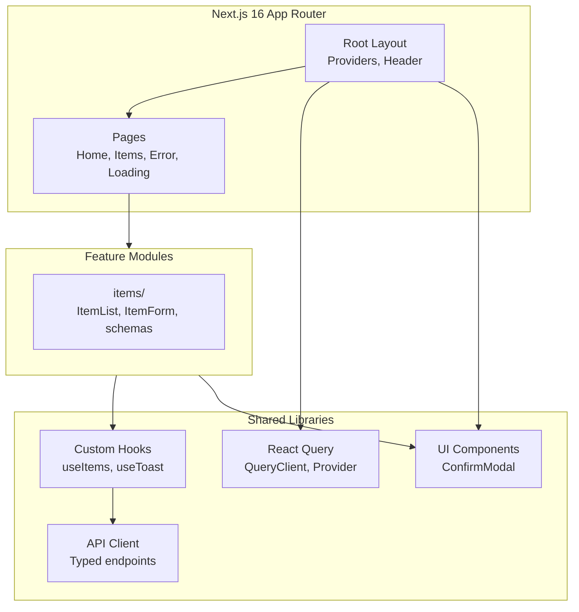
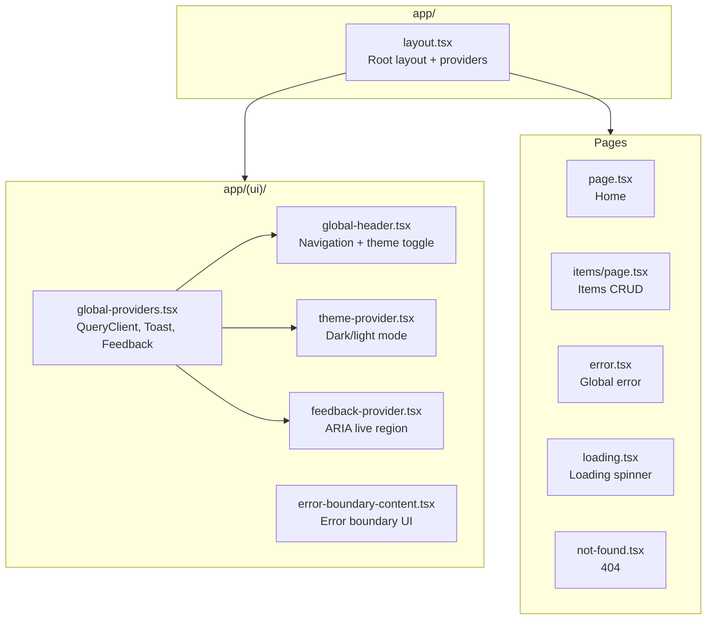
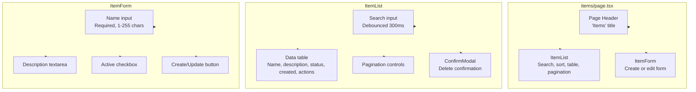
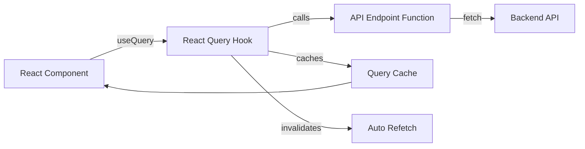
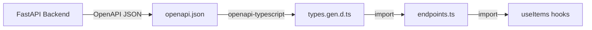
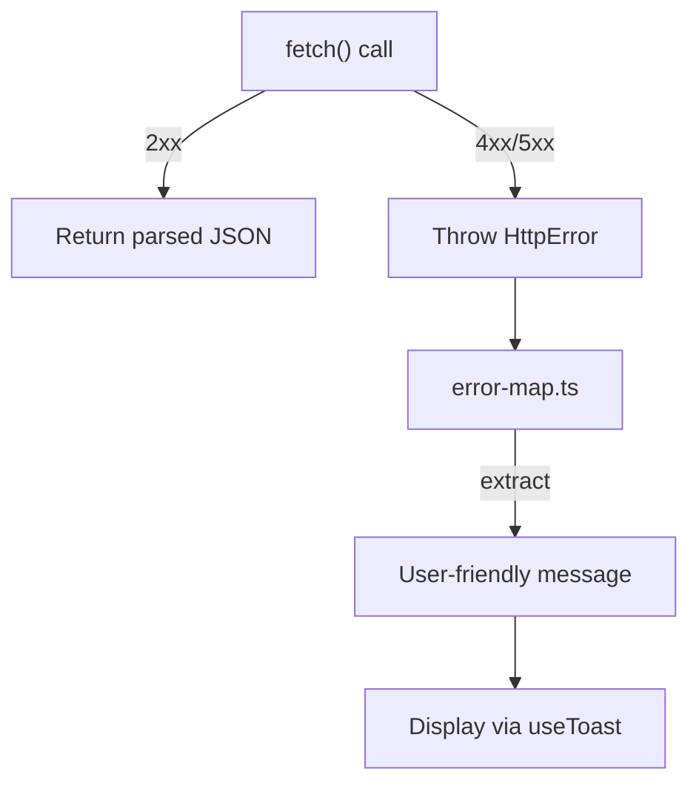
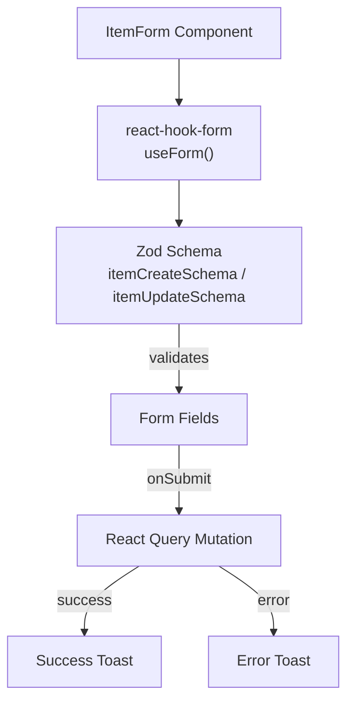
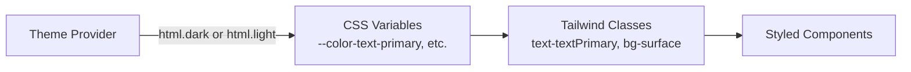
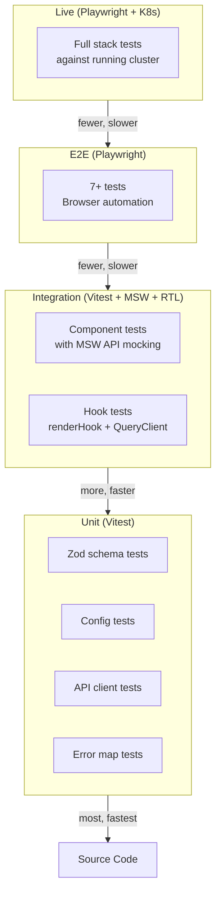
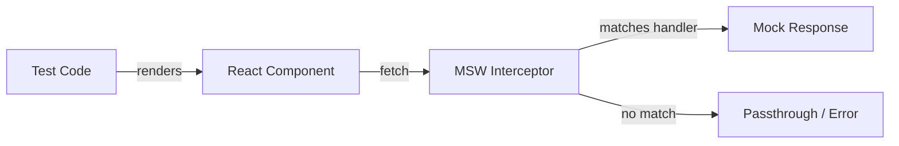

# Frontend Architecture

Detailed breakdown of the Next.js 16 frontend: App Router, components, hooks, API client, and testing.

---

## Table of Contents

- [Overview](#overview)
- [Project Layout](#project-layout)
- [App Router Structure](#app-router-structure)
- [Component Architecture](#component-architecture)
- [State Management](#state-management)
- [API Client](#api-client)
- [Form Handling](#form-handling)
- [Styling](#styling)
- [Testing Architecture](#testing-architecture)

---

## Overview

The frontend is a **Next.js 16** application using the App Router, built with:

| Technology | Purpose |
|-----------|---------|
| **Next.js 16** | Framework, App Router, SSR/SSG, standalone output |
| **React 19** | UI library, hooks, concurrent features |
| **TypeScript 6.0** | Type safety, strict mode |
| **Tailwind CSS 4** | Utility-first styling with CSS variable theming |
| **React Query v5** | Server state management, caching, refetching |
| **React Hook Form** | Form handling with zero re-renders |
| **Zod** | Runtime schema validation |
| **MSW** | API mocking for tests |
| **Playwright** | E2E browser testing |



---

## Project Layout

```
frontend/
├── app/                        # Next.js App Router
│   ├── (ui)/                   # Route group (not in URL)
│   │   ├── global-header.tsx   # Navigation header
│   │   ├── global-providers.tsx # Root providers (Query, Toast, Feedback)
│   │   ├── theme-provider.tsx  # Dark/light theme toggle
│   │   ├── feedback-provider.tsx # ARIA live region for accessibility
│   │   └── error-boundary-content.tsx # Error boundary UI
│   ├── api/healthz/route.ts    # API route for health checks (used by K8s probes)
│   ├── items/page.tsx          # Items CRUD page
│   ├── layout.tsx              # Root layout
│   ├── page.tsx                # Home page
│   ├── loading.tsx             # Loading spinner
│   ├── error.tsx               # Error boundary
│   └── not-found.tsx           # 404 page
│
├── components/                 # Shared UI components
│   └── ConfirmModal.tsx        # Reusable confirmation dialog
│
├── features/                   # Feature modules
│   └── items/
│       ├── components/
│       │   ├── ItemList.tsx    # Item list with search, sort, pagination
│       │   └── ItemForm.tsx    # Create/edit form with Zod validation
│       └── lib/
│           └── schemas.ts      # Zod schemas for item forms
│
├── lib/                        # Shared libraries
│   ├── api/
│   │   ├── client.ts           # HTTP client (fetch wrapper)
│   │   ├── endpoints.ts        # Typed API endpoint functions
│   │   ├── error-map.ts        # API error response mapper
│   │   ├── items.ts            # Item-specific API functions
│   │   ├── index.ts            # Public API barrel export
│   │   └── openapi.json        # Backend OpenAPI spec (for type generation)
│   ├── hooks/
│   │   └── useItems.ts         # React Query hooks for items CRUD
│   ├── config.ts               # App configuration (env vars)
│   ├── query.tsx               # React Query provider
│   └── toast.tsx               # Toast notification system
│
├── e2e/                        # Playwright E2E tests
│   ├── smoke.spec.ts           # Smoke tests
│   └── items-workflow.spec.ts  # Full items CRUD workflow
│
├── src/test/                   # Test infrastructure
│   ├── mocks/
│   │   ├── handlers.ts         # MSW request handlers
│   │   └── server.ts           # MSW server setup
│   ├── setup.tsx               # Vitest global setup
│   └── test-utils.tsx          # renderWithProviders helper
│
├── styles/
│   └── globals.css             # Tailwind import, @theme tokens, CSS variables, component classes
│
├── package.json
├── next.config.ts              # Next.js configuration
├── tsconfig.json               # TypeScript strict config
├── eslint.config.mjs           # ESLint 9 flat config
├── vitest.config.ts            # Base Vitest config
├── vitest.unit.config.ts       # Unit test config (jsdom)
├── vitest.integration.config.ts # Integration test config (happy-dom + MSW)
└── playwright.config.ts        # Playwright E2E config
```

---

## App Router Structure

Next.js 16 App Router with route groups and layouts:



### Route Groups

`(ui)` is a **route group** — it organizes files without affecting the URL path. All pages inside `(ui)` are accessible at their normal routes (`/`, `/items`).

### Key Pages

| Page | Route | Purpose |
|------|-------|---------|
| `page.tsx` | `/` | Home page with service info |
| `items/page.tsx` | `/items` | Full CRUD interface for items |
| `error.tsx` | All routes | Global error boundary |
| `loading.tsx` | All routes | Loading state during navigation |
| `not-found.tsx` | All routes | 404 for unmatched routes |

---

## Component Architecture

### Component Hierarchy



### Component Responsibilities

| Component | File | Responsibility |
|-----------|------|---------------|
| **ItemList** | `features/items/components/ItemList.tsx` | Display items in a table with search, sorting, pagination, and action buttons (Edit, Delete) |
| **ItemForm** | `features/items/components/ItemForm.tsx` | Create or edit an item with Zod validation; switches mode based on `editingItem` prop |
| **ConfirmModal** | `components/ConfirmModal.tsx` | Reusable confirmation dialog for destructive actions |
| **GlobalHeader** | `app/(ui)/global-header.tsx` | Navigation bar with links and theme toggle |
| **ErrorBoundaryContent** | `app/(ui)/error-boundary-content.tsx` | Error display with retry and navigation |

---

## State Management

### Server State — React Query v5

All API data is managed by **TanStack React Query**:



**Key hooks** (`lib/hooks/useItems.ts`):

| Hook | Type | Query Key | Purpose |
|------|------|-----------|---------|
| `useItems` | query | `['items', search, page, pageSize, sortField, sortDirection]` | List items with pagination/sort |
| `useItem` | query | `['item', id]` | Get single item (enabled only when `id` is truthy) |
| `useCreateItem` | mutation | — | Create item, invalidates `['items']` |
| `useUpdateItem` | mutation | — | Update item, invalidates `['items']` and `['item', id]` |
| `useDeleteItem` | mutation | — | Delete item, invalidates `['items']` |

### Client State — React `useState`

Local UI state (editing item, search input, modal visibility) uses React's `useState`:

```tsx
// Example: Items page manages editing state
const [editingItem, setEditingItem] = useState<ItemResponse | null>(null);
```

---

## API Client

### Typed API Client

The frontend generates TypeScript types from the backend's OpenAPI spec:



**Generation**:
```bash
npm run openapi-gen
# Reads: lib/api/openapi.json
# Writes: lib/api/types.gen.d.ts
```

### API Client Structure

| File | Purpose |
|------|---------|
| `client.ts` | Low-level fetch wrapper with base URL, error handling, abort support |
| `endpoints.ts` | Typed functions for each API endpoint (getHealth, getItems, createItem, etc.) |
| `items.ts` | Item-specific convenience functions |
| `error-map.ts` | Maps API error responses to user-friendly messages |
| `index.ts` | Barrel export for public API |

### Error Handling



---

## Form Handling

### React Hook Form + Zod

Forms use **React Hook Form** for performance (zero re-renders on input change) with **Zod** for validation:



**Schemas** (`features/items/lib/schemas.ts`):

| Schema | Mode | Constraints |
|--------|------|-------------|
| `itemCreateSchema` | Create | `name` required (1-255), `description` optional, `is_active` optional |
| `itemUpdateSchema` | Edit | All fields optional, same constraints |

### Create vs Edit Mode

The `ItemForm` component switches between create and edit modes via the `editingItem` prop:

- **Create mode**: Empty form, `Plus` icon, "Create Item" button
- **Edit mode**: Pre-populated form, `Pencil` icon, "Update Item" button, Cancel button

---

## Styling

### Tailwind CSS + CSS Variables

The frontend uses Tailwind CSS 4 (configured in CSS: `@theme` in `globals.css`, no `tailwind.config.ts`) with a **CSS variable-based theme** for light/dark mode:



**Key design tokens** (defined in `globals.css`):

| Token | Light Mode | Dark Mode |
|-------|-----------|-----------|
| `--color-text-primary` | `#111827` | `#f8fafc` |
| `--surface-base` | `#ffffff` | `#1e293b` |
| `--color-accent-blue` | `#2563eb` | `#3b82f6` |
| `--color-bg-main` | `#f0f2f5` | `#020617` |

**Dark mode** is the default. Toggle via the theme button in the header.

### npm overrides

`frontend/package.json` keeps only the overrides still needed; recheck them after a major bump (remove one, run `npm install`, read `npm ls <name>` and `npm audit`):

| Override | Why it stays |
|----------|--------------|
| `postcss` `^8.5.32` | Next.js pins its own older `postcss` (8.5.23); the override moves that copy to the override floor and keeps one version in the tree. |
| `openapi-typescript` > `typescript` `$typescript` | TypeScript 6 is outside openapi-typescript's `^5.x` peer range; the generated types are byte-identical. |

Vite 8 verified with the suites; the next lock refresh may move to it.

---

## Testing Architecture

### Test Pyramid



### Test Configuration

| Config | Environment | Purpose |
|--------|------------|---------|
| `vitest.config.ts` | Base | Shared settings |
| `vitest.unit.config.ts` | `jsdom` | Unit tests (pure logic, no DOM) |
| `vitest.integration.config.ts` | `happy-dom` | Component tests with MSW |
| `playwright.config.ts` | Chromium | E2E browser tests |

### MSW Mocking

Mock Service Worker intercepts API calls in tests:


