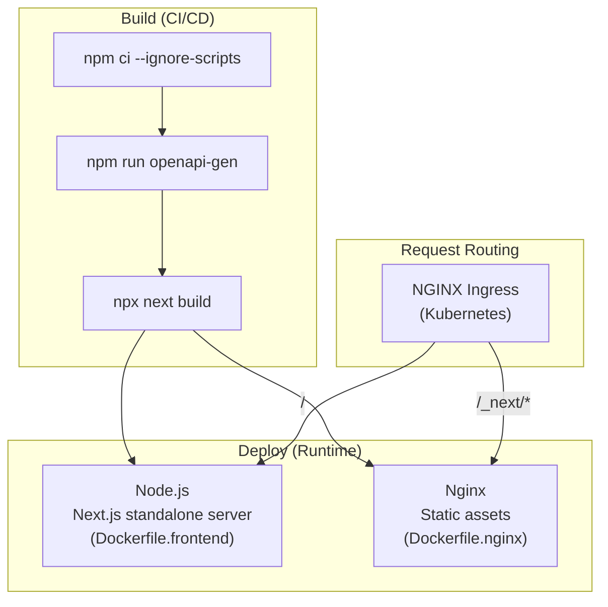

# Frontend Deployment

How the Next.js frontend is built, served, and deployed in production.

---

## Table of Contents

- [Overview](#overview)
- [Build Process](#build-process)
- [Standalone Output](#standalone-output)
- [Production Server](#production-server)
- [Nginx Static Serving](#nginx-static-serving)
- [Security Headers](#security-headers)
- [Environment Variables](#environment-variables)
- [Deployment Checklist](#deployment-checklist)

---

## Overview

The frontend is built as a **Next.js standalone application** and served by the Node.js runtime via its own container image (`Dockerfile.frontend`). Static assets are served by Nginx in a separate container (`Dockerfile.nginx`) for optimal caching. In Kubernetes, the frontend and nginx run as separate Deployments behind an NGINX Ingress Controller.



---

## Build Process

### Steps

1. **Install dependencies**: `npm ci --ignore-scripts` (deterministic; no dependency install script runs, see [Install scripts](#install-scripts))
2. **Generate API types**: `npm run openapi-gen` (from backend OpenAPI spec)
3. **Build Next.js**: `npx next build`

### Install scripts

Dependency install scripts (`preinstall`, `install`, `postinstall`) run arbitrary code at install time, so the
frontend installs with `npm ci --ignore-scripts` in the CI `setup-frontend` action and in both Dockerfile builder
stages. The build, every test, the dev server and Playwright pass without them.

Three lockfile packages declare an install script; none is needed:

| Package | What the script does | Without it |
|---|---|---|
| `esbuild` | Validates the platform binary and swaps the JS launcher for it (a start-up speed-up). | The JS launcher runs the same binary (Vite and Vitest use it). |
| `unrs-resolver` | Checks the native resolver binding and fetches a fallback if the platform package is missing. | The platform binding arrives as an optional dependency (`@unrs/resolver-binding-*`). |
| `fsevents` | Rebuilds the macOS file watcher from source (the package ships a prebuilt `fsevents.node`). | Optional and macOS-only; the prebuilt watcher still works. |

Playwright installs no browser from a postinstall: the CI jobs and developers run `npx playwright install`
explicitly.

**The allowlist.** npm 11.20 reads an `allowScripts` field in `frontend/package.json` (`name` or `name@version` to
`true` or `false`; see the npm `install-scripts` and `ci` manual pages). Ours lists the three packages above with
`false`, so even an install without `--ignore-scripts` skips them quietly. A denial is keyed by the bare name (it
survives a version bump). An approval (`true`) must be `name@<exact locked version>` and have its row in the
Exceptions section below; npm ignores ranges and dist-tags, and the guard rejects them. `npm install-scripts ls`
lists any package not yet reviewed.

**The guard.** `tests/supply_chain/test_npm_install_scripts.py` fails when `frontend/package-lock.json` has a
`hasInstallScript` package with no `allowScripts` entry, so a dependency update that adds an install script is
caught in review. When it fails, read the script, then deny it: `npm install-scripts deny <name>`, or for a package
that is not installed on this platform (npm answers ENOMATCH, as for `fsevents` on Linux)
`npm pkg set 'allowScripts.<name>=false' --json`. Do not run `npm install-scripts prune`: it drops the entries of
other-platform packages, and the guard then flags the loss. To approve, add the `name@version` row below first.

**Developers.** Install locally with `npm ci --ignore-scripts` as well: it is the same install CI runs, and nothing
in the local workflow needs a script.

#### Exceptions

None: no install script runs. An approved script gets one row here, as `name@exact-version`, with why it is
needed and how it runs instead (for example an explicit `npm rebuild <name>` step after the install).

| Package | Why | How it runs |
|---|---|---|
| (none) | | |

### Build Output

```
frontend/.next/
├── standalone/           # Minimal production server
│   └── server.js         # Entry point
├── static/               # Static assets (JS, CSS)
│   └── <hash>/
│       ├── chunks/
│       ├── css/
│       └── media/
├── server/               # Server-side code
│   └── app/
├── BUILD_ID              # Build identifier
└── required-server-files.json  # Required files manifest
```

### CI Build Validation

The Dockerfile validates the build output:

```dockerfile
RUN test -f .next/standalone/server.js \
 && test -d .next/static \
 && test -d .next/server \
 && test -f .next/BUILD_ID \
 && test -f .next/required-server-files.json \
 && test -d public
```

---

## Standalone Output

Next.js `output: 'standalone'` creates a **minimal production bundle**:

```typescript
// next.config.ts
const nextConfig: NextConfig = {
  output: 'standalone',
  // ...
};
```

### What's Included

- Only the files needed to run the production server
- No development dependencies
- No source maps (unless configured)
- Node.js binary copied from build stage

### Running the Standalone Server

```bash
# In the standalone directory
cd frontend/.next/standalone
node server.js

# Or via Docker Compose (uses Dockerfile.frontend)
docker compose up frontend
```

---

## Production Server

### Configuration

```typescript
// next.config.ts
const nextConfig: NextConfig = {
  reactStrictMode: true,
  poweredByHeader: false,    // Hide "Next.js" header
  output: 'standalone',       // Minimal production bundle
  images: { unoptimized: true }, // No Next.js Image optimization
  typedRoutes: true,          // Compile-time route checking
};
```

### Environment Variables (Production)

| Variable | Purpose |
|----------|---------|
| `NODE_ENV` | `production` (set by build) |
| `NEXT_TELEMETRY_DISABLED` | `1` (disable Next.js telemetry) |
| `NEXT_PUBLIC_API_URL` | Backend API base URL (exposed to browser) |
| `PORT` | Server port (from `FRONTEND_PORT`) |
| `HOSTNAME` | Server bind address (from `FRONTEND_HOST`). The image defaults to `0.0.0.0`: Next's standalone server binds `$HOSTNAME`, which docker sets to the container id. Override it (for example `::`) on an IPv6-only cluster. |

---

## Nginx Static Serving

Nginx serves **static assets** (`_next/static`, public files) with caching. It runs in a separate container built from `Dockerfile.nginx`:

### Configuration

```nginx
# infra/nginx/nginx.conf

server {
    listen ${NGINX_PORT};
    server_name _;

    root /app/frontend/public;

    # Next.js static assets (long cache)
    location /_next/static/ {
        alias /app/frontend/.next/static/;
        expires 365d;
        add_header Cache-Control "public, immutable";
    }

    # Health check
    location /healthz {
        return 200 'ok';
        add_header Content-Type text/plain;
    }
}
```

### Caching Strategy

| Asset Type | Cache Duration | Directive |
|-----------|---------------|-----------|
| `_next/static/*` | 365 days | `public, immutable` |
| Public files | Default | Browser default |

---

## Security Headers

Applied in production via `next.config.ts`:

```typescript
async headers() {
  if (process.env.NODE_ENV !== 'production') return [];
  return [
    {
      source: '/:path*',
      headers: [
        { key: 'Referrer-Policy', value: 'no-referrer' },
        { key: 'X-Content-Type-Options', value: 'nosniff' },
        { key: 'Permissions-Policy', value: 'geolocation=(), microphone=(), camera=()' },
        { key: 'Cross-Origin-Opener-Policy', value: 'same-origin' },
        { key: 'Cross-Origin-Resource-Policy', value: 'same-origin' },
      ],
    },
  ];
}
```

> Headers are **only applied in production** (`NODE_ENV !== 'production'` returns empty). HSTS is not set here (the edge sets it), and the Content-Security-Policy is per request in `proxy.ts` (it carries a nonce).

---

## Environment Variables

### Build-Time Variables

These are baked into the build at compile time:

| Variable | Source | Purpose |
|----------|--------|---------|
| `NEXT_PUBLIC_API_URL` | `.env` / CI variables | Backend API base URL (used by frontend API client) |

> Only variables prefixed with `NEXT_PUBLIC_` are exposed to the browser.

### Runtime Variables

These are read at server startup:

| Variable | Source | Purpose |
|----------|--------|---------|
| `PORT` | `FRONTEND_PORT` | Server port |
| `HOSTNAME` | `FRONTEND_HOST` | Server host |
| `NODE_ENV` | Build config | `production` |

---

## Deployment Checklist

### Pre-Deploy

- [ ] All tests pass (`npm test`, `npm run test:integration`)
- [ ] TypeScript type check passes (`npm run typecheck`)
- [ ] ESLint passes with 0 warnings (`npm run lint`)
- [ ] Prettier formatting is correct (`npm run format-check`)
- [ ] Build succeeds (`npm run build`)
- [ ] Environment variables are configured
- [ ] `NEXT_PUBLIC_API_URL` points to the correct backend (Ingress host)
- [ ] Helm chart renders for the target env (`helm template your-service-name charts/your-service-name -f charts/your-service-name/values.<env>.yaml`)

### Post-Deploy (Kubernetes)

- [ ] Frontend pod is running and ready
- [ ] Nginx pod is running and ready
- [ ] Frontend loads at expected URL (via Ingress)
- [ ] API calls reach the backend
- [ ] Static assets load correctly from nginx (check Network tab)
- [ ] Security headers are present (check Response headers)
- [ ] Theme toggle works (dark/light)
- [ ] Items CRUD operations work end-to-end
- [ ] Error boundary displays correctly on errors
- [ ] Loading states display during navigation
- [ ] HPA is scaling correctly (if under load)
