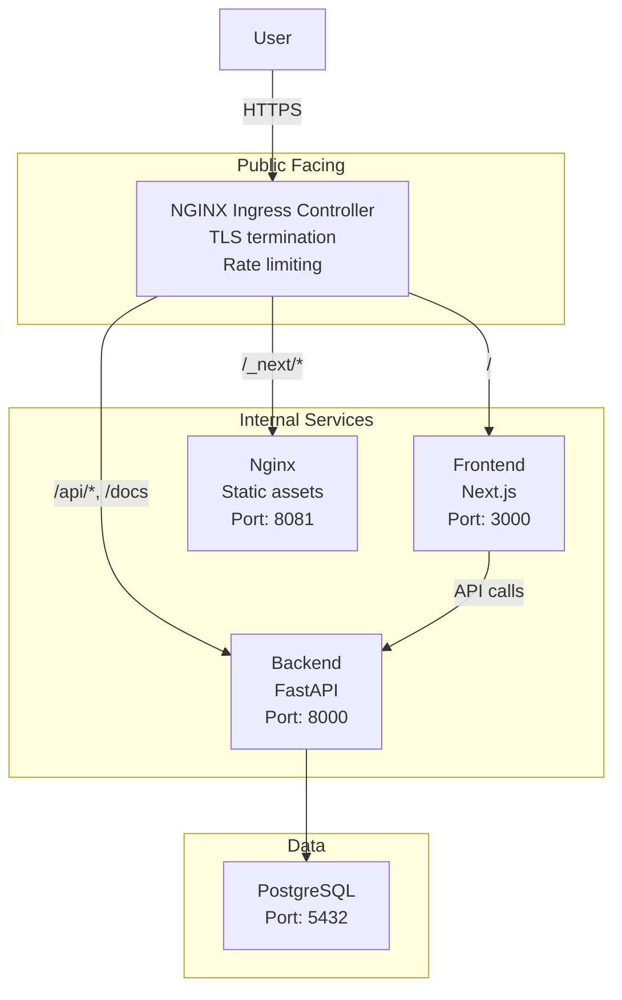
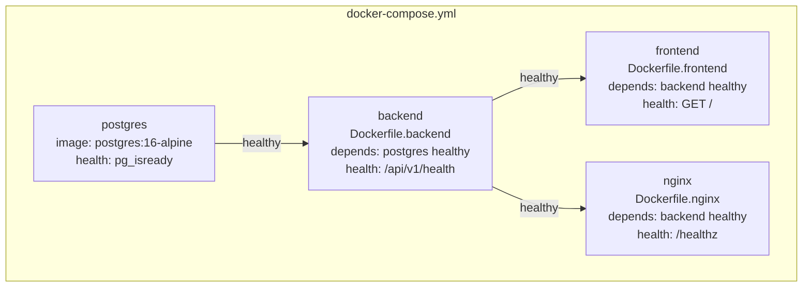

# Infrastructure

Kubernetes resources, NGINX Ingress, Docker Compose for local development, and the entrypoint system.

---

## Table of Contents

- [Overview](#overview)
- [Kubernetes Resources](#kubernetes-resources)
- [NGINX Ingress Controller](#nginx-ingress-controller)
- [Nginx Static Server](#nginx-static-server)
- [Entrypoint System](#entrypoint-system)
- [Docker Compose (Local Dev)](#docker-compose-local-dev)
- [Health Probes](#health-probes)
- [Configuration Reference](#configuration-reference)

---

## Overview

The infrastructure layer consists of Kubernetes resources that manage the application lifecycle:



---

## Kubernetes Resources

> **Deployed with the Helm chart** `charts/your-service-name/` (deploy pipeline in
> [`wiki/ci-cd.md`](./ci-cd.md)). The operational
> surface (`Makefile`, `scripts/`, `ci/deploy.yml`) drives `helm upgrade --install`; namespaces are
> per-env (`your-service-name-<env>` app + `<app-ns>-db` db). The resource set below maps 1:1 into the
> chart's `templates/`; the pre-Helm `k8s/` Kustomize tree was **removed in Phase 2 Stage C** (recoverable
> from git history, last touched `f72fdd1`) and is no longer part of the deploy flow.

### Chart templates (`charts/your-service-name/templates/`)

The base resource set maps 1:1 into the chart. Per-env differences live in
`values.<env>.yaml` (replicas, image tags/registry, hosts, gated Postgres), not in separate overlays.

---

## NGINX Ingress Controller

The NGINX Ingress Controller is the edge gateway.

### Ingress Resource

The Ingress resource defines three routing rules:

| Host | Path | Backend | Purpose |
|------|------|---------|---------|
| `api.your-domain.example` | `/api/*`, `/docs`, `/openapi.json` | Backend :8000 | API requests |
| `app.your-domain.example` | `/` | Frontend :3000 | UI rendering |
| `app.your-domain.example` | `/_next/static/*`, `/public/*` | Nginx :8081 | Static assets |
| `your-service-name.your-domain.example` | `/` | Combined | Single-domain access |

### Security Headers

Applied via `nginx.ingress.kubernetes.io/configuration-snippet` annotation:

```yaml
metadata:
  annotations:
    nginx.ingress.kubernetes.io/configuration-snippet: |
      more_set_headers "X-Content-Type-Options: nosniff";
      more_set_headers "X-Frame-Options: DENY";
      more_set_headers "Referrer-Policy: no-referrer";
      more_set_headers "Strict-Transport-Security: max-age=15552000; includeSubDomains; preload";
      more_set_headers "Content-Security-Policy: default-src 'self'; ...";
```

### Rate Limiting

```yaml
metadata:
  annotations:
    nginx.ingress.kubernetes.io/limit-rps: "100"
    nginx.ingress.kubernetes.io/limit-connections: "50"
```

### TLS Configuration

TLS is managed by cert-manager with Let's Encrypt:

```yaml
spec:
  tls:
    - hosts:
        - api.your-domain.example
        - app.your-domain.example
      secretName: your-service-name-tls
```

---

## Nginx Static Server

Nginx serves **static assets** (Next.js `_next/static`, public files) with caching headers:

- Serves files from the Next.js build output
- Configured via `infra/nginx/nginx.conf`
- Health endpoint at `/healthz`
- Binds to port 8081 (ClusterIP service)

---

## Entrypoint System

Each service has its own Dockerfile with a dedicated `CMD` that starts the service directly. There is no `SERVICE_MODE` variable in production.

The `infra/runtime/entrypoint.sh` script is retained **only for local development convenience**. It supports a `--mode` flag to start individual services or all at once:

```bash
# Start a single service locally
./infra/runtime/entrypoint.sh --mode backend
./infra/runtime/entrypoint.sh --mode frontend
./infra/runtime/entrypoint.sh --mode nginx

# Start all services (local dev only)
./infra/runtime/entrypoint.sh --mode all
```

### Backend Entry

- Runs the database migrations first (`run_migrations.sh`; the app does not migrate itself)
- Starts Uvicorn (one process per container; Kubernetes scales pods)
- Binds to `${BACKEND_HOST}:${BACKEND_PORT}`

### Frontend Entry

- Starts Next.js standalone server (`node .next/standalone/server.js`)
- Binds to `${FRONTEND_HOST}:${FRONTEND_PORT}`

### Nginx Entry

- Starts Nginx with the static config
- Binds to `${NGINX_HOST}:${NGINX_PORT}`

---

## Docker Compose (Local Dev)

The `docker-compose.yml` orchestrates the full stack for local development with 4 services:



### Service Dependencies

| Service | Depends On | Condition |
|---------|-----------|-----------|
| backend | postgres | `service_healthy` |
| frontend | backend | `service_healthy` |
| nginx | backend | `service_healthy` |

### Local Access

Access services directly on their ports:

| Service | URL |
|---------|-----|
| **Backend API** | `http://localhost:8000` |
| **Frontend** | `http://localhost:3000` |
| **Nginx (static)** | `http://localhost:8081` |
| **API Docs** | `http://localhost:8000/docs` |

### Volumes

| Volume | Purpose |
|--------|---------|
| `postgres_data` | Persistent PostgreSQL data |

---

## Health Probes

### Kubernetes Probes

| Probe | Backend | Frontend |
|-------|---------|----------|
| **startupProbe** | `/api/v1/health` (30×5s, failureThreshold: 30) | `/api/healthz` (20×5s, failureThreshold: 20) |
| **readinessProbe** | `/api/v1/health` (10s interval, 3s timeout) | `/api/healthz` (10s interval, 3s timeout) |
| **livenessProbe** | `/api/v1/healthz` (15s interval, 3s timeout) | `/api/healthz` (15s interval, 3s timeout) |

### Docker Compose Health Checks

| Service | Endpoint | Method | Success |
|---------|----------|--------|---------|
| **postgres** | `pg_isready` | CMD-SHELL | Exit 0 |
| **backend** | `/api/${API_VERSION}/health` | HTTP GET | 200 |
| **frontend** | `/api/healthz` | HTTP GET | 200 |
| **nginx** | `/healthz` | HTTP GET | 200 |

### Health Endpoint Behavior

- **`/health`** — Returns `{"ok": true}` when database is initialized, `{"ok": false}` otherwise
- **`/healthz`** — Always returns `ok` (simple connectivity check)

---

## Configuration Reference

### Environment Variables (Infrastructure)

| Variable | Default | Description |
|----------|---------|-------------|
| `BACKEND_HOST` | 127.0.0.1 | Backend bind host |
| `BACKEND_PORT` | 8000 | Backend bind port |
| `FRONTEND_HOST` | 127.0.0.1 | Frontend bind host |
| `FRONTEND_PORT` | 3000 | Frontend bind port |
| `FRONTEND_ROOT` | `./frontend` (local) / `/app/frontend` (container) | Frontend build root |
| `NGINX_HOST` | 127.0.0.1 | Nginx bind host |
| `NGINX_PORT` | 8081 | Nginx bind port |

### Kubernetes-Specific Configuration

Kubernetes environment variables are managed via the chart's ConfigMap and Secret resources; per-env values live in `charts/your-service-name/values.<env>.yaml`.
