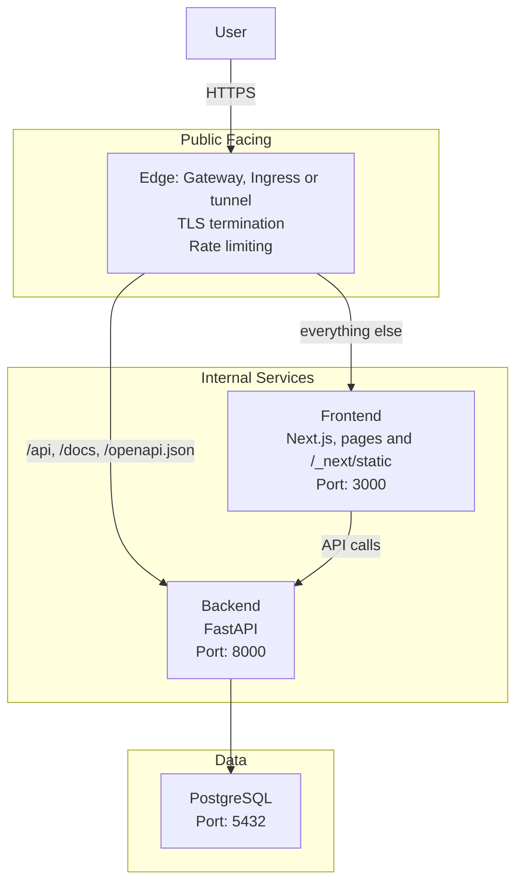
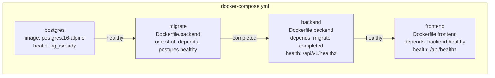

# Infrastructure

Kubernetes resources, the edge, Docker Compose for local development, and the entrypoint system.

---

## Table of Contents

- [Overview](#overview)
- [Kubernetes Resources](#kubernetes-resources)
- [Edge](#edge)
- [Collecting logs](#collecting-logs)
- [Static assets](#static-assets)
- [Entrypoint System](#entrypoint-system)
- [Docker Compose (Local Dev)](#docker-compose-local-dev)
- [Health Probes](#health-probes)
- [Configuration Reference](#configuration-reference)

---

## Overview

The infrastructure layer consists of Kubernetes resources that manage the application lifecycle:



---

## Kubernetes Resources

> **Deployed with the Helm chart** `charts/your-service-name/` (deploy pipeline in
> [`wiki/ci-cd.md`](./ci-cd.md)). The operational
> surface (`Makefile`, `scripts/`, `ci/deploy.yml`) drives `helm upgrade --install`; namespaces are
> per-env (`your-service-name-<env>` app + `<app-ns>-db` db). The resource set below maps 1:1 into the
> chart's `templates/`; the pre-Helm `k8s/` Kustomize tree was **removed in Phase 2 Stage C** (recoverable
> from git history, last touched `f72fdd1`) and is no longer part of the deploy flow.

**The deploy refuses placeholders.** The deploy script (`scripts/ci/deploy-env.sh`) runs
`helm upgrade` with `--set guards.rejectPlaceholders=true`, so the render fails while an
`edge.hosts` value still contains `your-domain.example`, or, in gateway mode, an
`edge.gateway.parentRefs` entry still names `your-gateway`. CI renders leave the guard off, so the
template's own values keep rendering. Pass the same `--set` to a `helm upgrade` you run by hand.

### Chart templates (`charts/your-service-name/templates/`)

The base resource set maps 1:1 into the chart. Per-env differences live in
`values.<env>.yaml` (replicas, image tags/registry, hosts, gated Postgres), not in separate overlays.

---

## Edge

How traffic reaches the two Services. `edge.mode` picks one of three modes, and one routes list
feeds all of them, so a path is written once. The values and their comments are the reference:
the `edge:` and `networkPolicy:` blocks of [`values.yaml`](../charts/your-service-name/values.yaml).

### The three modes

| Mode | Renders | Pick it when |
|------|---------|--------------|
| `gateway` (default) | One Gateway API `HTTPRoute` per host, attached to `edge.gateway.parentRefs` | The cluster runs a Gateway (GKE Gateway, or any in-cluster implementation). |
| `ingress` | One controller-agnostic `networking.k8s.io/v1` Ingress, no class or annotations by default | The cluster has an Ingress controller and no Gateway. |
| `tunnel` | No edge object; NOTES prints the route table | A tunnel (for example Cloudflare Tunnel) is the only way in. |

### The routes list

`edge.routes` in [`values.yaml`](../charts/your-service-name/values.yaml): `/api`, `/docs` and
`/openapi.json` go to `backend`, everything else to `frontend`. The root host serves every route,
the api host the `backend` routes, the app host the `frontend` routes. `backend` is the API Service,
or the WAF Service when `waf.enabled`. Gateway mode renders it into the HTTPRoutes, ingress mode into
the Ingress rules.

In tunnel mode the same list is the tunnel's route table. `helm install` prints it in NOTES (print it
again with `helm get notes <release> -n <namespace>`), one line per hostname and path, with the
in-cluster URL to point the tunnel at. The full table for the default values, release `svc` in
namespace `app`:

```text
api.your-domain.example/api                              PathPrefix -> http://svc-your-service-name-backend.app.svc.cluster.local:8000
api.your-domain.example/docs                             PathPrefix -> http://svc-your-service-name-backend.app.svc.cluster.local:8000
api.your-domain.example/openapi.json                     Exact      -> http://svc-your-service-name-backend.app.svc.cluster.local:8000
app.your-domain.example/                                 PathPrefix -> http://svc-your-service-name-frontend.app.svc.cluster.local:3000
your-service-name.your-domain.example/api                PathPrefix -> http://svc-your-service-name-backend.app.svc.cluster.local:8000
your-service-name.your-domain.example/docs               PathPrefix -> http://svc-your-service-name-backend.app.svc.cluster.local:8000
your-service-name.your-domain.example/openapi.json       Exact      -> http://svc-your-service-name-backend.app.svc.cluster.local:8000
your-service-name.your-domain.example/                   PathPrefix -> http://svc-your-service-name-frontend.app.svc.cluster.local:3000
```

Configure the tunnel from that table: [Cloudflare setup](./cloudflare-setup.md#84-route-a-test-hostname-through-the-tunnel).

### NetworkPolicy per mode

The app namespace is default-deny ([`network-policy.yaml`](../charts/your-service-name/templates/network-policy.yaml)).
The edge peers depend on the mode:

| Mode | Edge peers |
|------|------------|
| `gateway` | Each `edge.gateway.parentRefs` namespace (the release namespace when a ref names none), plus `35.191.0.0/16` and `130.211.0.0/22` (Google's load balancer proxies and health checks) when `edge.gateway.gke.enabled`. |
| `tunnel` | The namespace `edge.namespaceSelector` selects; empty means `kubernetes.io/metadata.name: cloudflared`. |
| `ingress` | The namespace `edge.namespaceSelector` selects. Required: the render fails without it, because the chart does not guess your controller's namespace. |

Every mode adds `edge.extraPeers`, for example a regional load balancer's proxy-only subnet as an
`ipBlock`. A `parentRef` without a namespace admits every Pod of the app namespace; to narrow it,
give the Gateway a namespace or list its Pods in `extraPeers` with a `podSelector`. The flows, each allowed on both ends:

| Source | Destination | When |
|--------|-------------|------|
| Edge peers | frontend, frontend port | always |
| Edge peers | backend, backend port | `waf.enabled: false` |
| frontend | backend, backend port | `waf.enabled: false` (server-side calls, `BACKEND_URL`) |
| Edge peers, frontend | WAF, `waf.service.port` | `waf.enabled: true`; then nothing but the WAF reaches the backend |
| WAF | backend, backend port | `waf.enabled: true` |
| `networkPolicy.backendExtraIngressPeers` (NetworkPolicy peers, for example the auth proxy) | backend, backend port | when set, with the WAF on or off; empty adds no rule. These peers reach the backend around the WAF |
| `monitoringPodSelector` Pods in the `monitoringNamespaceSelector` namespace (`networkPolicy`) | backend, the metrics port (today the API port) | only with a scrape target (`monitoring.scrapeAnnotations`, on by default, or `monitoring.serviceMonitor`); empty selectors mean `app.kubernetes.io/name: prometheus` in the `monitoring` namespace; `monitoringNamespaceSelector: null` removes the rule |
| backend, migration Job | PostgreSQL :5432 (or `externalDatabase.egressCIDR`) | always |
| every egress policy | kube-dns :53 (`networkPolicy.dns`; empty: `k8s-app: kube-dns` in `kube-system`; plus optional `ipBlocks` such as NodeLocal DNSCache) | always |

With the WAF on, the frontend's `BACKEND_URL` is the WAF Service too, so the same-origin `/api/v1`
proxy and server-side calls pass the WAF. A set selector replaces its default; it is not merged
with it. A managed collector (for example GKE's managed Prometheus) runs in another namespace with
other labels: set both monitoring selectors to match it. Nothing else reaches PostgreSQL or the migration Job. Other backend egress (a collector, a Redis) goes
in `backend.networkPolicy.extraEgress`.

### GKE Gateway policies

`edge.gateway.gke.enabled` (off by default; gateway mode only) renders two `networking.gke.io/v1`
policies for the backend Service (the WAF Service when the WAF is on) and the frontend Service:

- **HealthCheckPolicy.** GKE does not read readiness probes, and checks `/` otherwise; the backend has
  no `/`, so without it the load balancer marks the backend unhealthy and serves nothing. The check
  uses the readiness paths (`/api/v1/health`, `/api/healthz`) on the serving port, through the WAF
  when it is on.
- **GCPBackendPolicy.** `timeoutSec` (default 120), the load balancer access log
  (`logging.sampleRate`, default 1000000, every request) and, when `securityPolicy` names one, a
  Cloud Armor policy.

Cloud CDN is not rendered: no GKE Gateway policy field for it was confirmed. The CDN is the one in
front (Cloudflare or another); check GKE Gateway CDN support against current GKE docs before adding
it. Cluster-side steps: [GKE cluster setup](./gke-cluster-setup.md#94-serve-the-chart-through-gke-gateway).

### TLS per mode

| Mode | Where TLS terminates |
|------|---------------------|
| `gateway` | The Gateway listener's certificate, which you manage on the Gateway. The chart renders no TLS, and NOTES prints the hosts without a scheme. |
| `ingress` | `edge.ingress.tlsSecretName` adds a `tls` block for the three hosts; the certificate comes from an issuer you add (for example a cert-manager annotation in `edge.ingress.annotations`). NOTES prints `https` only when it is set. |
| `tunnel` | Cloudflare, at its edge. The hop from `cloudflared` to the Service is plain HTTP inside the cluster. |

### Where the former nginx practices live now

The chart used to carry ingress-nginx annotations. It is controller-agnostic now:

| Former annotation | Now |
|-------------------|-----|
| `enable-access-log` | gateway: the Gateway implementation's log (on GKE, the GCPBackendPolicy access log); ingress: the controller's log; tunnel: Cloudflare's logs. The backend's own request log is `LOG_REQUESTS` (off by default). |
| `limit-rps` (100 req/s per client, every path) | The backend's per-IP limit (`RATE_LIMIT_DEFAULT`, [Security](./security.md#rate-limiting)), backend only. At the edge, covering the frontend too: GKE, a Cloud Armor policy with a rate-based rule named in `edge.gateway.gke.securityPolicy`; tunnel, Cloudflare rate-limiting rules; ingress, the controller's own setting. |
| `limit-connections` | No chart setting. The edge's own connection limits apply (Cloud Armor, Cloudflare, the controller). |
| `proxy-connect-timeout` (5 s) | No chart setting; the edge's default applies. |
| `proxy-read-timeout` / `proxy-send-timeout` (120 s) | GKE: `edge.gateway.gke.timeoutSec` (120). Any Gateway: `edge.gateway.timeouts`, opt-in, for example `{request: 120s, backendRequest: 100s}`; `backendRequest` must not exceed `request`. |
| `ssl-redirect` | The Gateway listener (an HTTP listener with a redirect route), Cloudflare's Always Use HTTPS, or the controller. |
| `proxy-body-size` (10m) | The backend (`MAX_REQUEST_BODY_BYTES`, 10 MiB). |

Response headers come from the backend and the frontend, never the edge: [Security](./security.md#http-security-headers).

### Client IP behind the edge

Set `config.TRUSTED_PROXY_CIDRS` to the hops that connect to the backend: the gateway Pods' range
(gateway mode, in-cluster), the Google ranges above (GKE), the controller's Pods (ingress), or the
`cloudflared` Pod range (tunnel); add the WAF's Pods when it is on. With the WAF off, add the
frontend Pod range too: same-origin `/api/v1` calls on the app host reach the backend from the
frontend's proxy, which forwards `X-Forwarded-For` unchanged (it appends nothing), so trusting it
keeps each client's own address. The rules and what each proxy
must do: [Security, Client IP](./security.md#client-ip).

---

## Collecting logs

Every container writes its logs to stdout and stderr, and nothing else: no log file, no log
directory, no log volume. The backend's request line (`LOG_REQUESTS`, on in the chart) holds
the method, path, status, duration and the resolved client IP, and never a query string, header,
cookie or body.

Collecting them off the node is the platform's job. Use the platform's own agent (on GKE, the
built-in Cloud Logging, enabled with `--logging=SYSTEM,WORKLOAD`) or a collector the platform team
installs for the whole cluster, in its own namespace. The chart ships none, because a node-level
collector runs as root, mounts a `hostPath` to read the node's log files and needs capabilities, and
that breaks the `restricted` Pod Security profile the app namespace enforces.

---

## Static assets

The frontend server serves its own static assets, and a CDN in front caches them at the edge. [`frontend/static-paths.ts`](../frontend/static-paths.ts) is the one list of static paths. The cache policy: [Frontend Deployment](./frontend-deployment.md#static-assets).

---

## Entrypoint System

Each service has its own Dockerfile with a dedicated `CMD` that starts the service directly. There is no `SERVICE_MODE` variable in production.

The `infra/runtime/entrypoint.sh` script is retained **only for local development convenience**. It supports a `--mode` flag to start individual services or all at once:

```bash
# Start a single service locally
./infra/runtime/entrypoint.sh --mode backend
./infra/runtime/entrypoint.sh --mode frontend

# Start backend and frontend together (local dev only)
./infra/runtime/entrypoint.sh --mode all
```

### Backend Entry

- Runs the database migrations first (`python -m your_service_name.backend.db.run_migrations`; the app does not migrate itself)
- Starts Uvicorn (one process per container; Kubernetes scales pods)
- Binds to `${BACKEND_HOST}:${BACKEND_PORT}`

### Frontend Entry

- Starts Next.js standalone server (`node .next/standalone/server.js`)
- Binds to `${FRONTEND_HOST}:${FRONTEND_PORT}`

---

## Docker Compose (Local Dev)

The `docker-compose.yml` orchestrates the full stack for local development with three long-running services and a one-shot `migrate` job:



### Service Dependencies

| Service | Depends On | Condition |
|---------|-----------|-----------|
| migrate | postgres | `service_healthy` |
| backend | migrate | `service_completed_successfully` |
| frontend | backend | `service_healthy` |

### Local Access

Access services directly on their ports:

| Service | URL |
|---------|-----|
| **Backend API** | `http://localhost:8000` |
| **Frontend** | `http://localhost:3000` |
| **API Docs** | `http://localhost:8000/docs` |

### Volumes

| Volume | Purpose |
|--------|---------|
| `postgres_data` | Persistent PostgreSQL data |

---

## Health Probes

### Kubernetes Probes

| Probe | Backend | Frontend |
|-------|---------|----------|
| **startupProbe** | `/api/v1/healthz` (30×5s, failureThreshold: 30) | `/api/healthz` (20×5s, failureThreshold: 20) |
| **readinessProbe** | `/api/v1/health` (10s interval, 5s timeout) | `/api/healthz` (10s interval, 5s timeout) |
| **livenessProbe** | `/api/v1/healthz` (15s interval, 5s timeout) | `/api/healthz` (15s interval, 5s timeout) |

### Docker Compose Health Checks

| Service | Endpoint | Method | Success |
|---------|----------|--------|---------|
| **postgres** | `pg_isready` | CMD-SHELL | Exit 0 |
| **backend** | `/api/${API_VERSION}/healthz` | HTTP GET | 200 |
| **frontend** | `/api/healthz` | HTTP GET | 200 |

### Health Endpoint Behavior

- **`/health`** — Readiness: 200 when the database is reachable and the schema is current, 503 otherwise (see [Database](./database.md))
- **`/healthz`** — Process only: no database or schema check

---

## Configuration Reference

### Environment Variables (Infrastructure)

| Variable | Default | Description |
|----------|---------|-------------|
| `BACKEND_HOST` | 127.0.0.1 | Backend bind host |
| `BACKEND_PORT` | 8000 | Backend bind port |
| `FRONTEND_HOST` | 127.0.0.1 | Frontend bind host |
| `FRONTEND_PORT` | 3000 | Frontend bind port |
| `FRONTEND_ROOT` | `./frontend` (local) / `/app/frontend` (container) | Frontend build root |

### Kubernetes-Specific Configuration

Kubernetes environment variables are managed via the chart's ConfigMap and Secret resources; per-env values live in `charts/your-service-name/values.<env>.yaml`.
