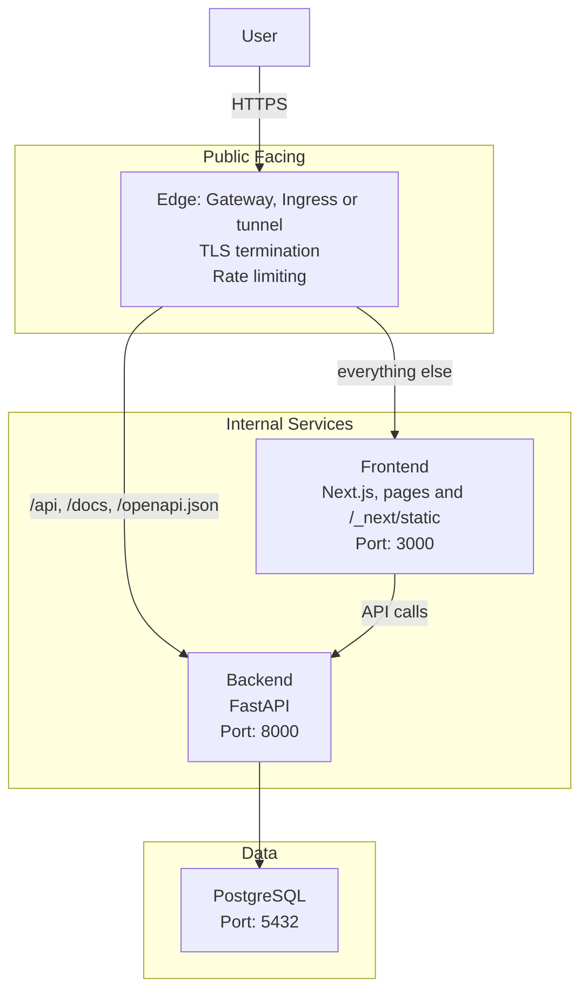
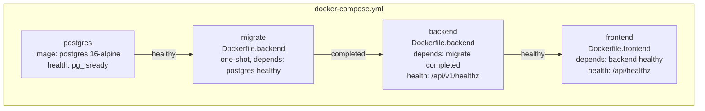

# Infrastructure

Kubernetes resources, the edge, Docker Compose for local development, and the entrypoint system.

---

## Table of Contents

- [Overview](#overview)
- [Kubernetes Resources](#kubernetes-resources)
- [Namespace bootstrap (one-time admin step)](#namespace-bootstrap-one-time-admin-step)
- [Local cluster (kind)](#local-cluster-kind)
- [Workloads: rollout, resources and shutdown](#workloads-rollout-resources-and-shutdown)
- [Edge](#edge)
- [Collecting logs](#collecting-logs)
- [Static assets](#static-assets)
- [Entrypoint System](#entrypoint-system)
- [Docker Compose (Local Dev)](#docker-compose-local-dev)
- [Health Probes](#health-probes)
- [Configuration Reference](#configuration-reference)

---

## Overview

The infrastructure layer consists of Kubernetes resources that manage the application lifecycle:



---

## Kubernetes Resources

> **Deployed with the Helm chart** `charts/your-service-name/` (deploy pipeline in
> [`wiki/ci-cd.md`](./ci-cd.md)). The operational
> surface (`Makefile`, `scripts/`, [`deploy.yml`](../.github/workflows/deploy.yml)) drives `helm upgrade --install`; namespaces are
> per-env (`your-service-name-<env>` app + `<app-ns>-db` db). The resource set below maps 1:1 into the
> chart's `templates/`; the pre-Helm `k8s/` Kustomize tree was **removed** (recoverable
> from git history) and is no longer part of the deploy flow.

**The deploy refuses placeholders.** The deploy script (`scripts/ci/deploy-env.sh`) runs
`helm upgrade` with `--set guards.rejectPlaceholders=true`, so the render fails while an
`edge.hosts` value still contains the template's placeholder domain, or, in gateway mode, an
`edge.gateway.parentRefs` entry still names `your-gateway`, or an image the release renders still
has the placeholder digest (`sha256:` and 64 zeros), or `config.OIDC_ISSUER` is the
placeholder issuer or on the placeholder domain, or `config.OIDC_AUDIENCE` is `your-oidc-audience` (or the Cloud SQL
instance or the ExternalSecret store is still the placeholder, `secrets.dbPassword` is empty with
the in-cluster PostgreSQL and the chart's own Secret, or, in production with the rules on,
`monitoring.runbookUrl` still points at the placeholder repository). Each match ignores case, and
the guard spells the placeholders in pieces, so `infra/adapt/adopt.sh` never stamps your own values
into it ([Adaptation](./adaptation.md#what-the-adapters-stamp-and-what-they-leave)). It collects every placeholder it
finds and fails once, naming each field, so one refused render lists them all. CI renders and the admin bootstrap leave the guard off, so the template's own values keep
rendering; so does the deploy's first render, which only finds the images that run, before the
release digests are set. Pass the same `--set` to a `helm upgrade` you run by hand.

**Production rules.** With `environment: production` the render fails unless:
- `config.ENV` is `production`, so the backend's own production checks run;
- every image the release renders has a digest (the backend and the migration Job, the frontend,
  the database client; the WAF and the Cloud SQL proxy while they are on). Your own
  `backend.extraInitContainers` too: each `image` must be `<repository>[:<tag>]@sha256:<64 hex>`;
- the database is managed: `postgresql.enabled` is false, and `externalDatabase.enabled` or
  `cloudSqlProxy.enabled` is true;
- `config.AUTH_MODE` is one of the backend's modes and not `none` (unset or blank means `none`),
  unless `config.ALLOW_ANONYMOUS` is `"true"`: the backend's own production rule, read as the backend
  reads it (trimmed, case-insensitive), checked before the Pods start;
- the backend and the frontend run at least 2 Pods: `hpa.<name>.minReplicas` while the HPA is on,
  else `replicas.<name>`;
- each PodDisruptionBudget keeps a Pod (`pdb.<name>.minAvailable` 1 or more);
- `tests.enabled` is false (the `helm test` hooks are for local and kind).

These live in `templates/validate-values.yaml`, not the schema, because they depend on what renders
and because Helm checks the schema before any template (a schema rule would hide the clearer
`config.ENV` message). The schema checks the digest format in every environment:
`sha256:<64 lower-case hex>`, or empty for the tag.

**Before the first production deploy**, replace what `values.production.yaml` holds as a
placeholder. The deploy sets the image digests itself, so in the file:
- `edge.hosts` (and, in gateway mode, `edge.gateway.parentRefs`): your hostnames and Gateway;
- `config.OIDC_ISSUER` and `config.OIDC_AUDIENCE`: your identity provider's issuer (https) and the
  API's audience. To use another mode, change `config.AUTH_MODE` and set its own settings
  ([Security](./security.md));
- `externalDatabase` (`host`, `egressCIDR`) and `secrets.existingSecret`: your managed database and
  its Secret.

A hand-run `helm upgrade` also passes `--set images.<name>.digest=sha256:<64 hex>` for each image.
The guard lists every field it refuses, in one message.

### Validating every render (kubeconform)

`make kubeconform` (`scripts/ci/kubeconform.sh`; CI runs it in the chart job) renders each
`values.<env>.yaml` with each edge mode (`ci/<mode>-values.yaml`) and both monitoring flavours, each
environment with every optional object on and with the Cloud SQL proxy, and the admin bootstrap,
and validates each render with `kubeconform -strict`. It reads local schemas only, so it runs
offline: an unknown field, or a kind with no schema, fails it.
- **Kubernetes kinds:** generated once into `.tools/k8s-schemas` from the Kubernetes OpenAPI spec of
  the chart's `kubeVersion` floor, pinned in `tools/pins.tsv` (`k8s-openapi`) and installed by
  `scripts/tools.sh install k8s-openapi`. Move the pin with the floor.
- **CRDs:** `charts/your-service-name/ci/crds/<group>/<kind>_<version>.json`, committed and
  generated from the upstream CRDs listed, with version and sha256, in `ci/crds/sources.tsv`.

To add a CRD schema (a new kind the chart renders): add or extend its row in `ci/crds/sources.tsv`
(the upstream file at a release tag, its sha256 and the kind), run `make crd-schemas` (the fetch is
the only network step; it refuses a sha256 mismatch) and commit the generated files.
`make crd-schemas-check`, which CI runs too, fails when the committed files differ from what the
pinned sources generate; its test (in `make test`) reads only the cache that `make tools`
(`scripts/tools.sh install crd-sources`) fills, so the tests stay offline. Renovate proposes new
versions of the sources like the tool pins; the `pins` check stays red until `make pins-refresh` has
written the new sha256, and then `make crd-schemas` regenerates the files.

### Checking the rules (promtool)

`make rules-test` (`scripts/ci/rules-test.sh`; CI runs it in the chart job) renders the chart with the
rules on in both monitoring flavours, extracts every `spec.groups` into a Prometheus rule file per
flavour, runs `promtool check rules` on it, and runs `promtool test rules` on each file in
`charts/your-service-name/tests/rules` against both. promtool comes from the Prometheus release,
pinned with its sha256 in `tools/pins.tsv` (`scripts/tools.sh install promtool`); the check is offline.
A test proves it fails on a broken rule. The objectives and alerts are described in
[Service Level Objectives](./operations-runbook.md#service-level-objectives).

### Chart templates (`charts/your-service-name/templates/`)

The base resource set maps 1:1 into the chart. Per-env differences live in
`values.<env>.yaml` (replicas, image tags/registry, hosts, gated Postgres), not in separate overlays.

---

## Namespace bootstrap (one-time admin step)

The chart creates no namespace (`namespaces.create: false`, the default), no RBAC (`rbac.create:
false`) and no quota. A cluster admin creates them once per environment, before the first deploy, so
the deployer needs no cluster-scoped rights and no RBAC rights at all.

**What it creates** ([`infra/k8s/bootstrap/`](../infra/k8s/bootstrap/), rendered by
[`scripts/k8s-bootstrap.sh`](../scripts/k8s-bootstrap.sh)):
- the app namespace `<release>-<env>` and, when the env uses the in-cluster PostgreSQL, the database
  namespace `<release>-<env>-db`. Both enforce, audit and warn on the **restricted** Pod Security
  profile, with the version label. Every workload of the chart meets it, PostgreSQL included; an
  offline test checks each Pod template against the profile's rules.
  The `tier` label (`app-ns`, `db`) is what the chart's NetworkPolicies select on;
- the app namespace's ResourceQuota and LimitRange. They set no CPU limit (CPU limits throttle);
  memory is capped. The quota is sized from the chart's worst case by a test (every Deployment at its
  HPA maximum plus the rollout surge and terminating Pods, the WAF, the proxy sidecars and the migration
  Job, with 20% headroom): raising replicas, an HPA `maxReplicas` or a request needs a quota bump in
  `infra/k8s/bootstrap/values.yaml`, or that test fails;
- in each namespace, the Role and RoleBinding `bootstrap-deployer` for the deploy identity;
- the app's own Role and RoleBinding (its ServiceAccount reads ConfigMaps), rendered from the chart's
  `templates/rbac.yaml` with `helm template --show-only`, so their rules have one source.

**Pull request previews** (optional, off by default; [CI/CD](./ci-cd.md#pull-request-previews)) are the environment `preview`, rendered only when you ask for it (`scripts/k8s-bootstrap.sh preview`, on the dev cluster): one namespace `<release>-preview` for every preview release, its database namespace, a quota sized for three previews (`quotaReleases`), a quota and LimitRange in its database namespace too, for exactly three databases (`dbQuota`, `dbLimitRange`: empty, so not rendered, in every other environment), a deployer of its own, and the ServiceAccount the releases share (`sharedServiceAccount`; the chart there runs with `serviceAccount.create: false`). Its app namespace's `tier` is `preview-app` (`appTier`, equal to the chart's `namespaces.appTier`; a test keeps them equal), so the other environments' databases, which admit `app-ns`, never admit a preview's Pods. After the apply, `scripts/k8s-bootstrap.sh preview --create-secrets` (the one mode that contacts the cluster, through your kubectl) creates the database Secrets the chart's `values.preview.yaml` names, with one random password the previews share, never printed or committed; a re-run keeps them ([Pull request previews](./ci-cd.md#pull-request-previews)).

**Render and apply it,** per environment (`dev`, `qa`, `production`, `preview`, or `local` for a local cluster):

```bash
scripts/k8s-bootstrap.sh dev > bootstrap-dev.yaml      # prints YAML; never contacts a cluster
kubectl apply -f bootstrap-dev.yaml                    # as a cluster admin
```

`--release NAME` sets the release (`SERVICE_NAME` in CI; default `your-service-name`), `--namespace`
the app namespace, and `--db` / `--no-db` overrides whether the database namespace is created.
`scripts/k8s-env.sh apply` (and `make k8s-apply`) applies it for you before the chart, on a cluster
where you are the admin. Re-applying is safe. Each environment's settings are in
`infra/k8s/bootstrap/values.<env>.yaml`, over the defaults in `values.yaml`.

**Set the deployer subject** in `values.<env>.yaml` (`deployer.kind`, `deployer.name`, and
`deployer.namespace` for a ServiceAccount). The committed names are placeholders. On GKE the deploy
logs in as the environment's Google service account, and Kubernetes RBAC sees its email as a user:

```yaml
deployer:
  kind: User
  name: gh-deployer-dev@<PROJECT_ID>.iam.gserviceaccount.com
```

**What the deployer may do:** create, change and delete exactly the kinds the chart renders in that
namespace, plus the Secrets Helm keeps its release history in; and read Pods and ReplicaSets, read Pod
logs and port-forward, which the deploy's wait, verify and smoke steps use. It can't `exec` into a
Pod: the verify step asks each Pod's health route over a port-forward. A test derives the kind list
from the chart, so a kind added to the chart fails it until the Role covers the kind.

**The quota and Helm's history:** every upgrade keeps 5 release revisions (`--history-max`,
`HELM_HISTORY_MAX` in `scripts/ci/deploy-env.sh` and `scripts/k8s-env.sh`), each a Secret. The Secrets
quota covers them, the one written during an upgrade, the chart's own Secrets and headroom; a test
recomputes it for every environment, so raise the two together.

**A `fullnameOverride`, `nameOverride` or `serviceAccount.name`:** the first two name the app's Role
and RoleBinding (`<fullname>-role`, `<fullname>-binding`), the third is the RoleBinding's subject.
The bootstrap renders them with the chart's `values.<env>.yaml`, so an override set there is used as
it is; one set elsewhere (`--set`, another values file) goes in the bootstrap's `values.<env>.yaml` as
`fullname`, `nameOverride` or `serviceAccountName`. Unset, the chart's own values decide.

**What it may never do:** use a wildcard, `escalate`, `bind` or `impersonate`; touch namespaces,
ResourceQuotas or LimitRanges; or create, change or delete any Role or RoleBinding. So it can't widen
its own rights, and it can't copy them to another identity by binding its Role to it. That is why the
quota, the LimitRange and all RBAC live in the bootstrap: a compromised deploy can't lift its own
limits or hand its rights on. (Its write access to Secrets and ServiceAccounts in its own namespaces
remains, as Helm needs it: Helm keeps its release records as Secrets, so `helm status`, `history` and
`rollback`, the deploy-ops operations, read them. It reads Secrets in its own namespaces only: in
every other namespace, and cluster-wide, it is refused, which the kind job checks on a real API
server.)

**The single-tenant path, without the bootstrap:** a cluster admin installs the chart with
`--set namespaces.create=true --set rbac.create=true`, so the release itself renders both namespaces
and the app's RBAC (there is then no quota, no LimitRange and no deployer Role). Helm keeps its release
record in the release namespace, so that namespace must exist first, with Helm's ownership metadata
for the release to adopt it (the label `app.kubernetes.io/managed-by=Helm`, the annotations
`meta.helm.sh/release-name` and `meta.helm.sh/release-namespace`).

**An existing release from an older chart** owns its Namespaces and the app's Role and RoleBinding
(the older chart rendered them unconditionally). Switching it to the bootstrap is a one-time admin
step, before the first deployer upgrade: the deployer has no rights on Namespaces or RBAC, so its
upgrade would try to delete them and be refused, and an admin upgrade without this step would delete
the namespaces with everything in them. As a cluster admin, with the chart checkout the deploy uses
and the values its deploy passes, run `scripts/migrate-to-bootstrap.sh` once per environment:

```bash
# Check everything and print the steps and what it would keep; changes nothing.
scripts/migrate-to-bootstrap.sh dev --context <context> --release your-service-name --values values.secret.yaml --dry-run
# Migrate, with the deploy's own values (yours: the secret values and the image digests).
scripts/migrate-to-bootstrap.sh dev --context <context> --release your-service-name --values values.secret.yaml
```

`--context` is required: every helm and kubectl call gets it, and the confirmation and the dry run
name it with its cluster's server. Pass the values the deploy of this chart version passes after the
env's values file: your secret values (or `secrets.existingSecret`) and the images it deploys, for
example `--values values.secret.yaml --set images.backend.digest=sha256:…`. `--set` and `--set-string` reach the bootstrap render too (as `--chart-set` and `--chart-set-string`), so it renders the app's RBAC from the values the upgrades use. Without any it refuses
(an upgrade without the secret values would empty the app's Secrets), unless `--env-values-only` says
`values.<env>.yaml` is all the deploy passes. Its bootstrap render takes each `--values` as `--chart-values`, and the files you pass to `scripts/k8s-bootstrap.sh --values` (for example `gmpClusterRules`, the deployer's name) go in with `--bootstrap-values`, repeatable: pass the same ones, or step 2 applies other RBAC than your own bootstrap run. The script:
1. refuses unless the context is in the kubeconfig, the namespace is not another env's, the release
   exists and is `deployed` (a `failed` or `pending-*` release: roll it back to its last good
   revision first, as the message says; one never deployed has none, and the message says so), and the identity has every right the steps use (the cluster-scoped ones asked cluster-wide; a kind in the bootstrap's render it has no check for stops the run): creating namespaces; get, create and patch on the quota, LimitRange, Roles and RoleBindings in every namespace the bootstrap writes them to (the database's too), with `escalate` and `bind` there; get, create and patch on the cluster-scoped GMP `ClusterRules` when the bootstrap renders them (`gmpClusterRules`, see [Metrics port and monitoring flavours](#metrics-port-and-monitoring-flavours)); and get, list and patch on Namespaces and on the PersistentVolumeClaims and Secrets of any namespace (a
   cluster admin); it asks for the release name unless `--yes` is given. It reads the release at its
   deployed revision, and a release that holds no Namespace, Role or RoleBinding is left alone, so a
   re-run is safe. A manifest it cannot classify (a document without a plain top-level `kind`, or a
   `List`) is refused, never taken as holding none; CRLF line ends are read as LF;
2. annotates `helm.sh/resource-policy=keep` on every Namespace, PersistentVolumeClaim and Secret
   the deployed revision holds and the current chart no longer renders, so no upgrade deletes it:
   an older chart's logging namespace (`monitoring.logging=true`), with whatever is in it, is one.
   Each also gets the labels `migrate-to-bootstrap/release=<release>` and
   `migrate-to-bootstrap/namespace=<namespace>`, and is read back from the cluster: no upgrade runs
   unless every one carries the annotation and both labels. An object the release holds that the cluster
   does not have stops the run too: restore it, or, if it was deleted on purpose, run the script again
   with `--allow-missing <kind>/<namespace>/<name>`, as the refusal prints it. The set is computed twice, by a
   line reader (`scripts/_manifest.sh`) and by the pinned yq (another version is refused): for the
   release and for the render alike, the two lists must be the same set of kind, namespace and
   name, and any difference (the message names the objects) or failure stops the run before any change.
   The cluster is a third source, read by neither: every live Namespace, and every
   PersistentVolumeClaim and Secret in the release's namespaces, that Helm's
   `meta.helm.sh/release-name` and `release-namespace` annotations record as this release's must be
   in the render or kept, before the keep annotations and again after them, or the run stops and
   names it. Helm 3.2 and later set those annotations; when the manifest lists such objects and the
   cluster records none, the run stops and says to upgrade the release once with its own chart and a
   current Helm. For that list kubectl prints names and annotations only, though it fetches the
   objects it prints from (Helm's own release Secrets are left out by a field selector). The summary, on a
   re-run too (for a cluster admin), lists the labelled objects as "kept, now unmanaged: decide by
   hand": no release owns them any more.
   The chart's own objects of the removed tiers in them (the Fluentd DaemonSet, its ConfigMap,
   ServiceAccount, Role and RoleBinding) are deleted by the upgrade, as the chart dropped them. The
   script deletes nothing itself;
3. upgrades once with `namespaces.create=true` and `rbac.create=true`: those objects gain
   `helm.sh/resource-policy: keep`;
4. applies the bootstrap (`scripts/k8s-bootstrap.sh <env> | kubectl apply -f -`) over the release's
   own objects of the same names;
5. upgrades once with both off: the release stops recording them, and keep leaves them in place;
6. fails unless the release then holds no Namespace, Role or RoleBinding.

The first upgrade deletes the old chart's ResourceQuota and LimitRange: the current chart no longer
renders them, and they carry no keep annotation. The bootstrap recreates them, as the bootstrap's own
(`bootstrap-quota`, `bootstrap-limits`). Between the two the namespace has neither, for as long as
the first upgrade's rollout takes. That is acceptable: Pods already running are not affected, the chart sets
explicit requests and limits on its own containers, and only the admin deploys in that window.

The upgrades pass the current chart's values, never the release's stored ones (`--reuse-values` or
`--reset-then-reuse-values`): an older release stored the values files of its own chart, which hold
keys the current schema refuses (`images.nginx`, `ingress`, `quota`, `limitRange`), so such an upgrade
would fail. The first upgrade is the first deploy of the current version, so it runs the images that
version deploys. The bootstrap's `kubectl apply` warns that the Namespaces, the Role and the RoleBinding lack its
last-applied annotation (Helm made them): expected, and the objects are updated in place. From then on
the deployer's upgrades touch none of these objects. The kind job runs the script whenever a pull
request's base chart still renders Namespaces or the app's Role ([Local cluster (kind)](#local-cluster-kind)):
from a release of an older chart that owned both Namespaces, the app's Role and RoleBinding, a
ResourceQuota and a LimitRange, no namespace or volume is replaced, the database keeps its rows, and
the deployer's next upgrade passes.
`scripts/k8s-env.sh apply` (`make k8s-apply`, `make deploy`), which runs as an admin in the current
context, runs this script (with `--context` set to that context, its own `--values` and `--set`, and
`--yes`) when the release's deployed revision holds a Namespace, Role or RoleBinding, or, for a
release never deployed, its last revision does (the script then refuses it with how to recover) (a dry run prints
the command it would run).

---

## Local cluster (kind)

The chart in a real cluster: [`kind`](https://kind.sigs.k8s.io) with a pinned node image, the same
sequence locally and in CI. The cluster is always named `fst` and its kubeconfig is always
`.local/kind/kubeconfig` (gitignored): every kind call passes `--name fst` and `--kubeconfig`, so
nothing writes `~/.kube/config` and no call lists or touches another cluster. Needs docker and the
pinned tools (`make tools`: kind, ct, Helm, yq, both kubectl pins, the CRD sources; cosign and the Kyverno chart for the admission test).

```bash
make kind-up                     # create fst (or reuse it) on the floor node image; KIND_NODE=newest for the other
make kind-deploy                 # the full sequence below; KIND_BASE=<ref> adds the upgrade test from that commit
                                 # (a commit id, branch or tag; no ~ or ^)
make kind-shutdown-test         # after kind-deploy: Pods deleted under load fail no request (Workloads, below)
make kind-migration-test        # after kind-deploy: the migration lifecycle on a release of its own (database.md)
make kind-deploy-env-test       # after kind-deploy: scripts/ci/deploy-env.sh itself on a release of its own (ci-cd.md)
make kind-preview-test          # after kind-deploy: pull request previews in namespaces of their own (ci-cd.md)
make kind-admission-test        # after kind-up: the image admission policy with its own Kyverno (admission-control.md)
make kind-live                   # after kind-deploy: the live suites (make test-live) against the release
make kind-smoke                  # after kind-deploy: the smoke test against the public forward
make kind-e2e                    # after kind-deploy: the Playwright suite (frontend: npm ci, browsers installed)
make kind-zap                    # after kind-deploy: an advisory ZAP baseline (pulls the pinned ZAP image)
make kind-down                   # delete fst and .local/kind
```

**The node images** are pinned by digest in `tools/kind-nodes.tsv`, one row per leg, from the pinned
kind's release notes: `floor` is the oldest Kubernetes minor kind publishes an image for and is the
chart's `kubeVersion` floor (1.34), `newest` is kind's default (1.37). Each row names the kubectl pin
of that leg (`kubectl-floor` 1.34, `kubectl` 1.37), so the client is always within one minor of the
server; `scripts/kind-deploy.sh` picks it from the server's version and refuses a server no row covers.

**The sequence** (`scripts/kind-deploy.sh`; it refuses any context but `kind-fst`, and ignores an
inherited `KUBECONFIG`):
1. Builds every image in [`.github/container-images.yml`](../.github/container-images.yml) through the images job's build path (`scripts/ci/build-image.sh`), loads
   them into fst and removes the local tags. No registry and no push; the third-party images are
   pulled by their pinned digests.
2. As cluster admin, applies the [bootstrap](#namespace-bootstrap-one-time-admin-step) for `local` in
   a namespace for ct (the release namespace's comes with the release, step 4), and the Gateway API
   CRDs from their pinned source and sha256 (`ci/crds/sources.tsv`, the `crd-sources` cache).
3. Runs `ct lint`, then `ct install` (every `ci/*-values.yaml` with `values.local.yaml`; settings in
   `.github/ct.yaml`) in the ct namespace.
4. Installs the release. With `KIND_BASE` (CI passes the pull request's base commit), it installs that
   commit's chart first, writes a row to the database, records the namespaces and the database volume,
   then upgrades to the checkout's chart, and fails on a Forbidden error, a replaced namespace or
   volume, a lost row or a migration Job that did not succeed. The base install uses the checkout's
   images: the chart is under test, not the app. A base chart that still renders its namespaces or
   the app's Role (`scripts/ci/chart-predates-bootstrap.sh`, from the base's own render) predates the
   deployer model: it is installed as cluster admin, as it was deployed then (an image it names that
   the checkout does not build is built from the base commit), the row is written, and
   `scripts/migrate-to-bootstrap.sh` moves it onto the bootstrap before the deployer's upgrade, with
   the same checks. Any other base gets the release namespace's bootstrap first and is installed as
   the deployer. Then `helm test`.
5. Turns the WAF on (an upgrade) and checks its Pod: admitted by the namespace's restricted
   enforcement, uid 65532 in the Pod spec and in the running container's status, Ready with no restart.
   Then `helm test` again.
6. Checks the deployer's deploy-ops rights: `helm status`, Pod logs and a port-forward (the health
   route answers 200) work; `exec` is refused; Secrets can be read only in the namespaces the
   bootstrap bound it in, and are refused in every other namespace and cluster-wide.

Every install, upgrade, `helm test` and `helm status` runs as the bootstrap's deployer
(`helm --kube-as-user your-deployer-local --kube-as-group system:authenticated`), except a base
chart's that predates the bootstrap: its install and its migration run as cluster admin, as such a
release was deployed then, and every upgrade after them as the deployer. So the run proves the deployer's Role is enough for `helm upgrade --install --wait`. The database
password is generated once into `.local/kind/values.yaml` and kept with the cluster. The base
commit's chart is installed with its own `values.local.yaml`, and only those of this run's overrides
(the built images, the scrape peers) that its `values.yaml` knows. After the first `helm test` the
run creates a Job from each backup CronJob, as admin: the backup must write a dump and the verify
Job must restore that same dump.

**`helm test`** (`templates/tests/release-test.yaml`) renders only with `tests.enabled` (off by
default; `values.local.yaml` and the kind run turn it on), so no dev, qa or production release
carries it. Its Jobs run the backend image's Python, restricted, as the deployer can create Jobs but
no Pods: the backend's readiness path, `tests.apiPath` and the frontend answer 200; with the WAF on a
benign request through it answers 200 and an XSS probe 403; and the backend's metrics port refuses
the test Pod, which no rule admits. When the scrape peers (`networkPolicy.monitoringNamespaceSelector`
and `monitoringPodSelector`) select the release namespace, as the kind run sets them, a second Job
with the peer's labels must reach the metrics port. Two hook NetworkPolicies open the default-deny to
this release's test Pods, for this release's Pods only (by component and instance), while the test
runs, never to the metrics port. Every hook object is deleted after a pass and after a failure
(`hook-succeeded`, `hook-failed`); the client prints each check, so the reason of a failure is in
`helm test`'s output. The refusal check needs a CNI that enforces NetworkPolicy: kind's kindnet does
(kube-network-policies); on one that does not, the failure says so and names the switch
(`tests.enabled=false`). A production render refuses `tests.enabled`.

**In CI** `reusable-kind.yml`, called by `ci.yml` on pull requests behind its path filter, runs this
on both legs: `scripts/kind-up.sh --node <leg>`, then `scripts/kind-deploy.sh --base <the pull
request's base commit>`, the scripts `make kind-up` and `make kind-deploy` run, then
`make kind-shutdown-test` ([graceful shutdown](#workloads-rollout-resources-and-shutdown)), and on the floor leg
`make kind-migration-test` ([the migration lifecycle](./database.md#proven-on-kind)), and on the newest leg
`make kind-deploy-env-test` ([the deploy script](./ci-cd.md#proven-on-kind)),
`make kind-preview-test` ([pull request previews](./ci-cd.md#previews-proven-on-kind)),
`make kind-admission-test` ([the admission policy](./admission-control.md#proven-on-kind)) and
`make kind-tracing-redis-test` ([tracing](./backend-architecture.md#tracing) and
[the Redis rate limit](./security.md#backend-rate-limiting), on a release of its own). It always deletes the
cluster at the end, and on a failure prints the cluster's state with the leg's own kubectl. It is
blocking, behind `CI OK`.

**The suites against the release.** Between the deploy and the shutdown check, so they see the release as
deployed, the job runs the repository's own suites through `scripts/ci/kind-forward.sh`. As the deployer
(its port-forward right, step 6), it forwards to the backend and frontend Services on loopback ports kubectl
picks, waits until both answer, exports the URLs and runs one command; the forwards stop on every exit, and
their logs are in the failure dump. *Public* on kind is the frontend Service: there is no Gateway controller,
and the frontend is the edge that serves the pages and proxies the API through the WAF to the backend.
`NEXT_DEPLOYMENT_ID` comes from the labels of the frontend image that runs (the script's header says how). That read is the one step outside the deployer's identity: `docker exec` and `crictl inspecti` on the kind node, as root there; it is read-only, on kind nodes only (`fst-*`), and used because it reads the image that actually runs.
- `make kind-live`, both legs: [the live suites](./testing.md#live-tests) against the backend forward and the
  public edge, on each Kubernetes version. `tests/live/test_static_files.py` skips (`LIVE_TARGET=deployed`):
  it starts its own server from a local build.
- `make kind-smoke`, both legs: [the smoke test](../scripts/smoke-test.sh) of the API through the public edge.
- `make kind-e2e`, newest leg only: the frontend's Playwright suite in a browser, through the public edge.
- `make kind-csp-report-test`, newest leg only: a browser's CSP violation report reaches the backend's log
  through the public edge, and the WAF's report-route exception stays narrow
  ([CSP Violation Reports](./security.md#csp-violation-reports)). It turns `cspReporting.enabled` on with an
  upgrade for its run and rolls the release back, so the steps after it see the release as deployed.
- `make kind-zap`, newest leg only, advisory, after the shutdown check: a ZAP baseline of the public edge
  ([Security](./security.md#runtime-application-protection-dast--waf)). Findings and tool errors warn, the
  report is the `kind-dast` artifact, and it runs last because its spider uses up the per-client rate limit
  for a minute.

Playwright and ZAP test the app's browser and HTTP surface, which the Kubernetes version does not change,
so one leg runs them.

**The kind directory** is always the repository's `.local/kind` (`scripts/_kind.sh`): an exported
`KIND_DIR` is never read, and the tests' override, `FST_KIND_DIR`, is refused unless it resolves under
`.local/`. `make kind-down` deletes the cluster `fst` and the files the scripts wrote there
(`kubeconfig`, `kubeconfig.part`, `values.yaml`), and leaves anything else.

**`ct`'s own `helm test`** runs as the deployer too: `--helm-extra-args` carries the deployer's
identity to every helm call ct makes, and the run checks ct's `--debug` output for it.

---

## Workloads: rollout, resources and shutdown

The settings live in the chart's `values.yaml` (`rollout`, `shutdown`, `resources`); this page is the
model, the values are the numbers.

**Rolling updates.** The backend and frontend Deployments roll with `maxUnavailable: 0` and a surge
(`rollout.maxSurge`): a new Pod starts first, and an old one stops only after the new one has been ready
for `rollout.minReadySeconds`, so the readiness probes gate every step (the backend's also checks the
schema, so a Pod waits for the migration Job). A rollout that makes no progress fails after
`rollout.progressDeadlineSeconds`. Because no ready Pod is ever removed, a rollout cannot breach the
PodDisruptionBudget, and the HPA's floor (`minReplicas`) stays above `pdb.*.minAvailable`, so a node
drain can still evict one Pod. A single replica with a PDB of 1 blocks drains: keep two.

**Resources.** Every container's `resources` is the standard `{requests, limits}` block. Each has a CPU
request and a memory limit equal to its memory request: `limits.memory` is rendered from the request when
unset, and a different value fails the render. CPU limits are off by default because they throttle; set
`limits.cpu` to add one (other limits, such as `ephemeral-storage`, pass through). This holds for the
backend, frontend, WAF, Cloud SQL proxy, migration Job (and its `wait-for-db` container), PostgreSQL and
the backup jobs. The backend and frontend get 1Gi, the former limit, so no workload lost headroom; the
in-memory `/tmp` volume counts against that limit, so tune it down only with load data. The namespace
LimitRange and ResourceQuota (`infra/k8s/bootstrap`) are the ceiling: raise the quota with the HPA
`maxReplicas` plus the rollout surge (a test computes the worst case and fails when the quota falls short). A test checks every container against the LimitRange's minimum
and maximum.

**Graceful shutdown.** On a delete the kubelet runs the `preStop` hook, then sends SIGTERM, then
SIGKILL when `terminationGracePeriodSeconds` ends. The images have no shell, so `preStop` is the native
`sleep` action (`shutdown.preStopSeconds`), which gives the endpoint time to leave the Services before
SIGTERM. The grace period is derived, never set: the sleep, plus the drain, plus
`shutdown.marginSeconds`. The backend's drain is Uvicorn's graceful timeout
(`config.BACKEND_GRACEFUL_TIMEOUT`, read by the launcher). Next.js has no drain timeout: on SIGTERM it
stops accepting, waits for open connections (Node closes idle keep-alive ones as soon as `server.close()` runs) and exits, so
`shutdown.frontendDrainSeconds` bounds a slow request. A test asserts that each grace period exceeds the
sleep plus the drain.

**The shutdown check** (`tests/k8s/test_graceful_shutdown.py`, `make kind-shutdown-test` after
`make kind-deploy`; the kind job runs it on both legs). For the backend, the frontend and the backend
behind the WAF, it scales the tier to two ready Pods (the replicas and the HPA floor are restored
after), starts a load Pod in the release namespace whose clients each hold one keep-alive
connection, as a proxy's pool does, to the tier's Service (the backend's `tests.apiPath`, the
frontend's page) or the WAF's, deletes one ready Pod with its default grace period, and waits for it
to be gone and for its replacement to be ready while the load runs. The deleted Pod must hold load
connections (from the load Pod, or from the WAF), so it served load: kube-proxy picks a Pod per
connection, and the WAF's two or three upstream connections can all land on the other Pod. If the
first ready Pod has none, the other is deleted instead; if neither has, the run fails as inconclusive. A connection the server closes
cleanly is replaced; a refused or reset one, a 5xx answer or a timeout fails the test, as do too few
answers (every answer below 500 counts, 429 included) before the delete or after the Pod was gone,
and a Pod never seen Terminating. Through the WAF the load Pod also sends `POST`s (5 a second, each a new
item with a unique name, over two keep-alive connections) to the API route, which the WAF sends to its writes
cluster (`upstream_writes`): every write must be answered `201` (a `401`, `405`, `422` or `429` would mean
none reached the create path), a write answered with a 5xx, reset or timed out fails the test, and the failure
names the write and whether the backend stored it anyway (looked up by name after the load). For its run
the test raises the backend's `RATE_LIMIT_DEFAULT` (`SHUTDOWN_TEST_RATE_LIMIT`, `100000/minute`) with a
`helm upgrade --reuse-values` as the deployer and rolls the release back after; the shipped values keep the
default. The load Pod is the release's [`helm test`](#local-cluster-kind)
Job's Pod (the backend image, restricted), admitted by the same two test NetworkPolicies, applied for
the test's duration and deleted after. It needs `kubectl exec` (it reads the Pods' sockets), so it runs
with the kind cluster's admin kubeconfig: the deployer role cannot exec. `make test` never collects `tests/k8s`.

What it proves on kind: no `GET` fails across a normal Pod deletion, through the Service and
through the WAF, with keep-alive clients, and no `POST` fails through the WAF's writes cluster. Its WAF
case found Envoy reusing a connection the backend was closing; `GET` is resent on that reset and writes
take their own path ([the WAF's upstream](./security.md#runtime-application-protection-dast--waf)). With
the raised limit every answer is the backend's own: in our runs 800 of 800 reads answered `200` in each
case and 200 of 200 writes `201`, no `429` (under the default limit 70 to 75% of the answers were the
limiter's `429`s). What it cannot prove there: that the shutdown settings
above are needed. On a one-node kind cluster the endpoint leaves the Service before the process stops
accepting, so the test passed with the settings at their schema minimums, with the `preStop` hook
removed, and even with the Pod force-deleted (`--grace-period=0 --force`). The `preStop` margin covers
the endpoint-propagation lag of multi-node clusters and external load balancers, which kind does not
have. The same holds for the writes: with the writes cluster pooled like the reads' (no
`max_requests_per_connection: 1`), no write failed in our runs either. So keep the settings and reason about them for each platform; a change to them must also keep
this check green.

**Kubernetes version.** The chart's `kubeVersion` is 1.34 or later, a tested floor: the kind job
([Local cluster (kind)](#local-cluster-kind)) installs and tests the chart on that minor and on the newest one. Every
feature the chart relies on is GA at 1.34: the `sleep` action (GA in 1.34) and native sidecars (the Cloud
SQL proxy; GA in 1.33). A Helm install on an older cluster refuses.

**Ports and probe paths.** The backend, frontend and database ports come from `config.BACKEND_PORT`,
`config.FRONTEND_PORT` and `config.DB_PORT` (the WAF's from `waf.service.port`), and the probe paths
from one helper each; the templates write none of them. A test renders the chart with every port moved
and fails on a default left behind.

---

## Edge

How traffic reaches the two Services. `edge.mode` picks one of three modes, and one routes list
feeds all of them, so a path is written once. The values and their comments are the reference:
the `edge:` and `networkPolicy:` blocks of [`values.yaml`](../charts/your-service-name/values.yaml).

### The three modes

| Mode | Renders | Pick it when |
|------|---------|--------------|
| `gateway` (default) | One Gateway API `HTTPRoute` per host, attached to `edge.gateway.parentRefs` | The cluster runs a Gateway (GKE Gateway, or any in-cluster implementation). |
| `ingress` | One controller-agnostic `networking.k8s.io/v1` Ingress, no class or annotations by default | The cluster has an Ingress controller and no Gateway. |
| `tunnel` | No edge object; NOTES prints the route table | A tunnel (for example Cloudflare Tunnel) is the only way in. |

### Edge hostnames

One hostname per environment: `edge.hosts.root` serves the whole app. The scheme is
`<service>[-<env>].<domain>`, always one label under the zone. Production is `<service>.<domain>`, the
others `<service>-dev.<domain>` and `<service>-qa.<domain>`; a pull request preview is
`<service>-pr-<N>.<preview-zone>`. The reasons, and the apex option, are in
[ADR-0042](./adr/0042-one-hostname-per-environment.md).

Set `edge.hosts.api` (`<service>-api[-<env>].<domain>`) only for a backend-only host, when a client
that is not a browser needs its own rules: a rate limit, an Access policy, a service token. It serves
the `backend` routes, and joins the backend's `ALLOWED_HOSTS`, the Ingress TLS hosts and NOTES. Leave
it empty otherwise. There is no `app` host: the schema refuses one.

### The routes list

`edge.routes` in [`values.yaml`](../charts/your-service-name/values.yaml): `/api`, `/docs` and
`/openapi.json` go to `backend`, everything else to `frontend`. The root host serves every route,
the optional api host the `backend` routes only; there is no frontend-only host. `backend` is the API
Service, or the WAF Service when `waf.enabled`. Gateway mode renders it into the HTTPRoutes, ingress mode into
the Ingress rules.

In tunnel mode the same list is the tunnel's route table. `helm install` prints it in NOTES (print it
again with `helm get notes <release> -n <namespace>`), one line per hostname and path, with the
in-cluster URL to point the tunnel at. The full table for the default values, release `svc` in
namespace `app`, with no api host set (with `edge.hosts.api` set, the three `backend` lines repeat
on that host):

```text
your-service-name.your-domain.example/api                PathPrefix -> http://svc-your-service-name-backend.app.svc.cluster.local:8000
your-service-name.your-domain.example/docs               PathPrefix -> http://svc-your-service-name-backend.app.svc.cluster.local:8000
your-service-name.your-domain.example/openapi.json       Exact      -> http://svc-your-service-name-backend.app.svc.cluster.local:8000
your-service-name.your-domain.example/                   PathPrefix -> http://svc-your-service-name-frontend.app.svc.cluster.local:3000
```

Configure the tunnel from that table: [Cloudflare setup](./cloudflare-setup.md#84-route-a-test-hostname-through-the-tunnel).

### NetworkPolicy per mode

The app namespace is default-deny ([`network-policy.yaml`](../charts/your-service-name/templates/network-policy.yaml)).
The edge peers depend on the mode:

| Mode | Edge peers |
|------|------------|
| `gateway` | Each `edge.gateway.parentRefs` namespace (the release namespace when a ref names none), plus `35.191.0.0/16` and `130.211.0.0/22` (Google's load balancer proxies and health checks) when `edge.gateway.gke.enabled`. |
| `tunnel` | The namespace `edge.namespaceSelector` selects; empty means `kubernetes.io/metadata.name: cloudflared`. |
| `ingress` | The namespace `edge.namespaceSelector` selects. Required: the render fails without it, because the chart does not guess your controller's namespace. |

Every mode adds `edge.extraPeers`, for example a regional load balancer's proxy-only subnet as an
`ipBlock`. A `parentRef` without a namespace admits every Pod of the app namespace; to narrow it,
give the Gateway a namespace or list its Pods in `extraPeers` with a `podSelector`. The flows, each allowed on both ends:

| Source | Destination | When |
|--------|-------------|------|
| Edge peers | frontend, frontend port | always |
| Edge peers | backend, backend port | `waf.enabled: false` |
| frontend | backend, backend port | `waf.enabled: false` (server-side calls, `BACKEND_URL`) |
| Edge peers, frontend | WAF, `waf.service.port` | `waf.enabled: true`; then nothing but the WAF reaches the backend |
| WAF | backend, backend port (or `waf.upstreamPeers` on the upstream port) | `waf.enabled: true`; `waf.upstream` points the WAF at an auth proxy |
| `networkPolicy.backendExtraIngressPeers` (NetworkPolicy peers, for example the auth proxy) | backend, backend port | when set, with the WAF on or off; empty adds no rule. These peers reach the backend around the WAF |
| `monitoringPodSelector` Pods in the `monitoringNamespaceSelector` namespace (`networkPolicy`) | backend, `config.METRICS_PORT` only (never the API port) | only with a scrape target (`monitoring.scrapeAnnotations`, on by default, or `monitoring.serviceMonitor`); empty selectors follow `monitoring.flavour`: `app.kubernetes.io/name: prometheus` in `monitoring` (prometheus-operator), `app.kubernetes.io/name: collector` in `gmp-system` (gmp); `monitoringNamespaceSelector: null` removes the rule |
| `networkPolicy.monitoringExtraPeers` (peers, for example a node range) | backend, `config.METRICS_PORT` only | when set, with a scrape target; never the API port |
| backend, migration Job | PostgreSQL :5432 (or `externalDatabase.egressCIDR`) | always |
| every egress policy | kube-dns :53 (`networkPolicy.dns`; empty: `k8s-app: kube-dns` in `kube-system`; plus optional `ipBlocks` such as NodeLocal DNSCache) | always |

With the WAF on, the frontend's `BACKEND_URL` is the WAF Service too, so the same-origin `/api/v1`
proxy and server-side calls pass the WAF. A set selector replaces its default; it is not merged
with it. A managed collector (for example GKE's managed Prometheus) runs in another namespace with
other labels: set both monitoring selectors to match it. Nothing else reaches PostgreSQL or the migration Job. Other backend egress (a collector, a Redis) goes
in `backend.networkPolicy.extraEgress`.

### Metrics port and monitoring flavours

The backend serves its Prometheus metrics on their own port, `config.METRICS_PORT` (`9102`), from the
launcher (`python -m your_service_name.backend.serve`). The API app has no `/metrics` route, so the
API port never exposes metrics. The port is the backend container's `metrics` port and the backend
Service's `metrics` port, and the scrape NetworkPolicy admits the collector to that port only. Pick a
value that no other container port in the Pod uses (the API port, the Cloud SQL proxy's
`cloudSqlProxy.healthPort`); a test checks every Pod's ports are unique with every option on. The
metric names and labels are unchanged. The frontend exposes no metrics. Every way of starting the
backend (the image, `run_backend.sh`, `infra/runtime/entrypoint.sh`, the CI job that boots it) runs
`python -m your_service_name.backend.serve`, so the metrics server, the graceful timeout and the
Uvicorn options are identical everywhere. A test checks that none runs bare `uvicorn`.

`monitoring.flavour` picks the scrape and rule objects (`monitoring.serviceMonitor` and
`monitoring.prometheusRule` still switch them on; both are off by default):

| `monitoring.flavour` | Monitor | Rules | Default scrape peers (namespace and Pod label) |
|---|---|---|---|
| `prometheus-operator` (default) | `ServiceMonitor` | `PrometheusRule` | `monitoring` and `app.kubernetes.io/name: prometheus` |
| `gmp` | `PodMonitoring` (`monitoring.googleapis.com/v1`) | `Rules` (app alert) and `ClusterRules` (kube and cAdvisor alerts), both `monitoring.googleapis.com/v1` | `gmp-system` and `app.kubernetes.io/name: collector` |

The rule groups are defined once, in two sets (`chart.alertGroupsApp`, `chart.alertGroupsCluster`), and
both flavours embed them. A `PodMonitoring` scrapes only its own namespace. A namespaced `Rules` object
evaluates only series of its own namespace, so with `gmp` it holds the app set (`HighErrorRate` and the SLO rules) and the
kube-state-metrics and cAdvisor set is a cluster-scoped `ClusterRules`. The deployer has no cluster
rights, so the deploy never renders it (`monitoring.gmp.clusterRules.enabled: false`): the admin
bootstrap does, with `gmpClusterRules: true` (in the bootstrap values) and `monitoring.flavour: gmp` in
the chart's `values.<env>.yaml` (or `--chart-values FILE` on the bootstrap), like the app's Role. The bootstrap refuses `gmpClusterRules` when that environment's flavour is not `gmp`, instead of running the kube alerts twice. The `kube_*` selectors name the object's
namespace with `monitoring.gmp.objectNamespaceLabel` (default `exported_namespace`; a third-party
report says GMP relabels kube-state-metrics so, **verify it against your GMP** by reading the labels
of `kube_pod_status_phase`). The prometheus-operator flavour is unchanged: one `PrometheusRule`,
selecting on `namespace`. The deployer Role holds `podmonitorings` and `rules`. Every alert links its section of the runbook (`runbook_url`, from `monitoring.runbookUrl`; [Alerts](./operations-runbook.md#alerts)). **With `gmp`, after a chart upgrade that changes the cluster
alerts (and after setting `monitoring.runbookUrl`), re-apply `scripts/k8s-bootstrap.sh <env>`**: the
deploy never renders `ClusterRules`, so until then the cluster keeps the old ones and the only symptom is
an alert that never fires. Which rules need which series, in both flavours:

| Rules | Series | Source |
|---|---|---|
| `PodRestartingFrequently`, `PodPendingTooLong`, `PodFailed` | `kube_pod_container_status_restarts_total`, `kube_pod_status_phase` | kube-state-metrics |
| `HighCPUUsage`, `HighMemoryUsage`, `MemoryApproachingOOM` | `container_cpu_usage_seconds_total`, `container_memory_working_set_bytes` | cAdvisor; and `kube_pod_container_resource_limits` from kube-state-metrics |
| `BackendEndpointsDown`, `FrontendEndpointsDown`, `PostgreSQLDown` | `kube_endpoint_address_available` | kube-state-metrics |
| `MigrationJobFailed`, `BackupJobFailed`, `BackupVerifyFailed` | `kube_job_failed` | kube-state-metrics |
| `BackupTooOld`, `BackupVerifyTooOld` (with the backup CronJobs; `monitoring.alerts.backupMaxAgeHours`, `backupVerifyMaxAgeHours`) | `kube_cronjob_status_last_successful_time`, `kube_cronjob_created` | kube-state-metrics |
| `CertificateExpiringSoon`, `CertificateExpiryCritical` (off by default: `monitoring.alerts.certificateExpiry`) | `certmanager_certificate_expiration_timestamp_seconds` | cert-manager's metrics endpoint; the Certificate's namespace is read from `exported_namespace` (gmp: `monitoring.gmp.objectNamespaceLabel`) or `namespace`, so cert-manager's own ServiceMonitor or PodMonitoring works with or without `honorLabels` |
| `HighErrorRate` | `http_requests_total` | the backend's metrics port (nothing to install) |
| `SLOAvailabilityBurnFast`, `SLOAvailabilityBurnSlow`, `SLOLatencyBurnFast`, `SLOLatencyBurnSlow` (and the `slo:sli_error:ratio_rate<w>` recording rules) | `http_requests_total`, `http_request_duration_seconds_bucket` | the backend's metrics port (nothing to install); the objectives are `monitoring.slo`, see [Service Level Objectives](./operations-runbook.md#service-level-objectives) |

Without kube-state-metrics every rule above that names a `kube_*` series evaluates to nothing and
never fires. With the Prometheus Operator, kube-prometheus-stack installs kube-state-metrics and
scrapes cAdvisor. With `gmp`, use GKE's kube-state-metrics package (the managed
`--monitoring` components) for the `kube_*` series and managed collection's cAdvisor for the
`container_*` ones; confirm the package exposes each series named above (an endpoint or job series
may be missing), or deploy upstream kube-state-metrics for GMP to scrape.

- **GKE Autopilot** runs the managed collector in `gke-gmp-system`: set
  `networkPolicy.monitoringNamespaceSelector` to `{kubernetes.io/metadata.name: gke-gmp-system}`
  (explicit selectors replace the defaults; set both).
- **Host networking.** Google's documentation does not say whether the collector uses host
  networking. If it reaches the Pod from a node address, the selectors never match and the scrape is
  refused: add the node range as an `ipBlock` in `networkPolicy.monitoringExtraPeers`. Those peers
  are admitted to the metrics port only, next to the collector peer, and never to the API port.
  `networkPolicy.monitoringNamespaceSelector: null` drops the collector peer and keeps them.

### GKE Gateway policies

`edge.gateway.gke.enabled` (off by default; gateway mode only) renders two `networking.gke.io/v1`
policies for the backend Service (the WAF Service when the WAF is on) and the frontend Service:

- **HealthCheckPolicy.** GKE does not read readiness probes, and checks `/` otherwise; the backend has
  no `/`, so without it the load balancer marks the backend unhealthy and serves nothing. The check
  uses the readiness paths (`/api/v1/health`, `/api/healthz`) on the serving port, through the WAF
  when it is on.
- **GCPBackendPolicy.** `timeoutSec` (default 120), the load balancer access log
  (`logging.sampleRate`, default 1000000, every request) and, when `securityPolicy` names one, a
  Cloud Armor policy.

Cloud CDN is not rendered: no GKE Gateway policy field for it was confirmed. The CDN is the one in
front (Cloudflare or another); check GKE Gateway CDN support against current GKE docs before adding
it. Cluster-side steps: [GKE cluster setup](./gke-cluster-setup.md#94-choose-the-edge-mode).

### TLS per mode

| Mode | Where TLS terminates |
|------|---------------------|
| `gateway` | The Gateway listener's certificate, which you manage on the Gateway. The chart renders no TLS, and NOTES prints the hosts without a scheme. |
| `ingress` | `edge.ingress.tlsSecretName` adds a `tls` block for `edge.hosts.root` (and `edge.hosts.api` when set); the certificate comes from an issuer you add (for example a cert-manager annotation in `edge.ingress.annotations`). NOTES prints `https` only when it is set. |
| `tunnel` | Cloudflare, at its edge. The hop from `cloudflared` to the Service is plain HTTP inside the cluster. |

### Where the former nginx practices live now

The chart used to carry ingress-nginx annotations. It is controller-agnostic now:

| Former annotation | Now |
|-------------------|-----|
| `enable-access-log` | gateway: the Gateway implementation's log (on GKE, the GCPBackendPolicy access log); ingress: the controller's log; tunnel: Cloudflare's logs. The backend's own request log is `LOG_REQUESTS` (off in the backend's default, on in the chart). |
| `limit-rps` (100 req/s per client, every path) | The backend's per-IP limit (`RATE_LIMIT_DEFAULT`, [Security](./security.md#rate-limiting)), backend only. At the edge, covering the frontend too: GKE, a Cloud Armor policy with a rate-based rule named in `edge.gateway.gke.securityPolicy`; tunnel, Cloudflare rate-limiting rules; ingress, the controller's own setting. |
| `limit-connections` | No chart setting. The edge's own connection limits apply (Cloud Armor, Cloudflare, the controller). |
| `proxy-connect-timeout` (5 s) | No chart setting; the edge's default applies. |
| `proxy-read-timeout` / `proxy-send-timeout` (120 s) | GKE: `edge.gateway.gke.timeoutSec` (120). Any Gateway: `edge.gateway.timeouts`, opt-in, for example `{request: 120s, backendRequest: 100s}`; `backendRequest` must not exceed `request`. |
| `ssl-redirect` | The Gateway listener (an HTTP listener with a redirect route), Cloudflare's Always Use HTTPS, or the controller. |
| `proxy-body-size` (10m) | The backend (`MAX_REQUEST_BODY_BYTES`, 10 MiB). |

The chart renders no edge header filter, so response headers come from the backend and the frontend, with one exception: in tunnel mode Cloudflare sets HSTS. [Security](./security.md#http-security-headers).

### Client IP behind the edge

Set `config.TRUSTED_PROXY_CIDRS` to the hops that connect to the backend: the gateway Pods' range
(gateway mode, in-cluster), the Google ranges above (GKE), the controller's Pods (ingress), or the
`cloudflared` Pod range (tunnel); add the WAF's Pods when it is on. With the WAF off, add the
frontend Pod range too: same-origin `/api/v1` calls on the root host reach the backend from the
frontend's proxy, which forwards `X-Forwarded-For` unchanged (it appends nothing), so trusting it
keeps each client's own address. The rules and what each proxy
must do: [Security, Client IP](./security.md#client-ip).

---

## Collecting logs

Every container writes its logs to stdout and stderr, and nothing else: no log file, no log
directory, no log volume. The backend's request line (`LOG_REQUESTS`, on in the chart) holds
the method, path, status, duration and the resolved client IP, and never a query string, header,
cookie or body.

Collecting them off the node is the platform's job. Use the platform's own agent (on GKE, the
built-in Cloud Logging, enabled with `--logging=SYSTEM,WORKLOAD`) or a collector the platform team
installs for the whole cluster, in its own namespace. The chart ships none, because a node-level
collector runs as root, mounts a `hostPath` to read the node's log files and needs capabilities, and
that breaks the `restricted` Pod Security profile the app namespace enforces.

---

## Static assets

The frontend server serves its own static assets, and a CDN in front caches them at the edge. [`frontend/static-paths.ts`](../frontend/static-paths.ts) is the one list of static paths. The cache policy: [Frontend Deployment](./frontend-deployment.md#static-assets).

---

## Entrypoint System

Each service has its own Dockerfile with a dedicated `CMD` that starts the service directly. There is no `SERVICE_MODE` variable in production.

The `infra/runtime/entrypoint.sh` script is retained **only for local development convenience**. It supports a `--mode` flag to start individual services or all at once:

```bash
# Start a single service locally
./infra/runtime/entrypoint.sh --mode backend
./infra/runtime/entrypoint.sh --mode frontend

# Start backend and frontend together (local dev only)
./infra/runtime/entrypoint.sh --mode all
```

### Backend Entry

- Runs the database migrations first (`python -m your_service_name.backend.db.run_migrations`; the app does not migrate itself)
- Starts the one launcher, `python -m your_service_name.backend.serve` (Uvicorn, one process per container; Kubernetes scales pods; the same fixed options, graceful timeout and metrics server as the image)
- Binds to `${BACKEND_HOST}:${BACKEND_PORT}`; the metrics are on `${METRICS_PORT}` (`9102`)
- `BACKEND_RELOAD=true` turns on hot reload (a developer option; default `false` here; the launcher refuses it when `ENV` is production)

### Frontend Entry

- Starts Next.js standalone server (`node .next/standalone/server.js`)
- Binds to `${FRONTEND_HOST}:${FRONTEND_PORT}`

---

## Docker Compose (Local Dev)

The `docker-compose.yml` orchestrates the full stack for local development with three long-running services and a one-shot `migrate` job:



### Service Dependencies

| Service | Depends On | Condition |
|---------|-----------|-----------|
| migrate | postgres | `service_healthy` |
| backend | migrate | `service_completed_successfully` |
| frontend | backend | `service_healthy` |

### Local Access

Access services directly on their ports:

| Service | URL |
|---------|-----|
| **Backend API** | `http://localhost:8000` |
| **Frontend** | `http://localhost:3000` |
| **API Docs** | `http://localhost:8000/docs` |

### Volumes

| Volume | Purpose |
|--------|---------|
| `postgres_data` | Persistent PostgreSQL data |

---

## Health Probes

### Kubernetes Probes

| Probe | Backend | Frontend |
|-------|---------|----------|
| **startupProbe** | `/api/v1/healthz` (30×5s, failureThreshold: 30) | `/api/healthz` (20×5s, failureThreshold: 20) |
| **readinessProbe** | `/api/v1/health` (10s interval, 5s timeout) | `/api/healthz` (10s interval, 5s timeout) |
| **livenessProbe** | `/api/v1/healthz` (15s interval, 5s timeout) | `/api/healthz` (15s interval, 5s timeout) |

### Docker Compose Health Checks

| Service | Endpoint | Method | Success |
|---------|----------|--------|---------|
| **postgres** | `pg_isready` | CMD-SHELL | Exit 0 |
| **backend** | `/api/${API_VERSION}/healthz` | HTTP GET | 200 |
| **frontend** | `/api/healthz` | HTTP GET | 200 |

### Health Endpoint Behavior

- **`/health`** — Readiness: 200 when the database is reachable and the schema is current, 503 otherwise (see [Database](./database.md))
- **`/healthz`** — Process only: no database or schema check

---

## Configuration Reference

### Environment Variables (Infrastructure)

| Variable | Default | Description |
|----------|---------|-------------|
| `BACKEND_HOST` | 127.0.0.1 | Backend bind host |
| `BACKEND_PORT` | 8000 | Backend bind port |
| `FRONTEND_HOST` | 127.0.0.1 | Frontend bind host |
| `FRONTEND_PORT` | 3000 | Frontend bind port |
| `FRONTEND_ROOT` | `./frontend` (local) / `/app/frontend` (container) | Frontend build root |

### Kubernetes-Specific Configuration

Kubernetes environment variables are managed via the chart's ConfigMap and Secret resources; per-env values live in `charts/your-service-name/values.<env>.yaml`.
