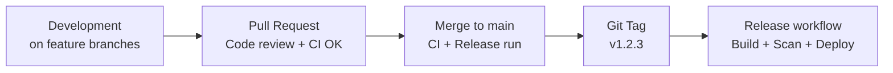
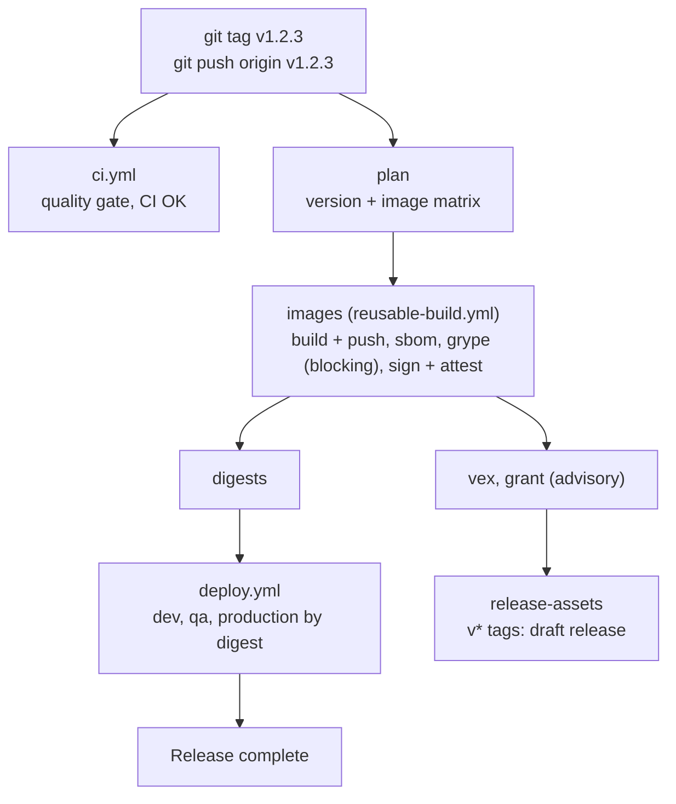

# Releasing

Git tag policy, the release workflow, GitHub release notes, Kubernetes deployment, and version management.

---

## Table of Contents

- [Overview](#overview)
- [Tag Policy](#tag-policy)
- [Release Workflow](#release-workflow)
- [Creating a Release](#creating-a-release)
- [GitHub Release Notes](#github-release-notes)
- [Kubernetes Deployment](#kubernetes-deployment)
- [Post-Release](#post-release)

---

## Overview

Releases are triggered by **Git tags**. A `v*` tag runs [`release.yml`](../.github/workflows/release.yml): it computes the version from the tag, builds and pushes the two images, verifies their digests, scans them, signs and attests them, attaches the SBOMs, the VEX document, the licence report and the image digests to a draft GitHub Release, and deploys to Kubernetes by digest. The quality gate ([`ci.yml`](../.github/workflows/ci.yml)) runs on the same tag.



---

## Tag Policy

### Format

```
v<major>.<minor>.<patch>
```

Examples: `v1.0.0`, `v1.2.3`, `v2.0.0-rc1`

### Version Numbering (SemVer)

| Component | When to Increment | Example |
|-----------|------------------|---------|
| **Major** | Breaking API changes | `1.0.0` → `2.0.0` |
| **Minor** | New features (backward compatible) | `1.0.0` → `1.1.0` |
| **Patch** | Bug fixes (backward compatible) | `1.0.0` → `1.0.1` |

### Pre-release Tags

For release candidates and betas:

```
v1.2.3-rc1
v1.2.3-beta.1
```

---

## Release Workflow

When a `v*` tag is pushed, `ci.yml` and `release.yml` both run:



### Key Differences between `main` and a release tag

| Aspect | Push to `main` | `v*` tag (release) |
|--------|-----------|---------------|
| **Grype scan** | blocking | blocking |
| **Image tags** | immutable `<version>-main-<sha>` | immutable `<version>-prod-<sha>` plus `latest` |
| **Deploy** | `dev`, then `qa` (when `DEPLOY_ENABLED` is `true`) | + `production`, behind the environment's reviewer |

On a `v*` tag, `release-assets` creates the GitHub Release for the tag as a **draft** (or reuses the one draft that already exists for it) and uploads the SBOMs, the OpenVEX document, the licence report, the image digests (`image-digests.env`, `scan.env`; the weekly re-scan reads them), the chart's reference (`chart.env`) and `provenance.md` (each signed digest, a link to the repository's attestations and the verify commands) to it. The workflow never publishes it: edit the notes and publish by hand once the run is green (immutable releases reject assets added after publication, so the draft must be complete first; if the release is already published the job fails with a message). To check a released image, see [Verifying an image](./security.md#verifying-an-image).

### The chart

On a `v*` tag only, the `chart` job of [`reusable-build.yml`](../.github/workflows/reusable-build.yml) runs after every image is signed: `helm package` with `version` and `appVersion` set to the tag without its `v` (the `Chart.yaml` literals never ship), `helm push` to `oci://ghcr.io/<owner>/charts` with the job's token, then a keyless signature and a provenance attestation by digest, with the images' identity rules. Its reference and digest are `chart.env` on the draft release. A push to `main` publishes no chart: deploys use the checked-out chart, so a chart per commit would only fill the registry. Install it by version or digest, then verify it as in [Verifying the chart](./security.md#verifying-the-chart):

```bash
helm install <release> oci://ghcr.io/<owner>/charts/your-service-name --version 1.2.3
```

### Pull request titles

The repository merges by squash only, with the pull request title as the commit title ([GitHub repository settings](./github-repository-settings.md#what-the-script-sets)), so the title is what lands on `main`. [`pr-title.yml`](../.github/workflows/pr-title.yml) checks it is a Conventional Commit, `type(scope)!: subject` with the scope and `!` optional; the allowed types are the `types` list in that workflow (`build`, `chore`, `ci`, `docs`, `feat`, `fix`, `perf`, `refactor`, `revert`, `style`, `test`). It is not a required check: an owner merging over a red title lands a commit message that release tooling cannot classify. The bots' titles are fixed to `fix(deps): …` ([`renovate.json5`](../renovate.json5), [`dependabot.yml`](../.github/dependabot.yml); the comment in each says why), so a merged dependency update is a patch release.

A pull request never reaches `release.yml`: no image is built, pushed, signed or deployed from one.

---

## Creating a Release

### 1. Ensure Tests Pass

```bash
# Run full test suite locally
make check-all
make test
make test-coverage
```

### 2. Update Changelog

Add entries to `wiki/changelog.md` under the new version heading.

### 3. Create and Push Tag

```bash
# Create annotated tag
git tag -a v1.2.3 -m "Release v1.2.3"

# Push tag (triggers the release workflow)
git push origin v1.2.3
```

> **Who may push the tag.** The `release-tags` ruleset allows only the release GitHub App to create,
> update or delete `v*` tags, and it has no owner bypass
> ([GitHub repository settings](./github-repository-settings.md)). The job that does this
> automatically is not implemented yet. Until then a manual `git push origin v1.2.3` is refused once
> `scripts/github-settings.sh --apply` has run. So either push the first tag before applying the
> settings, or create the tag with the App's credentials (its installation token). The owner's own
> credentials do not work.

### 4. Monitor the Run

Watch the runs in the repository's **Actions** tab. Both must pass:

1. **CI** — the `CI OK` gate (lint, types, tests, security, chart, workflow hardening)
2. **Release** — `plan`, `build` (two images), `digests`, `sbom`, `grype`, then `deploy`

---

## GitHub Release Notes

After the release run succeeds, create a GitHub release:

1. Go to **Releases** in the repository on GitHub
2. Click **Draft a new release**
3. Select the tag (`v1.2.3`)
4. Add release notes:

```markdown
## Changes

### New Features
- ...

### Bug Fixes
- ...

### Breaking Changes
- ...

### Security
- ...

### Kubernetes
- Updated the Helm chart / `values.<env>.yaml`
- Added new NetworkPolicy rules
```

5. Attach artifacts if needed (the SBOM is a CycloneDX file in the `sbom-*` run artifacts)

> A pre-filled template for the next release lives at
> [`release-notes-template.md`](./release-notes-template.md). Copy its category bodies from the
> matching `[<version>]` block of [`changelog.md`](./changelog.md), then set the tag, date, and image
> tag when you cut the release.

---

## Kubernetes Deployment

### Automatic Deployment

`release.yml` calls [`deploy.yml`](../.github/workflows/deploy.yml) when the repository variable `DEPLOY_ENABLED` is `true`:

1. **helm-checks** — lints and renders the chart (validation gate)
2. **deploy-dev**, **deploy-qa**, **deploy-production** — `helm upgrade --install` by image digest, migrations through the per-revision Job, verify, smoke test, and a rollback to the recorded revision if verify or smoke fails

### Manual Deployment (if needed)

```bash
# Build and push per-service images
docker build -f Dockerfile.backend -t <registry>/your-service-name-backend:1.2.3-prod-abc1234 .
docker build -f Dockerfile.frontend -t <registry>/your-service-name-frontend:1.2.3-prod-abc1234 .
docker push <registry>/your-service-name-backend:1.2.3-prod-abc1234
docker push <registry>/your-service-name-frontend:1.2.3-prod-abc1234

# Deploy to production (Helm; production uses an external DB). The namespaces come from the admin
# bootstrap, applied once (scripts/k8s-bootstrap.sh production; wiki/infrastructure.md).
# An auth mode must be set first: wiki/getting-started.md#production-needs-an-auth-mode
helm upgrade --install your-service-name charts/your-service-name \
  -f charts/your-service-name/values.production.yaml \
  -n your-service-name-production \
  --set images.backend.tag=1.2.3-prod-abc1234 \
  --set images.frontend.tag=1.2.3-prod-abc1234

# Verify rollout
kubectl -n your-service-name-production rollout status deployment/your-service-name-backend
kubectl -n your-service-name-production rollout status deployment/your-service-name-frontend
```

### Deployment Verification

```bash
# Check pods are running
kubectl -n your-service-name get pods

# Check services
kubectl -n your-service-name get svc

# Check ingress
kubectl -n your-service-name get ingress

# Test health endpoints
curl -fsS https://api.your-domain.example/api/v1/health
curl -fsS https://app.your-domain.example/

# Check HPA
kubectl -n your-service-name get hpa

# Check PDB
kubectl -n your-service-name get pdb
```

---

## Post-Release

### Verify Deployment

```bash
# Check the image digest in the registry (needs a login to ghcr.io)
docker buildx imagetools inspect ghcr.io/<owner>/<repo>/backend:1.2.3-prod-abc1234

# Verify Kubernetes deployments (backend and frontend)
kubectl -n your-service-name get deployments
kubectl -n your-service-name get pods
```

### Monitor

- **Watch logs** — Check for errors in the first few minutes
- **Check metrics** — Monitor request rate, error rate, latency
- **Verify health** — Ensure all health checks pass
- **Test functionality** — Smoke test critical user flows

### Communicate

- Notify stakeholders of the release
- Update any documentation or deployment guides
- Monitor for issues in production

### Rollback (if needed)

A failed verify or smoke step rolls back by itself, to the recorded revision. For a rollback by hand, run the
[`deploy-ops`](../.github/workflows/deploy-ops.yml) workflow from the Actions tab: pick the environment,
the operation `rollback`, an optional numeric `revision` (empty means the previous one), and type
`ROLLBACK` in `confirm`.
