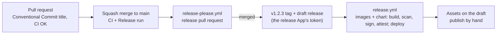
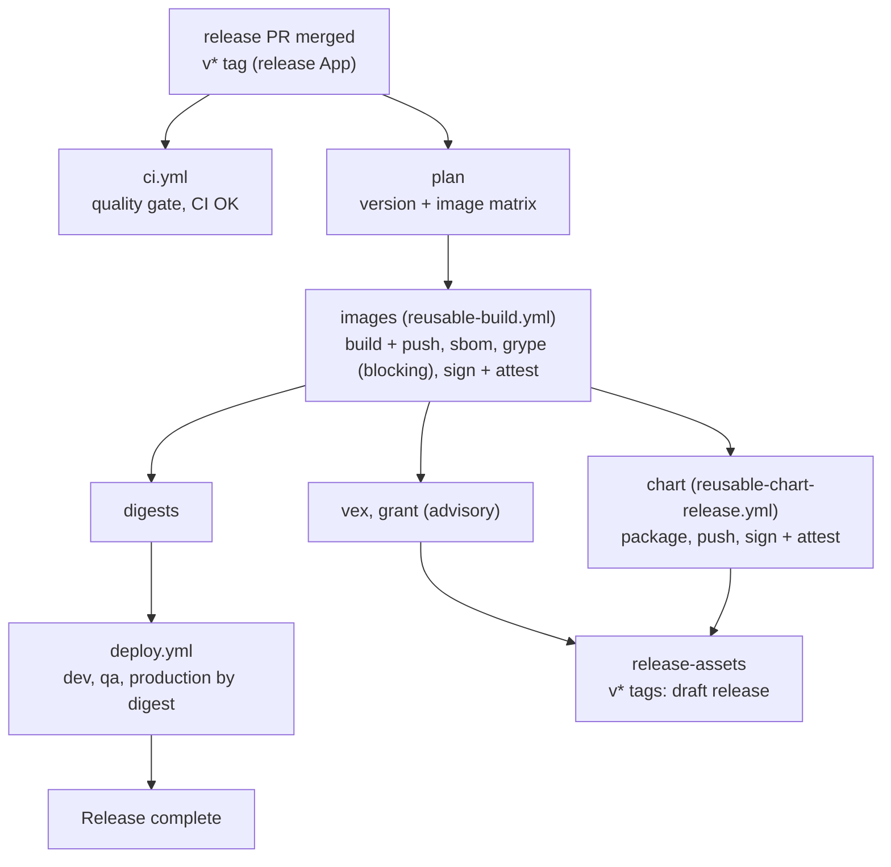

# Releasing

Git tag policy, the release workflow, GitHub release notes, Kubernetes deployment, and version management.

---

## Table of Contents

- [Overview](#overview)
- [Tag Policy](#tag-policy)
- [Release Workflow](#release-workflow)
- [Creating a Release](#creating-a-release)
- [GitHub Release Notes](#github-release-notes)
- [Kubernetes Deployment](#kubernetes-deployment)
- [Post-Release](#post-release)

---

## Overview

Releases are triggered by **Git tags**, and [`release-please.yml`](../.github/workflows/release-please.yml) makes them: on each push to `main` it updates a release pull request from the Conventional Commit titles merged since the last release; merging that pull request creates the `v*` tag and a draft GitHub Release. The tag runs [`release.yml`](../.github/workflows/release.yml): it computes the version from the tag, builds and pushes the images, verifies their digests, scans them, signs and attests them, packages, signs and attests the chart, attaches the SBOMs, the VEX document, the licence report, the digests and the provenance list to the draft, and deploys to Kubernetes by digest. The quality gate ([`ci.yml`](../.github/workflows/ci.yml)) runs on the same tag.



---

## Tag Policy

### Format

```
v<major>.<minor>.<patch>
```

Examples: `v1.0.0`, `v1.2.3`, `v2.0.0-rc.1` (the `Release-As` form below; `v2.0.0-rc1` parses too)

### Version Numbering (SemVer)

| Component | When to Increment | Example |
|-----------|------------------|---------|
| **Major** | Breaking API changes | `1.0.0` → `2.0.0` |
| **Minor** | New features (backward compatible) | `1.0.0` → `1.1.0` |
| **Patch** | Bug fixes (backward compatible) | `1.0.0` → `1.0.1` |

### Pre-release Tags

Only the release App creates `v*` tags, so a pre-release is cut through release-please too. Put a `Release-As:` footer as the last paragraph of a pull request's body (the squash merge makes the body the commit body), for example:

```
Release-As: 1.2.3-rc.1
```

The next release pull request then proposes exactly that version, and its merge creates the `v1.2.3-rc.1` tag, which runs the release workflow like any `v*` tag ([`container_matrix.py`](../.github/scripts/container_matrix.py) accepts `-<pre>`), with three differences, all from the plan's `prerelease` output (a `-` directly after `MAJOR.MINOR.PATCH`; build metadata alone does not count): it deploys to dev and qa, **never to production** (the deploy summary says production was skipped); its images do not move `latest`, which stays on the last final release; and `release-assets` marks its GitHub Release a **pre-release**, on release-please's draft or one it creates (a final tag's draft is set to not be one). The bundled release-please library (v5.0.0 of the action) reads the footer and parses a `-<pre>` suffix, but its next bump keeps the suffix (a `fix` after `1.2.3-rc.1` proposes `1.2.4-rc.1`), so cut the final release with another footer, `Release-As: 1.2.3`.

---

## Release Workflow

When the release pull request is merged, release-please creates the `v*` tag with the release App's token ([Creating a Release](#creating-a-release)), and the tag runs `ci.yml` and `release.yml`:



### Key Differences between `main` and a release tag

| Aspect | Push to `main` | `v*` tag (release) |
|--------|-----------|---------------|
| **Grype scan** | blocking | blocking |
| **Image tags** | immutable `<version>-main-<sha>` | immutable `<version>-prod-<sha>` plus `latest` (a final release only, never a pre-release) |
| **Deploy** | `dev`, then `qa` (when `DEPLOY_ENABLED` is `true`) | + `production`, behind the environment's reviewer; not for a pre-release tag |

On a `v*` tag, `release-assets` reuses the **draft** GitHub Release that release-please made for the tag (it creates a draft only if none exists), and uploads the SBOMs, the OpenVEX document, the licence report, the image digests (`image-digests.env`, `scan.env`; the weekly re-scan reads them), the chart's reference (`chart.env`) and `provenance.md` (each signed digest, a link to the repository's attestations and the verify commands) to it. The workflow never publishes it: edit the notes and publish by hand once the run is green (immutable releases reject assets added after publication, so the draft must be complete first; if the release is already published the job fails with a message). To check a released image, see [Verifying an image](./security.md#verifying-an-image).

### The chart

On a `v*` tag only, the `chart` job of `release.yml` calls [`reusable-chart-release.yml`](../.github/workflows/reusable-chart-release.yml) after the `images` job, so after every image is signed: `helm package` with `version` and `appVersion` set to the tag without its `v` (the `Chart.yaml` literals never ship), `helm push` to `oci://ghcr.io/<owner>/<repo>/charts` with the job's token (beside the images, so two repositories of one owner never share a chart package), then a keyless signature and a provenance attestation by digest, with the images' rules and the chart workflow's own identity. Its reference and digest are `chart.env` on the draft release. A push to `main` publishes no chart: deploys use the checked-out chart, so a chart per commit would only fill the registry. Install it by version or digest, then verify it as in [Verifying the chart](./security.md#verifying-the-chart):

```bash
helm install <release> oci://ghcr.io/<owner>/<repo>/charts/your-service-name --version 1.2.3
```

Only `release-assets` waits for the chart: the digests, the deploys (dev, qa, production) and the VEX do not, so a failed chart job holds back only the draft release's assets. **When the chart job fails** (most likely on the first release, when `helm push` is refused because the chart package already exists without write access for this repository): in the package's settings on GitHub, under Manage Actions access, give this repository the Write role; then re-run the failed jobs of the release run (`gh run rerun <run-id> --failed`), which runs the chart job and then `release-assets`.

### Pull request titles

The repository merges by squash only, with the pull request title as the commit title ([GitHub repository settings](./github-repository-settings.md#what-the-script-sets)), so the title is what lands on `main`. [`pr-title.yml`](../.github/workflows/pr-title.yml) checks it is a Conventional Commit, `type(scope)!: subject` with the scope and `!` optional; the allowed types are the `types` list in that workflow (`build`, `chore`, `ci`, `docs`, `feat`, `fix`, `perf`, `refactor`, `revert`, `style`, `test`). It is not a required check: an owner merging over a red title lands a commit message that release-please cannot classify. The bots' titles are fixed to `fix(deps): …` ([`renovate.json5`](../renovate.json5), [`dependabot.yml`](../.github/dependabot.yml); the comment in each says why), so a merged dependency update makes the next release a patch release ([Review the release pull request](#2-review-the-release-pull-request)).

A pull request never reaches `release.yml`: no image is built, pushed, signed or deployed from one.

---

## Creating a Release

### 1. Ensure Tests Pass

```bash
# Run full test suite locally
make check-all
make test
make test-coverage
```

### 2. Review the release pull request

[`release-please.yml`](../.github/workflows/release-please.yml) keeps one open release pull request on `main`. It proposes the next version from the commit types since the last release (`fix` a patch, `feat` a minor, `!` or a `BREAKING CHANGE` footer a major; [release-please](https://github.com/googleapis/release-please#how-should-i-write-my-commits)) and bumps only [`.release-please-manifest.json`](../.release-please-manifest.json) and the inert `.release-please-version` ([Versioning](./versioning.md)). It writes no changelog: [`release-please-config.json`](../release-please-config.json) sets `skip-changelog`, so [`changelog.md`](./changelog.md) stays the one changelog. Before merging, move the `[Unreleased]` entries under the version the pull request proposes, in a pull request of its own.

The one-time setup (the App, its permissions, the `release` environment and its secret, `RELEASE_APP_ID`, and a `bootstrap-sha` on a repository with history) is in [The release GitHub App](./github-repository-settings.md#the-release-github-app). Until it is done, the workflow is a green run with a notice.

### 3. Merge it

Merging creates the `v*` tag and a **draft** GitHub Release with the App's token (`draft` and `force-tag-creation` in the config: a draft alone gets no tag until published). A tag made with `GITHUB_TOKEN` would trigger no workflow, so the token comes from the App, and the `release-tags` ruleset lets only that App create, update or delete `v*` tags ([GitHub repository settings](./github-repository-settings.md)): a `git push origin v1.2.3` by the owner is refused.

> **First release: two things to watch.** If the token step fails on `client-id`, or release-please cannot force-push its release branch after a workflow file changed on `main`, see the watch item in [The release GitHub App](./github-repository-settings.md#the-release-github-app) (`app-id`; `permission-workflows: write`).

### 4. Monitor the Run

Watch the runs in the repository's **Actions** tab. Both must pass:

1. **CI** — the `CI OK` gate (lint, types, tests, security, chart, workflow hardening)
2. **Release** — `plan`, `build` (two images), `digests`, `sbom`, `grype`, then `deploy`

---

## GitHub Release Notes

release-please writes the draft's notes from the commit titles, and `release-assets` attaches the assets to it. After the release run succeeds, edit the notes and publish:

1. Go to **Releases** in the repository on GitHub
2. Open the draft for the tag (`v1.2.3`)
3. Edit the notes, for example into this shape:

```markdown
## Changes

### New Features
- ...

### Bug Fixes
- ...

### Breaking Changes
- ...

### Security
- ...

### Kubernetes
- Updated the Helm chart / `values.<env>.yaml`
- Added new NetworkPolicy rules
```

4. Publish it. Immutable releases freeze it, assets included

> A pre-filled template for the next release lives at
> [`release-notes-template.md`](./release-notes-template.md). Copy its category bodies from the
> matching `[<version>]` block of [`changelog.md`](./changelog.md), then set the tag, date, and image
> tag when you cut the release.

---

## Kubernetes Deployment

### Automatic Deployment

`release.yml` calls [`deploy.yml`](../.github/workflows/deploy.yml) when the repository variable `DEPLOY_ENABLED` is `true`:

1. **helm-checks** — lints and renders the chart (validation gate)
2. **deploy-dev**, **deploy-qa**, **deploy-production** — `helm upgrade --install` by image digest, migrations through the per-revision Job, verify, smoke test, and a rollback to the recorded revision if verify or smoke fails

### Manual Deployment (if needed)

```bash
# Build and push per-service images
docker build -f Dockerfile.backend -t <registry>/your-service-name-backend:1.2.3-prod-abc1234 .
docker build -f Dockerfile.frontend -t <registry>/your-service-name-frontend:1.2.3-prod-abc1234 .
docker push <registry>/your-service-name-backend:1.2.3-prod-abc1234
docker push <registry>/your-service-name-frontend:1.2.3-prod-abc1234

# Deploy to production (Helm; production uses an external DB). The namespaces come from the admin
# bootstrap, applied once (scripts/k8s-bootstrap.sh production; wiki/infrastructure.md).
# An auth mode must be set first: wiki/getting-started.md#production-needs-an-auth-mode
helm upgrade --install your-service-name charts/your-service-name \
  -f charts/your-service-name/values.production.yaml \
  -n your-service-name-production \
  --set images.backend.tag=1.2.3-prod-abc1234 \
  --set images.frontend.tag=1.2.3-prod-abc1234

# Verify rollout
kubectl -n your-service-name-production rollout status deployment/your-service-name-backend
kubectl -n your-service-name-production rollout status deployment/your-service-name-frontend
```

### Deployment Verification

```bash
# Check pods are running
kubectl -n your-service-name get pods

# Check services
kubectl -n your-service-name get svc

# Check ingress
kubectl -n your-service-name get ingress

# Test health endpoints
curl -fsS https://api.your-domain.example/api/v1/health
curl -fsS https://app.your-domain.example/

# Check HPA
kubectl -n your-service-name get hpa

# Check PDB
kubectl -n your-service-name get pdb
```

---

## Post-Release

### Verify Deployment

```bash
# Check the image digest in the registry (needs a login to ghcr.io)
docker buildx imagetools inspect ghcr.io/<owner>/<repo>/backend:1.2.3-prod-abc1234

# Verify Kubernetes deployments (backend and frontend)
kubectl -n your-service-name get deployments
kubectl -n your-service-name get pods
```

### Monitor

- **Watch logs** — Check for errors in the first few minutes
- **Check metrics** — Monitor request rate, error rate, latency
- **Verify health** — Ensure all health checks pass
- **Test functionality** — Smoke test critical user flows

### Communicate

- Notify stakeholders of the release
- Update any documentation or deployment guides
- Monitor for issues in production

### Rollback (if needed)

A failed verify or smoke step rolls back by itself, to the recorded revision. For a rollback by hand, run the
[`deploy-ops`](../.github/workflows/deploy-ops.yml) workflow from the Actions tab: pick the environment,
the operation `rollback`, an optional numeric `revision` (empty means the previous one), and type
`ROLLBACK` in `confirm`.
