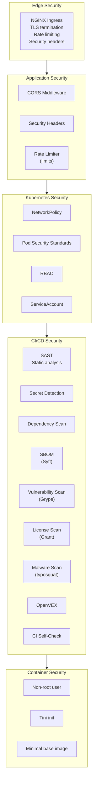

# Security

Security headers, CORS, rate limiting, supply-chain scanning, container hardening, and Kubernetes security.

---

## Table of Contents

- [Overview](#overview)
- [HTTP Security Headers](#http-security-headers)
- [CORS Configuration](#cors-configuration)
- [Rate Limiting](#rate-limiting)
- [Supply-Chain Security (CI)](#supply-chain-security-ci)
- [Container Security](#container-security)
- [Kubernetes Security](#kubernetes-security)
- [Runtime Application Protection (DAST + WAF)](#runtime-application-protection-dast--waf)
- [Secrets Management](#secrets-management)
- [TLS Configuration](#tls-configuration)

---

## Overview

Security is implemented at multiple layers:



---

## HTTP Security Headers

### Frontend (Next.js)

Security headers are applied in production via `next.config.ts`:

| Header | Value | Purpose |
|--------|-------|---------|
| `Strict-Transport-Security` | `max-age=15552000; includeSubDomains; preload` | Force HTTPS for 180 days |
| `Content-Security-Policy` | `default-src 'self'; img-src 'self' blob: data:; ...` | Restrict resource loading |
| `X-Content-Type-Options` | `nosniff` | Prevent MIME-type sniffing |
| `Referrer-Policy` | `no-referrer` | Don't send referrer header |
| `Permissions-Policy` | `geolocation=(), microphone=(), camera=()` | Disable browser features |
| `frame-ancestors` | `'none'` (via CSP) | Prevent clickjacking |

### Ingress-Level Headers

Additional headers are applied via NGINX Ingress annotations:

```yaml
metadata:
  annotations:
    nginx.ingress.kubernetes.io/configuration-snippet: |
      more_set_headers "X-Content-Type-Options: nosniff";
      more_set_headers "X-Frame-Options: DENY";
      more_set_headers "Referrer-Policy: no-referrer";
      more_set_headers "Strict-Transport-Security: max-age=15552000; includeSubDomains; preload";
```

### CSP Details

Production CSP (see `frontend/next.config.ts`):

```
default-src 'self'
img-src 'self' blob: data:
style-src 'self'
script-src 'self'
connect-src 'self'
frame-ancestors 'none'
base-uri 'self'
```

No `unsafe-eval`/`unsafe-inline` and no third-party (`https:`, CDN) origins: the
production build inlines no eval and loads styles from `'self'`. `connect-src
'self'` because the frontend calls the API same-origin (`/api/v1`, rewritten
server-side by `middleware.ts`) — no broad `https:` that would permit
exfiltration to any endpoint. The frontend also serves a per-request nonce on
`script-src` (see `middleware.ts`), so any *inline* script would be blocked.

Interactive docs (`/docs`) are the one deliberate, tightly-scoped exception.
FastAPI's built-in Swagger page loads Swagger UI from the jsDelivr CDN and inlines
its init script, so `/docs` alone gets a relaxed CSP that admits that CDN origin and
inline scripts/styles — **scoped to that single path**, so every other page keeps the
strict nonce-only policy. `/docs` can be disabled with `API_DOCS_URL=` (empty). The
machine-readable schema at `/openapi.json` is unaffected and stays available for
non-browser consumers regardless of the interactive page.

---

## Authentication & Authorization

The template imposes **no IdP of its own** — identity is config-driven via
`AUTH_MODE` (`backend/auth/`), so an adopter plugs in their own. The reference
CRUD stays open until auth is enabled; writes are gated by the `get_current_user`
FastAPI dependency, which resolves a `Principal` per request.

| `AUTH_MODE` | Behaviour | Trust model |
|-------------|-----------|-------------|
| `none` *(default)* | Auth disabled; the dependency yields an anonymous principal. Reference CRUD is open. | N/A — opt-in only. |
| `gateway` | Identity is read from a gateway-injected header (`AUTH_USER_ID_HEADER`, default `X-Authenticated-User-Id`; roles from `AUTH_ROLES_HEADER`, default `X-Authenticated-User-Roles`, comma-separated). Missing → `401`. | The service trusts the header **unconditionally**. Safe only because the deployment denies every client but the ingress the path to the pods (Kubernetes `NetworkPolicy` default-deny). Do not expose the service directly to untrusted clients in this mode. |
| `bearer` | Identity from an HMAC-signed JWT bearer token verified with a shared secret (`AUTH_JWT_SECRET`, algorithm `AUTH_JWT_ALGORITHM`, default `HS256`, subject claim `AUTH_JWT_USER_ID_CLAIM`, default `sub`). Missing/invalid → `401`. | The service verifies the signature itself. |

- **Authorization** is layered on with `require_roles(*roles)`: a dependency that
  returns `403` when the principal lacks a required role.
- **JWT verification is dependency-free** (no PyJWT in the tree) and deliberately
  accepts only the HMAC family (`HS256`/`HS384`/`HS512`), rejecting `alg` confusion
  (the header `alg` must match the configured one) and using a constant-time
  signature compare. It is a **reference pattern**, not a production IdP — replace
  with your token service / JWKS verification for production.
- **CSRF posture**: the API is stateless — it authenticates via a header or a
  bearer token, not cookie sessions — so classic CSRF does not apply. If you
  introduce cookie-based sessions, add same-site cookies and a CSRF token; do not
  rely on bearer/header auth alone for browser cookie flows.

---

## CORS Configuration

The backend configures CORS via FastAPI's `CORSMiddleware`, driven entirely by
environment variables (see `backend/main.py`). The template ships
**restrictive-by-default**: with no configuration it is same-origin only.

| Setting | Default | Purpose |
|---------|---------|---------|
| `CORS_ORIGINS` | *(unset → same-origin only)* | Which origins can access the API. Comma-separated. Never reflects `*`. |
| `CORS_ALLOW_CREDENTIALS` | `false` | Allow cookies/auth headers. When `true`, `*` is stripped from origins (browser rule). |
| `CORS_ALLOW_METHODS` | `GET,POST,PUT,PATCH,DELETE,OPTIONS` | Allowed methods (explicit set, never `*`). |
| `CORS_ALLOW_HEADERS` | `Authorization,Content-Type,X-Requested-With` | Allowed headers (explicit set, never `*`). |

> **Production recommendation**: Set `CORS_ORIGINS=https://app.example.com` to
> allow a specific frontend. Do not use `*` with credentials.

---

## Rate Limiting

Per-IP rate limiting via the **`limits`** library in `backend/middleware/rate_limiting.py`
(a `BaseHTTPMiddleware`), plus optional NGINX Ingress annotations:

### Backend Rate Limiting

| Setting | Default | Description |
|---------|---------|-------------|
| `RATE_LIMIT_DEFAULT` | `100/minute` | Max requests per IP (fixed-window, in-memory). `limits` format: `N/minute`, `N/second`, … |

> **Why not slowapi**: slowapi resolves the target route *handler* from the
> top-level route table to decide which limits apply, but FastAPI assembles the
> versioned API under a nested router that slowapi's lookup does not descend
> into — so its global `default_limits` were never checked (a silent no-op). The
> middleware here enforces the limit directly against the `limits` backend keyed
> by client IP, so it works regardless of how routes are nested.

### Ingress Rate Limiting

```yaml
metadata:
  annotations:
    nginx.ingress.kubernetes.io/limit-rps: "100"
    nginx.ingress.kubernetes.io/limit-connections: "50"
```

### Behavior

- Rate limit is applied **per IP address**
- Exceeding the limit returns `429 Too Many Requests`
- Response includes `Retry-After` header (seconds until reset)

---

## Supply-Chain Security (CI)

The full supply-chain control catalogue — every scanner, the tool behind it,
gate-vs-advisory, and pull-request-vs-release ref scope — lives on the dedicated
[`supply-chain-security.md`](./supply-chain-security.md) page; the pipeline wiring
(workflows, jobs, ref scope) and the tooling decision record are in
[`ci-cd.md`](./ci-cd.md) and
[`supply-chain-tooling-assessment.md`](./supply-chain-tooling-assessment.md). This
section no longer restates them — read those pages for the detail.

### Verifying an image

Every image the release workflow pushes is signed keyless (Sigstore, no key to keep) and carries a
SLSA build-provenance attestation and a CycloneDX SBOM attestation, all stored next to the image in
`ghcr.io`. Only images that passed the blocking Grype gate are signed. The signing certificate names
the reusable workflow that ran, not `release.yml`, because a keyless certificate issued inside a
called workflow carries that workflow's ref.

The certificate identity is `https://github.com/<owner>/<repo>/.github/workflows/reusable-build.yml@<ref>`
(`<ref>` is `refs/heads/main` or `refs/tags/v1.2.3`), the issuer is
`https://token.actions.githubusercontent.com`. Verify by digest, with cosign 3 or newer:

```bash
cosign verify ghcr.io/<owner>/<repo>/<image>@sha256:<digest> \
  --certificate-identity "https://github.com/<owner>/<repo>/.github/workflows/reusable-build.yml@refs/tags/v1.2.3" \
  --certificate-oidc-issuer https://token.actions.githubusercontent.com \
  --certificate-github-workflow-sha <commit sha of the release>
gh attestation verify oci://ghcr.io/<owner>/<repo>/<image>@sha256:<digest> --repo <owner>/<repo>
```

The release run runs the same `cosign verify` after signing, and fails if it does not pass.
Pin to a tag or to `main` with `--certificate-identity-regexp` only when you accept every ref.

---

## Container Security

### Non-Root User

The container runs as a non-root user:

```dockerfile
RUN useradd -m -u 10001 appuser
USER appuser
```

### Tini Init System

```dockerfile
ENTRYPOINT ["/usr/bin/tini", "-s", "--"]
```

- Proper PID 1 for signal forwarding
- Prevents zombie processes
- Handles SIGTERM gracefully

### Minimal Base Image

- `python:3.12-slim` — Debian slim variant
- Only necessary runtime packages installed
- No build tools in runtime image (build happens in separate stage)
- Apt cache cleaned after install

### Installed Runtime Packages

| Package | Purpose |
|---------|---------|
| `nginx-light` | Edge proxy (production) / static file serving |
| `tini` | Init system |
| `curl` | Health checks |
| `ca-certificates` | TLS certificate validation |
| `gettext-base` | `envsubst` for config templating |
| `dpkg` | Package management |
| `libsqlite3-0` | SQLite runtime (fallback DB) |
| `libpq5` | PostgreSQL client library |

---

## Kubernetes Security

### NetworkPolicy

Default deny all ingress and egress, with explicit allow rules:

```yaml
# Default deny all
apiVersion: networking.k8s.io/v1
kind: NetworkPolicy
metadata:
  name: default-deny-all
spec:
  podSelector: {}
  policyTypes:
    - Ingress
    - Egress
```

**Allow rules**:

| Policy | Direction | Source | Destination | Purpose |
|--------|-----------|--------|-------------|---------|
| `allow-from-ingress` | Ingress | ingress-nginx namespace | app pods on 8000/3000/8081 | Ingress → services |
| `allow-backend-to-db` | Egress | backend pods | postgresql:5432 + DNS | Backend → database |
| `allow-migration-to-db` | Egress | migration job | postgresql:5432 + DNS | Migration → database |

### Pod Security Standards

All pods run in **restricted** profile:

```yaml
securityContext:
  runAsNonRoot: true
  runAsUser: 10001
  allowPrivilegeEscalation: false
  capabilities:
    drop: ["ALL"]
```

### RBAC

Minimal permissions via ServiceAccount, Role, and RoleBinding:

```yaml
# ServiceAccount
automountServiceAccountToken: false

# Role (minimal permissions)
rules:
  - apiGroups: [""]
    resources: ["configmaps", "secrets"]
    verbs: ["get", "list", "watch"]
```

### Resource Quotas

Namespace-level resource quotas prevent resource exhaustion:

```yaml
# ResourceQuota
hard:
  requests.cpu: "4"
  requests.memory: 8Gi
  limits.cpu: "8"
  limits.memory: 16Gi

# LimitRange (default limits per container)
default:
  cpu: "500m"
  memory: "512Mi"
```

### Runtime Application Protection (DAST + WAF)

The running application is covered by two complementary layers (full plan +
operational steps in
[`dast-waf-openshift-local-runbook.md`](./dast-waf-openshift-local-runbook.md)):

- **DAST — OWASP ZAP (scan-time).** `zap-baseline.py` (single-source
  `infra/security/local/scan-dast.sh`) spiders and passively/actively scans the
  live deploy for web vulnerabilities (SQLi, XSS, …). It is **advisory**
  (findings warn, only a tool error fails), emits a Merged SARIF, and escalates to a full
  active / OpenAPI-driven / authenticated scan via `DAST_FULL_SCAN`.
- **WAF — Coraza (runtime).** An in-cluster **Coraza** proxy (Go, CNCF) runs as an
  Envoy wasm plugin with the **OWASP Core Rule Set**, fronting the API surface
  (`/api`, `/docs`, `/openapi.json`) and filtering requests live. It is rendered by
  the Helm chart (`charts/your-service-name/templates/waf-proxy.yaml`) and is
  **off by default** (`waf.enabled: false`) — no side effect until you enable it.
  The UI / static tiers bypass it (they are not injection targets).

| | DAST (ZAP) | WAF (Coraza) |
|---|---|---|
| When | At scan time (CI / runbook) | Continuously, in front of the running API |
| What it does | *Finds* web vulns by probing | *Blocks* malicious requests live |
| Where it lives | Ephemeral CI scanner | Helm-deployed pod (Envoy) |
| Gate | Advisory baseline | Off by default |

> **OpenShift:** the chart's WAF is the vanilla-K8s (Ingress) expression; on
> OpenShift it sits behind the Route/Router edge. The in-cluster proxy validates on
> any cluster; the exact wasm image pin and the SQLi/XSS→403 behaviour are confirmed
> on a cluster (runbook §4).

---

## Secrets Management

### Kubernetes Secrets

Sensitive data is stored in Kubernetes Secrets:

| Secret | Contents |
|--------|----------|
| `your-service-name-db-credentials` | DB_PASSWORD, DB_USER, DB_NAME |
| `your-service-name-stats` | STATS_PASS |

### Sealed Secrets (Recommended)

For GitOps workflows, use [sealed-secrets](https://github.com/bitnami-labs/sealed-secrets):

```bash
# Install sealed-secrets controller
helm install sealed-secrets sealed-secrets \
  --repo https://bitnami-labs.github.io/sealed-secrets \
  --namespace kube-system

# Create a sealed secret
kubeseal --format yaml < secret.json > sealed-secret.yaml

# Apply to cluster
kubectl apply -f sealed-secret.yaml
```

### External Secrets Operator (Alternative)

For cloud-integrated secret management, use [External Secrets Operator](https://external-secrets.io/):

```yaml
apiVersion: external-secrets.io/v1beta1
kind: ExternalSecret
metadata:
  name: your-service-name-db-credentials
spec:
  secretStoreRef:
    name: aws-secrets-manager
    kind: ClusterSecretStore
  target:
    name: your-service-name-db-credentials
  data:
    - secretKey: DB_PASSWORD
      remoteRef:
        key: your-service-name/db-password
```

### Best Practices

- **Never commit secrets** — Use GitHub environment secrets, sealed-secrets, or External Secrets Operator
- **Rotate regularly** — Especially `STATS_PASS`, database passwords
- **Use environment-scoped secrets** — For deployment secrets, on the GitHub Environment of the job that needs them, never repository-wide
- **Gate the environments** — `production` is limited to `v*` tags and needs a reviewer (see [GitHub repository settings](./github-repository-settings.md))

---

## TLS Configuration

### Ingress TLS

TLS is managed by cert-manager with Let's Encrypt:

```yaml
spec:
  tls:
    - hosts:
        - api.your-domain.example
        - app.your-domain.example
      secretName: your-service-name-tls
```

### cert-manager Configuration

```bash
# Install cert-manager
helm install cert-manager cert-manager \
  --repo https://charts.jetstack.io \
  --namespace cert-manager --create-namespace \
  --set installCRDs=true

# Create a ClusterIssuer for the certificate type you need:
#   - Local dev:   scripts/certs-local.sh applies cert-manager's bundled `selfsigned` issuer
#   - Production:  apply a Let's Encrypt (prod/staging) ClusterIssuer; the chart renders the
#                  Ingress TLS secretName + hosts from values.<env>.yaml
```

### Frontend HSTS

The frontend sets `Strict-Transport-Security` header in production:

```
max-age=15552000; includeSubDomains; preload
```

This tells browsers to **always use HTTPS** for 180 days.
