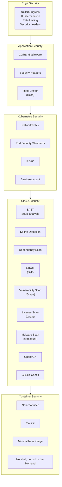

# Security

Security headers, CORS, rate limiting, supply-chain scanning, container hardening, and Kubernetes security.

---

## Table of Contents

- [Overview](#overview)
- [HTTP Security Headers](#http-security-headers)
- [CORS Configuration](#cors-configuration)
- [Rate Limiting](#rate-limiting)
- [CSP Violation Reports](#csp-violation-reports)
- [Request Limits and Trusted Hosts](#request-limits-and-trusted-hosts)
- [Client IP](#client-ip)
- [Supply-Chain Security (CI)](#supply-chain-security-ci)
- [Container Security](#container-security)
- [Kubernetes Security](#kubernetes-security)
- [Runtime Application Protection (DAST + WAF)](#runtime-application-protection-dast--waf)
- [Secrets Management](#secrets-management)
- [TLS Configuration](#tls-configuration)

---

## Overview

Security is implemented at multiple layers:



---

## HTTP Security Headers

### Frontend (Next.js)

Security headers are applied in production via `next.config.ts`:

| Header | Value | Purpose |
|--------|-------|---------|
| `Content-Security-Policy` | `default-src 'self'; img-src 'self' blob: data:; ...` | Restrict resource loading |
| `X-Content-Type-Options` | `nosniff` | Prevent MIME-type sniffing |
| `Referrer-Policy` | `no-referrer` | Don't send referrer header |
| `Permissions-Policy` | `geolocation=(), microphone=(), camera=()` | Disable browser features |
| `Cross-Origin-Opener-Policy` | `same-origin` | Isolate the browsing context from cross-origin windows |
| `Cross-Origin-Resource-Policy` | `same-origin` | Other origins cannot embed or read the response |
| `frame-ancestors` | `'none'` (via CSP) | Prevent clickjacking |

### Known limitation: the frontend port exposes an internal URL

On the paths it proxies to the backend (`/api/v1`, `/docs`, `/openapi.json`), Next.js adds an
`x-middleware-rewrite` response header that holds the backend's internal URL (for example
`http://<release>-backend:8000/api/v1/health`). Next always sets it, and removing it in `proxy.ts` cancels
the rewrite, so the frontend cannot drop it. It discloses internal topology (CWE-200, low severity).
Expose the app through an edge or a gateway that does not proxy through the frontend, never the frontend
port directly. The shipped nginx proxies nothing; as a safeguard for an adopter who adds a proxy location,
its config hides `X-Middleware-Rewrite` and `X-Powered-By` from proxied responses (`proxy_hide_header` at
http level, inherited by that location). The live header test lists the header as a known Next exposure and
allows it only on proxied paths of the frontend port.

### Ingress-Level Headers

Additional headers are applied via NGINX Ingress annotations:

```yaml
metadata:
  annotations:
    nginx.ingress.kubernetes.io/configuration-snippet: |
      more_set_headers "X-Content-Type-Options: nosniff";
      more_set_headers "X-Frame-Options: DENY";
      more_set_headers "Referrer-Policy: no-referrer";
      more_set_headers "Strict-Transport-Security: max-age=15552000; includeSubDomains; preload";
```

### CSP Details

Production CSP (see `frontend/next.config.ts`):

```
default-src 'self'
img-src 'self' blob: data:
style-src 'self'
script-src 'self'
connect-src 'self'
frame-ancestors 'none'
base-uri 'self'
```

No `unsafe-eval`/`unsafe-inline` and no third-party (`https:`, CDN) origins: the
production build inlines no eval and loads styles from `'self'`. `connect-src
'self'` because the frontend calls the API same-origin (`/api/v1`, rewritten
server-side by `proxy.ts`) — no broad `https:` that would permit
exfiltration to any endpoint. The frontend also serves a per-request nonce on
`script-src` (see `proxy.ts`), so any *inline* script would be blocked.

Interactive docs (`/docs`) are the one page that loads a third-party origin, and it is still strict:
the backend serves its own Swagger UI page with **no inline script**. Swagger UI's CSS and bundle come
from jsDelivr at one exact version, each pinned by a Subresource Integrity hash, and the init script is
the backend's own `/docs/init.js`. The backend sends this page's CSP itself, on the page and on the script, and the frontend proxy passes it through (one policy, whoever serves `/docs`). So `/docs` alone adds only `https://cdn.jsdelivr.net` to `script-src`
and `style-src`, with no `'unsafe-inline'` anywhere; every other page keeps the nonce-only policy.
`/docs` can be disabled with `API_DOCS_URL=` (empty). The machine-readable schema at `/openapi.json` is
unaffected by that and stays available for non-browser consumers regardless of the interactive page.
With `ENV=production` both are
off unless `ALLOW_PRODUCTION_DOCS=true` (see
[Environment Variables](./environment-variables.md#backend-settings)).

---

## Authentication & Authorization

The template imposes **no IdP of its own** — identity is config-driven via
`AUTH_MODE` (`backend/auth/`), so an adopter plugs in their own. The reference
CRUD stays open until auth is enabled; writes are gated by the `get_current_user`
FastAPI dependency, which resolves a `Principal` per request.

| `AUTH_MODE` | Behaviour | Trust model |
|-------------|-----------|-------------|
| `oidc` | **Production mode.** `Authorization: Bearer <jwt>` from an OpenID Connect provider, verified against the provider's JWKS. | The service verifies every token itself; see [OIDC](#oidc-mode). |
| `cloudflare-access` | **Production mode.** The Cloudflare Access application token in the `Cf-Access-Jwt-Assertion` header, verified against the team's keys and the application's AUD tag. | The service verifies every token itself; see [Cloudflare Access](#cloudflare-access-mode). |
| `none` *(default)* | Auth disabled; the dependency yields an anonymous principal. Reference CRUD is open. With `ENV=production` it is refused unless `ALLOW_ANONYMOUS=true`. | N/A — opt-in only. |
| `gateway` *(reference)* | Identity is read from a gateway-injected header (`AUTH_USER_ID_HEADER`, default `X-Authenticated-User-Id`; roles from `AUTH_ROLES_HEADER`, default `X-Authenticated-User-Roles`, comma-separated). Missing → `401`. | The service trusts the header **unconditionally**. Safe only because the deployment denies every client but the ingress the path to the pods (Kubernetes `NetworkPolicy` default-deny). Do not expose the service directly to untrusted clients in this mode. |
| `bearer` *(reference)* | Identity from an HMAC-signed JWT bearer token verified with a shared secret (`AUTH_JWT_SECRET`, algorithm `AUTH_JWT_ALGORITHM`, default `HS256`, subject claim `AUTH_JWT_USER_ID_CLAIM`, default `sub`). Missing/invalid → `401`. | A shared secret for internal or test use, **not** end-user identity: whoever holds it can mint any identity. |

`gateway` and `bearer` are **reference modes**; use `oidc` or `cloudflare-access` in production.

### OIDC mode

```bash
AUTH_MODE=oidc
OIDC_ISSUER=https://idp.example.com        # a token's `iss` must equal this exactly
OIDC_AUDIENCE=api://your-service           # comma-separated; the token's `aud` must contain one
# OIDC_JWKS_URL=https://idp.example.com/keys   # unset: taken once from ${OIDC_ISSUER}/.well-known/openid-configuration
# OIDC_ROLES_CLAIM=groups                      # a list of strings or a space-separated string
```

- Tokens: RS256/ES256 by default (`OIDC_ALGORITHMS`, an allowlist of RS*, PS*, ES*; `none` and
  every HS* are refused at startup). The header `alg` must be in the allowlist and fit the key's
  type (and curve), `kid` is required, a non-empty `crit` header is refused, and a token over
  8 KiB is refused. `exp` is required; `nbf` and `iat` are checked when present, with
  `OIDC_CLOCK_SKEW_SECONDS` (default 60, at most 300). The user id is the `OIDC_USER_ID_CLAIM`
  (default `sub`), which must be a non-empty string.
- Keys: fetched over `https` (plain `http` only for `localhost` outside production) with 5 s
  timeouts (and a 10 s deadline for the whole refresh), no redirects and a 1 MiB cap, and cached for `JWKS_CACHE_TTL_SECONDS` (3600).
  Concurrent cold requests make one fetch. An unknown `kid` triggers one refetch, at most once
  per `JWKS_MIN_REFETCH_SECONDS` (30) across all requests, so random `kid`s cannot hammer the
  provider. When a refresh fails the last good keys are kept for `JWKS_MAX_STALE_SECONDS`
  (86400); with no usable keys the answer is `503` ("authentication temporarily unavailable"),
  never `500` and never "allow". When discovery is used the document's `issuer` must equal
  `OIDC_ISSUER`.
- Failures: a missing token is `401` with `WWW-Authenticate: Bearer`; any other failure is `401`
  with `WWW-Authenticate: Bearer error="invalid_token"` and the generic detail "invalid or
  expired token". The reason is logged at info level (never the token); the response does not
  say which check failed.

### Cloudflare Access mode

```bash
AUTH_MODE=cloudflare-access
CF_ACCESS_TEAM_DOMAIN=team.cloudflareaccess.com   # exactly <team>.cloudflareaccess.com
CF_ACCESS_AUD=<application AUD tag>
```

The issuer is `https://<team domain>` and the keys are `https://<team domain>/cdn-cgi/access/certs`
(both as [Cloudflare documents](https://developers.cloudflare.com/cloudflare-one/access-controls/applications/http-apps/authorization-cookie/validating-json/)),
RS256 only; the claim checks and key cache are the ones above, except that the clock skew is a
fixed 60 s (`OIDC_CLOCK_SKEW_SECONDS` does not apply). `CF_ACCESS_TEAM_DOMAIN` must be exactly
`<team>.cloudflareaccess.com` (lowercased; anything else is refused at startup, because the issuer and
key URL derive from it). The user id is `sub` and the
claims (including `email`, when present) are on the principal. Only the `Cf-Access-Jwt-Assertion`
header is read: Cloudflare adds it on every request through the tunnel and recommends validating
it rather than the `CF_Authorization` cookie, which is not guaranteed to be passed, and a cookie
as a credential would bring cross-site request forgery questions the header does not have.
Cloudflare service-token requests carry no `sub` for a person, so they are refused here.

- **Authorization** is layered on with `require_roles(*roles)`: a dependency that
  returns `403` when the principal lacks a required role.
- The `bearer` reference mode is dependency-free and accepts only the HMAC family
  (`HS256`/`HS384`/`HS512`), rejecting `alg` confusion (the header `alg` must match the
  configured one) with a constant-time signature compare. `oidc` and `cloudflare-access` use
  PyJWT (with `cryptography`); the template implements no signature algorithm itself.
- **CSRF posture**: the API is stateless — it authenticates via a header or a
  bearer token, not cookie sessions — so classic CSRF does not apply. If you
  introduce cookie-based sessions, add same-site cookies and a CSRF token; do not
  rely on bearer/header auth alone for browser cookie flows.

---

## CORS Configuration

The backend configures CORS via FastAPI's `CORSMiddleware`, driven entirely by
environment variables (see `backend/main.py`). The template ships
**restrictive-by-default**: with no configuration it is same-origin only.

| Setting | Default | Purpose |
|---------|---------|---------|
| `CORS_ORIGINS` | *(unset → same-origin only)* | Which origins can access the API. Comma-separated. Never reflects `*`. |
| `CORS_ALLOW_CREDENTIALS` | `false` | Allow cookies/auth headers. When `true`, `*` is stripped from origins (browser rule). |
| `CORS_ALLOW_METHODS` | `GET,POST,PUT,PATCH,DELETE,OPTIONS` | Allowed methods (explicit set, never `*`). |
| `CORS_ALLOW_HEADERS` | `Authorization,Content-Type,X-Requested-With` | Allowed headers (explicit set, never `*`). |

> **Production recommendation**: Set `CORS_ORIGINS=https://app.example.com` to
> allow a specific frontend. Do not use `*` with credentials.

---

## Rate Limiting

Per-IP rate limiting via the **`limits`** library's async API (`limits.aio`) in
`backend/middleware/rate_limiting.py` (a `BaseHTTPMiddleware`) and `backend/rate_limiter.py`, plus
optional NGINX Ingress annotations:

### Backend Rate Limiting

| Setting | Default | Description |
|---------|---------|-------------|
| `RATE_LIMIT_DEFAULT` | `100/minute` | Max requests per IP (fixed window). `limits` format: `N/minute`, `N/second`, … |
| `RATE_LIMIT_STORAGE` | `memory://` | Where the counters live (a secret: a Redis URL can hold a password) |
| `RATE_LIMIT_STORAGE_TIMEOUT_SECONDS` | `0.2` | Redis connect and socket timeout, and the cap on one limiter call |

**Storage.** `memory://` keeps the counters in the process, so the limit is **per replica**: with
two Pods a client can make twice the configured rate. `redis://`, `rediss://` and `redis+unix://`
share the counters across replicas (`limits.aio.storage.RedisStorage` with the redis-py asyncio
client; see the `limits` documentation, "Async Storage"). Counter keys start with the service name, so several services can share one
Redis, and the CSP report limit has its own namespace. Anything else is refused at startup, and the
URL never appears in a log or an error. In production a plaintext `redis://` URL is refused unless
every host is loopback (use `rediss://`, a unix socket, or `memory://`), the same rule as the
database TLS, and a `rediss://` query that switches verification off (`ssl_cert_reqs` other
than `required`, `ssl_check_hostname=false`) is refused too (`ssl_ca_certs` and `ssl_ca_path` stay
allowed for a private CA). `redis://` and `rediss://` URLs need an explicit port (`:6379`) and
`redis+unix://` a socket path and no host; a URL the storage cannot parse is refused at startup
without the URL in the message. In the chart the URL comes from the app Secret (`RATE_LIMIT_STORAGE` in
`secrets.existingSecret`), never from `config:`; allow the egress to Redis (port 6379) with
`backend.networkPolicy.extraEgress`.

**Fail open.** A Redis error, or a call slower than `RATE_LIMIT_STORAGE_TIMEOUT_SECONDS`, allows the
request and logs a warning (the exception type only) at most once a minute: an outage of the
limiter must not take the API down. While Redis is unreachable a request can wait up to the timeout
(0.2 s by default: well above a same-cluster round trip, short enough to bound the added latency).
The ingress limit below still applies. Every such request increments the Prometheus counter
`rate_limit_storage_failures_total{reason="error"|"timeout"}` (on `/metrics`; a timeout also
covers an overloaded event loop), so alert on it: while it grows the limit is not applying.

> **Why not slowapi**: slowapi resolves the target route *handler* from the
> top-level route table to decide which limits apply, but FastAPI assembles the
> versioned API under a nested router that slowapi's lookup does not descend
> into — so its global `default_limits` were never checked (a silent no-op). The
> middleware here enforces the limit directly against the `limits` backend keyed
> by client IP, so it works regardless of how routes are nested.

### Ingress Rate Limiting

```yaml
metadata:
  annotations:
    nginx.ingress.kubernetes.io/limit-rps: "100"
    nginx.ingress.kubernetes.io/limit-connections: "50"
```

### Behavior

- Rate limit is applied **per client IP address** (the resolved address, see [Client IP](#client-ip))
- Exceeding the limit returns `429 Too Many Requests` as a problem body (see [Error Responses](api-reference.md#error-responses))
- Response includes `Retry-After` header (seconds until reset)

---

## CSP Violation Reports

Opt-in (`CSP_REPORT_ENABLED`, default off; the chart's `cspReporting.enabled` turns on this and the
frontend half with one value). `POST /api/v1/csp-report` takes the browser's violation reports and
logs them, so a policy change can be watched before it is enforced. It is a browser-defined format,
not API: it is not in the OpenAPI document, takes no authentication (browsers send none) and is a
404 when off.

- **Formats.** `application/csp-report` (`report-uri`: `{"csp-report": {...}}`) and
  `application/reports+json` (`report-to`: an array of reports; only `"type": "csp-violation"`
  entries count). Any other content type is a 415, malformed JSON or the wrong shape a 400, and an
  accepted report a 204. Every error is a problem body.
- **Limits.** The body is capped at `CSP_REPORT_MAX_BYTES` (16384), checked from `Content-Length`
  and again while it streams in, never read unbounded: a 413. At most 10 reports are taken from one
  request. `CSP_REPORT_RATE_LIMIT` (`20/minute` per client, its own counter in the same limiter and
  storage as above) answers 429 with `Retry-After`; a limited request is not read. The route is
  exempt from `RATE_LIMIT_DEFAULT`, so browser reports never use up a user's API budget.
- **What is logged.** One warning per violation, with a fixed set of fields: `document-uri`,
  `blocked-uri`, `violated-directive`, `effective-directive`, `disposition`, `status-code`,
  `source-file`, `line-number`, `column-number`. URLs lose their query string and fragment (they can
  carry tokens). A value is a string or an integer; strings lose control characters (so a report
  cannot forge a log line) and are cut to 512 characters, integers must be 0 to 2^31 - 1, and
  anything else, and every unknown field (such as `original-policy` or `script-sample`), is dropped.
  The sanitising is in `services/csp_report_service.py`.
- **Frontend.** With `CSP_REPORTING_ENABLED=true` (read per request by `frontend/proxy.ts`) the
  CSP gets `report-uri /api/v1/csp-report` and `report-to csp-endpoint`, and the response gets
  `Reporting-Endpoints: csp-endpoint="/api/v1/csp-report"`. Unset, nothing changes.
- **The backend's `/docs`.** It sets its own CSP (`api/docs_page.py`), so with `CSP_REPORT_ENABLED` on the
  backend adds the same `report-uri`, `report-to` and `Reporting-Endpoints` to the docs page and its init
  script. Off, they carry the plain CSP.

---

## Request Limits and Trusted Hosts

Two pure-ASGI middlewares in `backend/middleware/request_limits.py` refuse a request before anything
else reads it. They answer with the [problem body](api-reference.md#error-responses), carrying the
request id.

| Setting | Default | Effect |
|---------|---------|--------|
| `MAX_REQUEST_BODY_BYTES` | `10485760` (10 MiB) | A `Content-Length` over it is a `413` straight away; a body without a length (chunked) is cut off with a `413` once it streams past it |
| `ALLOWED_HOSTS` | `*` (production refuses `*` and an empty list) | A `Host` header that matches no entry is a `400`; `*.example.com` matches subdomains (not the apex), and the port is ignored |

- The body limit default is the chart's ingress `nginx.ingress.kubernetes.io/proxy-body-size`
  (`10m`, which nginx reads as MiB), so the edge and the service agree; a test fails if they diverge.
  Change both together.
- The probe and metrics paths (`/api/<version>/health`, `/api/<version>/healthz`, `/metrics`; exact
  paths, the rate limiter's exempt list) skip the host check, because Kubernetes probes and
  Prometheus send the Pod IP as `Host`.
- An entry is a host only: one with a port is refused at startup (the request's port is ignored), and
  a `Host` header that is not a valid hostname, IPv4 address or bracketed IPv6 (plus an optional
  numeric port) is a `400`.
- The chart sets `ALLOWED_HOSTS` from `ingress.hosts` (`api`, `app`, `root`) plus the backend
  Service names (`<svc>`, `<svc>.<ns>`, `<svc>.<ns>.svc`, `<svc>.<ns>.svc.cluster.local`): the
  frontend's server-side calls reach the backend by Service name. `backend.extraAllowedHosts`
  (comma-separated) appends more; `values.local.yaml` adds `localhost,127.0.0.1` so a local
  port-forward works. Set `config.ALLOWED_HOSTS` to take the whole list over. The deploy and e2e
  scripts send the backend Service name as `Host` through their port-forwards, and a test checks
  that name is in every rendered list.
- These refusals sit outside the security-headers and CORS middlewares, so a browser on another
  origin sees them as a failed request rather than a readable `413`.

---

## Client IP

Behind the gateway (and, in the Cloudflare Tunnel edge mode, `cloudflared`) the TCP peer of the
backend is a proxy Pod. The backend resolves the real client once, in
`backend/middleware/client_ip.py`, the outermost middleware, which rewrites `request.client` so the
rate limiter and the request logs see one value. Uvicorn's own proxy-header handling is off
(`--no-proxy-headers`): it cannot read `CF-Connecting-IP`, and two resolvers would be two trust lists.

| Setting | Default | Meaning |
|---------|---------|---------|
| `TRUSTED_PROXY_CIDRS` | empty | The cloudflared and gateway Pod ranges of your cluster (comma-separated IPv4/IPv6 CIDRs). An invalid entry stops startup, and so does one with host bits set (`10.1.2.3/8`): write the network form, `10.0.0.0/8`. |
| `TRUST_CF_CONNECTING_IP` | `false` | Believe `CF-Connecting-IP` from a trusted peer. Set it only in the Tunnel edge mode. |

Rules, in order:

1. A peer that is missing, is not an IP, or is **not** in `TRUSTED_PROXY_CIDRS`: the peer is the
   client, and every forwarding header is ignored. A client cannot forge its own address.
2. A trusted peer with `TRUST_CF_CONNECTING_IP` on and a `CF-Connecting-IP` holding exactly one valid
   IP (a repeated or comma-separated value does not count): that IP. Cloudflare
   [sends this header on traffic from its edge](https://developers.cloudflare.com/fundamentals/reference/http-headers/);
   in the other edge modes nothing sets it, so trusting it would let anyone forge it.
3. Otherwise a trusted peer's `X-Forwarded-For` is read **from the right**, skipping trusted hops;
   the first untrusted valid IP is the client. A value that is not an IP stops the walk at the last
   trusted hop, never at something left of it. If every entry is trusted, the leftmost is used.
4. Otherwise the peer.

A trusted peer's `X-Forwarded-Proto` (`http` or `https`) also sets the request scheme.

**Why the default trusts nothing.** Pod CIDRs are cluster-specific, so the chart guesses none. With
the default every client behind a proxy shares the proxy's address, so one rate-limit bucket: safe
but coarse. Set the ranges for your cluster (`values.yaml`, `config:`); production refuses
`TRUST_CF_CONNECTING_IP=true` with no ranges.

The **edge rate limit** (Cloudflare, or the Ingress annotations above) is the first line of defence;
this per-IP limit is the second.

### What the trusted proxies must do

The backend believes a trusted peer's headers, so every trusted hop has to **overwrite or append** to
`X-Forwarded-For`, never pass a client-supplied value through unchanged. The
resolver reads the header from the right, so an appended entry cannot be forged, but a client value
passed through as the only entry could. Claims below are the vendors' own; check them against the
versions you run.

- **ingress-nginx.** With `use-forwarded-headers` at its default (`false`) it ignores incoming
  `X-Forwarded-*` headers and fills them from the request it sees, which is safe. When it is `true`,
  it passes the incoming headers on, and `proxy-real-ip-cidr` (default `0.0.0.0/0`) defines which
  address is your external load balancer: at the default, any client counts as one. Narrow
  `proxy-real-ip-cidr` to the real upstream load balancer, or enable `compute-full-forwarded-for`,
  which appends the remote address and leaves the application to apply its own trusted list (this
  resolver). [ConfigMap reference](https://kubernetes.github.io/ingress-nginx/user-guide/nginx-configuration/configmap/).
  Its `upstream-keepalive-timeout` (default 60 s) must also stay below the backend keep-alive
  (`BACKEND_KEEPALIVE_TIMEOUT`, 75 s): raising it past that causes intermittent 502s.
- **Envoy (the WAF).** Without `use_remote_address` (the chart's setting) Envoy runs in a transparent
  mode and does not modify `X-Forwarded-For`. It trusts a downstream `X-Forwarded-Proto` only when
  `xff_num_trusted_hops` is non-zero; at zero it overwrites the header with `http` or `https` from its
  own connection. The same field also selects the trusted client address (the (N+1)th `X-Forwarded-For`
  entry from the right, falling back to the peer), so a value of 1 would make Envoy see the ingress Pod
  instead of the client; the chart leaves it at 0. **Limit:** with the WAF on, the backend sees
  `X-Forwarded-Proto: http` for https clients; the client IP is unaffected.
  The WAF is safe only because ingress-nginx in front has already set the headers: **nothing but the
  ingress may reach the WAF Pod.**
  Both behaviours (the `X-Forwarded-Proto` overwrite at zero, and the trusted-client-address rule) are in the
  [Envoy header reference](https://www.envoyproxy.io/docs/envoy/latest/configuration/http/http_conn_man/headers).
- **Trusting a range trusts every Pod in it.** A Pod inside `TRUSTED_PROXY_CIDRS` can send any
  `X-Forwarded-For` and be believed, so a [NetworkPolicy](#networkpolicy) must limit the backend port
  to the gateway Pods (and `cloudflared`), and nothing else may be in the trusted range.
- **`CF-Connecting-IP` is safe only when `cloudflared` is the only way in.** If the ingress or the
  backend is reachable any other way, a client sends its own header and is believed.

Per edge mode:

| Edge mode | `TRUSTED_PROXY_CIDRS` | `TRUST_CF_CONNECTING_IP` |
|-----------|-----------------------|--------------------------|
| **Ingress** (the chart's default) | The ingress controller's Pod range, plus the WAF's (Envoy) when `waf.enabled`. | `false` |
| **Tunnel** (Cloudflare Tunnel) | The same, plus `cloudflared`'s Pod range if it targets the backend Service directly. | `true`, with `cloudflared` the only way in |
| **Google** load balancer / GKE Gateway | The Google front end that is the peer (its request source ranges are listed in the [load balancer documentation](https://cloud.google.com/load-balancing/docs/https)), **and the load balancer's own address**: the balancer appends `CLIENT_IP, LOAD_BALANCER_IP`, so without that address trusted every client resolves to it. | `false` |

---

## Supply-Chain Security (CI)

The full supply-chain control catalogue — every scanner, the tool behind it,
gate-vs-advisory, and pull-request-vs-release ref scope — lives on the dedicated
[`supply-chain-security.md`](./supply-chain-security.md) page; the pipeline wiring
(workflows, jobs, ref scope) and the tooling decision record are in
[`ci-cd.md`](./ci-cd.md) and
[`supply-chain-tooling-assessment.md`](./supply-chain-tooling-assessment.md). This
section no longer restates them — read those pages for the detail.

### OpenSSF Scorecard

[`scorecard.yml`](../.github/workflows/scorecard.yml) runs the [OpenSSF Scorecard](https://scorecard.dev/) weekly and on every push to `main`. It scores the repository on practices such as pinned dependencies, token permissions, branch protection, signed releases, SAST and a security policy. It is assurance, not a gate: nothing blocks on it and `CI OK` does not include it. Results appear in three places: the Security tab (code scanning, category `scorecard`), the `scorecard-sarif` artifact on the run (5 days), and the published result behind the README badge. The Scorecard API only accepts published results from a workflow that follows the action's restrictions (no top-level `env`, no `run` steps in the job, only approved actions), so keep the file as it is. The job runs on public repositories; a scheduled run has no repository payload, so the guard lets it through. A private repository opts out by setting the repository variable `SCORECARD_ENABLED` to `false`.

### Vulnerabilities after release

[`rescan.yml`](../.github/workflows/rescan.yml) re-scans the images that run in each environment and the latest release every week and opens a `vuln` issue for each new critical (7 days) or high (30 days) finding. The SLA, how a risk is accepted, why the release VEX is not applied and the artifact-expiry caveat are in [Vulnerability management](./vulnerability-management.md).

### Dependency updates and pinned checksums

[Renovate](../renovate.json5) owns every version update (Dependabot is limited to security updates: [`dependabot.yml`](../.github/dependabot.yml) sets `open-pull-requests-limit: 0`, so version updates are off and security updates still arrive when they are enabled in the repository settings). The Renovate config is inert until the Renovate GitHub App is installed. Validate it with `npx --yes --package renovate@<version> renovate-config-validator --strict renovate.json5`; the validator loads a native RE2 module, so run it under the Node that installed it (a different Node major makes it fall back to JavaScript regexes and report the config's RE2 patterns as invalid). It waits 7 days after a release (`minimumReleaseAge`), groups minor and patch updates into one weekly pull request, opens each major on its own, and keeps `uses:` lines SHA-pinned with their version comments. Its regex managers read `tools/pins.tsv`, the `# renovate:` annotations in `infra/security/config.yaml`, and image digests in values files.

Two files pin tools with checksums: `tools/pins.tsv` (the dev toolchain, read by `scripts/tools.sh`) and `infra/security/config.yaml` (the security scanners; the frozen `tools-install.sh` verifies each download against the vendor's release checksum file at install time, so config.yaml records versions only). The expected flow for a bump:

1. A Renovate pull request changes a version (and the url beside it in `pins.tsv`).
2. The blocking `pins` check goes red, by design: the recorded sha256 no longer matches the vendor's published one for the new version, or a hashed lock still pins the old version.
3. A maintainer runs `make pins-refresh` (it writes the vendor checksums and regenerates the locks with `uv pip compile --generate-hashes`) and pushes the result. The check turns green.

No bot writes checksums or holds a write token for it. `scripts/pins-refresh.sh --check` is the read-only form CI runs: on a pull request only the rows that differ from the base, on `main` and weekly ([`pins-drift.yml`](../.github/workflows/pins-drift.yml)) every row. The check also reads every hashed lock under `tools/requirements/`: each entry's hashes must be published by PyPI for that version and the files the lock records must be at least 7 days old; `make pins-refresh` regenerates with `--exclude-newer` (now minus 7 days) and keeps one pyyaml across locks. A lock line that is not part of a hash-pinned entry (an index option, `-r`, a one-line requirement) fails the check. A url that does not start with the vendor's expected prefix fails the check, so a look-alike org cannot turn it green. `scripts/pins_refresh.py` holds the one table that says where each tool's checksum comes from (a vendor checksum file, the GitHub release-asset digest for the two tools that publish none, the tag archive for bats, PyPI for the Python tools).

### Verifying an image

Every image the release workflow pushes is signed keyless (Sigstore, no key to keep) and carries a
SLSA build-provenance attestation and CycloneDX SBOM attestations, all stored next to the image in
`ghcr.io`. An image is a multi-architecture index. The **signature and the provenance are on the
index digest** (the digest in `image-digests.env`, the one deploys and admission use). Each
**SBOM attestation is on one platform's manifest digest**, because an SBOM describes one platform's
image; `docker buildx imagetools inspect ghcr.io/<owner>/<repo>/<image>@sha256:<index digest>` lists those digests. Only images that passed the blocking Grype gate are signed. The signing certificate names
the reusable workflow that ran, not `release.yml`, because a keyless certificate issued inside a
called workflow carries that workflow's ref.

The certificate identity is `https://github.com/<owner>/<repo>/.github/workflows/reusable-build.yml@<ref>`
(`<ref>` is `refs/heads/main` or `refs/tags/v1.2.3`), the issuer is
`https://token.actions.githubusercontent.com`. Verify by digest, with cosign 3 or newer:

```bash
cosign verify ghcr.io/<owner>/<repo>/<image>@sha256:<digest> \
  --certificate-identity "https://github.com/<owner>/<repo>/.github/workflows/reusable-build.yml@refs/tags/v1.2.3" \
  --certificate-oidc-issuer https://token.actions.githubusercontent.com \
  --certificate-github-workflow-repository <owner>/<repo> \
  --certificate-github-workflow-sha <commit sha of the release>
# Provenance: the index digest
gh attestation verify oci://ghcr.io/<owner>/<repo>/<image>@sha256:<index digest> \
  --repo <owner>/<repo> \
  --signer-workflow <owner>/<repo>/.github/workflows/reusable-build.yml
# SBOM: a platform's manifest digest, with the SBOM predicate type
gh attestation verify oci://ghcr.io/<owner>/<repo>/<image>@sha256:<platform manifest digest> \
  --repo <owner>/<repo> \
  --signer-workflow <owner>/<repo>/.github/workflows/reusable-build.yml \
  --predicate-type https://cyclonedx.org/bom
```

Identity plus issuer is **not enough**. Any repository can call a public reusable workflow, and the
certificate of such a call carries the same workflow identity as ours, so only the repository claim
(certificate extension OID 1.3.6.1.4.1.57264.1.5, the workflow repository, or the newer Source
Repository URI extension) tells a foreign signer from this repository. Every verifier must check it:
`--certificate-github-workflow-repository` above, and the admission policy added later has to
require the same claim. `--signer-workflow` does the same for `gh attestation verify`, which would
otherwise accept any workflow in the repository.

The release run runs the same `cosign verify` after signing, and fails if it does not pass.
The hardening lint's `provenance` check is enforced: it fails when `reusable-build.yml` loses its sign, verify or attest steps. The comments in `infra/security/check-ci-hardening.sh` that call provenance a SKIP predate this.
Pin to a tag or to `main` with `--certificate-identity-regexp` only when you accept every ref, and
keep the repository claim in that case too.

**Private repositories.** Artifact attestations (provenance and SBOM) are available only for public
repositories or on GitHub Enterprise Cloud. The release workflow therefore attests only when the
repository is public or the variable `ATTESTATIONS_ENABLED` is `true`; otherwise a warning and a
summary line say so. Signing always runs. Keyless signing also writes the repository name, the
workflow ref and the commit to the public Rekor transparency log, so a private repository's name
becomes visible there. See [What a private repository needs](./platform-setup.md#what-a-private-repository-needs).

---

## Container Security

### Non-Root User

The container runs as a non-root user:

```dockerfile
RUN useradd -m -u 10001 appuser
USER appuser
```

### Tini Init System

```dockerfile
ENTRYPOINT ["/usr/bin/tini", "-s", "--"]
```

- Proper PID 1 for signal forwarding
- Prevents zombie processes
- Handles SIGTERM gracefully

### Minimal Base Image

- The backend runtime is distroless Python (`gcr.io/distroless/python3-debian13`, by digest); the build stage is Debian 13
- The backend image has **no shell, no `curl`, no package manager and no `pip`**: an attacker who reaches the container finds no `sh`, `bash`, `apt`, `dpkg` or `pip` to use. Its command (`python -m your_service_name.backend.serve`) and its HEALTHCHECK (`python -m your_service_name.backend.healthcheck`, standard library only) are Python, and no shell script is copied in. Do not run `kubectl exec` with a shell on it; use the interpreter (`/app/.venv/bin/python -c ...`) for a probe
- No build tools in the runtime image (build happens in a separate stage), and the runtime stage has no `RUN`
- `tini` is copied from the Debian package with its dpkg record, so an SBOM lists it like the base's own packages

### Installed Runtime Packages

The backend installs nothing at build time: its runtime is the distroless Python base (which carries
`ca-certificates`, `libsqlite3-0` for the fallback database and the Debian interpreter) plus `tini`,
copied from the Debian package. There is no `libpq`: the driver is asyncpg.

| Package | Purpose |
|---------|---------|
| `nginx-light` | Edge proxy (production) / static file serving |
| `tini` | Init system |
| `curl` | Health checks (the nginx image only; the backend probe is Python) |
| `ca-certificates` | TLS certificate validation |
| `gettext-base` | `envsubst` for config templating |

---

## Kubernetes Security

### NetworkPolicy

Default deny all ingress and egress, with explicit allow rules:

```yaml
# Default deny all
apiVersion: networking.k8s.io/v1
kind: NetworkPolicy
metadata:
  name: default-deny-all
spec:
  podSelector: {}
  policyTypes:
    - Ingress
    - Egress
```

**Allow rules**:

| Policy | Direction | Source | Destination | Purpose |
|--------|-----------|--------|-------------|---------|
| `allow-from-ingress` | Ingress | ingress-nginx namespace | app pods on 8000/3000/8081 | Ingress → services |
| `allow-backend-to-db` | Egress | backend pods | postgresql:5432 + DNS | Backend → database |
| `allow-migration-to-db` | Egress | migration job | postgresql:5432 + DNS | Migration → database |

### Pod Security Standards

All pods run in **restricted** profile:

```yaml
securityContext:
  runAsNonRoot: true
  runAsUser: 10001
  allowPrivilegeEscalation: false
  capabilities:
    drop: ["ALL"]
```

### RBAC

Minimal permissions via ServiceAccount, Role, and RoleBinding:

```yaml
# ServiceAccount
automountServiceAccountToken: false

# Role (minimal permissions)
rules:
  - apiGroups: [""]
    resources: ["configmaps", "secrets"]
    verbs: ["get", "list", "watch"]
```

### Resource Quotas

Namespace-level resource quotas prevent resource exhaustion:

```yaml
# ResourceQuota
hard:
  requests.cpu: "4"
  requests.memory: 8Gi
  limits.cpu: "8"
  limits.memory: 16Gi

# LimitRange (default limits per container)
default:
  cpu: "500m"
  memory: "512Mi"
```

### Runtime Application Protection (DAST + WAF)

The running application is covered by two complementary layers (full plan +
operational steps in
[`dast-waf-openshift-local-runbook.md`](./dast-waf-openshift-local-runbook.md)):

- **DAST — OWASP ZAP (scan-time).** `zap-baseline.py` (single-source
  `infra/security/local/scan-dast.sh`) spiders and passively/actively scans the
  live deploy for web vulnerabilities (SQLi, XSS, …). It is **advisory**
  (findings warn, only a tool error fails), emits a Merged SARIF, and escalates to a full
  active / OpenAPI-driven / authenticated scan via `DAST_FULL_SCAN`.
- **WAF — Coraza (runtime).** An in-cluster **Coraza** proxy (Go, CNCF) runs as an
  Envoy wasm plugin with the **OWASP Core Rule Set**, fronting the API surface
  (`/api`, `/docs`, `/openapi.json`) and filtering requests live. It is rendered by
  the Helm chart (`charts/your-service-name/templates/waf-proxy.yaml`) and is
  **off by default** (`waf.enabled: false`) — no side effect until you enable it.
  The UI / static tiers bypass it (they are not injection targets).

| | DAST (ZAP) | WAF (Coraza) |
|---|---|---|
| When | At scan time (CI / runbook) | Continuously, in front of the running API |
| What it does | *Finds* web vulns by probing | *Blocks* malicious requests live |
| Where it lives | Ephemeral CI scanner | Helm-deployed pod (Envoy) |
| Gate | Advisory baseline | Off by default |

> **OpenShift:** the chart's WAF is the vanilla-K8s (Ingress) expression; on
> OpenShift it sits behind the Route/Router edge. The in-cluster proxy validates on
> any cluster; the exact wasm image pin and the SQLi/XSS→403 behaviour are confirmed
> on a cluster (runbook §4).

---

## Secrets Management

### Kubernetes Secrets

Sensitive data is stored in Kubernetes Secrets:

| Secret | Contents |
|--------|----------|
| `your-service-name-db-credentials` | DB_PASSWORD, DB_USER, DB_NAME |
| `your-service-name-stats` | STATS_PASS |

### Sealed Secrets (Recommended)

For GitOps workflows, use [sealed-secrets](https://github.com/bitnami-labs/sealed-secrets):

```bash
# Install sealed-secrets controller
helm install sealed-secrets sealed-secrets \
  --repo https://bitnami-labs.github.io/sealed-secrets \
  --namespace kube-system

# Create a sealed secret
kubeseal --format yaml < secret.json > sealed-secret.yaml

# Apply to cluster
kubectl apply -f sealed-secret.yaml
```

### External Secrets Operator (Alternative)

For cloud-integrated secret management, use [External Secrets Operator](https://external-secrets.io/):

```yaml
apiVersion: external-secrets.io/v1beta1
kind: ExternalSecret
metadata:
  name: your-service-name-db-credentials
spec:
  secretStoreRef:
    name: aws-secrets-manager
    kind: ClusterSecretStore
  target:
    name: your-service-name-db-credentials
  data:
    - secretKey: DB_PASSWORD
      remoteRef:
        key: your-service-name/db-password
```

### Best Practices

- **Never commit secrets** — Use GitHub environment secrets, sealed-secrets, or External Secrets Operator
- **Rotate regularly** — Especially `STATS_PASS`, database passwords
- **Use environment-scoped secrets** — For deployment secrets, on the GitHub Environment of the job that needs them, never repository-wide
- **Gate the environments** — `production` is limited to `v*` tags and needs a reviewer (see [GitHub repository settings](./github-repository-settings.md))

---

## TLS Configuration

### Ingress TLS

TLS is managed by cert-manager with Let's Encrypt:

```yaml
spec:
  tls:
    - hosts:
        - api.your-domain.example
        - app.your-domain.example
      secretName: your-service-name-tls
```

### cert-manager Configuration

```bash
# Install cert-manager
helm install cert-manager cert-manager \
  --repo https://charts.jetstack.io \
  --namespace cert-manager --create-namespace \
  --set installCRDs=true

# Create a ClusterIssuer for the certificate type you need:
#   - Local dev:   scripts/certs-local.sh applies cert-manager's bundled `selfsigned` issuer
#   - Production:  apply a Let's Encrypt (prod/staging) ClusterIssuer; the chart renders the
#                  Ingress TLS secretName + hosts from values.<env>.yaml
```

### HSTS

The frontend does not set `Strict-Transport-Security`: HSTS belongs to the TLS edge, and a header from
every layer would give the browser several competing `max-age` values. Today the backend sends it over
https only (`max-age=31536000; includeSubDomains; preload`), and the browser applies it per host, so the
pages (which call the API same-origin) are covered. In the edge modes the edge sets HSTS once and the
backend's copy is turned off. A test per layer pins the final header set (`frontend/next.config.test.ts`,
`tests/supply_chain/test_nginx_headers.py`, the live `TestFinalHeaderSet`).
