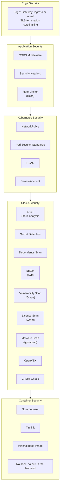

# Security

Security headers, CORS, rate limiting, supply-chain scanning, container hardening, and Kubernetes security.

---

## Table of Contents

- [Overview](#overview)
- [HTTP Security Headers](#http-security-headers)
- [CORS Configuration](#cors-configuration)
- [Rate Limiting](#rate-limiting)
- [CSP Violation Reports](#csp-violation-reports)
- [Request Limits and Trusted Hosts](#request-limits-and-trusted-hosts)
- [Client IP](#client-ip)
- [Supply-Chain Security (CI)](#supply-chain-security-ci)
- [Container Security](#container-security)
- [Kubernetes Security](#kubernetes-security)
- [Runtime Application Protection (DAST + WAF)](#runtime-application-protection-dast--waf)
- [Secrets Management](#secrets-management)
- [TLS Configuration](#tls-configuration)

---

## Overview

Security is implemented at multiple layers:



---

## HTTP Security Headers

### Frontend (Next.js)

Security headers are applied in production via `next.config.ts` (the Content-Security-Policy comes from `proxy.ts`):

| Header | Value | Purpose |
|--------|-------|---------|
| `Content-Security-Policy` | `default-src 'self'; img-src 'self' blob: data:; ...` | Restrict resource loading |
| `X-Content-Type-Options` | `nosniff` | Prevent MIME-type sniffing |
| `X-Frame-Options` | `DENY` | Not framable anywhere |
| `Referrer-Policy` | `no-referrer` | Don't send referrer header |
| `Permissions-Policy` | `geolocation=(), microphone=(), camera=()` | Disable browser features |
| `Cross-Origin-Opener-Policy` | `same-origin` | Isolate the browsing context from cross-origin windows |
| `Cross-Origin-Resource-Policy` | `same-origin` | Other origins cannot embed or read the response |
| `frame-ancestors` | `'none'` (via CSP) | Prevent clickjacking |

### Known limitation: the frontend port exposes an internal URL

On the paths it proxies to the backend (`/api/v1`, `/docs`, `/openapi.json`), Next.js adds an
`x-middleware-rewrite` response header that holds the backend's internal URL (for example
`http://<release>-backend:8000/api/v1/health`). Next always sets it, and removing it in `proxy.ts` cancels
the rewrite, so the frontend cannot drop it. It discloses internal topology (CWE-200, low severity).
Expose the app through an edge or a gateway that does not proxy through the frontend, never the frontend
port directly. The live header test lists the header as a known Next exposure and
allows it only on proxied paths of the frontend port.

### Edge headers

The chart renders no header filter or controller snippet in any edge mode. The headers on a response come from the app that sent it: the backend's security middleware (`backend/middleware/security.py`) and the frontend's `next.config.ts` and `proxy.ts`. The exception is `Strict-Transport-Security`: in tunnel mode Cloudflare sets it, and in the other modes your Gateway or controller may (see [HSTS](#hsts)).

### CSP Details

Production CSP (set per request in `frontend/proxy.ts`; the static paths get `default-src 'none'` from `frontend/next.config.ts`):

```
default-src 'self'
img-src 'self' blob: data:
style-src 'self'
script-src 'self' 'nonce-<per request>'
connect-src 'self'
frame-ancestors 'none'
base-uri 'self'
form-action 'self'
```

No `unsafe-eval`/`unsafe-inline` and no third-party (`https:`, CDN) origins: the
production build inlines no eval and loads styles from `'self'`. `connect-src
'self'` because the frontend calls the API same-origin (`/api/v1`, rewritten
server-side by `proxy.ts`) — no broad `https:` that would permit
exfiltration to any endpoint. The frontend also serves a per-request nonce on
`script-src` (see `proxy.ts`), so an *inline* script without that nonce is blocked.

Interactive docs (`/docs`) are the one page that loads a third-party origin, and it is still strict:
the backend serves its own Swagger UI page with **no inline script**. Swagger UI's CSS and bundle come
from jsDelivr at one exact version, each pinned by a Subresource Integrity hash, and the init script is
the backend's own `/docs/init.js`. The backend sends this page's CSP itself, on the page and on the script, and the frontend proxy passes it through (one policy, whoever serves `/docs`). So `/docs` alone adds only `https://cdn.jsdelivr.net` to `script-src`
and `style-src`, with no `'unsafe-inline'` anywhere; every other page keeps the nonce-only policy.
`/docs` can be disabled with `API_DOCS_URL=` (empty). The machine-readable schema at `/openapi.json` is
unaffected by that and stays available for non-browser consumers regardless of the interactive page.
With `ENV=production` both are
off unless `ALLOW_PRODUCTION_DOCS=true` (see
[Environment Variables](./environment-variables.md#backend-settings)).

---

## Authentication & Authorization

The template imposes **no IdP of its own** — identity is config-driven via
`AUTH_MODE` (`backend/auth/`), so an adopter plugs in their own. The reference
CRUD stays open until auth is enabled; writes are gated by the `get_current_user`
FastAPI dependency, which resolves a `Principal` per request.

| `AUTH_MODE` | Behaviour | Trust model |
|-------------|-----------|-------------|
| `oidc` | **Production mode.** `Authorization: Bearer <jwt>` from an OpenID Connect provider, verified against the provider's JWKS. | The service verifies every token itself; see [OIDC](#oidc-mode). |
| `cloudflare-access` | **Production mode.** The Cloudflare Access application token in the `Cf-Access-Jwt-Assertion` header, verified against the team's keys and the application's AUD tag. | The service verifies every token itself; see [Cloudflare Access](#cloudflare-access-mode). |
| `none` *(default)* | Auth disabled; the dependency yields an anonymous principal. Reference CRUD is open. With `ENV=production` it is refused unless `ALLOW_ANONYMOUS=true`. | N/A — opt-in only. |
| `gateway` *(reference)* | Identity is read from a header injected by the auth proxy (`AUTH_USER_ID_HEADER`, default `X-Authenticated-User-Id`; roles from `AUTH_ROLES_HEADER`, default `X-Authenticated-User-Roles`, comma-separated), and only when the direct TCP peer is inside `AUTH_PROXY_CIDRS`. Any other peer, a missing or blank header, or a header sent twice → `401`. | Who sent the header decides, not who can reach the port. API requests must reach the backend through the auth proxy, which must strip client copies: see [the identity trust boundary](#the-identity-trust-boundary). With `ENV=production` an empty `AUTH_PROXY_CIDRS` is refused at startup. |
| `bearer` *(reference)* | Identity from an HMAC-signed JWT bearer token verified with a shared secret (`AUTH_JWT_SECRET`, algorithm `AUTH_JWT_ALGORITHM`, default `HS256`, subject claim `AUTH_JWT_USER_ID_CLAIM`, default `sub`). Missing/invalid → `401`. | A shared secret for internal or test use, **not** end-user identity: whoever holds it can mint any identity. |

`gateway` and `bearer` are **reference modes**; use `oidc` or `cloudflare-access` in production.

### The identity trust boundary

Two kinds of header are believed only from listed senders, and each kind has its own list:

- **Identity headers count only from the auth proxy.** In `gateway` mode the backend reads the
  identity and roles headers only when the request's direct TCP peer is inside `AUTH_PROXY_CIDRS`
  (comma-separated IPv4/IPv6 CIDRs, default empty, validated like `TRUSTED_PROXY_CIDRS`). An address
  in `X-Forwarded-For` never counts, even from a trusted client-IP proxy: only the peer that opened
  the connection does. Any other peer gets a `401`, logged at info level without the header values.
  Empty trusts nobody, so every request gets a `401`; in production `gateway` mode with an empty
  list stops startup. An identity or roles header that appears more than once (names compared in
  any letter case), or an identity that is blank or holds a comma (a proxy that joined its value
  onto a client's copy), is a `401` too, even from a listed peer. The roles header stays a
  comma-separated list by design, so a joined roles value cannot be detected: that rests on the
  auth proxy's duty below.
- **Client-IP headers count only from the proxies in their own list**, `TRUSTED_PROXY_CIDRS` (see
  [Client IP](#client-ip)). Being a client-IP hop does not make a proxy an auth proxy: list a range
  in both only when that proxy authenticates and strips client copies of the identity headers.
- **The frontend is never the auth proxy.** Its same-origin `/api/v1` proxy (`frontend/proxy.ts`)
  drops the configured identity and roles header names, and every `x-authenticated-*` header, from
  the browser's request before it forwards, in every auth mode. It reads the names from the same
  `AUTH_USER_ID_HEADER` and `AUTH_ROLES_HEADER` variables as the backend; the chart's ConfigMap
  gives the backend and the frontend one value.

Set `AUTH_PROXY_CIDRS` to the Pod range of the authenticating proxy, the one that connects to the
backend, in every edge mode. **Never list a hop that does not both authenticate and strip client
copies of these headers.** The edge (Gateway, ingress controller, `cloudflared`), the WAF and the
frontend do neither by default, so their ranges do not belong here. A listed range trusts every Pod
in it.

**The auth proxy's duty.** On every route it forwards, the listed proxy must remove or overwrite
any copy of the identity and roles headers that the client sent. A proxy that appends its own
header would let a client's copy through. The backend refuses a request that carries either header
twice, but a client's copy that the proxy forwards alone, for example on a route it does not
authenticate, is believed.

**Routing.** In `gateway` mode every API request must reach the backend through the auth proxy:
route `/api/v1` on the root host (and the api host, when set) to the auth proxy at the edge, or point the
frontend's same-origin proxy at it with `BACKEND_URL`. Otherwise a browser's same-origin `/api/v1`
calls through the frontend get a `401`, by design: the frontend is not in the list and strips the
headers. The auth proxy needs three things: a NetworkPolicy flow to the backend
(`networkPolicy.backendExtraIngressPeers`, or an edge peer when the edge is the proxy), its Pod range
in `AUTH_PROXY_CIDRS`, and the routing above. Which component connects to the backend in each mode:
[Infrastructure, NetworkPolicy per mode](./infrastructure.md#networkpolicy-per-mode).

**With the WAF on.** The chain is WAF → auth proxy → backend: set the WAF's upstream to the auth
proxy (`waf.upstream.host` and `waf.upstream.port`) and list the proxy's NetworkPolicy peers in
`waf.upstreamPeers`, so the WAF's egress reaches the proxy on that port instead of the backend
Pods (a host without peers fails the render). Then list the proxy in
`networkPolicy.backendExtraIngressPeers` and in `AUTH_PROXY_CIDRS`; the WAF is in neither.

### OIDC mode

```bash
AUTH_MODE=oidc
OIDC_ISSUER=https://idp.example.com        # a token's `iss` must equal this exactly
OIDC_AUDIENCE=api://your-service           # comma-separated; the token's `aud` must contain one
# OIDC_JWKS_URL=https://idp.example.com/keys   # unset: taken once from ${OIDC_ISSUER}/.well-known/openid-configuration
# OIDC_ROLES_CLAIM=groups                      # a list of strings or a space-separated string
```

- Tokens: RS256/ES256 by default (`OIDC_ALGORITHMS`, an allowlist of RS*, PS*, ES*; `none` and
  every HS* are refused at startup). The header `alg` must be in the allowlist and fit the key's
  type (and curve), `kid` is required, a non-empty `crit` header is refused, and a token over
  8 KiB is refused. `exp` is required; `nbf` and `iat` are checked when present, with
  `OIDC_CLOCK_SKEW_SECONDS` (default 60, at most 300). The user id is the `OIDC_USER_ID_CLAIM`
  (default `sub`), which must be a non-empty string.
- Keys: fetched over `https` (plain `http` only for `localhost` outside production) with 5 s
  timeouts (and a 10 s deadline for the whole refresh), no redirects and a 1 MiB cap, and cached for `JWKS_CACHE_TTL_SECONDS` (3600).
  Concurrent cold requests make one fetch. An unknown `kid` triggers one refetch, at most once
  per `JWKS_MIN_REFETCH_SECONDS` (30) across all requests, so random `kid`s cannot hammer the
  provider. When a refresh fails the last good keys are kept for `JWKS_MAX_STALE_SECONDS`
  (86400); with no usable keys the answer is `503` ("authentication temporarily unavailable"),
  never `500` and never "allow". When discovery is used the document's `issuer` must equal
  `OIDC_ISSUER`.
- Failures: a missing token is `401` with `WWW-Authenticate: Bearer`; any other failure is `401`
  with `WWW-Authenticate: Bearer error="invalid_token"` and the generic detail "invalid or
  expired token". The reason is logged at info level (never the token); the response does not
  say which check failed.

### Cloudflare Access mode

```bash
AUTH_MODE=cloudflare-access
CF_ACCESS_TEAM_DOMAIN=team.cloudflareaccess.com   # exactly <team>.cloudflareaccess.com
CF_ACCESS_AUD=<application AUD tag>
```

The issuer is `https://<team domain>` and the keys are `https://<team domain>/cdn-cgi/access/certs`
(both as [Cloudflare documents](https://developers.cloudflare.com/cloudflare-one/access-controls/applications/http-apps/authorization-cookie/validating-json/)),
RS256 only; the claim checks and key cache are the ones above, except that the clock skew is a
fixed 60 s (`OIDC_CLOCK_SKEW_SECONDS` does not apply). `CF_ACCESS_TEAM_DOMAIN` must be exactly
`<team>.cloudflareaccess.com` (lowercased; anything else is refused at startup, because the issuer and
key URL derive from it). The user id is `sub` and the
claims (including `email`, when present) are on the principal. Only the `Cf-Access-Jwt-Assertion`
header is read: Cloudflare adds it on every request through the tunnel and recommends validating
it rather than the `CF_Authorization` cookie, which is not guaranteed to be passed, and a cookie
as a credential would bring cross-site request forgery questions the header does not have.
Cloudflare service-token requests carry no `sub` for a person, so they are refused here.

- **Authorization** is layered on with `require_roles(*roles)`: a dependency that
  returns `403` when the principal lacks a required role.
- The `bearer` reference mode is dependency-free and accepts only the HMAC family
  (`HS256`/`HS384`/`HS512`), rejecting `alg` confusion (the header `alg` must match the
  configured one) with a constant-time signature compare. `oidc` and `cloudflare-access` use
  PyJWT (with `cryptography`); the template implements no signature algorithm itself.
- **CSRF posture**: the API is stateless — it authenticates via a header or a
  bearer token, not cookie sessions — so classic CSRF does not apply. If you
  introduce cookie-based sessions, add same-site cookies and a CSRF token; do not
  rely on bearer/header auth alone for browser cookie flows.

---

## CORS Configuration

The backend configures CORS via FastAPI's `CORSMiddleware`, driven entirely by
environment variables (see `backend/main.py`). The template ships
**restrictive-by-default**: with no configuration it is same-origin only.

| Setting | Default | Purpose |
|---------|---------|---------|
| `CORS_ORIGINS` | *(unset → same-origin only)* | Which origins can access the API. Comma-separated. Never reflects `*`. |
| `CORS_ALLOW_CREDENTIALS` | `false` | Allow cookies/auth headers. When `true`, `*` is stripped from origins (browser rule). |
| `CORS_ALLOW_METHODS` | `GET,POST,PUT,PATCH,DELETE,OPTIONS` | Allowed methods (explicit set, never `*`). |
| `CORS_ALLOW_HEADERS` | `Authorization,Content-Type,X-Requested-With` | Allowed headers (explicit set, never `*`). |

> **Production recommendation**: Set `CORS_ORIGINS=https://app.example.com` to
> allow a specific frontend. Do not use `*` with credentials.

---

## Rate Limiting

Per-IP rate limiting via the **`limits`** library's async API (`limits.aio`) in
`backend/middleware/rate_limiting.py` (a `BaseHTTPMiddleware`) and `backend/rate_limiter.py`, plus
an optional limit at the edge:

### Backend Rate Limiting

| Setting | Default | Description |
|---------|---------|-------------|
| `RATE_LIMIT_DEFAULT` | `100/minute` | Max requests per IP (fixed window). `limits` format: `N/minute`, `N/second`, … |
| `RATE_LIMIT_STORAGE` | `memory://` | Where the counters live (a secret: a Redis URL can hold a password) |
| `RATE_LIMIT_STORAGE_TIMEOUT_SECONDS` | `0.2` | Redis connect and socket timeout, and the cap on one limiter call |

**Storage.** `memory://` keeps the counters in the process, so the limit is **per replica**: with
two Pods a client can make twice the configured rate. `redis://`, `rediss://` and `redis+unix://`
share the counters across replicas (`limits.aio.storage.RedisStorage` with the redis-py asyncio
client; see the `limits` documentation, "Async Storage"). Counter keys start with the service name, so several services can share one
Redis, and the CSP report limit has its own namespace. Anything else is refused at startup, and the
URL never appears in a log or an error. In production a plaintext `redis://` URL is refused unless
every host is loopback (use `rediss://`, a unix socket, or `memory://`), the same rule as the
database TLS, and a `rediss://` query that switches verification off (`ssl_cert_reqs` other
than `required`, `ssl_check_hostname=false`) is refused too (`ssl_ca_certs` and `ssl_ca_path` stay
allowed for a private CA). `redis://` and `rediss://` URLs need an explicit port (`:6379`) and
`redis+unix://` a socket path and no host; a URL the storage cannot parse is refused at startup
without the URL in the message. In the chart the URL comes from the app Secret (`RATE_LIMIT_STORAGE` in
`secrets.existingSecret`), never from `config:`; allow the egress to Redis (port 6379) with
`backend.networkPolicy.extraEgress`.

**Proven on kind.** `make kind-tracing-redis-test` (see [Tracing](backend-architecture.md#tracing))
also runs the limit in a throwaway Redis, the URL in the app Secret and the egress through
`extraEgress`: requests alternating over two backend Pods together get exactly the one limit
(`memory://` lets each Pod count its own, and the test fails); with Redis scaled to zero they are
all answered `200`, and once it is back the limit applies again (each Pod's first request after the
return still fails open, while redis-py replaces its connection to the old Redis Pod). That release
runs `ENV: development` (values.local.yaml), so the production refusal of plaintext `redis://` does
not apply; in production use `rediss://`.

**Fail open.** A Redis error, or a call slower than `RATE_LIMIT_STORAGE_TIMEOUT_SECONDS`, allows the
request and logs a warning (the exception type only) at most once a minute: an outage of the
limiter must not take the API down. While Redis is unreachable a request can wait up to the timeout
(0.2 s by default: well above a same-cluster round trip, short enough to bound the added latency).
An edge limit, if you set one, still applies. Every such request increments the Prometheus counter
`rate_limit_storage_failures_total{reason="error"|"timeout"}` (on the metrics port, `METRICS_PORT`; a timeout also
covers an overloaded event loop), so alert on it: while it grows the limit is not applying.

> **Why not slowapi**: slowapi resolves the target route *handler* from the
> top-level route table to decide which limits apply, but FastAPI assembles the
> versioned API under a nested router that slowapi's lookup does not descend
> into — so its global `default_limits` were never checked (a silent no-op). The
> middleware here enforces the limit directly against the `limits` backend keyed
> by client IP, so it works regardless of how routes are nested.

### Edge Rate Limiting

The chart sets no edge rate limit; the backend limit above covers the backend only, per replica.
The edge limit covers every path, the frontend included, and lives where the edge does: a Cloud
Armor rate-based rule on GKE (`edge.gateway.gke.securityPolicy`), Cloudflare rate-limiting rules in
tunnel mode, or the controller's own setting in ingress mode. What the former ingress-nginx
annotations did and where each lives now:
[Infrastructure, former nginx practices](./infrastructure.md#where-the-former-nginx-practices-live-now).

### Behavior

- Rate limit is applied **per client IP address** (the resolved address, see [Client IP](#client-ip))
- Exceeding the limit returns `429 Too Many Requests` as a problem body (see [Error Responses](api-reference.md#error-responses))
- Response includes `Retry-After` header (seconds until reset)

---

## CSP Violation Reports

Opt-in (`CSP_REPORT_ENABLED`, default off; the chart's `cspReporting.enabled` turns on this and the
frontend half with one value). `POST /api/v1/csp-report` takes the browser's violation reports and
logs them, so a policy change can be watched before it is enforced. It is a browser-defined format,
not API: it is not in the OpenAPI document, takes no authentication (browsers send none) and is a
404 when off.

- **Formats.** `application/csp-report` (`report-uri`: `{"csp-report": {...}}`) and
  `application/reports+json` (`report-to`: an array of reports; only `"type": "csp-violation"`
  entries count). Any other content type is a 415, malformed JSON or the wrong shape a 400, and an
  accepted report a 204. Every error is a problem body.
- **Limits.** The body is capped at `CSP_REPORT_MAX_BYTES` (16384), checked from `Content-Length`
  and again while it streams in, never read unbounded: a 413. At most 10 reports are taken from one
  request. `CSP_REPORT_RATE_LIMIT` (`20/minute` per client, its own counter in the same limiter and
  storage as above) answers 429 with `Retry-After`; a limited request is not read. The route is
  exempt from `RATE_LIMIT_DEFAULT`, so browser reports never use up a user's API budget.
- **What is logged.** One warning per violation, with a fixed set of fields: `document-uri`,
  `blocked-uri`, `violated-directive`, `effective-directive`, `disposition`, `status-code`,
  `source-file`, `line-number`, `column-number`. URLs lose their query string and fragment (they can
  carry tokens). A value is a string or an integer; strings lose control characters (so a report
  cannot forge a log line) and are cut to 512 characters, integers must be 0 to 2^31 - 1, and
  anything else, and every unknown field (such as `original-policy` or `script-sample`), is dropped.
  The sanitising is in `services/csp_report_service.py`.
- **Frontend.** With `CSP_REPORTING_ENABLED=true` (read per request by `frontend/proxy.ts`) the
  CSP gets `report-uri /api/v1/csp-report` and `report-to csp-endpoint`, and the response gets
  `Reporting-Endpoints: csp-endpoint="/api/v1/csp-report"`. Unset, nothing changes.
- **The backend's `/docs`.** It sets its own CSP (`api/docs_page.py`), so with `CSP_REPORT_ENABLED` on the
  backend adds the same `report-uri`, `report-to` and `Reporting-Endpoints` to the docs page and its init
  script. Off, they carry the plain CSP.
- **Through the WAF.** CRS refuses both report content types (rule 920420) and scores a report's body
  (the page's policy and URLs: `data:`, `http://...`) as XSS and SSRF, so with the WAF on every report
  was a 403. With `cspReporting.enabled` a `POST` to the report route whose `Content-Type` is one of
  those two (rule 900221 checks the path, the method and the type) gets exactly those two as its
  allowed content types and its body uninspected (`templates/waf-proxy.yaml`); the URI, the query and
  the headers stay inspected, and any other method, type or path is inspected as everywhere, so a
  removed 920420 (`extraDirectives`) does not widen it. The backend reads the body as hostile input
  (above).
- **Proven on kind.** `make kind-csp-report-test` (`tests/k8s/test_csp_report.py`, the kind job's newest
  leg; it turns `cspReporting.enabled` on for its run and rolls the release back) has Chromium load a page
  of the built frontend, injects an inline script without the nonce, and finds the backend's warning for
  that violation, sent through the frontend and the WAF. Through the same edge the WAF answers `403` to a
  JSON body with a script on the report route, a script in the report route's query, the report type on
  the sample route and a script in a JSON body there. Chromium under Playwright never delivered `report-to` reports (they
  stayed queued), so the spec (`frontend/e2e/csp-report.spec.ts`) drops `report-to` from the page's
  response in the browser after checking the release sent it, and the report goes through `report-uri`;
  the `report-to` delivery is not proven.

---

## Request Limits and Trusted Hosts

Two pure-ASGI middlewares in `backend/middleware/request_limits.py` refuse a request before anything
else reads it. They answer with the [problem body](api-reference.md#error-responses), carrying the
request id.

| Setting | Default | Effect |
|---------|---------|--------|
| `MAX_REQUEST_BODY_BYTES` | `10485760` (10 MiB) | A `Content-Length` over it is a `413` straight away; a body without a length (chunked) is cut off with a `413` once it streams past it |
| `ALLOWED_HOSTS` | `*` (production refuses `*` and an empty list) | A `Host` header that matches no entry is a `400`; `*.example.com` matches subdomains (not the apex), and the port is ignored |

- The body limit default is the backend's own 10 MiB `MAX_REQUEST_BODY_BYTES`; the chart sets no edge
  limit, so this is the one place it lives.
- The probe paths (`/api/<version>/health`, `/api/<version>/healthz`; exact paths, the rate
  limiter's exempt list) skip the host check, because Kubernetes probes send the Pod IP as `Host`.
  The metrics are not on the API app at all: they have their own port.
- An entry is a host only: one with a port is refused at startup (the request's port is ignored), and
  a `Host` header that is not a valid hostname, IPv4 address or bracketed IPv6 (plus an optional
  numeric port) is a `400`.
- The chart sets `ALLOWED_HOSTS` from `edge.hosts` (`root`, and `api` when set) plus the backend
  Service names (`<svc>`, `<svc>.<ns>`, `<svc>.<ns>.svc`, `<svc>.<ns>.svc.cluster.local`): the
  frontend's server-side calls reach the backend by Service name. `backend.extraAllowedHosts`
  (comma-separated) appends more; `values.local.yaml` adds `localhost,127.0.0.1` so a local
  port-forward works. Set `config.ALLOWED_HOSTS` to take the whole list over. The deploy and e2e
  scripts send the backend Service name as `Host` through their port-forwards, and a test checks
  that name is in every rendered list.
- These refusals sit outside the security-headers and CORS middlewares, so a browser on another
  origin sees them as a failed request rather than a readable `413`.

---

## Client IP

Behind the gateway (and, in the Cloudflare Tunnel edge mode, `cloudflared`) the TCP peer of the
backend is a proxy Pod. The backend resolves the real client once, in
`backend/middleware/client_ip.py`, the outermost middleware, which rewrites `request.client` so the
rate limiter and the request logs see one value. Uvicorn's own proxy-header handling is off
(`--no-proxy-headers`): it cannot read `CF-Connecting-IP`, and two resolvers would be two trust lists.

| Setting | Default | Meaning |
|---------|---------|---------|
| `TRUSTED_PROXY_CIDRS` | empty | The cloudflared and gateway Pod ranges of your cluster (comma-separated IPv4/IPv6 CIDRs). An invalid entry stops startup, and so does one with host bits set (`10.1.2.3/8`): write the network form, `10.0.0.0/8`. |
| `TRUST_CF_CONNECTING_IP` | `false` | Believe `CF-Connecting-IP` from a trusted peer. Set it only in the Tunnel edge mode. |

Rules, in order:

1. A peer that is missing, is not an IP, or is **not** in `TRUSTED_PROXY_CIDRS`: the peer is the
   client, and every forwarding header is ignored. A client cannot forge its own address.
2. A trusted peer with `TRUST_CF_CONNECTING_IP` on and a `CF-Connecting-IP` holding exactly one valid
   IP (a repeated or comma-separated value does not count): that IP. Cloudflare
   [sends this header on traffic from its edge](https://developers.cloudflare.com/fundamentals/reference/http-headers/);
   in the other edge modes nothing sets it, so trusting it would let anyone forge it.
3. Otherwise a trusted peer's `X-Forwarded-For` is read **from the right**, skipping trusted hops;
   the first untrusted valid IP is the client. A value that is not an IP stops the walk at the last
   trusted hop, never at something left of it. If every entry is trusted, the leftmost is used.
4. Otherwise the peer.

A trusted peer's `X-Forwarded-Proto` (`http` or `https`) also sets the request scheme.

**Why the default trusts nothing.** Pod CIDRs are cluster-specific, so the chart guesses none. With
the default every client behind a proxy shares the proxy's address, so one rate-limit bucket: safe
but coarse. Set the ranges for your cluster (`values.yaml`, `config:`); production refuses
`TRUST_CF_CONNECTING_IP=true` with no ranges.

The **edge rate limit** ([Edge Rate Limiting](#edge-rate-limiting)) is the first line of defence;
this per-IP limit is the second.

### What the trusted proxies must do

The backend believes a trusted peer's headers, so every trusted hop has to **overwrite or append** to
`X-Forwarded-For`, never pass a client-supplied value through unchanged. The
resolver reads the header from the right, so an appended entry cannot be forged, but a client value
passed through as the only entry could. Claims below are the vendors' own; check them against the
versions you run.

- **ingress-nginx.** With `use-forwarded-headers` at its default (`false`) it ignores incoming
  `X-Forwarded-*` headers and fills them from the request it sees, which is safe. When it is `true`,
  it passes the incoming headers on, and `proxy-real-ip-cidr` (default `0.0.0.0/0`) defines which
  address is your external load balancer: at the default, any client counts as one. Narrow
  `proxy-real-ip-cidr` to the real upstream load balancer, or enable `compute-full-forwarded-for`,
  which appends the remote address and leaves the application to apply its own trusted list (this
  resolver). [ConfigMap reference](https://kubernetes.github.io/ingress-nginx/user-guide/nginx-configuration/configmap/).
  Its `upstream-keepalive-timeout` (default 60 s) must also stay below the backend keep-alive
  (`BACKEND_KEEPALIVE_TIMEOUT`, 75 s): raising it past that causes intermittent 502s.
- **Envoy (the WAF).** Without `use_remote_address` (the chart's setting) Envoy runs in a transparent
  mode and does not modify `X-Forwarded-For`. It trusts a downstream `X-Forwarded-Proto` only when
  `xff_num_trusted_hops` is non-zero; at zero it overwrites the header with `http` or `https` from its
  own connection. The same field also selects the trusted client address (the (N+1)th `X-Forwarded-For`
  entry from the right, falling back to the peer), so a value of 1 would make Envoy see the ingress Pod
  instead of the client; the chart leaves it at 0. **Limit:** with the WAF on, the backend sees
  `X-Forwarded-Proto: http` for https clients; the client IP is unaffected.
  The WAF is safe only because the hop in front has already set the headers: **only the edge peers
  and the frontend may reach the WAF Pod**, which the chart's [NetworkPolicy](#networkpolicy)
  enforces (the frontend's proxy forwards `X-Forwarded-For` unchanged).
  Both behaviours (the `X-Forwarded-Proto` overwrite at zero, and the trusted-client-address rule) are in the
  [Envoy header reference](https://www.envoyproxy.io/docs/envoy/latest/configuration/http/http_conn_man/headers).
- **Trusting a range trusts every Pod in it.** A Pod inside `TRUSTED_PROXY_CIDRS` can send any
  `X-Forwarded-For` and be believed, so nothing but the trusted hops may be in the range. The chart's
  [NetworkPolicy](#networkpolicy) admits to the backend port, per mode: with the WAF off, the edge
  peers (the Gateway namespace, the controller's namespace, or `cloudflared`) and the frontend; with
  the WAF on, only the WAF, which the edge peers and the frontend reach; and, when a scrape target is
  rendered, the collector Pods (`monitoringPodSelector`) in the `monitoringNamespaceSelector`
  namespace, on the metrics port only (never the API port), unless `monitoringNamespaceSelector` is
  null. The full matrix:
  [Infrastructure, NetworkPolicy per mode](./infrastructure.md#networkpolicy-per-mode).
- **`CF-Connecting-IP` is safe only when `cloudflared` is the only way in.** If the ingress or the
  backend is reachable any other way, a client sends its own header and is believed.

Per edge mode:

`AUTH_PROXY_CIDRS` is a separate list in every mode: see
[the identity trust boundary](#the-identity-trust-boundary).

| Edge mode | `TRUSTED_PROXY_CIDRS` | `TRUST_CF_CONNECTING_IP` |
|-----------|-----------------------|--------------------------|
| **Gateway** (the chart's default), in-cluster implementation | The gateway Pods' range, plus the WAF's (Envoy) when `waf.enabled`. | `false` |
| **Ingress** | The ingress controller's Pod range, plus the WAF's (Envoy) when `waf.enabled`. | `false` |
| **Tunnel** (Cloudflare Tunnel) | The same, plus `cloudflared`'s Pod range if it targets the backend Service directly. | `true`, with `cloudflared` the only way in |
| **Google** load balancer / GKE Gateway | The Google front end that is the peer (its request source ranges are listed in the [load balancer documentation](https://cloud.google.com/load-balancing/docs/https)), **and the load balancer's own address**: the balancer appends `CLIENT_IP, LOAD_BALANCER_IP`, so without that address trusted every client resolves to it. | `false` |
| *Every mode, WAF off* | Add the frontend's Pod range: same-origin `/api/v1` calls on the root host reach the backend from the frontend's proxy, which forwards `X-Forwarded-For` unchanged (it appends nothing), so each client keeps its own address. | — |

---

## Supply-Chain Security (CI)

The full supply-chain control catalogue — every scanner, the tool behind it,
gate-vs-advisory, and pull-request-vs-release ref scope — lives on the dedicated
[`supply-chain-security.md`](./supply-chain-security.md) page; the pipeline wiring
(workflows, jobs, ref scope) and the tooling decision record are in
[`ci-cd.md`](./ci-cd.md) and
[`supply-chain-tooling-assessment.md`](./supply-chain-tooling-assessment.md). This
section no longer restates them — read those pages for the detail.

### OpenSSF Scorecard

[`scorecard.yml`](../.github/workflows/scorecard.yml) runs the [OpenSSF Scorecard](https://scorecard.dev/) weekly and on every push to `main`. It scores the repository on practices such as pinned dependencies, token permissions, branch protection, signed releases, SAST and a security policy. It is assurance, not a gate: nothing blocks on it and `CI OK` does not include it. Results appear in three places: the Security tab (code scanning, category `scorecard`), the `scorecard-sarif` artifact on the run (5 days), and the published result behind the README badge. The Scorecard API only accepts published results from a workflow that follows the action's restrictions (no top-level `env`, no `run` steps in the job, only approved actions), so keep the file as it is. The job runs on public repositories; a scheduled run has no repository payload, so the guard lets it through. A private repository opts out by setting the repository variable `SCORECARD_ENABLED` to `false`.

### Vulnerabilities after release

[`rescan.yml`](../.github/workflows/rescan.yml) re-scans the images that run in each environment and the latest release every week and opens a `vuln` issue for each new critical (7 days) or high (30 days) finding. The SLA, how a risk is accepted, why the release VEX is not applied and the artifact-expiry caveat are in [Vulnerability management](./vulnerability-management.md).

### Dependency updates and pinned checksums

[Renovate](../renovate.json5) owns every version update (Dependabot is limited to security updates: [`dependabot.yml`](../.github/dependabot.yml) sets `open-pull-requests-limit: 0`, so version updates are off and security updates still arrive when they are enabled in the repository settings). The Renovate config is inert until the Renovate GitHub App is installed. Validate it with `npx --yes --package renovate@<version> renovate-config-validator --strict renovate.json5`; the validator loads a native RE2 module, so run it under the Node that installed it (a different Node major makes it fall back to JavaScript regexes and report the config's RE2 patterns as invalid). It waits 7 days after a release (`minimumReleaseAge`), groups minor and patch updates into one weekly pull request, opens each major on its own, and keeps `uses:` lines SHA-pinned with their version comments. Its mise manager reads `mise.toml` (a few lines the manager cannot read, such as Helm and kubectl, have regex managers), and its regex managers read the rows left in `tools/pins.tsv`, the `# renovate:` annotations in `infra/security/config.yaml`, and image digests in values files.

Three places pin tools with checksums: `mise.toml` with `mise.lock` (most of the dev toolchain, read by `scripts/tools.sh`: [how](./getting-started.md#the-developer-toolchain)), `tools/pins.tsv` (mise itself, Python and its tools, two data rows) and `infra/security/config.yaml` (the security scanners; the frozen `tools-install.sh` verifies each download against the vendor's release checksum file at install time, so config.yaml records versions only). The expected flow for a bump of a tool in `mise.toml`: Renovate changes the version and runs `mise lock`, so `mise.lock` changes in the same pull request and the `pins` check stays green. The exception is `helm3`, `helm4`, `kubectl` and `kubectl-floor`, which regex managers move and which have no `mise lock` step: that pull request changes `mise.toml` only (its description says so) and the check is red until a maintainer runs `make pins-refresh` and pushes `mise.lock`. The pull request jobs stay `contents: read`, so nothing writes to the branch. The check reads `mise.lock` against `mise.toml` for both platforms (offline), and compares each `github:` tool's locked sha256 with the vendor's checksum file (a changed lock entry is checked against the vendor, not trusted). For a row of `tools/pins.tsv` or `config.yaml`:

1. A Renovate pull request changes a version (and the url beside it in `pins.tsv`).
2. The blocking `pins` check goes red, by design: the recorded sha256 no longer matches the vendor's published one for the new version, or a hashed lock still pins the old version.
3. A maintainer runs `make pins-refresh` (it writes the vendor checksums and regenerates the locks with `uv pip compile --generate-hashes`) and pushes the result. The check turns green.

No bot writes checksums or holds a write token for it. `scripts/pins-refresh.sh --check` is the read-only form CI runs: on a pull request only the rows that differ from the base, on `main` and weekly ([`pins-drift.yml`](../.github/workflows/pins-drift.yml)) every row. The check also reads every hashed lock under `tools/requirements/`: each entry's hashes must be published by PyPI for that version and the files the lock records must be at least 7 days old; `make pins-refresh` regenerates with `--exclude-newer` (now minus 7 days) and keeps one pyyaml across locks. A lock line that is not part of a hash-pinned entry (an index option, `-r`, a one-line requirement) fails the check. A url that does not start with the vendor's expected prefix fails the check, so a look-alike org cannot turn it green. `scripts/pins_refresh.py` holds the one table that says where each tool's checksum comes from (a vendor checksum file, the GitHub release-asset digest for the two tools that publish none, the tag archive for bats, PyPI for the Python tools).

### A release build starts cold

The release build reads and writes no build cache: no `cache-from`, no `cache-to`, no `actions/cache` and no `setup-*` cache anywhere on the release path, which is `release.yml` and every workflow and local action it reaches (build, deploy and chart checks), including the buildx binary. A cache that any job on `main` can write (a test job that runs third-party packages, or any third-party action) could put a poisoned layer into an image that the pipeline then signs and attests as built from its commit, and the signature and provenance would look valid. SLSA v1.0 Build L3 requires that one build cannot inject entries into a cache another build uses, and that the output does not depend on the cache. Each release therefore builds every layer from the commit, the pinned base images and the locked dependencies, at the cost of build time. The hardening lint (`no-release-cache`) fails any cache there; the cacheless pull-request `images` job is unchanged.

### Verifying an image

Every image the release workflow pushes is signed keyless (Sigstore, no key to keep) and carries a
SLSA build-provenance attestation and CycloneDX SBOM attestations, all stored next to the image in
`ghcr.io`. An image is a multi-architecture index. The **signature and the provenance are on the
index digest** (the digest in `image-digests.env`, the one deploys and admission use). Each
**SBOM attestation is on one platform's manifest digest**, because an SBOM describes one platform's
image; `docker buildx imagetools inspect ghcr.io/<owner>/<repo>/<image>@sha256:<index digest>` lists those digests. Only images that passed the blocking Grype gate are signed. The signing certificate names
the reusable workflow that ran, not `release.yml`, because a keyless certificate issued inside a
called workflow carries that workflow's ref.

The certificate identity is `https://github.com/<owner>/<repo>/.github/workflows/reusable-build.yml@<ref>`
(`<ref>` is `refs/heads/main` or `refs/tags/v1.2.3`), the issuer is
`https://token.actions.githubusercontent.com`. Verify by digest, with cosign 3 or newer:

```bash
cosign verify ghcr.io/<owner>/<repo>/<image>@sha256:<digest> \
  --certificate-identity "https://github.com/<owner>/<repo>/.github/workflows/reusable-build.yml@refs/tags/v1.2.3" \
  --certificate-oidc-issuer https://token.actions.githubusercontent.com \
  --certificate-github-workflow-repository <owner>/<repo> \
  --certificate-github-workflow-sha <commit sha of the release>
# Provenance: the index digest
gh attestation verify oci://ghcr.io/<owner>/<repo>/<image>@sha256:<index digest> \
  --repo <owner>/<repo> \
  --signer-workflow <owner>/<repo>/.github/workflows/reusable-build.yml
# SBOM: a platform's manifest digest, with the SBOM predicate type
gh attestation verify oci://ghcr.io/<owner>/<repo>/<image>@sha256:<platform manifest digest> \
  --repo <owner>/<repo> \
  --signer-workflow <owner>/<repo>/.github/workflows/reusable-build.yml \
  --predicate-type https://cyclonedx.org/bom
```

Identity plus issuer is **not enough**. Any repository can call a public reusable workflow, and the
certificate of such a call carries the same workflow identity as ours, so only the repository claim
(certificate extension OID 1.3.6.1.4.1.57264.1.5, the workflow repository, or the newer Source
Repository URI extension) tells a foreign signer from this repository. Every verifier must check it:
`--certificate-github-workflow-repository` above, and the example admission policy requires the
same claim (`githubWorkflowRepository` in
[`deploy/policies/kyverno-verify-images.yaml`](../deploy/policies/kyverno-verify-images.yaml);
[Admission control](./admission-control.md)). `--signer-workflow` does the same for `gh attestation verify`, which would
otherwise accept any workflow in the repository.

The release run runs the same `cosign verify` after signing, and fails if it does not pass.
The hardening lint's `provenance` check is enforced: it fails when `reusable-build.yml` loses its sign, verify or attest steps. The comments in `infra/security/check-ci-hardening.sh` that call provenance a SKIP predate this.
Pin to a tag or to `main` with `--certificate-identity-regexp` only when you accept every ref, and
keep the repository claim in that case too.

**Private repositories.** Artifact attestations (provenance and SBOM) are available only for public
repositories or on GitHub Enterprise Cloud. The release workflow therefore attests only when the
repository is public or the variable `ATTESTATIONS_ENABLED` is `true`; otherwise a warning and a
summary line say so. Signing always runs. Keyless signing also writes the repository name, the
workflow ref and the commit to the public Rekor transparency log, so a private repository's name
becomes visible there. See [What a private repository needs](./platform-setup.md#what-a-private-repository-needs).

### Verifying the chart

A release tag also publishes the chart, `ghcr.io/<owner>/<repo>/charts/<chart>` ([The chart](./releasing.md#the-chart)), signed and attested by digest in its own reusable workflow, `reusable-chart-release.yml`: the issuer and the repository claim are the images' ones above, the identity names that workflow. The digest is in the release's `chart.env`, and `provenance.md` holds these commands with the chart's reference filled in. Verify the chart before installing it, by digest:

```bash
cosign verify ghcr.io/<owner>/<repo>/charts/<chart>@sha256:<digest> \
  --certificate-identity "https://github.com/<owner>/<repo>/.github/workflows/reusable-chart-release.yml@refs/tags/v1.2.3" \
  --certificate-oidc-issuer https://token.actions.githubusercontent.com \
  --certificate-github-workflow-repository <owner>/<repo>
gh attestation verify oci://ghcr.io/<owner>/<repo>/charts/<chart>@sha256:<digest> \
  --repo <owner>/<repo> \
  --signer-workflow <owner>/<repo>/.github/workflows/reusable-chart-release.yml
```

Nothing verifies the chart for you. The admission policy checks images, not charts; `helm install --verify` checks a PGP provenance file, not a cosign signature; and the deploy workflow installs the checked-out chart, not the published one. Whoever installs the published chart, by hand or through a GitOps tool, runs the check above first (Argo CD, for one, does not verify cosign signatures on Helm charts).

---

## Container Security

### Non-Root User

The backend container runs as a non-root user. The runtime stage has no `RUN`, so the user
(`appuser`, uid 10001) is written into `/etc/passwd` in the build stage and copied in
([`Dockerfile.backend`](../Dockerfile.backend)):

```dockerfile
COPY --from=py-builder /out/etc/passwd /out/etc/group /etc/
USER 10001
```

### Tini Init System

```dockerfile
ENTRYPOINT ["/usr/bin/tini", "-s", "--"]
```

- Proper PID 1 for signal forwarding
- Prevents zombie processes
- Handles SIGTERM gracefully

### Minimal Base Image

- The backend runtime is distroless Python (`gcr.io/distroless/python3-debian13`, by digest); the build stage is Debian 13
- The backend image has **no shell, no `curl`, no package manager and no `pip`**: an attacker who reaches the container finds no `sh`, `bash`, `apt`, `dpkg` or `pip` to use. Its command (`python -m your_service_name.backend.serve`) and its HEALTHCHECK (`python -m your_service_name.backend.healthcheck`, standard library only) are Python, and no shell script is copied in. Do not run `kubectl exec` with a shell on it; use the interpreter (`/app/.venv/bin/python -c ...`) for a probe
- No build tools in the runtime image (build happens in a separate stage), and the runtime stage has no `RUN`
- `tini` is copied from the Debian package with its dpkg record, so an SBOM lists it like the base's own packages

### Installed Runtime Packages

The backend installs nothing at build time: its runtime is the distroless Python base (which carries
`ca-certificates`, `libsqlite3-0` for the fallback database and the Debian interpreter) plus `tini`,
copied from the Debian package. There is no `libpq`: the driver is asyncpg.

| Package | Purpose |
|---------|---------|
| `tini` | Init system |
| `ca-certificates` | TLS certificate validation |

---

## Kubernetes Security

### NetworkPolicy

Default deny all ingress and egress, with explicit allow rules:

```yaml
# Default deny all
apiVersion: networking.k8s.io/v1
kind: NetworkPolicy
metadata:
  name: <fullname>-default-deny
spec:
  podSelector: {}
  policyTypes:
    - Ingress
    - Egress
```

**Allow rules** (each name is prefixed with the release's full name, `<fullname>-`; in the database
namespace `<fullname>-postgresql-access` admits only the backend and the migration Job):

| Policy | Direction | Source | Destination | Purpose |
|--------|-----------|--------|-------------|---------|
| `allow-to-frontend` | Ingress | the edge peers of `edge.mode` | frontend pods on the frontend port | Edge → UI |
| `allow-to-backend` | Ingress | WAF on: the WAF pods; WAF off: the frontend pods and the edge peers; plus, only when the chart renders a scrape target, the collector Pods (`monitoringPodSelector`) in the `monitoringNamespaceSelector` namespace, both required (`monitoringNamespaceSelector: null` removes the rule); the defaults follow `monitoring.flavour` | backend pods, the backend port for the peers above and `config.METRICS_PORT` alone for the collector | Nothing reaches the backend around the WAF |
| `allow-waf` (WAF on) | Ingress + Egress | the frontend pods and the edge peers | WAF pods on `waf.service.port` (never `waf.health.port`: only the kubelet probes it); egress to the upstream (the backend Pods, or `waf.upstreamPeers`, on the upstream port) + DNS | Edge / frontend → WAF → backend (or auth proxy) |
| `allow-backend-to-db` | Egress | backend pods | postgresql:5432 + DNS | Backend → database |
| `allow-migration-to-db` | Egress | migration job | postgresql:5432 + DNS | Migration → database |
| `allow-frontend-to-backend` | Egress | frontend pods | the backend port (the WAF port when it is on) + DNS | Server-side calls (`BACKEND_URL`) |

DNS egress goes to kube-dns only (`networkPolicy.dns`). The edge peers per mode and the full flow
matrix: [Infrastructure, NetworkPolicy per mode](./infrastructure.md#networkpolicy-per-mode).

### Pod Security Standards

All pods run in **restricted** profile (the app Pods as uid 10001; the WAF as the image's 65532):

```yaml
securityContext:
  runAsNonRoot: true
  runAsUser: 10001
  allowPrivilegeEscalation: false
  capabilities:
    drop: ["ALL"]
```

### RBAC

Minimal permissions via ServiceAccount, Role, and RoleBinding
([`templates/rbac.yaml`](../charts/your-service-name/templates/rbac.yaml), applied by the admin
bootstrap). The Role grants no Secrets: the kubelet resolves `secretKeyRef` and `envFrom` itself.

```yaml
# ServiceAccount (serviceAccount.automountServiceAccountToken)
automountServiceAccountToken: false

# Role (minimal permissions)
rules:
  - apiGroups: [""]
    resources: ["configmaps"]
    verbs: ["get", "list", "watch"]
```

### Resource Quotas

A ResourceQuota and a LimitRange in the app namespace prevent resource exhaustion; the quota is sized from the chart's worst case by a test, so raising replicas or requests needs a quota bump. They come from the
admin bootstrap (`infra/k8s/bootstrap/values.yaml`), not the chart, so the deployer can't change them:
see [Namespace bootstrap](./infrastructure.md#namespace-bootstrap-one-time-admin-step). The
LimitRange sets no default CPU limit (CPU limits throttle) and caps memory. The chart sets a CPU request
and a memory limit equal to the request on every container, and no CPU limit unless `limits.cpu` is set
([Workloads](./infrastructure.md#workloads-rollout-resources-and-shutdown)).

### Runtime Application Protection (DAST + WAF)

The running application is covered by two complementary layers (full plan +
operational steps in
[`dast-waf-openshift-local-runbook.md`](./dast-waf-openshift-local-runbook.md)):

- **DAST — OWASP ZAP (scan-time).** `zap-baseline.py` (single-source
  `infra/security/local/scan-dast.sh`) spiders the target and scans it passively for
  web vulnerabilities. It is **advisory** (findings warn, only a tool error fails) and
  writes a SARIF report (`dast.sarif`). The full active / OpenAPI-driven / authenticated
  scan is not wired into the script: it is the runbook's job, with ZAP's own scripts.
- **WAF — Coraza (runtime).** An in-cluster **Coraza** proxy (Go, CNCF) runs as an
  Envoy wasm plugin with the **OWASP Core Rule Set**, fronting the API surface
  (`/api`, `/docs`, `/openapi.json`) and filtering requests live. It is rendered by
  the Helm chart (`charts/your-service-name/templates/waf-proxy.yaml`) and is
  **off by default** (`waf.enabled: false`) — no side effect until you enable it.
  The frontend's pages bypass it (they are not an injection target); with the WAF on, the
  frontend's same-origin API proxy and server-side calls go through it.
- **The WAF's supply chain.** The WAF runs this repository's third image,
  `Dockerfile.waf`: the distroless Envoy image pinned by its multi-arch index digest, plus
  the Coraza proxy-wasm release asset, pinned by version and sha256 and checked by
  BuildKit (`ADD --checksum`) before the build uses it. The sha256 was recorded when the
  version was first pinned (trust on first use); Renovate then proposes new versions and
  the build fails the checksum until a maintainer records the new asset's sha256. The
  release builds, scans, signs and attests it like the app images, and the deploy passes
  its digest. Envoy loads the Wasm from a file in the image (`code.local.filename`), so
  the Pod fetches nothing at runtime and its egress is only its upstream and DNS. The
  Pod runs as the image's user (65532) with a read-only root filesystem. The base is the newest
  supported Envoy minor (1.39), proven with the pinned Coraza release by a local run, because
  Coraza's own CI stops at an end-of-life minor. Coraza runs its recommended configuration,
  enforcing, and inspects request bodies (`SecRequestBodyAccess On`) up to
  `config.MAX_REQUEST_BODY_BYTES` (`SecRequestBodyLimit`, `SecRequestBodyInMemoryLimit`,
  `SecRequestBodyLimitAction Reject`, and Envoy's listener buffer), so a SQL injection in a form
  or JSON body is blocked, not only one in the URL, and a larger body is a `413`. A buffer filter
  between Coraza and the router holds every request until Coraza has passed all of it, so a
  request whose body never finishes never reaches the backend. Envoy's overload manager bounds
  its heap at 80% of the WAF's memory (the container limit stays the hard bound: Coraza's Wasm
  memory is outside that heap); paths are normalised and encoded slashes refused, slow clients get
  a `408`; `waf.extraDirectives` adds rule exclusions
  ([Containerization, Dockerfile.waf](./containerization.md#dockerfilewaf)). The same chart
  value sets the backend's limit through the ConfigMap; the backend's built-in default is kept
  equal to it by a test. Envoy's admin
  interface (which serves endpoints such as `/quitquitquit`) is disabled; the probes ask
  a separate listener (`waf.health.port`, `waf.health.path`) that answers a fixed `200`.
  Envoy reuses keep-alive connections to the backend, and a backend Pod that gets SIGTERM closes its
  idle ones, so a request Envoy has just written to one fails (`503`, response flag `UC`). The safe
  methods (`GET`, `HEAD`, `OPTIONS`) are resent on such a reset. Every other method goes to a second
  upstream cluster with one request per connection: it never lands on a pooled connection, a new
  connection reaches only a Pod still in the Service, and it is resent only when the reset came
  before anything was sent (`reset-before-request`). The cost is a new connection per write and a
  socket in `TIME_WAIT` on the WAF Pod for about a minute after each, so at tens of thousands of
  writes a minute scale the WAF out before it runs out of ephemeral ports. Envoy runs at most three
  retries per cluster at once (its default circuit breaker); a reset beyond that is still a `503`.
  The [shutdown check](./infrastructure.md#workloads-rollout-resources-and-shutdown) sends `POST`s
  through the WAF during a backend Pod deletion (with the limit raised for its run, so they reach
  the backend) and fails on any write answered with a 5xx or reset; it cannot show that the writes
  cluster is needed on one-node kind (the same section says why). The comments and routes are in `templates/waf-proxy.yaml`; the policies:
  [Envoy's retry conditions](https://www.envoyproxy.io/docs/envoy/latest/configuration/http/http_filters/router_filter#x-envoy-retry-on).
  The [shutdown check](./infrastructure.md#workloads-rollout-resources-and-shutdown) found it.
  CRS lets through only the methods in `waf.allowedMethods` (its `tx.allowed_methods`, rule 911100;
  CRS's own default has no `PATCH` or `DELETE`). A test keeps the list equal to the API's methods in
  the committed OpenAPI spec plus `HEAD` and `OPTIONS`, so add a new method there. Envoy adds no
  `server` or `x-envoy-*` header of its own: the
  [header contract](#http-security-headers) holds through the WAF. The
  [kind job's live suites](./infrastructure.md#local-cluster-kind) found both.

| | DAST (ZAP) | WAF (Coraza) |
|---|---|---|
| When | At scan time (CI / runbook) | Continuously, in front of the running API |
| What it does | *Finds* web vulns by probing | *Blocks* malicious requests live |
| Where it lives | Ephemeral CI scanner | Helm-deployed pod (Envoy) |
| Gate | Advisory baseline | Off by default |

> **OpenShift:** the chart's WAF is the vanilla-K8s (Gateway or Ingress) expression; on
> OpenShift it sits behind the Route/Router edge. The in-cluster proxy validates on
> any cluster; the SQLi/XSS→403 behaviour on your own edge is confirmed on a cluster
> (runbook §4). The WAF image is this repository's own (`Dockerfile.waf`, pinned and signed),
> and a local run proves it loads the Wasm, passes benign traffic and blocks CRS matches.

---

## Secrets Management

### Kubernetes Secrets

Sensitive data is stored in Kubernetes Secrets:

| Secret | Contents |
|--------|----------|
| `your-service-name-secret` (app namespace; synced by the External Secrets Operator in dev, qa and production, the chart's own locally) | DB_USER, DB_PASSWORD, STATS_PASS |
| `your-service-name-db-password` (database namespace, with the in-cluster PostgreSQL and the External Secrets Operator: dev and qa) | password (the app's DB_PASSWORD, synced from the same remote key) |
| `your-service-name-db-credentials` (database namespace, with the in-cluster PostgreSQL) | username, database, and the password with the chart's own Secret (local) |

### Secret sources

The app Secret (`DB_USER`, `DB_PASSWORD`, `STATS_PASS`) has exactly one source, and two at once fail the render:

| Source | Set | Renders | Used by |
|---|---|---|---|
| External Secrets Operator | `secrets.externalSecret.enabled` | an `ExternalSecret` (and the database's, with the in-cluster PostgreSQL) | dev, qa and production |
| a Secret you manage | `secrets.existingSecret` (one made by hand, [Sealed Secrets](#sealed-secrets), SOPS) | nothing | previews (the preview bootstrap creates it) |
| the chart's own Secret | `secrets.dbPassword` or `secrets.statsPass` (from the gitignored `values.secret.yaml`) | a `Secret` | local and kind |

Previews keep the Secret the preview bootstrap creates: every preview of the namespace shares one random password
that `scripts/k8s-bootstrap.sh preview --create-secrets` makes once, for throwaway databases, so there is nothing
worth keeping in a store ([CI/CD, Pull request previews](./ci-cd.md#pull-request-previews)).

### External Secrets Operator

[External Secrets Operator](https://external-secrets.io/) syncs the Secret from the environment's secret store:
Google Secret Manager by default, [OpenBao](#openbao) or [Infisical](#infisical) instead. With
`secrets.externalSecret.enabled` the chart renders one `external-secrets.io/v1` `ExternalSecret` that creates the
Secret the backend and the migration Job read (`creationPolicy: Owner`), with one `data` entry per key in
`secrets.externalSecret.keys`. With the in-cluster PostgreSQL (dev and qa) and no `postgresql.existingSecret`, a
second `ExternalSecret` in the database namespace syncs the same `DB_PASSWORD` remote key into
`<release>-db-password`, which the StatefulSet and the backup jobs read: the app and the database share one value.

Each remote key is `remoteKeyTemplate` with `{key}` replaced by the key's name, so moving to another store changes
three values and no template or app code (the schema validates them):

```yaml
secrets:
  externalSecret:
    enabled: true
    refreshInterval: 1h
    secretStoreRef: {name: secret-manager, kind: SecretStore}   # the environment's store
    remoteKeyTemplate: "your-service-name-dev-{key}"            # OpenBao: "your-service-name/dev/{key}"
    remoteProperty: ""                                          # OpenBao: "value"
    keys:                                                       # the Secret key -> {key}
      DB_USER: db-user
      DB_PASSWORD: db-password
      STATS_PASS: stats-pass
```

`values.dev.yaml`, `values.qa.yaml` and `values.production.yaml` turn it on with the store name as a placeholder,
`your-secret-store`, which `guards.rejectPlaceholders` refuses at deploy time. Add a key (for example
`RATE_LIMIT_STORAGE: rate-limit-storage`) to sync it too.

The stores are the platform's, not the chart's: the operator and one namespaced `SecretStore` per namespace, each
with an identity that reads only its environment's secrets. [GKE Cluster Setup, External
Secrets](./gke-cluster-setup.md#14-the-apps-secrets-external-secrets-with-secret-manager) installs them for Secret
Manager. The deployer's Roles (`infra/k8s/bootstrap`) hold `externalsecrets` in the `external-secrets.io` group, in
the app and the database namespace, and no store kind: the deployer chooses which keys a release reads, never what a
store may read. `make kind-external-secrets-test` runs the chart this way on kind
([`tests/k8s/test_external_secrets.py`](../tests/k8s/test_external_secrets.py)): the pinned operator, an OpenBao
store, and the release with only the store values switched.

### OpenBao

[OpenBao](https://openbao.org/) (MPL-2.0, a Linux Foundation fork of Vault) instead of Secret Manager, for a
cluster outside Google Cloud or a store you run yourself. The trade-offs are in [Tooling assessment,
Secrets](./tooling-assessment.md#4-secrets). The operator's `vault` provider talks to it.

**The store**, one per namespace:
[`deploy/external-secrets/secretstore-openbao.yaml`](../deploy/external-secrets/secretstore-openbao.yaml) (validated
against the operator's CRDs by `make kubeconform`, and run on kind by the test above): the KV v2 engine at `secret`,
Kubernetes auth as the namespace's `external-secrets` service account, and OpenBao's CA from a ConfigMap. Then the
values of each environment:

```yaml
secrets:
  externalSecret:
    secretStoreRef: {name: openbao, kind: SecretStore}
    remoteKeyTemplate: "your-service-name/dev/{key}"
    remoteProperty: value
```

**Least privilege**: a policy per environment that reads only its path, and a Kubernetes-auth role per environment,
bound to that environment's namespaces and its `external-secrets` service account (OpenBao's own service account
needs `system:auth-delegator` to review the tokens):

```bash
export BAO_ADDR="https://openbao.example.internal:8200"   # your OpenBao; log in first (bao login)
export SERVICE_NAME="your-service-name"
bao auth enable kubernetes   # once; then bao write auth/kubernetes/config kubernetes_host=<the API server>
for env in dev qa production; do
  printf 'path "secret/data/%s/%s/*" { capabilities = ["read"] }\n' "$SERVICE_NAME" "$env" \
    | bao policy write "$SERVICE_NAME-$env" -
  namespaces="$SERVICE_NAME-$env"
  [ "$env" = production ] || namespaces="$namespaces,$SERVICE_NAME-$env-db"
  bao write "auth/kubernetes/role/$SERVICE_NAME-$env" bound_service_account_names=external-secrets \
    bound_service_account_namespaces="$namespaces" token_policies="$SERVICE_NAME-$env" \
    audience=openbao token_ttl=10m
done
```

Set the role in each namespace's store (`role: your-service-name-<env>`). **Check:** `kubectl get secretstores
--all-namespaces` shows `openbao` READY `True` in each namespace; an `ExternalSecret` in dev that names
`your-service-name/production/db-user` shows `SecretSyncedError`, and the operator's log has OpenBao's `403`, as the
kind test proves.

**Migrating from Secret Manager**, one environment at a time, dev first:

1. Create the paths: for each key, copy the value from Secret Manager to OpenBao without showing it (it goes from one
   standard input to the other):

   ```bash
   env=dev
   for key in db-user db-password stats-pass; do
     gcloud secrets versions access latest --secret="$SERVICE_NAME-$env-$key" \
       | bao kv put -mount=secret "$SERVICE_NAME/$env/$key" value=- > /dev/null
   done
   bao kv list -mount=secret "$SERVICE_NAME/$env"   # → the three names, no values
   ```

2. Apply the OpenBao store in each of the environment's namespaces (above) and wait for READY `True`.
3. Switch the values (`secretStoreRef`, `remoteKeyTemplate`, `remoteProperty`) in `values.<env>.yaml` and deploy.
4. Wait for `Ready`: `kubectl -n <namespace> wait externalsecret --all --for=condition=Ready --timeout=120s`, in the
   app namespace and the database namespace; the Pods keep running on the same values.
5. Remove the old secrets once the environment runs on OpenBao: the Secret Manager store (`kubectl -n <namespace>
   delete secretstore secret-manager`), the environment's Secret Accessor bindings, and the secrets
   (`gcloud secrets delete "$SERVICE_NAME-$env-<key>"`).

### Infisical

[Infisical](https://infisical.com/) (MIT, with an `ee/` directory under its own licence; a hosted service or
self-hosted) instead of Secret Manager. The trade-offs are in [Tooling assessment,
Secrets](./tooling-assessment.md#4-secrets).

**The store**, one per namespace:
[`deploy/external-secrets/secretstore-infisical.yaml`](../deploy/external-secrets/secretstore-infisical.yaml)
(validated by `make kubeconform`): the project and environment slugs, and Universal Auth with a client ID and secret
from a Secret in the namespace. Then the values of each environment (the store's `environmentSlug` picks the
environment):

```yaml
secrets:
  externalSecret:
    secretStoreRef: {name: infisical, kind: SecretStore}
    remoteKeyTemplate: "/your-service-name/{key}"
    remoteProperty: ""
```

**Least privilege**: one machine identity per environment, with a project role that reads only that environment's
secrets, and its Universal Auth client in that environment's namespaces only. The operator's Kubernetes Auth for
Infisical reads a service account token from a path in the operator's Pod (its own, by default), so it cannot tell
the namespaces apart: use Universal Auth. Create the credentials Secret without showing the secret:

```bash
ns="your-service-name-dev"   # and its database namespace
read -r CLIENT_ID; IFS= read -rs CLIENT_SECRET && echo
printf '%s' "$CLIENT_SECRET" | kubectl -n "$ns" create secret generic infisical-universal-auth \
  --from-literal=clientId="$CLIENT_ID" --from-file=clientSecret=/dev/stdin
unset CLIENT_SECRET
```

**Check:** the store is READY `True`; a copy of it with `environmentSlug: production` and dev's client does not
sync (the identity has no access there).

### Sealed Secrets

[Sealed Secrets](https://github.com/bitnami/sealed-secrets) is one way to fill `secrets.existingSecret` from Git:
a per-cluster controller decrypts a `SealedSecret` into the Secret the release names. Its controller key is one more
thing to back up and rotate per cluster.

```bash
# Install the controller
helm install sealed-secrets sealed-secrets \
  --repo https://bitnami.github.io/sealed-secrets \
  --namespace kube-system

# Seal a Secret manifest, then apply the sealed one
kubeseal --format yaml < secret.json > sealed-secret.yaml
kubectl apply -f sealed-secret.yaml
```

### Best Practices

- **Never commit secrets** — use the External Secrets Operator (or a Secret you manage), and GitHub environment secrets for the deploy's own credentials
- **Rotate regularly** — Especially `STATS_PASS`, database passwords
- **Use environment-scoped secrets** — For deployment secrets, on the GitHub Environment of the job that needs them, never repository-wide
- **Gate the environments** — `production` is limited to `v*` tags and needs a reviewer (see [GitHub repository settings](./github-repository-settings.md))

---

## TLS Configuration

### Edge TLS

TLS terminates at the edge, per mode: the Gateway listener's certificate, the Ingress
`edge.ingress.tlsSecretName` with an issuer you add, or Cloudflare in tunnel mode.
[Infrastructure, TLS per mode](./infrastructure.md#tls-per-mode).

### cert-manager Configuration

```bash
# Install cert-manager
helm install cert-manager cert-manager \
  --repo https://charts.jetstack.io \
  --namespace cert-manager --create-namespace \
  --set crds.enabled=true

# Create a ClusterIssuer for the certificate type you need:
#   - Local dev:   scripts/certs-local.sh applies a `selfsigned` ClusterIssuer it renders
#   - Production:  apply a Let's Encrypt (prod/staging) ClusterIssuer; the chart renders the
#                  Ingress TLS secretName + hosts from values.<env>.yaml
```

### HSTS

The frontend does not set `Strict-Transport-Security`: a header from every layer would give the browser
several competing `max-age` values, so each deployment has one source, picked by the chart's
`edge.hsts`. The values and their reasons are in the `edge:` block of
[`values.yaml`](../charts/your-service-name/values.yaml); the default turns the backend's copy off in
tunnel mode, where Cloudflare sets HSTS
([Cloudflare setup, section 11](./cloudflare-setup.md#11-hsts-once-everything-is-https)).

**Who turns it on in gateway and ingress mode.** The backend sends HSTS while `HSTS_ENABLED` is on
([environment variables](./environment-variables.md)), and only on a request it sees as https
(`backend/middleware/security.py`). Behind an edge it sees https only from a peer in
`TRUSTED_PROXY_CIDRS` that forwards `X-Forwarded-Proto: https` ([Client IP](#client-ip)). The chart
leaves that list empty, so with the shipped values nothing sends HSTS. Choose one source:

- **The backend:** put the edge's Pod range in `TRUSTED_PROXY_CIDRS` (the per-mode table in
  [Client IP](#client-ip)). With the WAF on, the backend's peer is the WAF, which forwards
  `X-Forwarded-Proto: http` ([What the trusted proxies must do](#what-the-trusted-proxies-must-do)),
  so the backend sends none; use the edge then.
- **The edge:** set HSTS on your Gateway, controller or Cloudflare, and set `edge.hsts: edge`.

**The root host.** Its pages come from the frontend and carry no HSTS. The browser applies HSTS per
host, so the root host is covered once one of its responses carries it, such as a same-origin API call
that the frontend's proxy (`frontend/proxy.ts`) passes to the backend. The proxy forwards the edge's
`X-Forwarded-Proto` unchanged (Next.js fills in `http`, its own connection, only when the header is
missing), but the backend's peer is then the frontend: the backend's copy reaches the root host only
when the frontend's Pod range is in `TRUSTED_PROXY_CIDRS` too (the table's "Every mode, WAF off" row).
An edge source covers every host directly.

A test per layer pins the final
header set (`frontend/next.config.test.ts`, `frontend/static-paths.test.ts`, the live
`tests/live/test_header_set.py`, which runs over http and so sees no HSTS).
