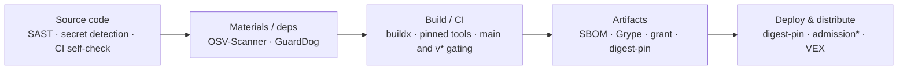
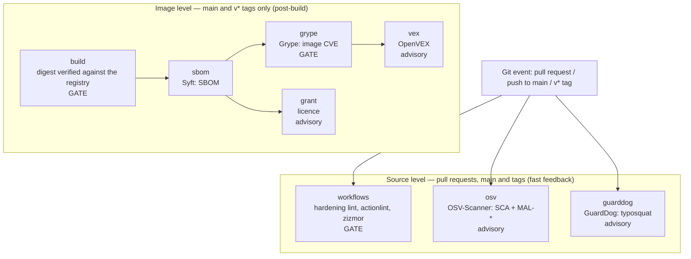

# Supply-Chain Security

Software supply-chain security for this template — what it is, the controls the pipeline runs, what
each tool covers, and how to reproduce any of them locally. This page is the **entry point**: it
defines the concepts and maps the controls; the deep "how" for each lives in the owning doc it links
to (nothing is restated here — one home per fact).

> **What this page answers**
> - What "software supply-chain security" means, and the stages it spans (the CNCF / SLSA model).
> - How NIST SSDF relates to it (the umbrella secure-development framework).
> - What each control covers, whether it is a **gate** or **advisory**, and when it runs (pull request vs `main` and tags).
> - The core concepts — SBOM, SLSA provenance, Sigstore signing, digest-pin, OpenVEX, typosquat — in one place.
> - How to run any control locally with `devsec.sh`.
>
> The *why-this-toolset* decision record (the overlap ledger) is
> [`supply-chain-tooling-assessment.md`](./supply-chain-tooling-assessment.md); what is **not**
> implemented yet is [`ROADMAP-supply-chain.md`](./ROADMAP-supply-chain.md); the pipeline mechanics
> (workflows / jobs / gates) are [`ci-cd.md`](./ci-cd.md); application / runtime security (headers,
> CORS, secrets, TLS) is [`security.md`](./security.md).

## What is software supply-chain security?

Software supply-chain security protects a product against risk introduced **through what it is built
from and how it is built** — as distinct from, and complementary to, *application* security (the
vulnerabilities in the code you *write*). Supply-chain security is about the code and artifacts you
*consume*: a typosquatted or compromised dependency, a tampered build / CI pipeline, a poisoned base
image, or an impersonated artifact. It also lets you **prove** the integrity of what ships
(provenance, signing) and **act** on findings later (VEX).

The canonical way to reason about it is the **CNCF software-supply-chain model** — the *CNCF Software
Supply Chain Best Practices* guidance, which breaks the chain into **five stages** and examines each
through four cross-cutting **lenses** — **Verification, Automation, Controlled Environments, and
Secure Authentication** — with **Metadata, Policy, Zero-trust, and Root-of-Trust** running across all
of them (see [Citations](#citations)). The template's controls map onto those stages:

| Stage | What flows through it | Characteristic risk | Template control |
|---|---|---|---|
| **Source code** | Your repo, commits, CI definition | injected code, secret leakage, a tampered CI config | CodeQL, gitleaks, the workflow hardening lint |
| **Materials / dependencies** | Third-party packages | typosquats, compromised / malicious deps | OSV-Scanner, GuardDog |
| **Build / CI pipeline** | The reproducible build | a compromised builder or pipeline step | buildx on GitHub-hosted runners, SHA-pinned actions, pinned + checksum-verified tools, `main` and `v*` gating |
| **Artifacts** | Built images + their metadata | impersonation / drift, known CVEs, license risk | SBOM (Syft), Grype, grant, digest-pin, keyless image signing, SLSA provenance and SBOM attestations |
| **Deployment & distribution** | Registries, clusters, runtime | an unsigned or drifted image actually running | digest-pin, admission *(roadmap)*, VEX actuation |

No single control covers every stage, so the template runs a **layered (defense-in-depth) set** where
each layer covers a different target or detection model. The building blocks it leans on — an
**SBOM**, **OpenVEX**, **digest-pin**, and the **NIST SSDF** process framework — are the same ones
the CNCF guidance maps onto these stages. (**SLSA** provenance and **Sigstore** keyless signing are
part of that model too and are delivered: see
[Delivered vs roadmap](#delivered-vs-roadmap).)

## The NIST SSDF umbrella

NIST SP 800-218, the **Secure Software Development Framework (SSDF)** — the umbrella behind U.S.
EO 14028 / OMB M-22-18 — organises secure-software-development practices into **four groups across
the whole SDLC**:

| Group | Meaning | Where the template's controls land |
|---|---|---|
| **PO — Prepare** the organization | Profiles, secure dev environments / tooling, policy, training | *forward work* (process level) |
| **PS — Protect** the software | Source / artifact integrity, least privilege, immutable artifacts | digest-pin, keyless image signing, `main` and `v*` gating |
| **PW — Produce** well-secured software | Secure design / coding, code review, dev-time vuln scanning | SAST, the quality gates (ruff / mypy / tests) |
| **RV — Respond** to vulnerabilities | Response process, disclosure, coordination | OpenVEX, SBOM-consumption / fixable-CVE SLA *(roadmap)* |

Supply-chain scanning (SBOM, Grype, typosquat) is a **slice** that lands mostly in **Protect +
Produce**; the SSDF framing makes clear that scanning alone is not a "secure-development process" —
Prepare and Respond are the forward work. The controls below are therefore necessary but not
sufficient on their own.

## The pipeline at a glance

The controls run in two tranches, split by **ref**. Source-level scans read committed files, so they
run on **every pull request** (fast feedback) and on `main`. Image-level scans need a built, pushed
image, so they run in the release workflow on **`main` and `v*` tags only**, never in a pull request.
A **gate** (blocking) fails the run and sits behind the required `CI OK` check or fails the release;
an **advisory** control turns findings into a warning and never blocks.

## Concepts

Short definitions of the terms above. Each is defined **once** here; the owning doc linked from the
row holds this repo's *how*.

| Concept | What it is | Why it matters here | Deep doc |
|---|---|---|---|
| **SBOM** | A machine-readable inventory of a product's components ("list of ingredients"). Two leading standards: **SPDX** (ISO/IEC 5962) and **CycloneDX** (ECMA-424); this template emits **CycloneDX** via Syft. | You can't reason about what's in an image without an inventory; the SBOM is the input to vulnerability + license scanning and to VEX. | [`containerization.md`](./containerization.md) |
| **SLSA provenance** | A signed attestation of *how* an artifact was built. SLSA v1.2 defines a **Build track at L0–L3 (no L4)** plus a **Source track**; hermetic / reproducible builds are a future direction, not a current requirement. | Provenance lets you verify an image was built where you think it was — the basis for admission enforcement. **Delivered**: `actions/attest-build-provenance` per image digest; see [Verifying an image](./security.md#verifying-an-image). | [`containerization.md`](./containerization.md) |
| **Sigstore keyless signing** | cosign signs with an **ephemeral** key; **Fulcio** issues a short-lived certificate bound to the signer's OIDC identity; **Rekor** records the event in an append-only transparency log. The signature is then **enforced-verified** against the project's issuer + identity. | A signature proves the image came from this project's pipeline; keyless means no long-lived signing key to leak. **Delivered**: `sign-attest` in `reusable-build.yml`; identity and verification in [Verifying an image](./security.md#verifying-an-image). | [`containerization.md`](./containerization.md) |
| **Digest-pin** | Referencing an image by its immutable `repository@sha256:…` digest, **captured** at build — never floated on a mutable `:latest` / `:main` tag. | Guarantees what you deploy is byte-identical to what you signed / attested / vetted (zero-trust promotion). | [`ci-cd.md`](./ci-cd.md) |
| **OpenVEX** | A VEX (Vulnerability Exploitability eXchange) statement **complements** the SBOM by asserting whether a product is *affected* by a CVE — statuses: `not_affected`, `affected`, `fixed`, `under_investigation`. It complements — does not replace — the SBOM or signing. | Turns scanner noise into an actionable "this CVE is not exploitable here", so fixable ones get prioritised. | [`ci-cd.md`](./ci-cd.md) |
| **Typosquat / malicious dep** | A look-alike package name (e.g. `0requests`) that is malicious. SCA matches *known CVEs* and **misses** these at ingest; the OpenSSF **malicious-packages** corpus (OSV `MAL-*`) and heuristic tools catch them. | The #1 rising supply-chain vector; a single malicious dep runs in your build. | [`supply-chain-tooling-assessment.md`](./supply-chain-tooling-assessment.md) |

## What each control does

Every control the pipeline runs, what it covers, and how it behaves. (The *rationale* and the
intentional overlaps are in the [tooling assessment](./supply-chain-tooling-assessment.md).)

| Control (CI job) | Covers / purpose | Target | Model | Gate / advisory | Runs on | Deep doc |
|---|---|---|---|---|---|---|
| **Syft** (`reusable-build.yml` / `sbom`) | SBOM inventory | built image | inventory | — (produces the SBOM) | `main` and `v*` tags | [`containerization.md`](./containerization.md) |
| **Grype** (`reusable-build.yml` / `grype`) | known-CVE SCA | image SBOM | known-CVE (Grype DB / GHSA) | **gate** (threshold `policy.fail_level` in `infra/security/config.yaml`) | `main` and `v*` tags | [`ci-cd.md`](./ci-cd.md) |
| **grant** (`release.yml` / `grant`) | licence compliance | image SBOM | policy | advisory | `main` and `v*` tags | [`ci-cd.md`](./ci-cd.md) |
| **pip-audit** (`security.yml` / `pip-audit`) | Python known-CVE SCA | installed venv | known-CVE (PyPI advisory DB + OSV) | advisory | pull requests, `main`, tags | [`ci-cd.md`](./ci-cd.md) |
| **OSV-Scanner** (`security.yml` / `advisory`, leg `osv`) | SCA + known-malicious | lockfiles / source (npm + `MAL-*`) | known-CVE + `MAL-*` (OSV.dev) | advisory | pull requests, `main`, tags | [`ci-cd.md`](./ci-cd.md) |
| ~~**matcher** (`malware_scan`)~~ | — | **Retired.** Known-`MAL-*` coverage now comes from **OSV-Scanner**; the hand-rolled matcher was removed. | — | — | — | — |
| **GuardDog** (`security.yml` / `advisory`, leg `guarddog`) | typosquat / heuristic | **direct** deps (PyPI + npm) | proactive heuristic | advisory | pull requests, `main`, tags | [`supply-chain-tooling-assessment.md`](./supply-chain-tooling-assessment.md) |
| **CodeQL, gitleaks, dependency review** (`security.yml`) | code analysis, secrets, new vulnerable or disallowed-licence dependencies | source | static analysis, secret rules, advisory DB | **gate** (dependency review on pull requests only) | pull requests, `main`, tags | [`ci-cd.md`](./ci-cd.md) |
| **cosign + GitHub attestations** (`reusable-build.yml` / `sign-attest`) | signing, provenance, SBOM attestation | image digest | Sigstore (Fulcio, Rekor), GitHub OIDC | **gate** (the run fails if `cosign verify` fails) | `main` and `v*` tags only | [`security.md`](./security.md#verifying-an-image) |
| **Digest verify** (`reusable-build.yml` / `build`, `release.yml` / `digests`) | digest-pin + verify | image | immutable `sha256` | **gate** | `main` and `v*` tags only | [`containerization.md`](./containerization.md) |
| **OpenVEX** (`release.yml` / `vex`) | VEX (`affected`; reviewed `not_affected`) | shipped digest | exploitability assertion | advisory document | `main` and `v*` tags only | [`vulnerability-management.md`](./vulnerability-management.md#the-releases-openvex) |
| **Workflow hardening** (`ci.yml` / `workflows`) | lints the repo's own workflows | `.github/` | hardening lint, actionlint, zizmor | **gate** | pull requests, `main`, tags | [`ci-cd.md`](./ci-cd.md) |

> Two overlaps are **intentional** (different target or detection model): OSV-Scanner and
> GuardDog both touch the malicious/typosquat concern, but by different model — OSV-Scanner matches
> the known-`MAL-*` corpus (known-bad list), GuardDog is the proactive heuristic (typosquat before
> any advisory). The former third overlap — the hand-rolled `malware_scan` matcher, which duplicated
> OSV-Scanner's `MAL-*` coverage — has been **retired**, leaving OSV-Scanner the single `MAL-*`
> source. The full ledger is in the [tooling assessment](./supply-chain-tooling-assessment.md).

## Delivered vs roadmap

Everything in the control table above is **delivered**, and the image-touching jobs run only on
`main` and `v*` tags (a pull request author can never resolve a production digest). Image **signing +
SLSA provenance are delivered** too (see [Verifying an image](./security.md#verifying-an-image)). What is **not** implemented yet, in
[`ROADMAP-supply-chain.md`](./ROADMAP-supply-chain.md) —
cryptographic **admission enforcement** (Kyverno), OpenSSF Scorecard,
and the SBOM-consumption / VEX-actuation loop — is that same roadmap. Together they cover the known gaps: signing, provenance and admission, malicious dependencies, the CI's own
supply chain, and the adjacent runtime and cluster items.

## Reproduce any job locally

Every job above has a `devsec.sh` subcommand (single source for CI + laptop). Run them from the repo
root; they write to the same `output/security/` shape the pipeline consumes.

| `devsec.sh` subcommand | CI job(s) |
|---|---|
| `devsec.sh sbom` | `sbom` (release) |
| `devsec.sh osv` | `advisory`, leg `osv` |
| `devsec.sh malware-heuristic` | `advisory`, leg `guarddog` |
| `devsec.sh audit` | `pip-audit` |
| ~~`devsec.sh sign`~~ | — (signing runs only in `reusable-build.yml`, never locally) |
| `devsec.sh vex` | `vex` (release) |

> Image-level subcommands (`sbom`, `vex`) need a built, pushed image and registry
> credentials, so they are effectively release operations even when run by hand. The install
> standard (pin + SHA-256 checksum, never `curl | bash`) is
> [`containerization.md`](./containerization.md); adding a new scanner the established way is the
> `add-supply-chain-scanner` skill.

> The eight `infra/security/*.sh` scripts (including `_helpers.sh`, the most dangerous to edit) are
> **frozen** — extend supply-chain logic only under `infra/security/local/`, never by editing them.

## Citations

Authoritative sources for the concepts above (fetched / verified 2026-11-03):

- **Frameworks & specs** — NIST SSDF (SP 800-218): <https://csrc.nist.gov/Projects/ssdf> ·
  SP 800-218: <https://nvlpubs.nist.gov/nistpubs/SpecialPublications/NIST.SP.800-218.pdf> ·
  SLSA v1.2: <https://slsa.dev/spec/v1.2/> · build levels: <https://slsa.dev/spec/v1.2/build-requirements> ·
  what's new (Source track): <https://slsa.dev/spec/v1.2/whats-new>
- **CNCF supply-chain guidance + building blocks** — CNCF Public Sector Software Supply Chain
  Whitepaper: <https://www.cncf.io/reports/public-sector-software-supply-chain-whitepaper/> ·
  Sigstore signing (keyless / Fulcio / Rekor): <https://docs.sigstore.dev/about/overview/>
- **SBOM / VEX / deps** — SPDX (ISO/IEC 5962): <https://spdx.dev/> · CycloneDX (ECMA-424):
  <https://cyclonedx.org/> · OpenVEX spec: <https://github.com/openvex/spec> · OpenSSF
  malicious-packages: <https://github.com/ossf/malicious-packages>
- **GitHub** — Actions OIDC: <https://docs.github.com/en/actions/security-for-github-actions/security-hardening-your-deployments/about-security-hardening-with-openid-connect> ·
  artifact attestations: <https://docs.github.com/en/actions/security-for-github-actions/using-artifact-attestations> ·
  dependency review: <https://docs.github.com/en/code-security/supply-chain-security/understanding-your-software-supply-chain/about-dependency-review>
