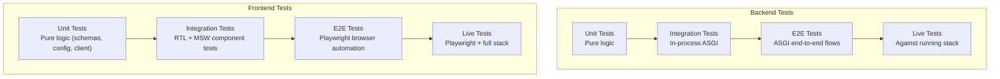
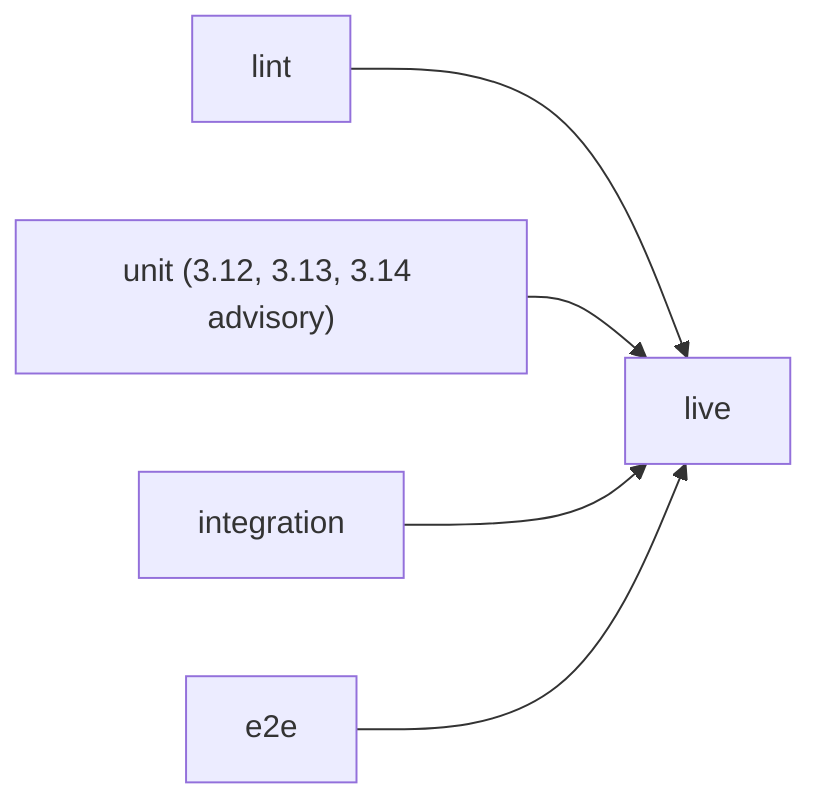

# Testing Strategy

Four-layer testing pyramid for both backend and frontend, with CI integration.

---

## Table of Contents

- [Overview](#overview)
- [Backend Testing](#backend-testing)
- [Frontend Testing](#frontend-testing)
- [PostgreSQL, contract tests and the two gates](#postgresql-contract-tests-and-the-two-gates)
- [Test Markers & Filtering](#test-markers--filtering)
- [CI Integration](#ci-integration)
- [Coverage Targets](#coverage-targets)
- [Running Tests](#running-tests)

---

## Overview

Both backend and frontend follow a **four-layer testing pyramid**:



| Layer | Speed | Scope | External Dependencies |
|-------|-------|-------|---------------------|
| **Unit** | Fastest | Pure logic, single function/class | None |
| **Integration** | Fast | Multiple components wired together | In-process only |
| **E2E** | Medium | Full API flows | ASGI or browser |
| **Live** | Slowest | Against real running services | Full stack |

---

## Backend Testing

### Unit Tests

**Location**: `tests/backend/`, `tests/utils/`

Pure logic tests with no external dependencies:

| Test File | What It Tests |
|-----------|--------------|
| `db/test_engine.py` | Database URL resolution, session lifecycle |
| `db/test_models.py` | SQLAlchemy model metadata, column types |
| `entities/test_item.py` | Item dataclass (frozen, slots) |
| `entities/test_echo_record.py` | EchoRecord dataclass |
| `schemas/test_echo.py` | Echo Pydantic schemas (validation) |
| `schemas/test_item.py` | Item Pydantic schemas (create, update, response) |
| `services/test_echo_service.py` | EchoService business logic |
| `middleware/test_logging.py` | Request logging middleware |
| `middleware/test_rate_limiting.py` | Rate limiting middleware |
| `utils/test_versioning_api.py` | API version resolution |

**Run** (`make test` runs these with the integration and e2e layers):
```bash
make test-unit
# or
pytest tests/ -v
```

### Integration Tests

**Location**: `tests/integration/`

In-process ASGI tests that wire multiple components:

| Test File | What It Tests |
|-----------|--------------|
| `test_echo_api.py` | POST /echo, GET /echo/history |
| `test_health_api.py` | GET /health, GET /healthz |
| `test_readiness.py` | Schema-aware readiness (head, ahead, behind, missing, unreachable) on real Alembic revisions |
| `test_db_lifecycle.py` | App start/stop |
| `test_lifespan_no_migration.py` | Startup never migrates |

Integration and e2e tests get a migrated database from a shared fixture in `tests/conftest.py`; a test that
needs another state overrides `_migrate_integration_and_e2e`. They run on SQLite, or on PostgreSQL when
`TEST_DATABASE_URL` is a PostgreSQL URL (see [below](#postgresql-contract-tests-and-the-two-gates)).

**Markers**: `@pytest.mark.integration`

**Run**:
```bash
make test-integration
# or
pytest tests/ -m integration -v
```

### E2E Tests

**Location**: `tests/e2e/`

End-to-end API tests through the public interface:

| Test File | What It Tests |
|-----------|--------------|
| `test_items_workflow.py` | Full CRUD: create → list → get → update → delete |
| `test_error_handling.py` | 404, 422, error response formats |

**Markers**: `@pytest.mark.e2e`

**Run**:
```bash
make test-e2e
# or
pytest tests/ -m e2e -v
```

### Live Tests

**Location**: `tests/live/`

Tests against a **running backend** (and optionally full stack):

| Test File | What It Tests |
|-----------|--------------|
| `test_items_live.py` | Full CRUD against running backend |
| `test_full_stack.py` | Health, docs, OpenAPI, security headers, full workflow |

**Markers**: `@pytest.mark.live`

**Requirements**: Running backend (or full stack via Compose)

**Run**:
```bash
make test-live
# or
pytest tests/ -m live -v
```

---

## Frontend Testing

### Unit Tests

**Config**: `vitest.unit.config.ts` (environment: `jsdom`)

Pure logic tests with no DOM or network:

| Test File | What It Tests |
|-----------|--------------|
| `lib/config.test.ts` | Environment variable defaults |
| `lib/api/client.test.ts` | HTTP client (success, error, timeout) |
| `lib/api/endpoints.test.ts` | Typed API endpoint functions |
| `lib/api/error-map.test.ts` | API error response mapping |
| `features/items/lib/schemas.test.ts` | Zod validation schemas |

**Run**:
```bash
cd frontend && npm run test:unit
```

### Integration Tests (Component + MSW)

**Config**: `vitest.integration.config.ts` (environment: `happy-dom`)

Component tests with Mock Service Worker for API mocking:

| Test File | What It Tests |
|-----------|--------------|
| `app/(ui)/global-header.test.tsx` | Navigation, theme toggle |
| `app/(ui)/error-boundary-content.test.tsx` | Error boundary UI |
| `app/(ui)/global-providers.test.tsx` | Provider composition |
| `app/(ui)/feedback-provider.test.tsx` | ARIA live region |
| `app/(ui)/theme-provider.test.tsx` | Dark/light theme toggle |
| `app/loading.test.tsx` | Loading spinner |
| `app/error.test.tsx` | Error boundary |
| `components/ConfirmModal.test.tsx` | Confirmation dialog |
| `features/items/components/ItemForm.test.tsx` | Create/edit form |
| `features/items/components/ItemList.test.tsx` | Item list with search/sort |
| `app/items/page.test.tsx` | Items page composition |
| `lib/hooks/useItems.test.tsx` | React Query hooks |
| `lib/query.test.tsx` | QueryClient provider |
| `lib/toast.test.tsx` | Toast notification system |

**Run**:
```bash
cd frontend && npm run test:integration
```

### E2E Tests (Playwright)

**Config**: `playwright.config.ts`

Browser automation tests:

| Test File | What It Tests |
|-----------|--------------|
| `e2e/smoke.spec.ts` | Smoke tests (backend API, frontend load) |
| `e2e/items-workflow.spec.ts` | Full items CRUD workflow in browser |
| `e2e/a11y.spec.ts` | axe accessibility scan, zero violations (see below) |

**Run**:
```bash
cd frontend && npm run test:e2e
```

---

## PostgreSQL, contract tests and the two gates

**Unit tests always use SQLite.** Integration, e2e and contract tests use PostgreSQL when `TEST_DATABASE_URL` is a
`postgresql+asyncpg://` URL, and a per-test SQLite file otherwise; the same tests pass on both. The schema is made
by the migrations (never `create_all`), once, and every test empties the application tables afterwards. A test that
needs PostgreSQL is marked `postgres_only` (skipped on SQLite).

```bash
# a throwaway local PostgreSQL 16 (pick any password; the port is published on loopback only)
docker run --rm -d --name pg-test -p 127.0.0.1:5432:5432 -e POSTGRES_PASSWORD=<password> postgres:16-alpine
export TEST_DATABASE_URL='postgresql+asyncpg://postgres:<password>@127.0.0.1:5432/postgres'
make test-integration test-e2e test-contract
docker rm -f pg-test
```

CI does the same with a `postgres` service container in `reusable-backend.yml`, pinned by digest to the same major
version and variant as the chart's in-cluster database (`postgresql.image`); a test keeps the two in step, and
Renovate updates the digest. `tests/integration/test_migration_round_trip.py` upgrades to head, downgrades to base
and upgrades again, on whichever database is selected.

**Contract tests** (`tests/contract/`, `make test-contract`): [Schemathesis](https://schemathesis.readthedocs.io/)
generates requests from the app's live OpenAPI document and sends them to the ASGI app in process. Checks: no server
error, status code, content type and response schema conformance (the documented problem responses included).
Deterministic: Hypothesis `derandomize` and 50 examples per operation. A failure prints the request that reproduces it.

**The two gates** (both block, both behind `CI OK`):

- **squawk** lints the migrations rendered offline for PostgreSQL (`alembic upgrade base:head --sql`, no database) with
  the pinned [squawk](https://squawkhq.com/): `bash scripts/ci/squawk.sh`. Every revision gets the default rules,
  except that `prefer-text-field` is excluded for revision `0001` alone (the reason is in `.squawk.toml`).
- **oasdiff** compares the OpenAPI snapshot with the base branch's and blocks breaking changes unless the pull
  request has the `breaking-change` label. It reads the base snapshot from the first parent of the merge commit, so
  locally run `EVENT_NAME=pull_request bash scripts/ci/oasdiff.sh` on a merge commit. See
  [API lifecycle](./api-lifecycle.md).

---

## Test Markers & Filtering

### Backend Markers

| Marker | Description | Default in `pytest` |
|--------|-------------|-------------------|
| `integration` | Hermetic tests wiring multiple components | **Excluded** |
| `e2e` | End-to-end tests through public API | **Excluded** |
| `live` | Tests requiring a running external server | **Excluded** |
| `contract` | Schemathesis property tests from the OpenAPI document (`make test-contract`) | **Excluded**, and not in `make test` |
| `postgres_only` | Needs PostgreSQL; skipped on SQLite | Runs with its layer |
| `sqlite_only` | Edits a SQLite database file directly; skipped on PostgreSQL | Runs with its layer |

A bare `pytest` run is unit only: the default `addopts` in `pyproject.toml` (`[tool.pytest.ini_options]`)
excludes the integration, e2e, live and contract markers. The `make` targets clear it (`-o addopts=""`) and pass
their own `-m` ([Makefile](../Makefile)).

### Frontend Configs

| Config | Tests Included |
|--------|---------------|
| `vitest.config.ts` | All tests (base) |
| `vitest.unit.config.ts` | Unit tests only (`.test.ts` not in `features/` or `app/`) |
| `vitest.integration.config.ts` | Component/integration tests (MSW, RTL) |

---

## CI Integration

### Backend CI

[`reusable-backend.yml`](../.github/workflows/reusable-backend.yml) runs the backend jobs in parallel; [`reusable-live.yml`](../.github/workflows/reusable-live.yml) waits for the backend and frontend gates.



| Job | Tests |
|-----|-------|
| `lint` | ruff format, ruff lint, mypy, squawk on the migration SQL |
| `unit` | Unit (matrix: Python 3.12, 3.13, and the advisory 3.14), with coverage |
| `integration` | Integration twice (SQLite, then PostgreSQL with the backend started), then the contract tests, on a PostgreSQL service container |
| `e2e` | E2E (ASGI in-process), on a PostgreSQL service container |
| `live` (`reusable-live.yml`) | Live (starts the full stack): the backend suite, then Playwright; advisory on pull requests |

A failed run uploads its JUnit and coverage reports as an artifact (7 days).

### Frontend CI

[`reusable-frontend.yml`](../.github/workflows/reusable-frontend.yml):

| Job | Tests |
|-----|-------|
| `build` | Next.js build |
| `unit` | Vitest pure-logic tests, fast signal (`npm run test:unit`, writes `test-results/junit.xml`) |
| `integration` | The whole Vitest suite once with coverage (`npm run test:coverage`); blocks on the thresholds below and uploads `frontend/coverage/` on failure |
| `playwright-list` | Playwright config validation |
| `a11y` | axe scan of the built app (`npm run test:a11y`), blocking |
| `lighthouse` | Lighthouse CI budgets (`frontend/lighthouserc.json`), advisory: findings are warnings |
| `eslint`, `prettier`, `type-check`, `openapi-drift` | Lint, format, types, API-type drift |

The other Playwright specs run in the `live` job, which also runs the axe spec against the full stack. The `a11y` job
does not need a backend: `npm run test:a11y` serves the built app with the standalone server the image ships
(`frontend/scripts/serve-standalone.mjs`, the Playwright `webServer`, switched on by `E2E_START_SERVER=1`, on port 3100
unless `E2E_SERVER_PORT` says otherwise) and the spec answers the API itself.

**Accessibility.** `e2e/a11y.spec.ts` scans the home page (backend up and down), the items page (list, load failure,
form errors, delete dialog) and the 404 page, in light and dark mode at 1280 and 390 px, for the WCAG 2.0/2.1 A and AA
and 2.2 AA rules. A single violation fails the job. No rule is disabled; `/docs` is the backend's Swagger UI, a
third-party page, so it is not scanned. Fix a violation in the component, not in the test.

axe files text it cannot decide (for example white text on a transparent button) under `incomplete`, not
`violations`. The spec fails on those too, with a short allowlist (selector and reason) for nodes a phone-width scroll
box clips, and measures the computed contrast of every visible text node itself (`e2e/support/contrast.ts`) as a
backstop (CSS opacity included; `e2e/contrast.spec.ts` checks the backstop itself). The spec never retries and
allowlists nothing.

Two more specs guard what axe cannot see. `e2e/console.spec.ts` fails on any console error, page error, failed
response or `/docs` prefetch, in both themes (a React hydration mismatch is a console error), and checks that the theme
choice survives a reload. `e2e/layout.spec.ts` checks the header at 390 and 1280 px: no overflow, the name on one line,
every link fully visible, and the items list at 390 to 1280 px: no sideways scroll, Edit and Delete inside the viewport.

**Lighthouse CI** (advisory) builds the app, runs Lighthouse three times on `/` and `/items` in the Playwright Chromium,
and checks the budgets in `frontend/lighthouserc.json`: a minimum score for performance, accessibility, best practices
and SEO, and a ceiling on script and stylesheet bytes. A miss is a `::warning` annotation and a summary line, never a
failed check. To change a budget, run `npx lhci collect --config=lighthouserc.json` on a build and set the value a little
above (or below) the measured one.

### Deployment Tests

| Job | Tests |
|-----|-------|
| `chart` (`reusable-chart.yml`) | Lint + render the chart for every values file, with the pinned Helm |
| `deploy-<env>` (`deploy.yml`) | `helm upgrade --install` by digest, migration Job, verify and smoke test |

---

## Coverage Targets

### Backend

| Metric | Target | Config |
|--------|--------|--------|
| **Line coverage** | ≥ 85% | `pyproject.toml` `[tool.coverage]` |
| **Source** | `src/your_service_name/backend`, `src/your_service_name/utils` | — |

### Frontend

| Metric | Target | Config |
|--------|--------|--------|
| **Lines** | ≥ 80% | `vitest.config.ts` coverage thresholds |
| **Functions** | ≥ 80% | — |
| **Statements** | ≥ 80% | — |
| **Branches** | ≥ 70% | — |

---

## Running Tests

### Quick Reference

```bash
# Backend — unit, integration and e2e (hermetic; not live, not contract)
make test

# Backend — unit only, with the coverage gate
make test-unit

# Backend — specific test file
make test-file FILE=tests/backend/schemas/test_item.py

# Backend — specific test function
make test-file-function FILE=tests/backend/schemas/test_item.py FUNC=test_item_create_valid

# Backend — integration tests
make test-integration

# Backend — E2E tests
make test-e2e

# Backend — live tests (requires running stack)
make test-live

# Backend — coverage (terminal)
make test-coverage

# Backend — coverage (HTML)
make test-cov-html

# Frontend — all tests
cd frontend && npm test

# Frontend — unit tests only
cd frontend && npm run test:unit

# Frontend — integration tests
cd frontend && npm run test:integration

# Frontend — E2E tests
cd frontend && npm run test:e2e

# Frontend — whole suite with the coverage thresholds (what CI runs)
cd frontend && npm run test:coverage
```
