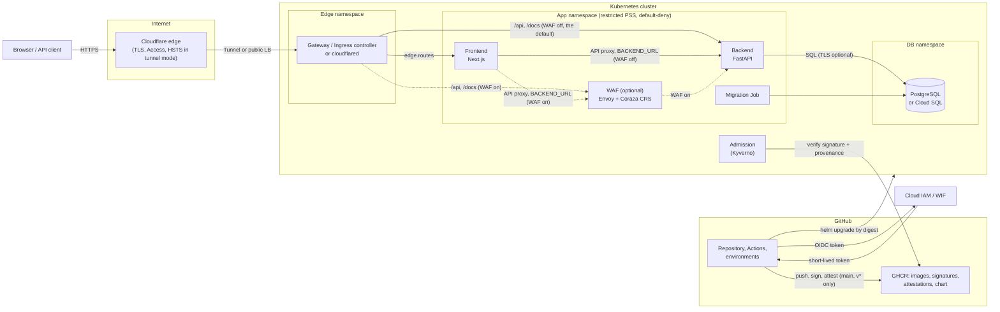

# Threat model

The threats to a service built from this template, by trust boundary, with STRIDE (Spoofing, Tampering,
Repudiation, Information disclosure, Denial of service, Elevation of privilege). Each row names the mitigation, links
the code or doc that implements it, and says what risk is left. It describes the template as shipped; an adopter who
changes a boundary owns the change to this page. The design decisions behind the mitigations are the
[architecture decision records](./adr/README.md).

---

## Table of Contents

- [Scope](#scope)
- [Assets](#assets)
- [Assumptions](#assumptions)
- [Data flow](#data-flow)
- [1. The edge: Cloudflare, the Tunnel or the Gateway](#1-the-edge-cloudflare-the-tunnel-or-the-gateway)
- [2. The gateway and the WAF](#2-the-gateway-and-the-waf)
- [3. The app: backend and frontend](#3-the-app-backend-and-frontend)
- [4. The database](#4-the-database)
- [5. CI: workflows, pull requests, OIDC and previews](#5-ci-workflows-pull-requests-oidc-and-previews)
- [6. The registry and the supply chain](#6-the-registry-and-the-supply-chain)
- [7. Cluster admission](#7-cluster-admission)
- [What is not mitigated](#what-is-not-mitigated)

---

## Scope

In scope: the two app images and the optional WAF image, the Helm chart and the admin bootstrap, the GitHub
workflows and repository settings, the registry artifacts (images, signatures, attestations, the chart) and the
example admission policies. Out of scope: the adopter's own business logic and identity provider, the cluster and
cloud platform themselves (see [Assumptions](#assumptions)), and the developer's workstation.

## Assets

| Asset | Why it matters |
|-------|----------------|
| User data in PostgreSQL | confidentiality and integrity of what the service stores |
| Database credentials and app Secrets | read access to every row; the chart Secret, `existingSecret` or an ExternalSecret |
| User identity tokens (OIDC, Cloudflare Access) | impersonation of a user |
| The release signing identity | the keyless certificate of `reusable-build.yml` (and the chart workflow) is what admission trusts |
| Deploy credentials | short-lived Workload Identity tokens per environment, or a kubeconfig in kubeconfig mode |
| The release GitHub App's private key | the only actor that may create `v*` tags |
| The source and workflow files on `main` | whatever they say is what CI builds and signs |
| Availability of the service | the API and the pages |
| Logs and request ids | the record of who did what, and the input to incident response |

## Assumptions

- The repository owner's GitHub account (with 2FA), GitHub itself and its hosted runners are trusted, including
  their isolation between jobs, which the [SLSA Build L3 aim](./adr/0016-slsa-build-l3-for-release-images.md) rests on.
- The cloud project, the GKE control plane and nodes, and Cloudflare's account and edge are trusted and set up as the
  guides say ([GKE](./gke-cluster-setup.md), [Cloudflare](./cloudflare-setup.md)).
- Sigstore (Fulcio, Rekor) and GitHub's OIDC issuer are trusted to issue and log certificates honestly.
- A cluster admin runs the bootstrap and applies the admission policies; until they do, those controls are absent.
- The operator sets the values the docs mark as required before production (`TRUSTED_PROXY_CIDRS`, `ALLOWED_HOSTS`,
  `AUTH_MODE`, the HSTS source); the production render and the backend refuse the unsafe defaults they can detect.
- Anyone with write access to the repository is trusted not to be malicious; the preview boundary below says what such
  a person could still do if they were.

## Data flow

Dotted arrows exist only with the WAF on (`waf.enabled`); then both the gateway and the frontend's API proxy
reach the backend through it. The trust boundaries are the arrows that cross a box: the Internet to the edge, the edge to the app namespace, the
app to the database namespace, GitHub to the cloud and the cluster, and the registry to the cluster at admission.

---

## 1. The edge: Cloudflare, the Tunnel or the Gateway

The boundary between the Internet and the cluster. Which component sits here depends on `edge.mode`
([ADR-0008](./adr/0008-edge-modes.md)).

| STRIDE | Threat | Mitigation | Residual risk |
|--------|--------|------------|---------------|
| S | A client forges `X-Forwarded-For` or `CF-Connecting-IP` to pick its own rate-limit bucket or hide in the logs | forwarding headers count only from peers in `TRUSTED_PROXY_CIDRS` ([Client IP](./security.md#client-ip), [`client_ip.py`](../src/your_service_name/backend/middleware/client_ip.py)) | a trusted proxy that passes a client's header through makes it trusted ([what the proxies must do](./security.md#what-the-trusted-proxies-must-do)) |
| S | A client reaches the app around the edge (tunnel mode) | the app NetworkPolicy admits only the `cloudflared` namespace ([NetworkPolicy per mode](./infrastructure.md#networkpolicy-per-mode)); Access in front of non-public hosts ([Cloudflare §9](./cloudflare-setup.md#9-keep-previews-private-with-cloudflare-access)) | any Pod in the admitted edge namespace can reach the app |
| T | Downgrade to plain HTTP, or a stripped TLS hop | TLS at the edge; one HSTS source per deployment ([HSTS](./security.md#hsts), [ADR-0010](./adr/0010-one-source-per-security-header.md)) | with the shipped values in gateway and ingress mode nothing sends HSTS until the operator picks a source; traffic from the edge to the Pods is plain HTTP inside the cluster |
| I | The Host header or an internal URL leaks topology | `ALLOWED_HOSTS` (production refuses `*`) ([Request limits](./security.md#request-limits-and-trusted-hosts)) | the frontend's `x-middleware-rewrite` header exposes the backend's internal URL ([known limitation](./security.md#known-limitation-the-frontend-port-exposes-an-internal-url)) |
| D | Volumetric or request floods | the CDN and Cloudflare's edge; Cloud Armor through the GKE Gateway policy (`edge.gateway.gke.securityPolicy`, [GKE Gateway policies](./infrastructure.md#gke-gateway-policies)); [edge rate limiting](./security.md#edge-rate-limiting) | the template configures none of these by default; the backend's own limiter is per Pod or shared through Redis, behind the edge |
| E | The edge controller is compromised | out of the template's control; the chart grants the edge namespace only the app ports | a compromised edge sees all traffic in clear |

## 2. The gateway and the WAF

The optional WAF (`waf.enabled`) sits between the edge and the backend.

| STRIDE | Threat | Mitigation | Residual risk |
|--------|--------|------------|---------------|
| T | Injection payloads (SQLi, XSS) in requests | Coraza with the OWASP CRS, pinned image and Wasm by digest ([Runtime application protection](./security.md#runtime-application-protection-dast--waf)); parameterised SQL in the repositories | the WAF is off by default; with it on, the CSP-report route skips body inspection for two content types ([ADR-0032](./adr/0032-waf-csp-report-exception.md)) and relies on the backend's caps |
| S | A client forges the scheme or client address the WAF passes to the backend | Envoy trusts zero hops, so it overwrites `X-Forwarded-Proto` from its own connection, and the NetworkPolicy admits only the edge peers and the frontend to the WAF Pod ([what the proxies must do](./security.md#what-the-trusted-proxies-must-do), [NetworkPolicy](./security.md#networkpolicy)) | the backend sees `X-Forwarded-Proto: http` for https clients, so HSTS must come from the edge when the WAF is on; an admitted peer that passes a client's headers through makes them trusted |
| D | A Pod shutdown turns requests into 503s | idempotent methods retried, writes on a one-request-per-connection cluster ([changelog](./changelog.md)) | high write rates may exhaust ephemeral ports (the TIME_WAIT note in the security page) |
| E | The WAF container is a weak workload | the same securityContext, probes and digest pins as the app ([`waf-proxy.yaml`](../charts/your-service-name/templates/waf-proxy.yaml)) | none beyond the app's |

## 3. The app: backend and frontend

| STRIDE | Threat | Mitigation | Residual risk |
|--------|--------|------------|---------------|
| S | A request impersonates a user | `AUTH_MODE` `oidc` or `cloudflare-access`, tokens verified by the service; production refuses `none` unless `ALLOW_ANONYMOUS=true` ([Authentication](./security.md#authentication--authorization), [ADR-0029](./adr/0029-auth-modes.md)) | the template ships with `none` for local use, and the reference CRUD is open until auth is on |
| S | Forged identity headers in `gateway` mode | read only from a direct peer in `AUTH_PROXY_CIDRS` ([identity trust boundary](./security.md#the-identity-trust-boundary)) | the auth proxy must strip client copies |
| T | XSS in the pages | CSP with a per-request nonce, reports to the backend ([CSP details](./security.md#csp-details), [CSP violation reports](./security.md#csp-violation-reports)) | a CSP bypass in a dependency |
| R | A user denies an action | JSON request logs with a correlation id on every response, and audit log lines on writes ([log correlation](./operations-runbook.md#log-correlation--tracing)) | logs live as long as the platform's collector keeps them ([ADR-0007](./adr/0007-stdout-logging-no-collector.md)); they are not tamper-evident |
| I | Errors leak internals | one problem-details error body with the request id ([error responses](./api-reference.md#error-responses)); no `Server` header ([ADR-0004](./adr/0004-one-uvicorn-process-per-pod.md)) | the frontend's rewrite header (above) |
| D | Large bodies, slow clients, request floods | `MAX_REQUEST_BODY_BYTES`, per-client rate limits ([Rate limiting](./security.md#rate-limiting)), memory limit equal to request ([ADR-0012](./adr/0012-cpu-requests-no-cpu-limits.md)), HPA and PDB | the in-memory limiter is per Pod unless Redis is configured |
| E | Code execution in a container escalates | distroless images, non-root, read-only root filesystem, no privilege escalation, dropped capabilities, seccomp `RuntimeDefault`, restricted Pod Security, `automountServiceAccountToken: false` ([Container security](./security.md#container-security), [Pod Security](./security.md#pod-security-standards), [ADR-0013](./adr/0013-distroless-runtime-one-interpreter.md)) | a kernel or runtime escape is the platform's to patch |
| E | A compromised Pod reaches other services | default-deny NetworkPolicies in both namespaces, DNS egress to kube-dns only ([NetworkPolicy](./security.md#networkpolicy)) | egress the operator opens with `extraEgress` |

## 4. The database

| STRIDE | Threat | Mitigation | Residual risk |
|--------|--------|------------|---------------|
| S | Another workload connects as the app | the database NetworkPolicy admits only Pods of namespaces with the environment's `tier` label ([NetworkPolicy for Database](./database.md#networkpolicy-for-database)); a password from one Secret source ([Secret sources](./security.md#secret-sources)) | every release in a namespace shares its tier (the preview case below) |
| T / I | Traffic to a managed database is read or altered | `DB_SSLMODE` `verify-full`; the production migration runner refuses a weak `sslmode` to a remote host; or the Cloud SQL Auth Proxy ([TLS to the database](./database.md#tls-to-the-database)) | the default is `disable`, right only for the in-cluster database |
| T | Racing or failed migrations corrupt the schema | one migration Job per release, readiness gated on the schema, squawk on the SQL ([ADR-0006](./adr/0006-migrations-as-a-release-job.md)) | a destructive migration that passes review |
| I | Secrets leak through the chart or the repo | no secret in values files; `existingSecret` or External Secrets; the secret-template check and gitleaks in CI ([Secrets management](./security.md#secrets-management)) | Kubernetes Secrets are readable by anyone with `get secrets` in the namespace |
| D | Data loss | nightly backup CronJob with a restore check, Cloud SQL point-in-time recovery ([Disaster recovery](./disaster-recovery.md)) | the in-cluster backup is on the same cluster; an off-site copy is a later item |
| E | The database Pod runs privileged | the restricted profile in the database namespace ([Pod Security](./security.md#pod-security-standards)) | none beyond the app's |

## 5. CI: workflows, pull requests, OIDC and previews

The boundary between code anyone can propose and the credentials that build, sign and deploy.

| STRIDE | Threat | Mitigation | Residual risk |
|--------|--------|------------|---------------|
| E | A fork's pull request reaches a secret or a write token | workflows never use `pull_request_target`; every workflow starts from `permissions: {}`; outside contributors' runs need approval ([Triggers and gates](./ci-cd.md#triggers-and-gates), [settings](./github-repository-settings.md#what-the-script-sets)) | a maintainer who approves a malicious fork run gives it a read-only token |
| T | A pull request pushes or signs an image | image operations run on `main` and `v*` only; the hardening lint fails any other push, sign or attest ([Image operations](./ci-cd.md#image-operations), [ADR-0016](./adr/0016-slsa-build-l3-for-release-images.md)) | the kind tests push to a loopback registry inside the runner, which leaves nothing behind |
| T | A branch, a fork or a build dependency publishes to the project's Pages site | `docs-site.yml` runs on `main` only and its jobs refuse a fork or another ref; the `github-pages` environment's branch rule, set by the settings script; only its `deploy` job holds `pages: write` and `id-token: write`, and it runs no repository code; the build is read-only, with `npm ci --ignore-scripts`, exact pins and the seven-day release age ([Documentation site](./ci-cd.md#documentation-site), [settings](./github-repository-settings.md#what-the-script-sets), [ADR-0041](./adr/0041-documentation-site.md)) | the published site is whatever the read-only build produced: a malicious docs-site dependency could change the public site without ever holding a write token |
| T | A compromised action or tool runs in CI | every action pinned by full SHA (enforced by the repository setting and the lint), tools pinned with checksums, zizmor and actionlint ([Where each tool is pinned](./ci-cd.md#where-each-tool-is-pinned), [ADR-0025](./adr/0025-renovate-for-updates.md)) | a malicious commit behind a pinned SHA that Renovate proposes and a reviewer merges; the seven-day wait narrows it |
| T | A poisoned cache enters a release | the release path restores no cache ([ADR-0017](./adr/0017-release-builds-use-no-cache.md)) | test jobs keep caches; they sign nothing |
| S | A workflow from another repository or branch obtains deploy credentials | the WIF condition pins owner id, repository id and the workflow file; one deployer per environment, bound to `environment:<env>`; environment branch policies ([ADR-0021](./adr/0021-keyless-deploys-per-environment.md), [GKE §12](./gke-cluster-setup.md#12-keyless-access-for-github-actions)) | kubeconfig mode stores a long-lived credential ([kubeconfig mode](./platform-setup.md#kubeconfig-mode)) |
| E | The deployer escalates in the cluster | namespace-scoped Helm verbs only; namespaces, RBAC and quotas come from the admin bootstrap ([ADR-0011](./adr/0011-namespace-bootstrap-scoped-deployer.md)) | the deployer can still change anything the chart renders in its namespaces |
| E | A same-repository pull request abuses a preview | previews off by default; the `preview` environment, its own WIF provider and deployer, quotas, restricted Pod Security, a separate database tier ([ADR-0031](./adr/0031-optional-pr-previews.md)) | **not mitigated within the preview namespaces**: see the [preview trust boundary](./ci-cd.md#pull-request-previews) |
| T | Someone merges without checks or forges a release tag | the `main` ruleset (required check, no direct push or force-push), the tag ruleset (only the release App creates `v*`) ([ADR-0022](./adr/0022-repository-settings-as-a-script.md), [ADR-0023](./adr/0023-release-flow.md)) | 0 required approvals, and an admin can turn the ruleset off: a single owner's account is the gate |
| R | A deploy or release cannot be traced | GitHub deployment records per environment, the release's `provenance.md`, Rekor entries for every signature ([Releasing](./releasing.md)) | the GitHub audit log's retention is GitHub's |
| I | The optional AI reviewer is prompt-injected or leaks code | off by default; same-repository pull requests, and commands from owners, organisation members and collaborators only (`MEMBER` is organisation membership, not write access); one job whose token can comment and edit a pull request's title, body and labels, its settings ([`.pr_agent.toml`](../.pr_agent.toml)) keeping it to comments; no checkout, the model key alone in its `ai-review` environment; the image pinned by digest ([ADR-0040](./adr/0040-optional-ai-pr-review.md), [AI pull request review](./ci-cd.md#ai-pull-request-review)) | when on, diffs go to the model provider, and an injected pull request can make its comments misleading |
| I | A secret leaks into logs or the repo | gitleaks, the secret-template check, push protection, environment-scoped secrets enforced by the lint ([Security](./security.md#supply-chain-security-ci)) | a secret in a form the scanners do not recognise |

## 6. The registry and the supply chain

| STRIDE | Threat | Mitigation | Residual risk |
|--------|--------|------------|---------------|
| S | An image or chart that was not built here passes as ours | keyless cosign signatures by digest, with the build workflow's identity; the chart signed by its own workflow ([Verifying an image](./security.md#verifying-an-image), [Verifying the chart](./security.md#verifying-the-chart), [ADR-0024](./adr/0024-signed-chart-from-its-own-workflow.md)) | a verifier who checks the issuer but not the identity and repository claim |
| T | A tag is moved to another image after testing | deploys by digest, checked after the deploy; admission pins tags to digests ([ADR-0020](./adr/0020-deploy-by-digest.md)) | a hand deploy by tag outside CI |
| T | A dependency or base image is malicious or vulnerable | hashed locks, seven-day release age, Grype gate on Critical and High, licence gate, OSV and typosquat checks, Debian fixes before the base ships them ([Supply-chain security](./supply-chain-security.md), [ADR-0014](./adr/0014-debian-fixes-over-the-base.md)) | a malicious package older than seven days with no advisory yet |
| T | The frozen supply-chain scripts are changed in passing, altering what a release claims | the freeze rule and its recorded exceptions ([ADR-0028](./adr/0028-frozen-supply-chain-scripts.md)) | a reviewer who misses a change |
| R | Nobody can say how an image was built | SLSA provenance and SBOM attestations pushed to the registry; SBOMs, VEX and digests on the release ([ADR-0019](./adr/0019-attestations-and-release-assets.md)) | attestations need a public repository (or `ATTESTATIONS_ENABLED`) |
| E | A vulnerability published after release is exploited in a running image | the weekly re-scan of deployed digests and the latest release, issues with an SLA ([Vulnerability management](./vulnerability-management.md), [ADR-0037](./adr/0037-weekly-rescan-scope.md)) | older releases run elsewhere are not re-scanned; the window until the next re-scan and the fix |

## 7. Cluster admission

| STRIDE | Threat | Mitigation | Residual risk |
|--------|--------|------------|---------------|
| S / T | An unsigned, unattested or foreign-identity image from this repository's path runs | the example `ImageValidatingPolicy`: signature identity, issuer and repository claim, provenance, Rekor; tags mutated to digests ([Admission control](./admission-control.md), [ADR-0018](./adr/0018-cosign-keyless-and-kyverno-admission.md)) | **the policies are examples**: nothing is enforced until an admin renders and applies them |
| S | An alias spelling (`ghcr.io:443/...`, upper case) slips past the match | the alias `ValidatingPolicy` denies it | none for this path |
| E | An image from another registry runs | out of scope of the shipped policies ([What is enforced](./admission-control.md#what-is-enforced)) | add a registry allowlist; a preview deployer can name any public image |
| D / E | Kyverno is unavailable and admission fails open | the policy sets `failurePolicy: Fail` ([`kyverno-verify-images.yaml`](../deploy/policies/kyverno-verify-images.yaml)), so matching Pods are refused rather than admitted unchecked | a Kyverno outage blocks new Pods from this path, including rescheduling: run Kyverno highly available |

---

## What is not mitigated

Stated plainly, each with where it is documented:

- **Inside the preview namespaces**, a write-access pull request can run arbitrary code in Pods, read the preview
  Secrets and the Access service token, and change any preview. The bounds and the reasons are in the
  [preview trust boundary](./ci-cd.md#pull-request-previews); previews are off by default.
- **Admission is opt-in.** Until the policies are applied, the cluster runs any image the deployer names.
- **Other registries' images run even with the policies applied.** The shipped policies match only this
  repository's path; a registry allowlist is the adopter's to add ([What is enforced](./admission-control.md#what-is-enforced)).
- **A single owner is the gate.** With 0 required approvals, and an admin able to turn the ruleset off
  ([ADR-0022](./adr/0022-repository-settings-as-a-script.md)), a compromised owner account can merge and release.
- **In-cluster traffic is plain HTTP** between the edge, the WAF, the frontend and the backend; the
  NetworkPolicies limit who can see it, nothing encrypts it.
- **HSTS is off with the shipped values** in gateway and ingress mode until the operator chooses a source
  ([HSTS](./security.md#hsts)).
- **Logs are not tamper-evident**, and their retention is the platform's.
- **The frontend's rewrite header** discloses the backend's internal URL on proxied paths
  ([known limitation](./security.md#known-limitation-the-frontend-port-exposes-an-internal-url)).
- **Builds are not reproducible bit for bit**; verification relies on provenance, not rebuilding.
