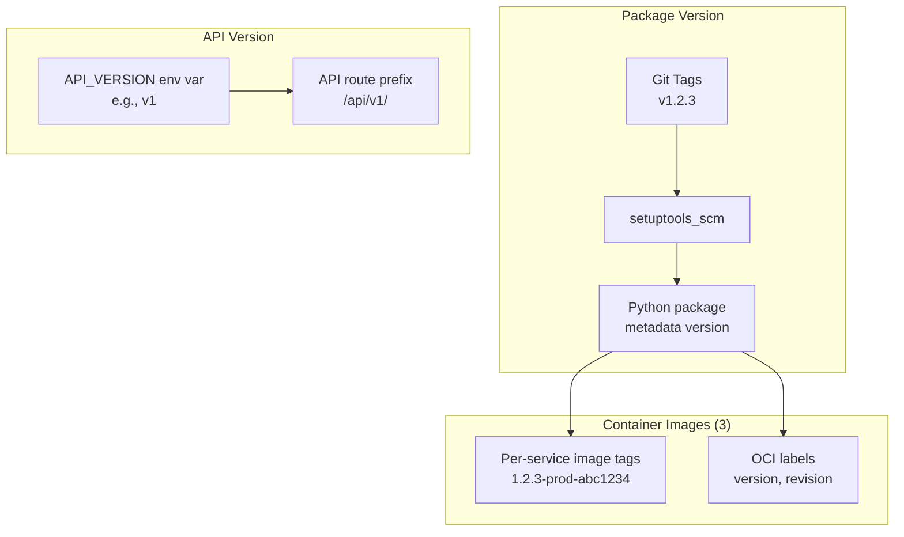
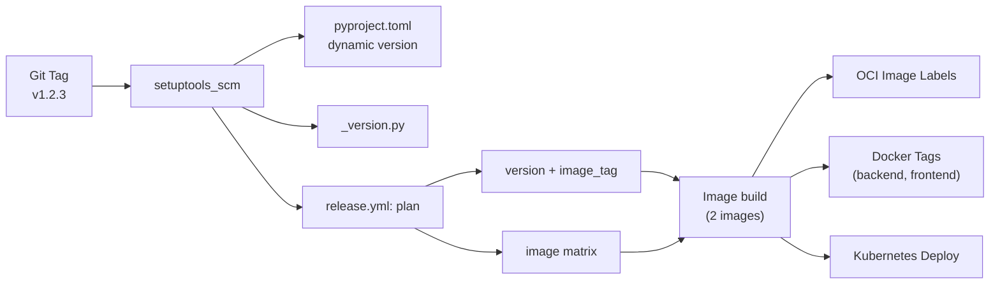

# Versioning

Dual versioning strategy: package version from Git tags and API version from environment.

---

## Table of Contents

- [Overview](#overview)
- [Package Version](#package-version)
- [API Version](#api-version)
- [Version Computation (CI)](#version-computation-ci)
- [Image Tagging](#image-tagging)
- [Version Propagation](#version-propagation)

---

## Overview

The project uses **two independent versioning schemes**:



| Version Type | Source | Example | Purpose |
|-------------|--------|---------|---------|
| **Package version** | Git tags via `setuptools_scm` | `1.2.3`, `0.1.0.dev4+gabc1234` | Python package, OCI labels, image tags |
| **API version** | `API_VERSION` environment variable | `v1` | URL routing, OpenAPI docs, health endpoints |

---

## Package Version

### setuptools_scm

Package version is **automatically derived from Git tags**:

```toml
# pyproject.toml
[tool.setuptools_scm]
version_file = "src/your_service_name/_version.py"
```

| Scenario | Version |
|----------|---------|
| **Tagged commit** (`v1.2.3`) | `1.2.3` |
| **Untagged commit** (4 commits after `v1.2.0`) | `1.2.0.dev4+gabc1234` |
| **Dirty working tree** | `1.2.0.dev4+gabc1234.d20240115` |
| **No Git history** (CI build) | Uses `SETUPTOOLS_SCM_PRETEND_VERSION` or `0.0.0.dev+g<sha>` |

### Version File

`setuptools_scm` generates `_version.py` at build time:

```python
# src/your_service_name/_version.py (auto-generated)
__version__ = "1.2.3"
```

---

## API Version

### Configuration

```bash
# .env
API_VERSION=v1
```

### Supported Versions

Defined in `src/your_service_name/utils/versioning_api.py`:

```python
SUPPORTED_VERSIONS = {
    "v1": "your_service_name.backend.api.routers.v1",
    # Future: "v2": "your_service_name.backend.api.routers.v2",
}
```

### Usage

- **Route prefix**: `/api/v1/health`, `/api/v1/items`
- **Health endpoint**: `/api/v1/health`
- **OpenAPI docs**: `/api/v1/docs`
- **Frontend API calls**: All typed endpoints use the configured version

### Version Validation

| Input | Result |
|-------|--------|
| `v1` | Valid — routes loaded |
| `v2` | Invalid — returns 400 if not in `SUPPORTED_VERSIONS` |
| `""` (empty) | Invalid — falls back to `DEFAULT_API_VERSION` |
| `  v1  ` (whitespace) | Valid — stripped before validation |

---

## Version Computation (CI)

The `plan` job of [`release.yml`](../.github/workflows/release.yml) runs `.github/scripts/container_matrix.py`, which computes the version metadata. It reads the Git ref from the GitHub environment and the committed `VERSION` file (`0.0.0` when absent) as the baseline. The template commits no `VERSION`, and release-please writes its version to `.release-please-version`, which nothing reads ([`release-please-config.json`](../release-please-config.json)): a release never moves the baseline, so a `main` image after a release is still `0.0.0-main-<sha>` and never carries the release's version label.

### Inputs

| Source | Value |
|--------|-------|
| `VERSION` file | Baseline version for branch builds |
| `GITHUB_REF_TYPE`, `GITHUB_REF_NAME` | A `v*` tag overrides the baseline; on `main` the channel is `main` |
| `GITHUB_SHA` | The short commit SHA (7 characters) in the image tag |

### Outputs

The job writes these to `GITHUB_OUTPUT`; the image matrix is the script's `--matrix` JSON.

| Output | Example | Description |
|--------|---------|-------------|
| `version` | `1.2.3` | Docker-safe version (`+` replaced by `-`) |
| `channel` | `prod` / `main` | Release channel (`prod` on a `v*` tag) |
| `image_tag` | `1.2.3-prod-abc1234` | Full image tag, `{version}-{channel}-{short_sha}` |
| `immutable` | `true` | `true` exactly for `v*` tags |

---

## Image Tagging

Two per-service images are tagged: `backend` and `frontend`, nested under the repository path.

### Tag Policy

Images are pushed only by `release.yml`, on a push to `main` or a `v*` tag; a pull request never pushes. The registry is `ghcr.io/<owner>/<repo>/<id>`.

| Trigger | Immutable Tag | Mutable Tags |
|---------|--------------|-------------|
| **Git tag** (`v1.2.3`) | `1.2.3-prod-abc1234` | `latest` |
| **Push to `main`** | `0.0.0-main-abc1234` (baseline from `VERSION`) | — |

Each tag is applied to both images (backend and frontend).

### Tag Format

```
{IMAGE_VERSION}-{CHANNEL}-{SHORT_SHA}
```

Example: `1.2.3-prod-abc1234`

### Kubernetes Image Reference

The Helm chart takes the image tag from `charts/your-service-name/values.<env>.yaml` (`images.*.tag` —
one tag for both images), or via `--set images.<svc>.tag=<tag>` at deploy; the release workflow passes the
git-derived version and pins each image by digest. The pre-Helm per-image `newTag` overlay block is gone — the `k8s/` Kustomize tree
was removed in Phase 2 Stage C. See `charts/your-service-name/values.yaml` for the authoritative schema.

---

## Version Propagation

Version flows through the system:



### OCI Image Labels

Applied in `Dockerfile.backend` and `Dockerfile.frontend`:

```dockerfile
LABEL org.opencontainers.image.title="Your Service Name"
LABEL org.opencontainers.image.version="${VERSION}"
LABEL org.opencontainers.image.revision="${VCS_REF}"
LABEL org.opencontainers.image.ref.name="${VCS_BRANCH}"
LABEL org.opencontainers.image.created="${BUILD_DATE}"
LABEL org.opencontainers.image.vendor="YourOrg"
```
